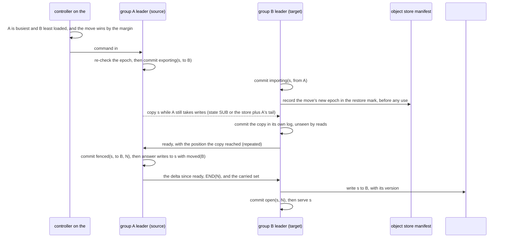
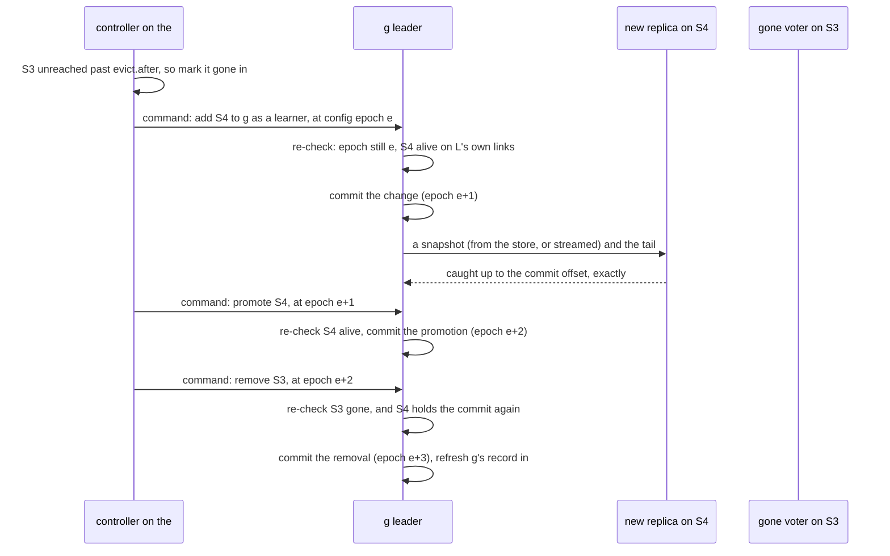

# fero v5: the layers of the chosen design

Written 2026-11-11 for the v5 design-space study ([BRIEF.md](BRIEF.md)). It says what each layer of the chosen design keeps, does and still owes. Words follow VERDICT's [key of terms][key].

- **The design.** Aim for COMP2. Build MIN-P+par's shape first, in TypeScript ([VERDICT 0][v0], [5.1][v51], [9 step 4][v9]). MIN-P+par is COMP2 without the `memory` rung. So in the first build a commit always means "on disk at a majority".
- **The layers** are DESIGN-V5's six ([DESIGN-V5 4][d4]): L0 storage and I/O, L1 the log, L2 fold and ops, L3 flow, L4 the surface, L5 libraries.
- **L4 lives in [API.md][api].** API.md was revised alongside this page. This page points to its sections by title and copies nothing from it.

**Where COMP2 departs from DESIGN-V5's layers.** DESIGN-V5 is the draft the study started from. COMP2 keeps its layers but changes these parts ([VERDICT 5.1][v51]):
- Groups belong to the project and hold slots of many resources (G `pslot`). DESIGN-V5 cut each resource into its own shards.
- One loop on `#meta`'s leader heals replicas and moves slots (C `cent-co`). In DESIGN-V5 each shard's leader healed itself.
- There are no log replicas (witnesses). Replicas are voters and learners only (V `+lrn`).
- Exactly once uses client sessions (D `sess`), not DESIGN-V5's issuer window.
- A damaged entry is repaired from a peer (Z `par`). DESIGN-V5 wiped the replica.
- Across boxes, a cluster is founded by a conditional create in the object store. A restore takes an epoch above a mark kept in the store ([A-08][a11]).
- Each resource has 4,096 slots, not 1,024 ([A-16][a12]). Writer time is the median of the members' clocks ([A-23][a12]).
- `data` folds every row on every full replica, in every phase. This is the DATA-01 design rule, RR-17 ([VERDICT 3.3][v33]).

**How sure each part is.** Nothing here is built.
- Each rule says how it was checked. **Model-checked** means TLC or an exhaustive Python model, and **simulated** means seeded runs. **Measured** means timed on the study's box. The rest are **cited** or **not modelled**.
- **This page's reading** marks a gap the files leave, filled in here. Section 10 lists every one.
- **Computed here** means a scratch script that only calls `tools/closure.py`'s own mechanism model and pair rule. Section 11 says how to repeat it.

## 0. The stack at a glance

A **mechanism** is one named piece of durable or replicated state plus the rules that write it ([MECHANISMS 1](MECHANISMS.md#1-how-mechanisms-are-counted)). COMP2 carries 50, of which 3 are novel. MIN-P+par carries 49: all but the `memory` rung ([cards.json][cards]; `python3 tools/closure.py mechrow 'C=cent-co,Z=par' COMP`).

| Layer | Its job | Thread in TypeScript | At the native step | Mechanisms (novel) | Pairs inside |
|---|---|---|---|---|---|
| L0 storage and I/O | one journal per process, segments, the object store, links, disk checks | kernel worker | Rust | 8 (2: the dir lease, the restore mark); 7 in MIN-P+par | 19 (13) |
| L1 the log | Raft per group, `#meta`, the controller loop, slot moves | kernel worker | Rust | 25 (1: the slot move) | 118 |
| L2 fold and ops | records to rows through `data`, judging writes, sessions, writer time | main thread (this page's reading; it puts F-14 and P-01's p99 at risk, section 10 item 1) | stays JavaScript | 9 | 12 |
| L3 flow | subscribe, credits, relays, the `none` rung | main thread (this page's reading) | stays JavaScript | 3 | 1 |
| L4 the surface | `fero()`, views, methods, config ([API.md][api]) | main thread | stays JavaScript | 1 | 0 |
| L5 libraries | locks, sagas, queues, consumer groups, gateways, the CLI | main thread | stays JavaScript | 4 | 1 |

The "Thread" column follows M `kw`: the kernel on a worker thread, user code and the rows on the main thread ([VERDICT 5.1][v51]). The "Native" column follows RR-17: the Rust core holds only L0 and L1 ([VERDICT 3.3][v33]).

**Which layers touch which.** An **interacting pair** is two mechanisms that touch one piece of state, at least one of them writing it. COMP2 has 277 ([VERDICT 5.2][v52]). By layer (computed here; MIN-P+par's figure in brackets where it differs):

| | L0 | L1 | L2 | L3 | L4 | L5 |
|---|---|---|---|---|---|---|
| **L0** | 19 (13) | 36 (29) | 3 | 3 | 0 | 2 |
| **L1** | | 118 | 38 | 17 | 1 | 6 |
| **L2** | | | 12 | 4 | 4 | 11 |
| **L3** | | | | 1 | 0 | 1 |
| **L4** | | | | | 0 | 0 |
| **L5** | | | | | | 1 |

- 151 pairs sit inside one layer, and 126 cross a boundary. L1 alone holds 118.
- 70 pairs cross the worker seam: one mechanism in L0 or L1, the other in L2 to L5. That seam is also where the native step cuts.
- The `memory` rung's 13 pairs all sit in L0 and L1: 6 inside L0 and 7 with L1.
- **The pair count misses the crossings that matter most.** RR-11 to RR-13 found that the rung's lost tail takes back L2's fence tables and session floors and L5's saga records (K-09). The rung's mechanism record does not read those states, so the pair rule counts none of them. They are what model 2b checks ([VERDICT 9][v9]).

## 1. L0: storage and I/O

### 1.1 What it does

L0 keeps bytes safe and moves them. It writes every group's entries into one journal per process and fsyncs them in batches. It also talks to peers and to the object store, and checks the disk at boot ([DESIGN-V5 4.1][d41]).

### 1.2 The state it keeps

| Record | Fields | Where it lives | Who writes it |
|---|---|---|---|
| Journal record | group, kind (entry, term and vote, cut), payload; a crc32c and the offset of the record before it | the process's journal, in preallocated segments | L0, for L1 |
| Cut record | group, last offset kept | the journal | a follower whose tail a new leader overwrites |
| Group segment | entries, with indexes by offset, by slot and by partition | one set of files per group, in the dir | L0, after the journal fsync that covers them |
| Reserve segment | at least 1 MiB kept for removes, votes, member changes and retention marks (48 to 96 B each) | the dir | L0 ([E-29]) |
| Local snapshot | the folded rows at one offset, with L2's tables beside them | the dir ("a volume holds the rows twice", [A-09][a11]) | each full replica, for its own restarts |
| Boot record | cluster id, project, disk incarnation (a random 128-bit id), lease epoch | the dir | the first open; each new lease holder |
| Dir lease | a lock file (pid, host, start), a lease renewed from its own thread, the epoch in every file name, `retired-<epoch>` folders with the end offset to read | the dir | the process that holds the dir |
| Bad mark | per entry: the checksum failed, so the entry is marked bad | the replica | L0, when it reads a bad entry |
| Recorder tape | every kernel input; bulk bytes named by journal reference | per process | the kernel, before it steps on each input |
| Cluster id | one object, created once with `If-None-Match` | the object store | the founding process |
| Restore mark | the highest epoch ever used; a session generation | the object store's manifest | a slot move (each new epoch, before use); a restore; a `memory` group's unclean recovery; once, the seed when the tier is turned on (8.3) |
| Old segments, snapshot layers | segments with their indexes; snapshot layers with removal markers and merged bases, named by (group incarnation, offset) | the object store | the group's leader, put-if-absent, then named in the group's log |
| Clean-stop mark (`memory` rung only) | whether the replica stopped cleanly | the replica | L0, at stop |

Sources: [DESIGN-V5 4.1][d41] and the mechanism records in [mechanisms.json][mjson].

### 1.3 Its rules

| Mechanism or fix | The rule, in short | Rules | How it was checked |
|---|---|---|---|
| Journal (S `jrnl`; [A-09][a11], [A-25][a12]) | One journal, one flush stream. One `fdatasync` covers a batch, at most every millisecond or megabyte. `persisted` waits for it. A cut comes before a replaced tail. The journal is cut only once segments cover it. Six format rules | not counted by ablation | measured: [E-12], [E-02]; 2,640 power cuts lost 0 of 10,020 acknowledged batches ([E-29]) |
| Disk incarnation ([A-28][a12]) | A new or wiped disk never votes as the replica it replaced. The same rule brings back as new a replica whose store a failed fsync condemned. Under the `memory` rung it does so for an unclean stop too | 2 | model-checked ([E-37]) |
| `par` repair (Z `par`; RF-01 in [rerulings.mech.json][rrm]) | A replica marks a bad entry and keeps its id. While marked, it grants no vote, takes no append and does not stand. It neither serves nor folds past the entry (a reader gets `END`). It copies the entry from a peer with a good copy whose commit covers it, by a `REPAIR` ask to that peer (section 7) | 7, each needed; plus an append guard kept for F-22's words, and the read rule | model-checked on three voters with no voter change: 8 of 9 mutants caught. With one bad entry on each of two replicas, none of 565,222 states was stuck ([E-37]). The read rule is not modelled |
| Dir lease (novel) | A process takes a dir only when the lock is free or its holder is gone. It writes only files of its own epoch. It reads the old epoch's files read-only, never past the named end | not counted | not modelled |
| Restore mark (novel; [A-08][a11]) | Every new epoch is recorded in the mark before use. A restore takes an epoch above it and a new session generation | 8 | model-checked, 8 of 8 mutants ([E-33]). The store is always up in the model |
| Object-store tier (S `+tier`) | The leader uploads put-if-absent and names the object in the log only after the put is confirmed. A replica drops its log below an offset only when a reachable snapshot covers it and no slot move or fork still reads it | not counted | not modelled (K-21 in [AMENDMENTS 4][a4]) |
| Recorder ([A-09][a11]) | Whole-frame inputs, bulk bytes by journal reference, journal kept as long as the recorder's window | 3 format rules | measured: 18 of 18 recordings replayed byte for byte ([E-42]) |
| `memory` rung (COMP2 only) | A commit waits for a majority to hold the entry in memory, with disks within about a second | not counted | not modelled (K-09; G-05 in [AMENDMENTS 5][a5]) |

### 1.4 Its interface

- **Up to L1.** L0 hands the kernel its input events. They are a frame received (after the `HELLO` and `DOOR` handshake), a tick, an fsync done, a store completion, the boot replay and a bad entry found. L0 to L3 take events and return effects, so the simulator runs them unchanged ([DESIGN-V5 4][d4]). The recorder records exactly these inputs ([E-42]).
- **Down from L1.** Write entries, a term and vote, or a cut. Read entries from an offset, or one slot's entries for a move. Cut or install a snapshot. Upload a segment. Send a frame.
- **The object store** has five calls: put, get with a byte range, list, delete and put-if-absent. A local folder stands in on one box ([DESIGN-V5 4.1][d41]).
- **Transports.** TCP, TLS, WebSocket and in-process. A frame is encoded once with a crc32c, and the same bytes are the journal row and the wire. A Raft batch is at most 1 MB, a catch-up at most 4 MB ([DESIGN-V5 4.1][d41]).
- **L0 never sees rows.** It moves bytes only. The data seam is in L2.

### 1.5 Size and cost

- **The bar.** C, the study's commit bar, is 0.73 ms here: the three-writer fsync p99 (676 µs) plus the round-trip p99 (58 µs) ([E-01]).
- **One journal.** Its commit p99 was 2 to 6.6 ms, against 9 to 854 ms for a file per group, from 256 groups up. It made 8 to 30 times fewer fdatasyncs ([E-12]).
- **The TypeScript pipeline, with the kernel on a worker** (E-02's `ts-w1`, M `kw`). 6.9 µs of CPU per committed append at 50,000 a second, p99 3.68 ms, on the real disk with 100-byte records. On the main thread (`ts`) it was 5.5 µs and 4.33 ms: the worker costs about 25 % more CPU. Its ceiling is about 2.7 million 100-byte appends a second per process on the real disk, and 4.8 million on tmpfs. Preallocated segments beat growing files 1.3 to 1.9 times ([E-02]).
- **Big records.** A 1 MiB record ten times a second raised other partitions' p99 in the same journal 1.18 to 1.26 times ([E-35]).
- **The recorder.** 1.1 to 1.7 % of a core, and 0.15 to 0.4 % of the journal's bytes. Keeping the journal for its window costs 441 GB a day at 50,000 appends a second, 8.8 GB at 1,000 ([E-42]).
- **The object store.** A 1 KB conditional PUT to MinIO took 1.37 ms at the median and 2.67 ms at p99 here. S3 Standard is about 30 ms typical (cited) ([E-28]).
- **Client links.** 10,000 idle TLS 1.3 links take 538 MB in one Node server, 49.7 KB each ([E-27]).

### 1.6 Not built yet, and owed

- **In the first slice** ([VERDICT 9 step 4][v9]): one journal per process with its reserve, and a checksum per entry with `par`'s repair. The tier and the restore are left out.
  - The store keeps one job: genesis. Across boxes, the founders create the cluster id there once, by a conditional write (A-08's 4 rules). On one box a local folder stands in, with an exclusive file create. No segment, snapshot or restore mark goes there yet (this page's reading; section 10).
- **Models owed:** `par` with a voter change and on one journal per process (step 2a; G-15, K-24). Model 2a should also carry the repair as messages, `REPAIR` and `REPAIRED`, that can be lost, late or doubled: E-37's TLC model reads the peer's copy directly. The `memory` rung inside Raft, only if its timing passes (step 2b; K-09). The dir lease (DEV-03 in [VERDICT 5.4][v54]).
- **Tests owed** ([VERDICT 5.4][v54]): F-10's failed-fsync and lost-directory-entry cases need the simulator's disk model or a block-level tool (G-26). F-15 needs a sim with the store down for an hour (K-21, K-23). Also DEP-13's memory pins, OPS-09 (V4-59's tests ported), OPS-11's replay of a recorded run, OPS-13 (erase) and OPS-14 (a key per project at rest).

## 2. L1: the log

### 2.1 What it does

L1 orders and copies each group's log with Raft, and so decides who writes. It keeps the project's own facts in `#meta`: members, the catalogue, the slot table and the controller's commands. One loop on `#meta`'s leader heals each group's replicas and moves slots, one at a time ([VERDICT 5.1][v51]).

### 2.2 The state it keeps

| Record | Fields | Where it lives | Who writes it |
|---|---|---|---|
| Group log | entries (index, term, payload): a committed part and a tail | each replica's journal and segments | the group's leader appends; followers copy |
| Term and vote | the current term and the vote in it, fsynced before any reply that depends on them | the journal | each replica |
| Configuration | voters, one pending change, learners, and the config epoch (the count of committed changes) | entries in the group's log | the group's leader, on a controller command |
| Commit index | the highest index a majority holds on disk | memory; stamped on later messages | the group's leader |
| Snapshot | the folded state at one index | the replica's disk; the store | each full replica; the leader uploads |
| Member | id, life, disk incarnation, roles, addresses, capacity, code hashes, kernel version, state (live, draining, retiring, gone) | `#meta` | the member itself; `gone` by `#meta`'s leader |
| Resource (catalogue) | name, config (slots, copies, standbys, durability, history, rules), allowed code hashes, seed applied, write gate | `#meta` | the first `fero(name, opts)` that creates it; `alter` |
| Group (directory) | settings class (copies, durability), its (resource, slot set) pairs, incarnation, last known replicas and leader (a hint) | `#meta` | the group's leader, after each change |
| Slot table | per (resource, slot): the group that holds it open, or is about to; a version (slot epoch, move name, writer incarnation, step), of which `#meta` keeps the highest | `#meta` | the target group, before it opens; the source's write-back after an abort; a recovery |
| Commands | each live command, naming the config epoch it was decided at | `#meta` | the controller loop |
| Cluster | id, cluster version, door secret (current and next), CA key envelopes, join tokens, member certificates, revoked certificates | `#meta` | joins, rotations, removals |
| Forks | per fork, a new resource whose groups start from named snapshots and segments | `#meta` | a fork |
| Move entries | `exporting`, `importing`, `fenced(N)`, the copy and `END(N)`, `open`, `cancel`, `abort`, `unfenced`; the carried set | the source's and the target's logs | the two groups' leaders |
| Not durable | link state and peers' clocks per member pair; "quiet at i" per group; election timers; pending read indexes; a transfer in flight; the route view and forwards in flight | memory | the kernel |

Sources: [DESIGN-V5 4.2][d42] and [mechanisms.json][mjson].

### 2.3 Its rules

| Mechanism or fix | The rule, in short | Rules | How it was checked |
|---|---|---|---|
| Raft log, term and vote, commit (I `port`) | etcd's Raft, ported to TypeScript | not counted by ablation | model-checked on etcd's TLA+ spec ([E-14], [E-14b], [E-14c]). The port passes 41 of 41 of etcd's test files and 4,000 random scripts ([E-10]). 26 clean Maelstrom runs were linearizable ([E-46]) |
| Membership on commit, learners ([A-01][a11]) | No campaign while a committed change is unapplied. Learners grant votes. Only a voter of its own applied config stands. A lost disk never returns under its old id. Healing grows before it shrinks | 16 | model-checked: 0 stuck of 340,671 and of 235,702 judged states; 12 of 13 mutants that change behaviour caught ([E-14c]) |
| PreVote, CheckQuorum, transfer ([A-02][a11]) | CheckQuorum every E/4. Jitter 0.25 E, with E = 2 s in TypeScript. A member that cannot forward refuses at once. A handover refuses caught writes, never drops them | 2, not ablated | simulated ([E-38]); measured on etcd ([E-38c], [E-13]) |
| Read index | The leader confirms with a majority, then answers once its fold reaches that commit index | not counted | checked end to end by Maelstrom ([E-46]) |
| Link pings, quiet groups ([A-12][a11]) | One ping per member pair. An idle group goes quiet at an offset | not counted | measured ([E-11], [E-25]); failure detection on quiet groups not exercised (G-30, K-22) |
| Controller commands (C `cent-co`; [A-19][a12], [A-20][a12]) | The loop decides from its own links and the reported config, and writes a command naming the config epoch. The group's leader runs it only if the epoch still matches and its own links agree: gone for a removal, alive for a promotion. A refused command times out | 18 (16 with a counterexample) | model-checked: 12 of 21 mutants caught, 9 undecided ([E-16]) |
| Slot move (novel; [A-17][a12]) | Fenced once, opened once. The carried set moves with it. One decider gives a move up. A new epoch goes into the restore mark before use | 28 crash-only ([E-17c]); 31 with unclean recovery, cancel and abort ([E-15]) | model-checked: TLC agrees with `slot_move.py` on 74 runs, up to 7.5 million states. Only 39 % of mechanical mutants were caught, against an 85 % bar (G-07) ([E-15]) |
| Slot table | Never behind an open | inside the move's 31 | model-checked ([E-15]) |
| Groups owned by the project (G `pslot`) | Each move entry names (resource, slot). A different `copies` or durability forces a group boundary | 28, the same as plain slot moves; about 2 placement rules reasoned | model-checked ([E-17b], [E-17c]) |
| Move policy ([A-18][a12]) | One slot at a time, from the busiest group to the least loaded, only when the move wins by a margin | 0 safety rules | simulated ([E-18]) |
| Forwarding ([A-02][a11], [A-21][a12]) | Forward a write only over the link to the leader it had, and each copy only once | 1, counted under sessions | model-checked ([E-20]) |
| Genesis ([A-08][a11]) | Create the cluster id in the store only if none exists. `seeds` never runs beside a dir that holds an id. On one box, an exclusive file create | 4 (5 on one box, reasoned) | model-checked, 4 of 4 mutants ([E-33]) |
| Slow-leader rule, the controller's form ([A-03][a11]) | Move leadership away from a member much slower than its followers | not counted | named, not built or modelled (K-17) |
| Cluster version, credentials, forks | As DESIGN-V5 4.2 and 4.5 | not counted | not modelled |

**Where they meet.** E-32's composed model ran a slot move with a leader change, a voter swap and a log drop. The carried dedup state came too, in any order. Every property held on 28 bounds, up to 2,612,006 states. It needed 20 of the 24 rules added at the crossing, and caught 95 of 136 mutants (70 %) ([crossing]).

### 2.4 Its interface

- **Up to L2: the kernel's five operations.** Append, read from a cursor, snapshot, change members, hand over leadership (K `lib`, [SPACE 2][space2]). L2 and L3 are a library on top.
- **Events up to L2.** Committed batches in offset order. The commit offset. Leadership gained (with its term and log end) or lost; on a loss, pending answers become `unknown`. A read index confirmed. A snapshot to install. Each step of a slot move.
- **The worker crossing** (M `kw`, decision 13). In TypeScript, L1 runs on the kernel worker and L2 on the main thread. The seam carries byte batches: 27 to 40 ns a record at batch 256. One record at a time costs 0.8 to 2.2 µs ([A-27][a12]; [E-07]).
- **What crosses that seam** (computed here). Most pairs across it share who leads (8 pairs), the slot table (8), slot epochs (8) or the move records (7). Next come the group log (6), the rows (6), and slot sequences, session tables and fence tables (5 each). So the slot move and the snapshot both carry L2's tables across the seam.
- **Down to L0.** As in 1.4.
- **How commands reach a group.** Every member follows `#meta` as a subscriber ([DESIGN-V5 4.2][d42]). So a group's leader sees each command in its own copy of `#meta`.

### 2.5 Size and cost

- **The Raft core.** etcd's Raft is about 4,100 lines of library. The port reached its first green run in 16 agent-minutes ([E-10]).
- **Many groups.** 2,000 idle groups per process used 0.15 % of a core in TypeScript ([E-11]). A quiet group costs 16 to 26 KB of RSS in TypeScript, against 3.5 KB live ([A-13][a11]).
- **At 100 members.** One member with 2,000 quiet groups used 0.95 % of a core in Node. The whole cluster sent 19,800 ping frames a second ([E-25]).
- **Failover and catch-up** (on etcd here). Failover is the election timer plus about 5 ms: 2.03 to 3.36 s at E = 2 s. A handover paused the group 9.7 to 9.8 ms at the median. A new member catches up at 5.2 to 6.9 s per GB ([E-13]).
- **Many resources.** With groups owned by the project, an idle resource costs 0.4 to 1.2 KB. A create answers in 1.6 to 1.8 ms ([E-36]).
- **Writers per resource.** 4,096 slots give 135 effective writers, with the app splitting hot partitions; 1,024 give 72 ([E-18]).
- **Cursors.** A whole-resource cursor is 1.0 to 3.3 KB delta-coded at 1,024 slots ([E-19]). At 4,096 it is about 4 to 13 KB by reasoning, against an 8 KB bar (G-06).
- **Asleep.** With one process per project, a sleeping project keeps no group in memory ([E-26]).

### 2.6 Not built yet, and owed

- **In the first slice:** E-10's port with A-01 and A-02, and the controller loop with A-20. Groups owned by the project, and a 4,096-slot table in `#meta`. One slot move, with its carried set and one give-up decider. Genesis as A-08 has it: the store's conditional create, or an exclusive file create on one box (1.6). Left out: hints and the slow-leader rule ([VERDICT 9 step 4][v9]).
- **Models owed** ([VERDICT 9 step 2][v9]): the controller healing and moving at once, with `#meta` down (2c; K-07, G-09). The move cut to one or two commits with its carried set, and E-15's mutants re-run (2d; K-03, K-25, G-07). A slot move meeting a membership change at two faults (K-01; it would hit every slot row). PreVote and CheckQuorum with voter changes, and quiet groups with failure detection (DEV-03). Placement under `pslot` (K-04, K-05), and hints (K-08).
- **Tests owed** ([VERDICT 5.4][v54]): F-05's failover pins on three processes, and F-07's stop-one-by-one harness. F-17's partition sweeps with CheckQuorum every E/4, and SC-07's sweep from 1 to 100 members. DEP-01's four-roll test and DEP-03's restart-all.
- **Kill rows** ([VERDICT 9][v9]). A move's unwritable window over 10 ms at p99, under 10,000 writes a second. Failover p99 over 2.5 s. A whole-resource cursor over 8 KB at 4,096 slots, which means falling back to 1,024.

## 3. L2: fold and ops

### 3.1 What it does

L2 turns records into rows, and judges writes. On a group's leader it checks each write against the newest state, in a fixed order, and appends only results. On every full replica it hands committed records to `data`, which folds them into rows ([DESIGN-V5 4.3][d43]).

### 3.2 The state it keeps

| Record | Fields | Where it lives | Who writes it |
|---|---|---|---|
| Batch header | the leader's term, the base offset, writer time `t` | the group's log | the writer |
| Record | its offset, the slot's sequence (one varint), the attempt id (session, sequence), and `data`'s change record `{ type, key: [rowKey, ...path], value, at? }` | the group's log | the writer; the change record's shape is `data`'s (DATA-03) |
| Rows | `data`'s rows of every partition this replica's groups hold | memory on the main thread; snapshots | `data`'s lane, from committed records only |
| Slot sequence | per slot, the last sequence, read with the slot's epoch | group state; snapshots; carried by a move | the writer |
| Session tables | the `#sessions` registry (per client life, a lease); per group and slot, each session's outcomes at or above its floor, and the floor | `#sessions`; group state; snapshots; carried | the writer, from committed entries |
| Fence table | per group, the highest token seen per lock | group state; snapshots; carried, merged by max | the writer |
| Caller-key table | per caller key on a write (`id`): the attempt's first answer, and its lapse by writer time (1 day); at most the group's share of the resource's bound ([API.md][api], "Sessions and retries") | group state, kept per slot; snapshots; carried by a move with its slot (this page's reading) | the writer, from committed entries; a new key past the bound is refused `too-many-keys` |
| Derived-once marks (`srchi` marks in the mechanism records) | per consumer, source slot and output slot: the highest source sequence applied | in the output's own entry; carried | the output's writer |
| Fold version | the fold version in force from an offset (`data`'s build and fero's L2) | an entry in each group's log | a roll, once every replica can run it |
| Presence rows | rows written `while: 'session'` carry the session id | rows | the writer; it removes them once the session's lapse commits |
| Not durable | the log-end overlay (the uncommitted tail), the expiry heap, peers' clocks | memory | the writer |

"Group state" is derived from the log and held on every full replica. A snapshot keeps the floor, the outcomes, the marks and the highest lock token beside the rows. That is one of E-32's three rules ([VERDICT 9 step 4][v9]). Sources: [DESIGN-V5 4.3][d43], [mechanisms.json][mjson].

### 3.3 Its rules

| Mechanism or fix | The rule, in short | Rules | How it was checked |
|---|---|---|---|
| Judging at the writer (K `lib`; [A-04][a11]) | In order: dedup, shape checks, `validation` and `rules.write`, conditions, ops. All judged on the log-end state. Every answer, a refusal too, waits for the commit of what it was judged on. A deposed writer answers `unknown` | 2 (A-04) | simulated: Porcupine on 183,159 histories ([E-22]); real Knossos agrees on 185,959 ([E-22b]) |
| Client sessions (D `sess`; [A-21][a12]) | Apply an attempt only when it is not among the session's outcomes, is above its floor, and the session lives. A session expires by the registry's writer time | 13; 14 with forwarding | model-checked ([E-20]). E-32 added three rules: the floor guards every path that judges a copy. A snapshot keeps the tables. A move carries the floor and the mark ([crossing]) |
| Slot sequence (O `slot`) | Stamp the next sequence; never go back; travel with the slot | inside the move's rules | model-checked ([E-15], [E-17c]); group offsets break cursors at the first move ([E-31]) |
| Fence tokens | Refuse a token below the highest seen for that lock. A move carries the table, merged by max | inside the saga's 38 | model-checked ([E-24]); simulated under clock faults ([E-21]) |
| Writer time (T `clamp`; [A-23][a12]) | `t` = the larger of the last `t` and the median of the members' clocks. TTLs and leases lapse by `t` on the writer's tick, as log entries | 7; 9 with the agreement guard, which [VERDICT 8][v8] item 12 has in force | simulated: 30 seeds in each of nine families ([E-21]) |
| Derived-once marks ([A-05][a11]) | Apply an output only above the mark. Commit the consumer's cursor only after every output is answered. Carry the marks with the move | 5 | model-checked, 6 of 6 mutants; real Elle agrees on 2,800 histories ([E-30]) |
| Fold on every full replica (F `all`; RR-17) | Apply each committed record once, in offset order, through `data`'s lane. Never re-run a condition or an op. A new leader folds its whole log before it answers | a design rule, not a counted rule | [VERDICT 3.3][v33] |
| Fold version ([A-10][a11]) | Never fold an entry under another version than the one in force at its offset. Refuse to serve until running it | five pins | measured ([E-43]) |
| Merger of views across groups ([A-10][a11]) | A cut, one owner per key, paired move halves, resync on rebuild. In-memory only, so not a mechanism | 4 | measured: 0 mismatches in 225.6 million checks with `data`'s merge contract ([E-23]) |
| Presence | The writer follows `#sessions` and removes a lapsed session's rows | not counted | not modelled |

### 3.4 Its interface

- **Down to L1:** the five operations and the events of 2.4.
- **The data seam.** Records cross into `data`'s hot lane verbatim, as fero's change records ([CLAUDE.md, "The two seams"][claude]; DATA-03). `data` folds every row on every full replica, in every phase (RR-17, [VERDICT 3.3][v33]). User code that throws while `data` closes a commit goes to the composer's fault printer, never into the kernel (V4-47; DATA-06).
- **What the worker may keep.** At most an index or a cache of the rows. It is never served and never the rows of record, and F-21's hash checks it against `data`'s rows ([A-27][a12]; RR-17).
- **Which thread judges writes** (this page's reading). RR-17 says `data`'s rows are the rows a replica "serves, reads, replays and judges writes by" ([VERDICT 3.3][v33]). So L2's writer step reads `data`'s rows, on the main thread. The worker then holds L0 and L1 only: the same cut the native core keeps later. DESIGN-V5 4.3 ran writer rules on the kernel thread, before RR-17 existed. **This puts a met MUST at risk:** a stalled main thread now holds the leader's new writes, which F-14 forbids (section 10, item 1).
- **Up to L3:** the committed rows, each delta with its slot sequence, and readiness (the fold has reached the commit offset).
- **From L4:** a write or a call, as an `ASK`. The answer goes back only after commit.
- **What `data` owes** ([A-10][a11]): a merge contract and per-row `group` deltas. Also a removed row restored at its old key, and a digest a test forces to move with the fold. That needs a `SCHEDULE_VERSION` bump, not yet published (G-23).

### 3.5 Size and cost

- **The fold.** 0.22 to 1.90 µs a record in batches of 256, up to 1e6 rows. 315 to 338 B of heap per small row (about 100 B); 510 to 528 B with the worker's copy too. 1e6 rows replay in 4.5 s, about 36 s per GB. A 1e6-row hash takes 259 ms on a worker holding encoded rows ([E-05]).
- **Positions.** A slot position adds 3.9 B per record and at most 22 ns in Node ([E-19]).
- **Sessions and marks.** 309 B per active client ([E-20]); 29 B per derived-once mark ([E-30]).
- **Pauses.** Main-thread GC paused at most 45 ms under 10,000 to 50,000 steady writes a second. Loading 5e6 small rows, it paused 0.77 to 0.98 s at worst ([E-07]).
- **Limits.** One `data` source holds at most 16,777,216 rows. 10 GB of 2 KB rows wakes in 86 to 122 s in one process, over the 60 s bar ([E-34]).
- **The price of the design rule.** Every row sits on the main thread, beside the worker's copy. In that form 5 GB of rows wakes in about 32 s and holds about 12 GB of RSS. So 10 GB in that form cannot run on a 16 GB box ([VERDICT 3.3][v33]; [E-34]).

### 3.6 Not built yet, and owed

- **In the first slice** ([VERDICT 9 step 4][v9]): client sessions, with forwarding once and E-32's three rules. Writer time as the median, and the `persisted` rung. `data` folding the records, with a full copy on every full replica.
- **Owed by `data`:** the merge contract and the version bump (DATA-01, DATA-04), then the sim monitor that compares folds ([VERDICT 5.4][v54]).
- **Tests owed** ([VERDICT 5.4][v54]): codec round trips in both repos (DATA-03), and one wrong fold injected and caught (F-21). The mutation test on every hand-out path (DATA-07). PERF-10's pins, such as a conditional op in 3 µs. P-02's expiry tick at 1e3 to 1e6 rows.
- **Models owed:** a restore with removes (F-08), and a keyed call (TEST-03, G-12). Writer time with moves and a changing member set (K-11). Sessions with a restore (K-13).
- **Kill row** (this page's reading, section 10 item 1). Re-run E-07's 5 s main-thread stall with L2 judging on the main thread. A leader's writes must keep going (F-14's test), and commit p99 must stay under C + 5 ms = 5.73 ms (P-01, kill row 6a). If writes stop, F-14 fails on this reading.
- **A critic's option** could replace sessions: D `keys`, if its experiment passes (step 3; [VERDICT 9][v9]).

## 4. L3: flow

### 4.1 What it does

L3 moves committed rows and records out to readers. One verb, subscribe, serves followers, clients, relays, consumers and the viewer: a selector, a mode and a cursor. It also meters writes in, with credits ([DESIGN-V5 4.4][d44]).

### 4.2 The state it keeps

| Record | Fields | Where it lives | Who writes it |
|---|---|---|---|
| Cursor | cluster id, resource incarnation, and per slot the epoch and last sequence seen; or `latest`, `earliest` | the subscriber; a durable row only for a consumer | the subscriber |
| Subscriber index | partitions to subscribers, per group | server memory | the serving replica |
| Credits | per link, bytes granted; per client, writes outstanding | memory | the server grants; the client holds |
| Pending writes | at most 512 writes or 64 MB | client memory | the client |
| `none` rung | no state: messages go straight to current subscribers | — | — |

### 4.3 Its rules

| Mechanism or fix | The rule, in short | Rules | How it was checked |
|---|---|---|---|
| Subscribe ([A-06][a11]) | A ready replica serves up to the commit offset, never before its fold reaches the cursor. A replica that lacks the next record answers `END`. Only the holding group's leader says `expired`. A snapshot replaces. An older epoch is refused `unknown-log` | 26; 27 with the move's segment names | model-checked on ten bounds, up to 7.6 million states; 31 of 32 mutants ([E-31]) |
| Admission credits ([A-07][a11]) | A client holds at most its grant; the rest wait and fail at their deadline. A handshake budget at the edge | not counted | measured with a fixed client window ([E-39]); the server's grant was not built |
| Relay coalescing ([A-11][a11]) | A relay coalesces each room for a few ms, about 1,000 sockets a core. A TLS terminator stands in front of a TypeScript edge | 1 | measured ([E-08], [E-27], [E-40]) |
| `none` rung | Best effort, in order per subject | not counted | not modelled; its failover rule is unwritten (K-10) |
| Read your writes | A write resolves when it commits and, if the client follows the partition, its own subscription has passed it | not counted | simulated with the API ([E-22]) |

### 4.4 Its interface

- **Down:** `data`'s rows and deltas from L2; a read index through L1 for a `fresh` read; L0's transports. WebSocket is first class ([A-11][a11]).
- **Up to L4:** live views of followed partitions, reads from a cursor, `fresh` reads, and the answers to writes.
- **On the wire:** `SUB`, `SNAP`, `DELTA`, `END` and `CREDIT` ([DESIGN-V5 4.7][d47]).
- **Thread** (this page's reading): the main thread, since it serves `data`'s rows. The files do not fix which thread ends a client link.

### 4.5 Size and cost

- **Relays.** One Node relay core pushed 0.57 to 1.50 million deliveries a second with no added wait. With 1,000 subscribers p99 was 1.2 ms; with 10,000 it was 0.22 to 0.25 s ([E-08]).
- **Overload.** A client credit window kept 79 to 82 % goodput at twice capacity in TypeScript. 10,000 subscribers resubscribed in 1.5 s over TCP and 5.6 to 7.1 s over TLS ([E-39]).
- **Browsers.** `data` plus a client is 27.9 KB gzipped. A cold browser client made its first committed write in 13 to 17 ms ([E-40]).
- **Cursors.** A client cursor of 1 to 10 partitions is 22 to 79 B ([E-19]).

### 4.6 Not built yet, and owed

- The first slice leaves out the `none` rung and relays ([VERDICT 9 step 4][v9]).
- **Owed:** the `none` rung built, with its failover rule modelled (P-06, K-10), then timed with `nats bench` (PERF-03). E-39 re-run with a server grant and many clients (F-19, G-19). Credits with forwarding, failover and moves (K-18). One health test per failure kind (OPS-02) ([VERDICT 5.4][v54]).

## 5. L4: the surface

### 5.1 What it does

L4 is what an app writes against: `fero(name, opts)` and its handle. It keeps v4's shape (`data`, `methods`, `cluster`, `snapshot`, `destroy`) and adds the verbs the patterns need. The exact surface is [API.md][api], not this page.

### 5.2 Where each part is in API.md

Section titles as of API.md's final page of 2026-11-11:
- **What comes when** (the first slice, the `memory` rung, the native step): API.md's opening.
- **The whole surface on one screen:** "The shape on one screen". **What changed from v4, and why:** "What changes from v4, and why".
- **Every type and verb:** "The declarations".
- **What the types cannot say:** roles, answers, sessions and retries, the writer's order, rungs, reads, cursors, versions, values, time, methods, locks and fences, the door, sizes, starting, stopping and restoring, and running under test.
- **Every refusal code:** "Errors and refusal codes". **Every key:** "Config keys".
- **Each pattern, with its code, guarantee, layer and status:** "Every pattern: the code, the guarantee, the layer".
- **What the verdict fixed on the surface:** "What the verdict fixed". **What is still open:** "Open API questions".

### 5.3 The state it keeps

- **Resource config** goes into `#meta`'s catalogue the first time a process creates the resource (2.2). Code keys need a server ([API.md][api], "Roles"). A later open that differs is refused; `alter` changes it online ([DESIGN-V5 4.5][d45]).
- **Call keys:** a row in `#calls` per key, with a lease and the first result (caller keys, [A-10][a11]).
- **Config** comes in three scopes: node keys in the config cascade, cluster keys in `#meta`, resource keys in the catalogue ([DESIGN-V5 4.5][d45]). Resource keys include the durability rung. The slot count, 4,096 ([A-16][a12]), sits in the catalogue too, but it is not a key a user sets ([API.md][api], Q-A7).

### 5.4 Its rules and interface

- **Kept from v4:** `methods:` is the door (V4-5), and a write shows only once it commits (V4-7). User code's throws go to the fault printer (V4-47) ([API.md][api], "What changes from v4").
- **Caller keys:** E-20 modelled `keys` alone at 12 rules. Beside sessions they were not modelled (G-12; [E-20]).
- **Down:** writes and calls go to L2 as `ASK`s; reads and views come from L3.
- **Up:** L5 is built only from L4's calls ([DESIGN-V5 4.6][d46]).
- **Measured:** the API covers all 22 patterns on the kernel's five operations. A fresh node plus a scenario ran in 0.14 ms at the median and 3.6 ms at p99, against TEST-01's 5 ms ([E-22]). The drivers need five API changes fixed in phase 1 ([E-45]).
- **Owed** ([VERDICT 5.4][v54]): L4's bind tests on the config layer (TEST-04), and range and cross-key config tests (OPS-03). A supervisor layer for secrets (DEP-09). Door and TLS tests (OPS-06), the hostile-client suite (OPS-10), and P-20's shape changes.

## 6. L5: libraries

### 6.1 What it does

L5 builds the patterns from L4's calls only. Each library is a file with its own tests, and none adds a wire verb ([DESIGN-V5 4.6][d46]). It holds the locks, sagas, queues and consumer groups, the protocol gateways and the `fero` CLI.

### 6.2 The state it keeps

| Record | Fields | Where it lives | Who writes it |
|---|---|---|---|
| Lock row | holder, lease end, version (the version is the fence token) | `#locks` | the claimant, by a condition |
| Saga intent | per unit: its steps and its direction (run, undo, then done or undone) | `#sagas` | the unit's holder |
| Consumer group | per member, a row bound to its session; per share, an ownership row with a lease, whose version is that share's token; per share, its cursor, written only under that token's fence | members in `#groups`; ownership in `#locks`; cursors in `#groups` | members |
| Queue message | its claim's lease end and its delivery count; a dead-letter resource past the limit | the queue's rows | `take` and `ack` |

These are resources like any other, so their slots live in project groups (this page's reading).

The consumer group's mechanism record ([mechanisms.json][mjson], `consumer-groups`) still says "a generation", after Kafka's. The API dropped it, since each share has its own token ([E-22]'s group library). Its pairs were counted from that record. Whether per-share tokens change them was not computed.

### 6.3 Its rules

| Mechanism or fix | The rule, in short | Rules | How it was checked |
|---|---|---|---|
| Lock rows | Claim only when the row is absent or its lease lapsed by writer time. A lock name has one lease ([A-10][a11]) | inside the saga's 38 | model-checked ([E-24]); simulated under clock faults ([E-21]) |
| Sagas (X `saga`; [A-24][a12]) | Take the unit's locks in key order, write the intent, apply each step under its fence, record done. A holder resolves another unit's intent first. A failed run undoes every step. Readers may see half a unit | 38 | model-checked on seven bounds, up to 2.9 million states; 41 of 44 mutants ([E-24]); real Elle found no G0 with the rules ([E-22b]) |
| Consumer groups | Each share has its own token: a member takes a free share by a conditional write with a lease, and that write's version is the token. A new owner first rewrites the share's cursor under its own token, so a paused owner's later commit is refused `fenced`. Each member aims at its fair count of shares and gives extras back between batches. There is no group generation ([API.md][api], Q-A21; E-22 D16) | not counted | the cursor and marks model-checked ([E-30]); the per-share tokens built and checked on E-22's prototype, where 40 of 40 zombie commits were refused ([E-22]); the membership not modelled |
| Queue claims | `take(n)` is one claim at the writer. A take hands over what it has at once ([A-10][a11]) | not counted | not modelled; the pattern ran on JetStream ([E-44]) |

### 6.4 Its interface, size and debts

- **Down:** L4's calls only. **Up:** apps, and the competitors' own tools through the gateways.
- **Gateways.** RESP, NATS, Kafka and etcd gateways took about 1,300 lines of TypeScript. They let each rival's own tool drive fero ([E-45]).
- **Owed** ([VERDICT 5.4][v54], [9 step 6][v9]): the consumer group's rebalance pin (P-08), and request and reply on the `none` rung (P-21). Every rival timed through its gateway (PERF-02 to PERF-07). Sagas with the dedup horizon, a move and real leases (K-16).
- **A critic's option** could add a SHOULD here: X `rampv`, read-atomic saga units (step 3; [VERDICT 9][v9]).

## 7. The wire

DESIGN-V5's 18 verbs in four families stay ([DESIGN-V5 4.7][d47]):
- **link,** in L0: `HELLO`, `DOOR`, `PING`, `DIAG`;
- **Raft,** in L1: `VOTE`, `VOTED`, `APPEND`, `APPENDED`, `SNAPSHOT`, `TIMEOUT-NOW`, `QUIET`;
- **ask,** for L2 to L4: `ASK`, `ANSWER`;
- **flow,** in L3: `SUB`, `SNAP`, `DELTA`, `END`, `CREDIT`.

COMP2's options add one pair, for `par` (this page's reading):
- **`REPAIR` and `REPAIRED`,** in L1's Raft family. A replica with a bad entry asks one peer for the entry at that offset. The peer answers with its copy and its commit index, or says it has no good copy. The replica takes the copy only from a peer whose own copy is good and whose commit covers the offset (RF-01).
- Raft's `APPEND` cannot carry it, since only a leader sends it. E-37 found that repair only from the leader leaves 4 to 9 % of the two-damage states stuck: two damaged voters refuse their votes, so no leader is elected ([E-37]). An `ASK` would not fit either: its answer waits for a commit (DESIGN-V5 4.7), and a repair commits nothing.
- E-37's model reads the peer's copy in one step, with no message. Model 2a should carry the pair as messages that can be lost, late or doubled (1.6).

So the wire has 20 verbs. Controller commands are `#meta` entries, which members follow with `SUB` (this page's reading).

## 8. Walk-throughs

Each walk-through ends with what changes when the `memory` rung is added, and at the native step. The native step moves only L0 and L1 to Rust; `data` keeps folding in JavaScript ([VERDICT 9 step 8][v9]).

### 8.1 The processes and threads of one project

One project with three servers. Each server is the app's own Node process with fero inside it (H `emb`), one Fly app per project (N `proc`) ([VERDICT 5.1][v51]).

```
 clients: other app processes with a bare fero(name), browsers and edge workers over WebSocket
          each one folds what it follows with data           (a TLS terminator sits in front, A-11)
                                    │ ASK · SUB · ANSWER · DELTA
 ┌──────────────── server S1: the app's own Node process (S2 and S3 are the same) ───────────────┐
 │ main thread    app code and methods (L4), L5 libraries and gateways, L3 serving,              │
 │                L2: judging on groups S1 leads, data's fold of every group S1 holds            │
 │ kernel worker  L1: Raft for every group S1 holds, link pings, the recorder                    │
 │                L0: the journal, segments, member links                                        │
 │ other threads  libuv's pool runs fdatasync · a lease thread renews the dir lease              │
 │ dir            journal + reserve · segments per group · snapshots · boot record · lock file   │
 └────────────────────────────────────────────────────────────────────────────────────────────────┘
 groups (each one Raft log; 3 voters on S1, S2, S3, plus learners up to `standbys`):
   #meta   S3 leads, so S3's worker also runs the controller loop: it heals and moves slots
   g1      S1 leads   (resource, slot set) pairs of the class {copies 3, persisted}
   g2      S2 leads   more pairs of the same class
 object store (S3 or compatible; a local folder on one box):
   cluster id · manifest with the restore mark · old segments · snapshot layers
```

- **On one box** a single process is the only voter of every group, over a local-folder store ([DESIGN-V5 4.0](../DESIGN-V5.md#40-the-shape)).
- **The controller's thread** is not fixed by the files. It is L1 work on `#meta`'s leader, so the diagram puts it on the worker (this page's reading).
- **Asleep,** a project has no process running and no group in memory ([E-26]). A free project keeps one copy on its volume, at about $0.19 a month; the store keeps old segments and snapshots ([E-41]). DEP-16 asks that this one-disk copy's loss window be stated.
- **With the `memory` rung:** groups split by durability class, so a `memory` resource lives in groups of its own ([AMENDMENTS 4][a4], footnote 13; K-05).
- **At the native step:** the kernel worker becomes a Rust core. The main thread does not change.

### 8.2 One write, from `f.data.x = 1` to every fold

Say S1 runs the app, the partition of row `x` hashes to a slot held by g2, and S2 leads g2. S1 and S3 hold g2's other two voters (8.1), so S1 also folds its own copy of g2.

```mermaid
sequenceDiagram
    participant A as S1 main thread (app, L4; data's fold of g2)
    participant W1 as S1 worker (g2 follower, L1, L0)
    participant W2 as S2 worker (g2 leader, L1, L0)
    participant M2 as S2 main thread (L2, data)
    participant W3 as S3 worker (g2 follower)
    participant M3 as S3 main thread (data)
    A->>A: the lens traps the assignment and makes an attempt (session, sequence)
    A->>W1: ASK, routed by slot to g2's leader
    W1->>W2: ASK, forwarded once over the link to the leader
    W2->>M2: the ASK crosses up the seam
    M2->>M2: dedup, shape checks, rules, conditions, ops, then stamp slot sequence and t
    M2->>W2: append the result
    par the leader's own disk
        W2->>W2: journal write and fdatasync
    and the followers
        W2->>W1: APPEND
        W1->>W1: journal write and fdatasync
        W1-->>W2: APPENDED
        W2->>W3: APPEND
        W3->>W3: journal write and fdatasync
        W3-->>W2: APPENDED
    end
    W2->>W2: a majority holds it on disk, so the commit index moves
    W2->>M2: the committed batch
    M2->>M2: data's lane folds x = 1
    M2->>W2: ANSWER (the Ack), sent only after commit
    W2->>W1: ANSWER, and the commit offset (on the next APPEND or a small ping)
    W1->>A: the committed batch, then the ANSWER
    A->>A: data's lane folds x = 1 in S1's own copy of g2
    A->>A: the write resolves and now shows
    W2->>W3: the commit offset, on the next APPEND or a small ping
    W3->>M3: the committed batch
    M3->>M3: data's lane folds x = 1
```

1. **L4 (S1, main).** fero owns the write surface. Its lens traps the assignment before `data` sees anything ([CLAUDE.md][claude]). The write gets an attempt id from the client's session (D `sess`). It does not show until it commits (V4-7).
2. **L3 and L1 (S1).** A credit lets the write out (A-07). S1 hashes the partition key (the row key by default) to one of 4,096 slots, and finds g2 in its copy of the slot table. A stale route costs one `moved` ([DESIGN-V5 4.2][d42]).
3. **L1 (S1 to S2).** S1 forwards once, over the link to the leader it had. If it cannot forward, it refuses at once with a redirect ([A-02][a11], [A-21][a12]).
4. **L2 (S2, main).** The writer judges in its fixed order, on the log-end state. It stamps the slot's next sequence and the writer time `t`, and appends only the result ([DESIGN-V5 4.3][d43]).
5. **L1 and L0 (every voter).** The leader sends the batch to every replica at once, S1's worker included, and writes its own journal in parallel. One fdatasync covers each batch ([DESIGN-V5 4.2][d42]).
6. **L1 (S2).** The batch commits when a majority of voters, the leader counted, hold it on disk. The leader sends the commit offset at once if nothing else is in flight.
7. **L2 (S2).** `data`'s lane folds the record, and the session's outcome is now in group state. The answer leaves only now (A-04).
8. **Every full replica.** S1 and S3, and any learners, hand the committed batch to `data`, in offset order, with no last-writer-wins compare (DATA-01).
9. **L3 (S1).** S1 follows g2's partitions, since a server folds every group it holds. So the write resolves only once S1's own fold shows it, even if the `ANSWER` came first (read your writes, [DESIGN-V5 4.4][d44]). Each ready replica also sends a `DELTA` with the slot sequence to that partition's subscribers.

- **What it costs.** No `persisted` commit here can beat 0.323 ms at p99. That is the second-fastest of three fsyncs, with no network at all (RR-15, [VERDICT 2][v2]). E-02's TypeScript pipeline with the kernel on a worker (`ts-w1`, M `kw`) measured p99 3.68 ms at 50,000 writes a second ([E-02]). Its bar is C + 5 ms = 5.73 ms (kill row 6a, [VERDICT 9][v9]). Judging on the main thread adds the event loop's delay to every write (section 10, item 1).
- **With the `memory` rung:** at step 5 the leader acknowledges once a majority holds the batch in memory. Disks follow within about a second. E-02's pipeline read p99 0.57 ms in TypeScript and 0.33 ms in Rust at 50,000 a second, never one write in flight ([VERDICT 5.2][v52]). The rung stays only if it passes kill test 6b ([VERDICT 0][v0]). With one write in flight, it needs p99 under about 0.30 ms and at least about 4,340 acks a second.
- **At the native step:** steps 3, 5 and 6 run in Rust. The rest stay in JavaScript. This page reads the Rust core as its own thread, as the worker is now, so records reach `data` by a thread-safe function, in batches. That costs 52 ns a record at batch 256. A shared ring costs 14 ns, but JavaScript spins while it waits. Handing over a frame's bytes inside a call costs under 1 ns a record. Decoding them in v4's codec costs 712 ns, which a TypeScript kernel's follower pays too ([E-03]).

### 8.3 One slot move

The controller decides; the two groups' leaders run the move ([DESIGN-V5 4.2][d42], [A-17][a12], [A-18][a12]). Group A gives slot s to group B.



1. **Who decides.** The loop moves one slot at a time, from the busiest group to the least loaded. It moves only when the move wins by a margin ([A-18][a12]). It writes a command naming A's config epoch, which A's leader re-checks ([A-20][a12]). The controller is the one give-up decider (this page's reading of [VERDICT 5.3][v53]).
2. **The mark, then the copy.** Right after `importing`, B records the move's new epoch in the store's restore mark ([A-08][a11]). Only then does the copy start. B copies s while A still takes writes, and commits it unseen. Until `open` commits, B answers writes to s with `retry`.
3. **The fence.** From the moment `fenced` is in A's log, A takes no write to s. It sends B the delta since B's ready position, then `END(N)`, then the carried set.
4. **The carried set** ([A-17][a12]): the slot's sequence and epoch, and session outcomes and floors. The lock fence table, merged by max. The derived-once marks, and the names of the segments that hold s's older records.
5. **The open.** B writes s to B in the slot table, then commits `open` at the epoch it recorded in step 2. The table is never behind an open.
6. **Readers.** A `state` subscriber gets `END` at the fence and resubscribes at B. A `log` reader below N is sent back to A's segments ([E-31]).

- **The unwritable window** is about three commits: A's fence, the table row, B's open. It measured 2.7 to 4.1 ms at the median and 16.7 ms at p99 under 10,000 writes a second, against a 10 ms bar. A one-commit move stayed at or under 4.7 ms at p99 ([E-13]). The mark's write sits before the fence, so it adds no store PUT to the window. A PUT would add 2.67 ms at p99 on MinIO here, and S3 Standard is about 30 ms typical ([E-28]).
- **What waits.** The move waits while `#meta` has no majority, and while the store is down (F-15 restated, [VERDICT 8][v8] item 11). Since the mark comes before the fence, a store outage stops the move at step 2, and A keeps taking writes to s. An epoch recorded for a move that is then given up is never used, which the mark allows: it is only a high-water mark (this page's reading). The mark with a move while the store is down is still not modelled (K-23).
- **In the first slice** the tier and the restore are left out. So its moves write no mark (this page's reading of [VERDICT 9 step 4][v9]).
- **When the tier is turned on,** a cluster born in the first slice already has epochs that no mark records. So before any restore is allowed, the cluster writes the highest slot epoch in `#meta`'s slot table into the mark, and moves record theirs from then on (this page's reading). Without that seed, a restore read as "the backup's epoch plus one" repeats a lock token in 5 steps ([E-33]).
- **With the `memory` rung:** a slot moves only between groups of its resource's durability class, since `pslot` cuts groups by class (reasoned; K-05). A `memory` group that loses its unsynced tail can lose a raised fence table (RR-12). So fences never sit on a `memory` resource (RR-14, [VERDICT 5.3][v53]).
- **At the native step:** every step above runs in Rust except the carried set's L2 tables. Those cross the seam at the fence and at the open (2.4).

### 8.4 One heal

A voter of group g sits on S3, and S3's links stay down past `evict.after` (10 minutes by default, [DESIGN-V5 4.2][d42]).



- **The order.** Healing grows before it shrinks ([A-01][a11]). A swap adds a learner, lets it catch up exactly, promotes it, then removes the old voter in the very next step ([DESIGN-V5 4.2][d42]). A surplus removal waits until the voters left answer ([A-19][a12]).
- **The re-checks.** Each command is checked again where it runs: the epoch, "alive" for a promotion, "gone" for a removal. A command the group refuses times out ([A-20][a12]; [E-16]).
- **What it costs.** A new member catches up at 5.2 to 6.9 s per GB ([E-13]). The controller needs 18 rules where healing by each leader needs 14 ([E-16]).
- **What waits.** While `#meta` has no leader, healing waits. With a member fault as well, 24 to 62 % of the judged states could not finish healing until `#meta` returned. It is a delay, not a stuck state ([E-16]).
- **What nobody modelled:** the controller healing and moving at once (K-07, step 2c), and `par` repairing an entry during this voter change (G-15, step 2a).
- **With the `memory` rung:** a replica that stopped uncleanly cannot vouch for its log. It comes back as a new replica with a new incarnation, and this same heal adds it ([mechanisms.json][mjson], memory-rung).
- **At the native step:** all of it is L1, so all of it runs in Rust.

### 8.5 A restart

A server stops and starts again with its disk.

```
 1  L0  take the dir lease: a new epoch; the old epoch's folder becomes retired-<epoch>
 2  L0  read the boot record: another cluster or project? refuse, naming both
 3  L0  replay the journal, checking each crc32c and the chain of offsets
          a torn tail that no fsync covered   -> cut it (it was never acknowledged)
          a bad entry inside the log          -> mark it; par copies it from a peer
 4  L2  per group: load the newest local snapshot into data (it replaces)
 5  L2  replay the segment tail through data's lane
 6  L2  check the fold version in force; refuse to serve the group if it cannot run it
 7  L1  rejoin each group as a follower; PreVote keeps it from unseating a leader
 8  L1  the leader sends the missing tail, or a snapshot if this replica is behind its log start
 9  L3  ready per group once the fold reaches the commit offset it was told at start
```

- **Sources.** Steps 1 to 3: [DESIGN-V5 4.1][d41], the dir lease and `par` (RF-01). Steps 4 to 9: [DESIGN-V5 4.2][d42], [4.4][d44] and the fold version ([A-10][a11]).
- **Until ready,** the replica answers `moved`, naming a ready one ([DESIGN-V5 4.4][d44]). A replica with a marked entry neither votes nor stands until the copy lands (RF-01).
- **What it costs.** 1e6 rows replay in 4.5 s ([E-05]). 5e6 small rows wake in 22 to 24 s, and 10 GB of 2 KB rows in 86 to 122 s. Most of that is v4's JavaScript crc32c and decode ([E-34]). E-26's cold start of a project's three processes, waking 20 groups from its own dormant-group store, took 265 to 318 ms on a warm box. A real machine start adds its own seconds ([E-26]). DEP-04 asks a small project to be writable within 1.5 s ([REQUIREMENTS][req]).
- **Owed:** a faster wake, with a native crc32c and blind writes while the fold catches up. Time it in the two-copy form RR-17 asks for (SC-05; G-29; [VERDICT 5.4][v54]).
- **With the `memory` rung:** at step 3, a replica whose clean-stop mark is missing cannot vouch for its tail. It never votes under its old identity, and comes back as a new replica (8.4).
- **At the native step:** steps 1 to 3, 7 and 8 run in Rust. Steps 4 to 6 stay in JavaScript, fed by record batches.

### 8.6 A restore from the store

A restore brings a project back from the object store, after every disk is lost or to a past position (OPS-07). It is `fero restore`, an admin step ([API.md][api], "Starting, stopping, restoring").

```
 1  read the restore mark in the store's manifest: the highest epoch ever used, the session generation
 2  pick each group's snapshot layers (a merged base, then layers) and the segments after them
 3  take an epoch above the mark, and write it to the mark before any use
 4  raise the session generation
 5  load the snapshot layers into data and replay the segments up to the chosen position
 6  open every slot at the new epoch, so no (epoch, sequence) names two records
 7  answer a retry from an older session generation `restored`, never re-run it;
    refuse a cursor the history lacks with `unknown-log`
```

- **Why the mark.** Read as "the backup's epoch plus one", a restore reuses an epoch after a later slot move. A lock token and a version then repeat, in 5 and 6 steps ([E-33]). Lock tokens are versions, so they rise with the new epoch.
- **Checked:** 8 rules, every mutant caught, with one slot and one restore. The store is always up in that model ([E-33]).
- **Not modelled:** a restore with removes (F-08), sessions with a restore (K-13), the mark with a move while the store is down (K-23). How `#meta` itself is rebuilt is not in E-33.
- **Owed:** OPS-07's test, a restore to a past position while an outside holder keeps the newest token, and an export round trip ([VERDICT 5.4][v54]).
- **With the `memory` rung:** a `memory` group's acknowledged tail may never reach the store's segments. Such a tail can be lost, as in an unclean stop (K-09).
- **At the native step:** steps 1 to 4 and the segment reads are L0 and L1 work, in Rust. Step 5's fold stays in `data`.

## 9. The two later changes, in one place

**Adding the `memory` rung** (COMP2 over MIN-P+par; [VERDICT 5.3][v53]):
- **L0:** for a `memory` resource, the ack no longer waits for the fsync. Each replica marks a clean stop, and an unclean stop brings it back as new.
- **L1:** a commit means "in memory at a majority". Groups split by durability (K-05). A majority's unclean stop within the second loses the acknowledged tail (K-09).
- **L2 and L5:** two rules, both kept, as API.md has them ([API.md][api], "Rungs" and Q-A23).
  - RR-14's refusal: locks, fences, sagas and session-bound (`while: 'session'`) writes never sit on a `memory` resource.
  - And RR-13's recovery rule, for plain writes' floors and refusals: `fero recover --unclean` starts a new session generation for the group's slots. It also takes new slot epochs, recorded in the restore mark first (RR-12; [A-08][a11]), so no (epoch, sequence) from the lost tail is handed out twice.
  - RR-13 offers the two as "either ... or", and RR-14 narrows only P-15's closer to the refusal. Model 2b decides whether both are needed.
- **L2's writer order** gains a step after dedup: the rung rule, which refuses such a write `needs-persisted` ([API.md][api], "At the writer" and "Rungs").
- **L4:** `durability: 'memory'` per resource, never per write ([AMENDMENTS 4][a4], footnote 13). Until the rung is built, `fero()` refuses it ([API.md][api], opening).
- **Its price:** 1 mechanism and 13 pairs, all in L0 and L1 (section 0). P-10, P-15 and F-02 open ([VERDICT 5.3][v53]).
- **What that count misses.** The crossings RR-11 to RR-13 found sit in L2's fence and session tables and in L5's saga records (K-09). The pair rule misses them, because the rung's mechanism record does not read those states. They are what model 2b checks.
- **Its gate:** kill test 6b, then model 2b ([VERDICT 9][v9]).

**The native step** (`ts→rs`; [VERDICT 9 step 8][v9]):
- **Only for the rows TypeScript does not win:** PERF-04's default test line, PERF-08's native column and PERF-07's single client. If TypeScript wins them all, fero stays TypeScript.
- **L0 and L1 go to Rust.** L2 to L5 and `data` stay JavaScript. Records cross in batches (X3's first way; [E-03]).
- **What changes at the seam.** In TypeScript the seam is a worker crossing (27 to 40 ns a record at batch 256, [E-07]). Native, the Rust core's own thread calls into JavaScript. This page takes a thread-safe function: 52 ns a record at batch 256 ([E-03]). A shared ring costs 14 ns, but JavaScript spins while it waits. Inside that call, handing over the frame's bytes costs under 1 ns a record (8.2).
- **The twin guard.** A TypeScript and a Rust kernel must give the same bytes, state included, over 1,000 seeds ([A-30][a12]). E-04's twins stayed byte-identical over 1,000 seeds ([E-04]).
- **Constants.** Election jitter is 0.25 × E: 500 ms in TypeScript, at E = 2 s. A native row needs E under 1 s ([A-02][a11]), so its jitter is under 250 ms. DESIGN-V5 4.2 gave 250 ms at E = 1 s ([DESIGN-V5 4.2][d42]).
- **Still open:** raft-rs 0.7.0 cannot run etcd's test files (G-24). If a timing shows L2 must go native, COMP2 drops RR-17 and fails DATA-01 on the strict reading, as SRV does ([VERDICT 3.3][v33]).

## 10. This page's own readings

The files leave these open. This page fills them in as follows, and each needs a check before code.

1. **L2 judges on the main thread, beside `data`.** RR-17 makes `data`'s rows the rows writes are judged by. DESIGN-V5 4.3 ran writer rules on the kernel thread, before RR-17.
   - **This reading puts a met MUST at risk.** F-14 says a stalled main thread "never stalls replication", and its test is "a 5 s main-thread stall keeps writes going" ([REQUIREMENTS][req]). COMP2's F-14 is met only because E-07's worker kept acking writes through such a stall, by appending them without the main thread ([E-07]; [cards.json][cards]). With L2 on the main thread, the same stall holds every new write of the groups this server leads. Heartbeats and followers' acks still go on, so there is no false failover.
   - **It also puts P-01's p99 at risk.** Every judged write now waits on the main thread's event loop. E-07 measured its delay at p99 1.5 to 14.1 ms under 10,000 to 50,000 steady writes a second, against P-01's bar of C + 5 ms = 5.73 ms.
   - **Kill row:** re-run E-07's stall with L2 on the main thread (K-20), and time commit p99 in the same run (3.6). If writes stop, F-14 fails on this reading.
   - **The way back** would be judging on the worker, against its checked copy of the rows. RR-17 does not allow that as written: its rows of record are the rows a replica "judges writes by", and the worker's copy is "never served". So it would need a referee's ruling first.
2. **L3 serves from the main thread**, since it serves `data`'s rows. Which thread ends a client link is not fixed.
3. **The controller is L1 work on the kernel worker of `#meta`'s leader.**
4. **A move is a controller command run by the source's leader,** and the controller is its one give-up decider (from [VERDICT 5.1][v51] and [5.3][v53]).
5. **System resources** (`#sessions`, `#locks`, `#sagas`, `#groups`, `#calls`) live in project groups like any resource.
6. **In a move, B writes the restore mark right after `importing`,** before A fences (8.3). So a store outage delays the move but never the slot's writes, and the window gains no PUT. The files say only "before use" ([A-08][a11]). API.md says the move records it "first", and that writes go on. K-23 is still owed.
7. **The first slice's moves write no restore mark,** since the tier and the restore come later. When the tier is turned on, the highest slot epoch in `#meta`'s slot table is written into the mark before any restore is allowed (8.3).
8. **The first slice keeps genesis in the store** (A-08's conditional create), or an exclusive file create on one box. That is its only use of the store (1.6).
9. **Five mechanisms have no layer in [mechanisms.json][mjson].** This page puts three in L1: the controller commands, groups owned by the project and the slow-leader rule. The fold version goes in L2, and the restore mark in L0.
10. **One new wire pair, `REPAIR` and `REPAIRED`,** carries `par`'s repair from any peer (section 7). Controller commands reach groups through `#meta`, which members follow.
11. **The caller-key table lives in group state, per slot, and a move carries it** (3.2). A-17's carried set does not name it, and keys beside sessions were not modelled (G-12).
12. **A consumer group has a token per share, not a generation** (6.2, 6.3), as API.md has it. The mechanism record still says generation.

## 11. How the computed numbers were made

- **Mechanisms and pairs.** `python3 tools/closure.py mechrow 'C=cent-co,Z=par' COMP` gives COMP2's 50 mechanisms, 3 novel, 277 pairs. `mechrow 'Z=par' MIN-P` gives MIN-P+par's 49 and 264.
- **By layer.** A scratch script imports `tools/closure.py` and takes `Model().mechs()` for each row's options in [cards.json][cards]. It groups them by `layer` in [mechanisms.json][mjson], with item 9 of section 10. It counts pairs with the tool's own rule: two mechanisms pair when one writes a state the other reads or writes. Its totals equal the tool's, 277 and 264.
- **The seam.** The same script counts the pairs with one side in L0 or L1 and the other above, and lists the state they share.
- **Every other number** is copied from the file it links.

[key]: VERDICT.md#key-of-terms
[v0]: VERDICT.md#0-the-answer
[v2]: VERDICT.md#2-outcome-a-the-requirements-as-worded
[v33]: VERDICT.md#33-which-data-01-reading-the-brief-supports
[v51]: VERDICT.md#51-its-full-line-in-plain-words
[v52]: VERDICT.md#52-its-score
[v53]: VERDICT.md#53-what-it-gives-up
[v54]: VERDICT.md#54-every-must-it-leaves-open-restated-99
[v8]: VERDICT.md#8-what-the-user-must-confirm
[v9]: VERDICT.md#9-the-next-step
[a11]: AMENDMENTS.md#11-fixes-that-every-row-takes-whatever-its-options
[a12]: AMENDMENTS.md#12-fixes-that-belong-to-one-option
[a4]: AMENDMENTS.md#4-the-composite-row-comp
[a5]: AMENDMENTS.md#5-what-the-evidence-left-open
[mjson]: judging/mechanisms.json
[cards]: judging/closure/hybrids/cards.json
[rrm]: judging/closure/rerulings.mech.json
[crossing]: experiments/E32-composition/crossing/README.md
[space2]: SPACE.md#2-the-axes
[req]: REQUIREMENTS.md
[api]: API.md
[claude]: ../../CLAUDE.md#the-two-seams
[d4]: ../DESIGN-V5.md#4-the-layers-and-their-primitives
[d41]: ../DESIGN-V5.md#41-l0-storage-and-io
[d42]: ../DESIGN-V5.md#42-l1-the-log
[d43]: ../DESIGN-V5.md#43-l2-fold-and-ops
[d44]: ../DESIGN-V5.md#44-l3-flow
[d45]: ../DESIGN-V5.md#45-l4-surface
[d46]: ../DESIGN-V5.md#46-l5-libraries-and-adapters
[d47]: ../DESIGN-V5.md#47-the-wire
[E-01]: experiments/E01-floors/README.md
[E-02]: experiments/E02-pipeline/README.md
[E-03]: experiments/E03-napi-cost/README.md
[E-04]: experiments/E04-wasm-kernel/README.md
[E-05]: experiments/E05-fold-cost/README.md
[E-07]: experiments/E07-gc-worker/README.md
[E-08]: experiments/E08-relay-fanout/README.md
[E-10]: experiments/E10-raft-port/README.md
[E-11]: experiments/E11-many-groups/README.md
[E-12]: experiments/E12-journal/README.md
[E-13]: experiments/E13-handover/README.md
[E-14]: experiments/E14-membership-on-commit/README.md
[E-14b]: experiments/E14b-membership-liveness/README.md
[E-14c]: experiments/E14c-membership-completion/README.md
[E-15]: experiments/E15-slot-move-tla/README.md
[E-16]: experiments/E16-controller-loop/README.md
[E-17b]: experiments/E17b-partitioning-part2/README.md
[E-17c]: experiments/E17c-partitioning-rerun/README.md
[E-18]: experiments/E18-slot-balance/README.md
[E-19]: experiments/E19-slot-positions/README.md
[E-20]: experiments/E20-dedup/README.md
[E-21]: experiments/E21-time/README.md
[E-22]: experiments/E22-api-prototype/README.md
[E-22b]: experiments/E22b-real-elle/README.md
[E-23]: experiments/E23-merged-views/README.md
[E-24]: experiments/E24-sagas-ramp/README.md
[E-25]: experiments/E25-idle-fd/README.md
[E-26]: experiments/E26-dormant-groups/README.md
[E-27]: experiments/E27-idle-links/README.md
[E-28]: experiments/E28-minio-log/README.md
[E-29]: experiments/E29-power-loss-disk-full/README.md
[E-30]: experiments/E30-derived-once/README.md
[E-31]: experiments/E31-subscribe/README.md
[E-33]: experiments/E33-genesis-restore/README.md
[E-34]: experiments/E34-wake-10gb/README.md
[E-35]: experiments/E35-neighbours/README.md
[E-36]: experiments/E36-many-resources/README.md
[E-37]: experiments/E37-bad-entry/README.md
[E-38]: experiments/E38-raft-gray-failures/README.md
[E-38c]: experiments/E38c-etcd-iptables/README.md
[E-39]: experiments/E39-overload-storm/README.md
[E-40]: experiments/E40-browser-client/README.md
[E-41]: experiments/E41-hosted-cost/README.md
[E-42]: experiments/E42-recorder/README.md
[E-43]: experiments/E43-fold-versions/README.md
[E-44]: experiments/E44-outside-log/README.md
[E-45]: experiments/E45-drivers/README.md
[E-46]: experiments/E46-maelstrom-raft/README.md
