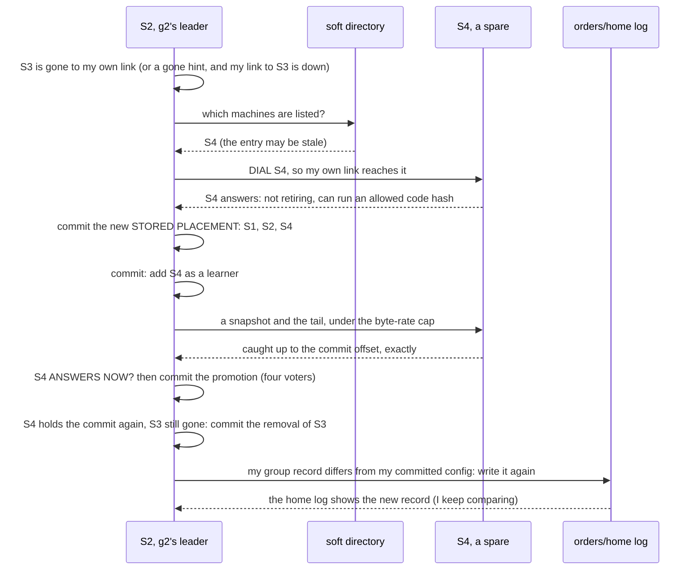

# fero v5: the layers of the chosen design

Rewritten 2026-11-16 for the design the owner chose ([DECISIONS V5-1 to V5-11][dec]; [VERDICT 11.7][v117]). **Updated 2026-11-18 for V5-12, the connect lens** ([LENS.md][lens]; the table "What V5-12 changed" below). It says what each layer does, what it keeps, its rules, its interface, its cost, and what is still owed. A builder should be able to work from it.

**This page replaces the COMP2 version** of 2026-11-11. Git history keeps that one (`git log -- docs/v5-space/LAYERS.md`). COMP2 was the study's earlier pick: Raft groups owned by the project, a `#meta` group, and one central loop. The owner set it aside (V5-2, V5-6).

**What changed from the COMP2 page.**

| COMP2's page | This page | Decision |
|---|---|---|
| Groups belong to the project and hold slots of many resources | Each resource has its own Raft groups. Its first group is its **home group** | V5-2 |
| `#meta` holds members, the catalogue, the slot table and the group records | No `#meta`. A resource's settings, slot table and group records are entries in its own **home log** (the home group's log) | V5-2 |
| One loop on `#meta`'s leader heals copies and moves slots | Each group's leader heals its own copies. The home group's leader moves the resource's slots | V5-2 |
| Members join `#meta`; clients find things through it | A **soft directory**: servers announce, it keeps no log and decides nothing, and a client learns the rest from the resource itself | V5-3 |
| One cluster id, created once | One id per resource, created on its first open. The opener writes a candidate id to disk first | V5-2, V5-10 |
| The `memory` rung as COMP2's next step | Every write commits on disk at a majority. Answer stages come second. The `memory` rung comes third, only for a timed need | V5-5, V5-11 |
| A write is forwarded to the leader | A linked client sends straight to its slot's leader. Forwarding stays for one-link clients | V5-9 |
| A crc32c per entry, in JavaScript | One native checksum per batch (CRC-32/IEEE), with the headers covered | V5-9 |
| Bulk work shares links and the disk freely | Bulk work is held to a byte rate, on the link and the disk | V5-9 |
| Hand-back at ten a second per member | At most 8 hand-back transfers in flight per member, busiest groups first, with one rule for a stalled transfer | V5-7, V5-10 |
| DEP-13's 100 MB counted whatever a copy holds | An empty copy holds no resources. An idle resource has its own budget: about 8 KB resident, 2.5 KB dormant | V5-8 |
| Counted by mechanisms, novel ones and pairs (VERDICT's rule 3) | Counted by rules a builder must get right ([SIMPLICITY][simp]): 416 for this design | V5-6, V5-10 |

**What V5-12 changed on this page** (2026-11-18). V5-12 took all fourteen picks of [LENS 7][lens]. A **lens** is an address: `orders.data.x` names a resource and a path in it, and does no work. Reads, live links, methods and server work hang off it. LENS 4.3 lists what that changes here; each row below is one of its items, or a fix where this page said the old thing.

| Before | Now | Where |
|---|---|---|
| L4 had no rules of its own | L4 has the lens's rules: the lens, links and how they end, counts and linger, the net, what "held on purpose" means, the closable kinds, frozen rows to sinks. +8 to +10, reasoned | 0.2, 5.4 |
| 416 rules | 416 counted, plus +12 to +18 reasoned for the lens's first build: **428 to 434** | 0.2, 12 |
| A partition: a row key, a prefix, or a function | The first key. `depth: 1` (the default) makes it the row; `depth: 2` puts rows under it. `{ before }` goes; the function comes later | 0.1, 3.2, 3.3 |
| `follow`, a method's `.open()`, a `get` that follows its key | `here()`, `tap` and `connect` on a lens; a served view's `here()`; `get()` reads once and keeps nothing | 4, 5.2, 7, 8.1, 8.3, 8.10 |
| `near`, a hint a client learns | A call on a path goes to that path's leader. The method declares where it may be called (`at:`), and the server refuses another path, `bad-path` | 2.3, 3.3, 7 |
| The source mark set by `derive`'s `out` | A write option `{ from: e }`, read back by `marks()`, with a bare `mark(e)`. A marked write waits where a plain one is refused `backpressure` | 3.2, 3.3, 6.3, 8.8 |
| Who runs a `derive`: open (API.md Q-B8) | The app's choice: `derive()` and `consumer()` split the source's shares, or the app takes a lock | 6.3, 8.8, 11 |
| A `SUB` carried "a follow set" | A `SUB` carries a selection: a partition, the whole resource, or a served view `{ method, arg }`; later `{ path, ops }`. No new verb | 4, 7 |

**How each claim is marked.**
- **Model-checked**: every reachable state of a small model was explored (TLC, or an exhaustive Python model). **Simulated**: seeded runs. **Measured**: timed on the study's box. **Spec**: taken from etcd's Raft spec and code. **Code**: read in v4's or a prototype's source. **Reasoned**: an argument; nothing ran it.
- **E-NN** names an experiment; **V5-N** a decision; **PA-N** a finding of [PATHS][paths]; **A-NN** an amendment of [AMENDMENTS](AMENDMENTS.md). **LENS n** is a section of [LENS.md][lens]. **Claim n** is one of [E-55]'s 27 claims: the lens built small on `data`'s real engine and checked by seeded runs. A rule E-55 checked is still counted as reasoned: E-55 ran a prototype, not a model.
- **This page's reading** marks a gap the records leave, filled in here. Section 10 lists every one, with what the records leave unclear or say two ways.
- **Nothing here is built.** Section 11 lists what is owed before the first build slice.

## 0. The stack at a glance

### 0.1 Words

- **Resource**: one `fero(name)`. It is its own small cluster (V5-2). **Project**: machines plus a name lookup (V5-2 point 5).
- **Slot**: one of 4,096 fixed hash buckets per resource ([A-16][a12]). A partition's key hashes to a slot. The user never sees slots. **Partition**: the unit of order. It is always the first key of a row's path (V5-12 item 4). With `depth: 1`, the default, the first key is the row, so each row is its own partition. With `depth: 2`, `chat.data.room1.m7` is a row and `room1` its partition. The user's function comes later (V5-2; V5-12).
- **Group**: one Raft group, holding some of a resource's slots. **Home group**: the resource's first group. **Home log**: its log. A small resource has only its home group (E-49).
- **Copy**: a full replica of a group. It stores and folds every record, as a **voter** or a **learner** (a copy that follows but does not vote). **Member**: a process holding copies.
- **Fold**: `data` applying committed records to its rows. **Lane**: `data`'s fast entry for a batch of records.
- **Batch**: the records one leader appended together, under one header.
- **Soft directory**: a lookup table rebuilt from what servers announce (V5-3). **Seed**: a directory address a client starts from.
- **Preferred member**: the member that should lead a group when all are up. **Hand-back**: giving leadership back to it.
- **Main** and **worker**: a server's two JavaScript threads. The kernel (L0 and L1) runs on the worker. `data`, judging, flow and user code run on main.
- **Lens** (V5-12): an address. `orders.data.x` names a resource and a path in it. Building it sends nothing, reads nothing and keeps nothing, and it is never a promise. A property read on it is a **step**; a call on it is a **verb** (`get`, `set`, `here`, …) or a method.
- **Selection**: what one subscription brings into a process: a partition, the whole resource, or a view a server serves. Equal lenses in one process share one selection.
- **Link**: one live connection from a selection to code. `here()` and `tap(fn)` are **strong**: they end only when code ends them. `connect(target, fn)` is **weak**: it also ends when its target is collected.
- **Held on purpose**: rows a process keeps because it is a server, because of `hold: 'all'`, or because a strong link names them. Only these rows serve a read here. Rows that only a `connect` keeps are not held on purpose.
- **The net**: JavaScript's garbage collector, as the last way a weak link ends. Nothing a program can see may depend on it (LENS 2.2).
- **Picture**: a selection's rows when a link starts. **Frame**: one commit's records on the wire.
- **Mark**: how far a reader got in a source, written in the same log entry as the output it caused (`{ from: e }`; [E-30]).
- **"Follows"**, below the surface, means "subscribes to": one `SUB`, as when a writer follows `#sessions`. The app's `follow` verb is gone (V5-12).

### 0.2 The layers, with their rules

A **rule** is one thing a builder must get right ([SIMPLICITY 1][simp]). The design has 55 rule records and **416 rules** (318 to 524 at the records' low and high counts). 413 are fero's to write and 3 the operator's ([SIMPLICITY 3.1][simp31]; V5-10). By how each rule is known: 197 model-checked, 128 reasoned, 64 from Raft's spec, 26 read in code, 1 measured.

**The connect lens adds about +12 to +18 rules to the first build, so 428 to 434 in all** (V5-12; LENS 4.4). The 416 are the counted base, and stay as counted. The lens's rules are reasoned: none is modelled, and none is a record in [simplicity.json][sjson]. The last column gives them per layer; the next table gives them row by row.

| Layer | Its job | Thread in TypeScript | Records | Rules, counted (low to high) | How the rules are known | The lens, first build (reasoned) |
|---|---|---|---|---|---|---|
| L0 storage and I/O | one journal per process, segments, the object store, links, the handshake, disk checks | kernel worker; a journal thread or pool hop for the fsync; a lease thread | 11 | 78 (54 to 97) | 54 reasoned, 12 model-checked, 12 code | 0 |
| L1 the log | Raft per group; the home log's records; founding; the soft directory; healing; hand-back; slots and moves; routing | kernel worker | 26 | 183 (139 to 238) | 89 model-checked, 64 spec, 29 reasoned, 1 measured | 0 |
| L2 fold and ops | judging writes, sessions, writer time, `data`'s fold, answer stages, marks, a call's path | main (this page's reading; section 10 item 1) | 11 | 72 (56 to 92) | 38 reasoned, 34 model-checked | +1 to +4 (3.3) |
| L3 flow | subscribe, credits, the `none` rung, shared selections | main, or a link-and-flow thread (open; section 10 item 2) | 3 | 33 (24 to 40) | 26 model-checked, 7 reasoned | +3 to +4 (4.3) |
| L4 the surface | `fero()`, the lens, links, methods, config ([API.md][api]) | main | 0 | 0: no record of its own in the base | — | +8 to +10 (5.4) |
| L5 libraries | locks, sagas, queues, consumer groups, `derive`, the `asOf` reader, gateways, the CLI | main | 4 | 50 (45 to 57) | 36 model-checked, 14 code | 0; `asOf` +3 later, in a reader library (6.3) |
| **All** | | | **55** | **416 (318 to 524)** | | **+12 to +18: 428 to 434** |

**The lens's rules, row by row** (LENS 4.4's rows, as they stand there; the layer is this page's reading, section 10 item 26):

| LENS 4.4 row | Net | Layer | Where |
|---|---|---|---|
| *LENS's first form* | | | |
| the lens and the call space | +3 | L4 | 5.4 |
| `get` holds nothing; read through the handle | −1 | L4 | 5.4 |
| writes on a path | −1 | L4 | 5.4 |
| a method on a path: route by the path, `ctx.at` | 0 | L4 (the routing reuses L1's, 2.3) | 5.4 |
| `here`, `connect`, lifetimes | +3 | L4 | 5.4 |
| the line | +2 | L4 | 5.4 |
| `tap`'s one shape | −1 | L4 (the rule it removes is `data`'s) | 5.4 |
| `{ from: e }`, `marks()`, `mark()` | 0 to +2 | L2 | 3.3 |
| `depth` for `{ before }` | −1 to 0 | L2 | 3.3 |
| *sum* | *+4 to +7* | | |
| *Found by building it (E-55)* | | | |
| a partition inside a held whole sends no `SUB`; it subscribes again when the whole ends | +1 | L3 | 4.3 |
| a resume starts from the server's position; a client drops a frame it already applied | +1 | L3 | 4.3 |
| a `connect` function changes only its target | +1 | L4 | 5.4 |
| *sum* | *+3* | | |
| *Found by the review* | | | |
| a read is served here only from rows held on purpose; a GET carries the highest position seen | +1 | L4 (the GET's position rides L3) | 5.4, 4.3 |
| a marked write waits instead of `backpressure` and pauses its reader; a failed one ends the loop | +1 | L2 | 3.3 |
| a cap on live served views per client and per resource | +1 to +2 | L3 | 4.3 |
| a method declares its path shape; the server refuses another | +1 | L2 | 3.3 |
| a warm closed selection is not subscribed; a re-open resumes or takes a new picture | +1 | L4 | 5.4 |
| `at()` turns a number key into a string and refuses other types | 0 to +1 | L4 | 5.4 |
| the target's close is listened for only on named kinds, or a named event | 0 to +1 | L4 | 5.4 |
| *sum* | *+5 to +8* | | |
| **the first build, net** | **+12 to +18** | L2 +1 to +4, L3 +3 to +4, L4 +8 to +10 | **428 to 434** with the base |
| *Not in the first build's count* | | | |
| `asOf` | +3 | L5, a reader library; none in the kernel | 6.3 |
| owed already: the `view` selector's rules, when modelled | +4 to +6 | L3 (API.md's `.open()` owed the same) | 4.3 |
| owed already: the lazy freeze of rows handed out (DATA-07), now also for sinks | 0 here | L4, done in `data` | 5.4 |
| later: class B, work pushed below a partition | +5 (4 to 7) | L3: 4 for the views and the resume, 1 for the order channel | 4.3, 9.4 |

- **The layer of each record is this page's reading** (section 12). [simplicity.json][sjson] has no layer field. The sums equal SIMPLICITY's totals.
- **The lens's net is against API.md's shape, not against the 416** (section 10 item 27). The rules it removes (the follow hidden in `get`, `near`'s hint, `{ before }`'s text rule, `f.data.set`, `data`'s tap mode) were API.md's or `data`'s, and no record of the 416 holds them. Read gross, LENS 4.4's "+" column sums to 22 to 27 and its "−" column to 9 to 10 (summed here). 428 to 434 is V5-12's own sum, and this page keeps it.
- **A user of fero learns seven rules** (LENS 2.0; 5.4). They are not builder rules and are in no count here.
- **Two records are owed and not in the 416.** With them the base has **421 rules** ([SIMPLICITY 3.4][simp]).
  - `issue-order` (3 rules: each writer numbers its writes to a partition, O.seq, A-10). **The first build owes it, whatever the answer stages.** A client that sends writes without awaiting each one needs it under `persisted` alone (model-checked, [E-48]). The prototype broke the order in 12 of 100 seeds ([E-45]). API.md promises this order from the first build (its section 7, "Order of issue").
  - `timeline-merge` (2 rules: V5-4's viewer).
- **More rules are owed and counted in no record**: growing a group from one voter to three, two voters stepping back to one, and dropping a gone learner (2.3, "Growing from one voter"). No model ran them. `slot-table`'s count is also up to 4 low for this shape (2.3).
- **"Model-checked" is SIMPLICITY's basis field.** It counts `writer-time`'s 6 rules, which ran as seeded simulations and not over every state ([E-21]). So L2's 34 is 28 rules explored in full and 6 simulated, and the 197 holds those 6 too.
- **Pairs are not recomputed.** The COMP2 page counted interacting pairs. The closure tool has no record for the soft directory, answer stages or the hand-back, and V5-6 compares designs by rules. So this page gives rules only.
- **At a native step** (section 9) L0 and L1 would move to Rust. L2 to L5 and `data` stay JavaScript.

### 0.3 Where each decision lands on this page

| Decision | In short | Where |
|---|---|---|
| V5-1 | The log is the truth; state is its fold | 2.1, 3.1, 4.1 |
| V5-2 | A resource is its own cluster | 2.2 to 2.4; walk-throughs 8.2, 8.4, 8.6, 8.8 |
| V5-3 | A soft directory | 2.3 (soft directory), 8.3 |
| V5-4 | One timeline by writer time | 3.3 (writer time), 4.4 |
| V5-5 | One commit point; answer stages second; the `memory` rung third | 3.3 (answer stages), 8.1, 9.1 |
| V5-6 | The base, counted by rules | 0.2, every rules table |
| V5-7, V5-10 | Random timers; hand-back cap 8 with its rule | 2.3 (hand-back), 2.5 (DEP-04), 8.5 |
| V5-8 | Budgets per idle resource | 2.5 |
| V5-9 | Direct routing, the batch checksum, the byte-rate cap | 2.3 (routing), 1.3, 1.4 |
| V5-10 | Nine fixes from the models | the table below |
| V5-11 | Answer stages are progress reports | 3.3 (the eight rulings), 8.1 |
| V5-12 | The connect lens: a path is an address; reads, live links, methods and server work hang off it | 0.2 (the count); 2.3 (a call routed by its path); 3.2, 3.3 (keys under `depth`, marks, a call's path); 4.2, 4.3 (shared selections, coverage, resume, the cap on served views); 5 (L4's own rules); 6.3 (`derive`, `asOf`); 7; walk-throughs 8.1, 8.3, 8.8, 8.10; 11 |

**The nine fixes of V5-10.**

| # | Fix | From | Where |
|---|---|---|---|
| 1 | An opener writes a candidate id to disk before the store's create, and founds only if the stored id is its own | E-51 | 2.3 (founding), 8.2 |
| 2 | A client asks the directory again once every member it learned has failed | E-51 | 2.3 (soft directory), 8.3 |
| 3 | A group's leader writes its record whenever the home log's record differs from its committed config | E-51 | 2.3 (group records), 8.4 |
| 4 | The design states how the home group's own recovery window ends | E-51 | 2.3 (group records) |
| 5 | The seed mark goes: the seed rides the founding entry | E-51 | 2.3 (founding, settings) |
| 6 | Promote only a learner that answers the leader now | E-52 | 2.3 (healing), 8.4 |
| 7 | When the preferred member leaves, a placed voter becomes preferred | E-52 | 2.3 (hand-back), 8.5 |
| 8 | Dial a spare the directory lists before using it | E-52 | 2.3 (healing), 8.4 |
| 9 | A lead hint moves leadership itself, never to a draining or leaving machine | E-52 | 2.3 (hints) |

**Build traps** ([PATHS 0][paths0]). The design's text already avoids these. A builder who ports v4's code would bring them back. Each is noted where it bites.

| Trap | Where |
|---|---|
| The leader's fsync before its sends | 1.4, 8.1 step 6 |
| A record encoded again for each link, the journal and each subscriber | 1.4, 4.4 |
| A lane call per record | 3.4 |
| v4's kernel copy of every cell and its state hash (about 2 µs a record on every copy, PA-10) | 2.4 |
| Two pool hops per flush (PA-2) | 1.4 |
| Crossings through main for bytes nobody on main reads (PA-3) | 4.4 |
| 7 to 8 KB of garbage a record (PA-13) | 5.6 |
| A lens that keeps its children: `data`'s handle today keeps 318 to 1,333 B per key for its parent's life (LENS 2.1) | 5.6 |
| A dense slot table, a timer or a socket per resource, v4's directory as written (E-49) | 2.5 |

### 0.4 The processes and threads of one project

One project with three servers. Each server is the app's own Node process with fero inside it. The resources here are `orders` (two groups) and `totals` (one group, derived from `orders`).

```
 clients: other app processes with a bare fero(name), browsers and edge workers over WebSocket
          each one folds with data what its live links hold (here(), tap, connect): nothing until then
          a linked client sends each write, and each call on a path, to its slot's leader;
          a one-link client is forwarded
                                    │ ASK · SUB · ANSWER · DELTA
 ┌──────────────── server S1: the app's own Node process (S2 and S3 are the same) ───────────────┐
 │ main thread    app code, the lens and methods (L4), L5 libraries and gateways, L3 serving,    │
 │                L2: judging on groups S1 leads, data's fold of every group S1 holds            │
 │ kernel worker  L1: Raft for every group S1 holds; for groups it leads: healing, hand-back,    │
 │                    its group record; for home groups it leads: slot moves                     │
 │                L0: the journal, segments, member links, link pings, the recorder              │
 │                the soft directory: announces S1's copies to every seed; may host a directory  │
 │ other threads  one hop for fdatasync (a journal thread or libuv's pool) · a lease thread      │
 │ dir            journal + reserve · segments · snapshots · boot record · lock file             │
 │                per resource: its id (or a candidate id, before founding)                      │
 └────────────────────────────────────────────────────────────────────────────────────────────────┘
 groups (each one Raft log; 3 voters on S1, S2, S3, plus learners up to `standbys`):
   orders/home   S1 leads   settings, slot table, group records, version; and some of orders' slots
   orders/g2     S2 leads   the rest of orders' slots
   totals/home   S3 leads   every slot of totals; its outputs carry how far it read in orders
 object store (S3 or compatible; a local folder on one box):
   per resource: its id · its restore mark · old segments · snapshot layers
 soft directory (any machine can host it; clients start from seeds):
   project + resource name → the addresses of the servers that hold a copy; and each machine
```

- **What resources share**: the machines, the journal and its fsync (E-12), the links, the directory (V5-2), and fero's system resources.
- **`#sessions` is a dependency of every resource.** A group's writer applies a write only while the write's session lives in `#sessions`, and follows `#sessions` to remove a lapsed session's rows (`client-sessions`' `apply.live` and `expired.dead`; `presence-rows` rule 6). So while `#sessions` has no majority, no new client can start writing to any resource (reasoned; section 10 item 5). `#calls` serves every `once` call and `#locks` every lock, for all resources (API.md section 7); a write that uses neither does not wait on them.
- **On one box** the founder is a group's only voter until other server processes of that name join. With three such processes the group has three voters, as in v4's example 01 ([DESIGN-V5 4.2][d42]; API.md 3.1). The store is a local folder.
- **System resources** (`#sessions`, `#locks`, `#sagas`, `#groups`, `#calls`) are resources like any other, each with its own home group. Any process that serves a resource serves them too (this page's reading and API.md's; section 10 item 5).

## 1. L0: storage and I/O

### 1.1 What it does

L0 keeps bytes safe and moves them. It writes every group's entries into one journal per process and fsyncs them in batches. It talks to peers and to the object store, runs the handshake, and checks the disk at boot ([DESIGN-V5 4.1][d41]).

### 1.2 The state it keeps

| Record | Fields | Where it lives | Who writes it |
|---|---|---|---|
| Journal row | a row header (group, kind: batch, term and vote, cut; a chained sequence number; its own small checksum), then the batch bytes | the process's journal, in preallocated segments | L0, for L1 |
| Batch | a header (term, base offset, group, writer time), the records, and one CRC-32/IEEE over all of it | the journal row; the wire carries the same bytes | the group's leader, once |
| Cut record | group, last offset kept | the journal | a follower whose tail a new leader replaces |
| Group segment | a group's entries, with indexes by offset, slot and partition | files per group in the dir, as drafted (2.5 gives the cost) | L0, after the journal fsync that covers them |
| Reserve segment | at least 1 MiB kept for removes, votes, member changes, handovers and retention marks | the dir | L0 ([E-29]) |
| Local snapshot | the folded rows at one offset, with L2's tables beside them | the dir | each copy, for its own restarts |
| Boot record | per dir: the lease epoch, the retired folder and its end offset, a disk incarnation (a random id) | the dir | each new lease holder |
| Resource id | per resource: nothing, a **candidate id**, an adopted id, or the id of a copy it holds | the dir | the opener (2.3, founding) |
| Dir lease | a lock file (pid, host, start), touched from its own thread; the epoch in every file name; `retired-<epoch>` folders | the dir | the process that holds the dir |
| Bad mark | per batch whose checksum failed | the copy | L0, when it reads a bad batch |
| Recorder tape | every kernel input; bulk bytes by journal reference | per process | the kernel, before it steps on each input |
| Resource id object | one object per (project, resource name), created once with `If-None-Match` | the object store | the founding opener |
| Restore mark | per resource: the highest slot epoch ever used; a session generation | the object store | a slot move (before it uses a new epoch); a restore |
| Old segments, snapshot layers | named by (group incarnation, offset) | the object store | the group's leader, put-if-absent, then named in the group's log |
| Not durable | link state per member pair; the byte-rate cap's budget; the durable mark (the journal offset the last fsync started from) | memory | the kernel |

Sources: [DESIGN-V5 4.1][d41]; V5-9; [simplicity.json][sjson]. That the restore mark is per resource is this page's reading (section 10 item 8).

### 1.3 Its rules

Counts are "rules (low to high)" from [simplicity.json][sjson], where each record lists its rules in full.

| Record | The rules, in short | Rules | How known |
|---|---|---|---|
| `journal` | One write stream, so batches never land swapped. An fsync covers only bytes written before it began. A chained sequence number per batch; recovery stops at the first gap. A torn tail is cut. A cut record before a replaced tail. Segments are written from synced entries. The journal is cut only once segments cover it. Folder fsyncs. One failed fsync condemns the store. The reserve takes no data. An unreadable row taints every group after it | 16 (10 to 18) | reasoned; measured in part: 2,640 power cuts lost 0 of 10,020 acknowledged batches ([E-29]); [E-12], [E-02] |
| `batch-checksum` (V5-9) | One CRC-32/IEEE per batch (Node's native `zlib.crc32`), made where the batch is made and checked once per receiver. It covers the term, base offset, group and writer time. The journal row header has its own small checksum and keeps the chain. So every byte that boot, `par` or the disk check trusts sits under a checksum | 1 (1 to 2) | reasoned (PA-1a); no model yet |
| `disk-incarnation` | A checksum finds damage below the tail, and the copy marks it bad for `par`. A new or wiped disk never votes as the copy it replaced (that rule is counted in `raft-config`) | 1 (1 to 3) | model-checked ([E-37]) |
| `par-repair` | A copy with a bad batch grants no vote and does not stand. It repairs only from a peer whose own copy is good and whose commit covers it. The repair copies the batch and clears the mark | 6 (6 to 8) | model-checked on three voters, with "entry" where this page says "batch": 8 of 9 mutants caught ([E-37]) |
| `bulk-rate-cap` (V5-9) | Bulk work (a catch-up, a snapshot install, a move's copy, a roll's catch-up) is held to a byte rate on the link and on the disk. On a member link it goes in chunks of 64 KB or less, queued behind live frames | 1 (1 to 3) | reasoned (PA-6); no run yet |
| `dir-lease` | One process per data folder. The lock is taken atomically, before the boot record is read. A holder is judged by its pid or its lease. The toucher runs on its own thread. A takeover runs under a marker. Each holder writes only files of its own epoch and reads the old epoch's read-only, never past its end | 18 (12 to 22) | code: v4's `shell/runtime.ts` and V4-59's 20 mutations |
| `tier` | Uploads are put-if-absent, and named in the log only after the put is confirmed. Layers carry removal markers. Only a merged base or a full snapshot lets the log be dropped. Nothing a move, a fork or a reader still names is deleted | 10 (6 to 13) | reasoned; not modelled |
| `restore-mark` | A move records its new epoch in the mark before use. A restore takes an epoch above the mark and a new session generation. A retry from an older session and a cursor the history lacks are refused | 5 (5 to 6) | model-checked, every mutant caught, the store always up ([E-33]) |
| `input-recorder` | Every kernel input is recorded whole, in order, before the kernel steps on it. Bulk bytes go by journal reference, and the journal is kept for the recorder's window | 4 (3 to 5) | reasoned; measured: 18 of 18 recordings replayed byte for byte ([E-42]) |
| `link-pings` | Two members that share a group ping every `ping.ms` when no other frame went that way. Any frame is a sign of life. A peer silent past `evict.after` is gone to this member, until it answers again | 4 (3 to 5) | reasoned; measured cost ([E-11], [E-25], [E-49]) |
| `cluster-credentials` | The handshake: a nonce each way, an HMAC proof that cannot be replayed, a constant-time check, a secret refused against none. Member verbs only on links that passed the door. Certificates and revocations checked at every handshake. The CA key, join tokens and revocations are the operator's (3 of the 12) | 12 (6 to 12) | reasoned; rules 1 to 4 are v4's `kernel/door.ts` (V4-30) |

**V5-9's guards**, as [PATHS 7.1 and 7.2][paths7] state them:
- **The checksum is per batch, never per record.** Called once per 100 B record, the native checksum costs 213 to 231 ns, as slow as JavaScript (measured, E-50). It is a format change from v4's crc32c (DEV-09). Only the wire's per-link fields sit outside it, under the frame header's own checksum.
- **`par`'s unit becomes a batch.** E-37's model must be read again with "entry" as "batch", with a damaged header among its cases (owed).
- **The cap goes on both the link and the disk.** A side file is taken only if a run shows it helps. The run is owed: a 4 MB catch-up beside live writes ([PATHS 7.3][paths7]).

### 1.4 Its interface

- **Up to L1.** L0 hands the kernel its input events: a frame received (after `HELLO` and `DOOR`), a tick, an fsync done, a store call done, the boot replay, a bad batch found. L0 to L3 take events and return effects, so the simulator runs them unchanged ([DESIGN-V5 4][d4]).
- **Down from L1.** Write a batch, a term and vote, or a cut. Read from an offset, or one slot's entries for a move. Cut or install a snapshot. Upload a segment. Send a frame.
- **The object store** has five calls: put, get with a byte range, list, delete, put-if-absent. A local folder stands in on one box.
- **Transports.** TCP, TLS, WebSocket and in-process. A Raft batch is at most 1 MB, a catch-up frame at most 4 MB, cut into 64 KB chunks under the cap.
- **One link per machine pair**, shared by every group the two share, and one listen port per process (E-49).
- **L0 never sees rows.** It moves bytes only.

Build notes, all from [PATHS 7.2][paths7]; none changes a rule:
- **Send beside the fsync (a build trap).** The leader's journal write runs beside its `APPEND`s, never before them ([DESIGN-V5 4.2][d42]). An in-place fsync in the same run as corked sends breaks this silently.
- **Encode once (a build trap).** The batch is encoded once. The same bytes go to each follower (`writev` of a small per-link header plus the batch), to the journal, and to subscribers where bytes can route. The client's record bytes become the batch only after a strict decode shows them canonical; otherwise the leader re-encodes them (one build rule, PA-5).
- **The flush.** One hop off the kernel thread (a journal thread or one pool hop), never v4's two. A sync `writev` on arrival. Batches are cut when the disk is free, never on a timer. The durable mark is the file offset the fsync started from (`journal` rule 2).
- **Flushing in place is an option, off by default.** It needs guards: the corked sends leave first; never on a process that may get a batch holding a `replicated` write; after one slow flush the hop takes over.
- **For answer stages** (built second), the journal must write each batch on arrival and fsync in the background, so a follower can report "handed to the operating system" early (MEMORY 9.4).

### 1.5 Size and cost

- **The bar.** C, the study's commit bar, is 0.73 ms on this box: the three-writer fsync p99 (676 µs) plus the round-trip p99 (58 µs) ([E-01]). A commit must stay under C + 5 ms = 5.73 ms at p99 in TypeScript.
- **One journal.** Commit p99 2 to 6.6 ms, against 9 to 854 ms for a file per group, from 256 groups up ([E-12]).
- **The pipeline without Raft** (E-02's `ts-w1`): 6.9 µs of CPU per committed append at 50,000 a second, p99 3.68 ms ([E-02]).
- **A flush**: 80 µs of CPU through one hop, 106 through v4's two, 30 in place (measured, E-50).
- **A checksum**: v4's crc32c in JavaScript 2.2 to 2.9 ns a byte; the native one 0.19 to 0.23 ns a byte once per batch (measured, E-50).
- **A link message** of 150 B under TLS: 8.7 to 9.6 µs alone, 0.58 to 0.60 µs when 64 are corked in one write (measured, E-50).
- **Bulk beside live work**: a 4 MB frame holds a 1 Gb/s link for 34 ms (computed). Big records raised other partitions' commit p99 1.18 to 1.59 times ([E-35]). A small fsync beside bulk writes waited 250 to 300 ms ([E-01]). These are why the cap exists.
- **Disk per resource.** As drafted, a set of files per group costs 12 KB and 3 inodes per resource, whatever its size. One shared segment per process costs about 300 B (measured, [E-49]). The journal's founding rows are about 300 B per resource per member.
- **The recorder**: 1.1 to 1.7 % of a core ([E-42]).
- **The object store**: a 1 KB conditional PUT to MinIO took 1.37 ms at the median; S3 Standard is about 30 ms (cited, [E-28]).
- **Client links**: 10,000 idle TLS links take 538 MB in one Node server ([E-27]).

### 1.6 Not built yet, and owed

- **Models:** `par` on batches with a damaged header, with a voter change, and on one journal per process (G-15, K-24), with `REPAIR` and `REPAIRED` as messages that can be lost, late or doubled. The dir lease. The tier.
- **Runs:** the catch-up beside live writes, with and without the cap ([PATHS 7.3][paths7]). E-10's Raft port inside the v5 shell at 50,000 writes a second, under the 5.73 ms bar.
- **Deferred by V5-9, until the first slice is timed:** one shared log per process in place of journal plus segments (PA-7, about +4 to +6 rules). As drafted every entry is written twice.
- **Tests** ([VERDICT 5.4][v54]): F-10's failed-fsync and lost-folder-entry cases; F-15 with the store down for an hour; OPS-09 (V4-59's tests ported); OPS-11's replay of a recorded run.

## 2. L1: the log

### 2.1 What it does

L1 orders and copies each group's log with Raft, and so decides who writes. The log is the truth (V5-1): a row's state at a position is the fold of the log up to it. L1 also holds everything a resource knows about itself, as entries in its home log, and the rules by which a resource is founded, found, healed and rebalanced. There is no controller and no `#meta` (V5-2).

### 2.2 The state it keeps

| Record | Fields | Where it lives | Who writes it |
|---|---|---|---|
| Group log | entries (index, term, batch): a committed part and a tail | each copy's journal and segments | the group's leader appends; followers copy |
| Term and vote | fsynced before any message that depends on them | the journal | each copy |
| Configuration | voters, learners, one pending change | entries in the group's log | the group's leader |
| **Stored placement** | the machines the group's voters should be on. The first one names the founder alone (this page's reading; 2.3, "Growing from one voter") | an entry in the group's log | the group's leader (a pick), or a place hint |
| **Preferred member** | the member that should lead when all are up | with the group | a re-pick, or a lead hint (section 10 item 9 on where) |
| Commit index | the highest index a majority holds on disk | memory; stamped on later messages | the leader |
| Snapshot | the folded state at one index | the copy's disk; the store | each copy; the leader uploads |
| **Settings record** | the first open's options, the allowed code hashes, the write gate (open or read-only) | the home log; the first one rides the founding entry, with the seed | the founder; an `alter` |
| **Slot table** | per slot, the group that holds it open or is about to, with a version (slot epoch, move name, writer incarnation, step) | the home log; run-length coded, and nothing at all while every slot is in the home group | the target group, before it opens; a write-back after an abort (`slot-table`'s high rules, 2.3) |
| **Group record** | per group: its members, its leader (a hint), its incarnation | the home log | the group's leader, whenever the record differs from its committed config |
| **Version** | the protocol version the resource's entries and frames use | the home log | a roll, once every copy can speak it |
| Move entries | `exporting`, `importing`, `fenced(N)`, the copy and `END(N)`, `open`, `cancel`, `abort`, `unfenced`; the carried set | the source's and the target's logs | the two groups' leaders |
| Fork record | per group, the parent's snapshot and segments and the start position | the fork's home log | a fork |
| **Directory table** | (project, resource name) → the addresses that announced a copy; each machine, with its room and the code it can run | memory at each directory host; rebuilt from announcements | servers announce; an entry dies with its announcer's link |
| Not durable | link state and peers' clocks; what each peer last said (draining, retiring); gone marks and gone hints; "quiet at i"; election timers; pending read indexes; hand-back transfers in flight; each client's view of members, slot table and leaders | memory | the kernel; the client |

The bold records are new or moved against the COMP2 page. Sources: V5-2, V5-3, [E-51], [E-52], [DESIGN-V5 4.2][d42].

### 2.3 Its rules

**Raft (80 rules, 63 to 91).**

| Record | The rules, in short | Rules | How known |
|---|---|---|---|
| `raft-log`, `raft-term-vote`, `raft-commit`, `raft-snapshot` | etcd's Raft, ported to TypeScript: one vote a term, log matching, commit by a majority on disk counting only an entry of the leader's own term, snapshots | 10, 17, 8, 10 | spec. The port passes 41 of 41 of etcd's test files and 4,000 random scripts ([E-10]); 26 clean Maelstrom runs were linearizable ([E-46]) |
| `raft-config` ([A-01][a11]) | Membership applies on commit, one change at a time. No member stands while a committed change is unapplied. Only a voter of its own applied config stands. Learners grant votes. A lost disk never returns under its old id | 15 (14 to 16) | model-checked: 0 stuck states; 12 of 13 behaviour-changing mutants caught ([E-14], [E-14b], [E-14c]) |
| `learners` | A learner's ack never counts. It is promoted only once caught up to the commit offset | 3 (2 to 3) | spec; rule 3 model-checked ([E-52]) |
| `raft-prevote-checkquorum` ([A-02][a11]) | PreVote before a term is raised. A leader that hears no majority within an election timeout steps down. On a quiet group, link pings count as heard | 7 (5 to 9) | spec; simulated ([E-38]); measured on etcd ([E-38c]) |
| `raft-leader-transfer` | While a transfer runs the leader takes no new writes, and refuses them with the target's name, never drops them. TimeoutNow only once the target holds the whole log. A transfer not done within an election timeout is given up | 6 (4 to 6) | spec; measured ([E-13]) |
| `raft-readindex` | A leader serves a read index only after committing an entry of its own term, confirms it still leads with one majority round, and answers once its fold reaches the index | 4 (3 to 6) | spec; checked end to end by Maelstrom ([E-46]) |

**Leaders (V5-7).** Leaders are elected by Raft's random timers and PreVote. No rank and no campaign at boot. A copy whose fold is behind can win and answer late; voting before the fold (PA-16) is the deferred answer.

**Many groups (16 rules, 10 to 23).**

| Record | The rules, in short | Rules | How known |
|---|---|---|---|
| `quiet-groups` ([A-12][a11]) | A leader goes quiet only when nothing is in flight and every live voter holds its commit offset. It says "quiet at i" and stops sending. A follower below i asks it to wake. Any write or read index wakes the group. A quiet follower whose link to the leader is silent for `election.ms` wakes the group and may stand. When a link comes back, each side reports its log ends | 7 (5 to 8) | reasoned; idle cost measured ([E-11], [E-49]); failure detection on quiet groups not run (G-30, K-22) |
| `handback` (V5-7, V5-10) | (1) Once a group's preferred member has been live and caught up for `settle.ms`, the group's leader hands it leadership by a transfer. (2) Only to a voter. (3) At most **8** hand-back transfers in flight per member, busiest groups first by recent writes (4 where F-05's 10 ms must hold). (4) **A group with a transfer in flight does not go quiet**, so Raft's own abort ends a transfer whose taker died within `election.ms`. (5) The preferred member is re-picked only once it has left the group's placement. (6) The re-pick makes the placement's first voter preferred | 6 (3 to 10) | 4 model-checked ([E-52]); rule 4 measured on real Raft code ([E-53]); rule 3 reasoned |
| `slow-leader-self` ([A-03][a11]) | A leader whose latency stays k times its followers' hands the lead to its most caught-up fast follower, and takes none back until it has been normal for a hold time | 3 (2 to 5) | reasoned; not built or modelled (K-17) |

- **The stalled-transfer rule, both forms** (V5-10). Counted at the giver, it is rule 4 above. Counted at the taker, it is: a transfer not won within `election.ms` plus jitter frees its slot. Without the taker's rule, groups were never handed back, in every run (measured, [E-53]). At the giver, the stuck quiet transfers were measured in 22 of 22 runs; that they would hold a giver's place for good is reasoned, since a cap per giver was not built ([E-53]). Section 10 item 6 says what the records leave open here.
- **`settle.ms`** stays 30 s.

**The resource's own records, in its home log (17 rules, 11 to 21).**

| Record | The rules, in short | Rules | How known |
|---|---|---|---|
| `meta-catalog` (settings) | A later open whose options differ is refused, naming the difference. An `alter` changes the record online, by an entry; a roll adds the new code hash first and removes the old only after the roll. A server becomes a copy only if it can run an allowed code hash. While the gate is read-only, every group refuses every write | 4 (3 to 5) | model-checked ([E-51]) |
| `meta-directory` (group records) | (1) **Whenever the home log's record of a group differs from the group's committed config, the group's leader writes it again, and it keeps comparing** (fix 3). (2) An operator recovery raises the group's incarnation: in its record, and for the home group in its own log and its members' `HELLO`. (3) A copy that sees a higher incarnation for its group, in the home log or a `HELLO`, stops and comes back as a new copy. (4) A removed copy deletes its data only once the record shows the config without it. (5, 6) A group's record is deleted only after the slot table shows none of its slots, and its history is safe | 6 (4 to 7) | model-checked ([E-51]) |
| `cluster-version` | Every frame carries its sender's protocol version. A resource's version is raised only once every copy can speak it, and never lowered past a format change. A server that cannot speak it is refused as a copy | 5 (3 to 6) | reasoned |
| `meta-members` | A leaving server says "retiring" first, in its pings. Healing never picks, adds or promotes a machine that said it is retiring | 2 (1 to 3) | model-checked ([E-51], [E-52]) |

- **Where the records say `HELLO` for one resource, this page reads the resource check** (section 7; section 10 item 11). That is the first `SUB` or `ASK` for a resource on a link. One link serves every resource a machine pair shares (E-49), so a `HELLO` cannot name each one. It touches `meta-directory` rules 2 and 3, `cluster-version` rule 3, `soft-directory` rule 8 and fix 4. The tables keep the records' word.
- **How the home group's recovery window ends** (fix 4). A data group's old copies learn a raised incarnation from the home log. The home group has no second log, only what its members say on a link. So after an operator recovers the home group, an old home copy that returns cannot learn the bump while the recovered copy is down, and two old copies can elect under the old incarnation. The window ends when the recovered copy is back (model-checked, [E-51]). It also ends at the first resource check from any member of the resource that has read the bump in the home log, so every resource check carries the home group's incarnation (reasoned in E-51, which says "every `HELLO`"; not modelled). The recover command says so before it runs.

**Founding (6 rules, 6 to 11).** `genesis-conditional-create`, model-checked ([E-51]: 14 of 14 rules needed at the model's grain).
1. The create of the resource's id in the object store succeeds only while no id is stored under that project and name (`If-None-Match`).
2. **An opener first writes a candidate id to its own disk, only while its dir holds no id, and only then asks the store to create that id** (fix 1).
3. **After the create answers, or after a restart, the opener founds only if the stored id is its own candidate.** Otherwise it drops its candidate and adopts the stored id.
4. The founder makes the home group with itself as the only voter. Its first entry holds the id, the settings record and the seed (fix 5: no seed mark; a joining copy never applies a seed).
5. Every other opener adopts only the id it finds stored, under a key that carries the project and the name.
6. An opener adopts only while it holds no id, keeps that id in its dir, and joins as a copy through healing.

- **On one box** an exclusive file create stands in for the store. A resource first founded on one box and later opened across boxes can end with two ids (E-33's `onebox1`, 3 steps, carried over per resource). It needs E-33's rule per resource: other boxes join a resource that holds a one-box id and never found it themselves. Not modelled again ([E-51]).
- **The founding placement names the founder alone** (this page's reading; the records do not say). The group grows to three voters by rules that no record counts ("Growing from one voter", below).
- **A lost disk between the create and two more voters** is F-12: the operator clears or restores the name.

**The soft directory (12 rules, 11 to 14).** `soft-directory`, model-checked ([E-51]), ported from v4's `api/directory.ts`.
1. A server announces each resource it holds a copy of: project, name, its own address.
2. It also announces itself as a machine, with its room and the code it can run, so a leader can find a spare.
3. It announces everything again on every new link to a directory, so a fresh host rebuilds the table from announcements alone.
4. An entry lives only while its announcer's link lives: a closed link, or one silent for 20 of the host's beats, drops every entry it made.
5. A server takes back an entry as soon as it stops holding that copy.
6. When a machine's directory host stops, the other servers there try to host it after a short random delay.
7. Across machines, a server links and announces to every seed, so whichever seed a client asks knows every copy.
8. **A client keeps an address only if the `HELLO` there names the same project and resource.** Any other answer drops it, and the client tries the next.
9. A client learns members, slot table and leaders from the resource itself, and again when they change. **It does not stop asking the directory after a first address** (fix 2).
10. A lookup that fails or finds nothing is asked again after a growing delay. It is never given up.
11. A later announcement of the same entry takes it over, and only its current announcer's link may drop it.
12. A server that announces is marked seen at once, so a clean leaver leaves no dead address behind.

- **Rule 8's check is the resource check** on this page (section 7). An entry carries no id (rule 1), so a client takes the id from its first check and holds later links to it (reasoned).
- **Rule 1 lists any copy, not only a home copy.** With more than three machines, the address a client gets can be a server that holds only g2. Every copy must then serve the home group's records or point to them (2.4; owed).
- **While the directory is down**, connected clients keep working. Only first lookups wait (V5-3; model-checked as CONN).
- **The seed addresses need a config key** (V5-3). API.md proposes v4's `rendezvous`, which then also takes a list of directory addresses across machines (its section 9, pending the owner). Its row in `api/config.ts`'s `LEAVES` is owed.

**Healing and hints (23 rules, 19 to 29).**

| Record | The rules, in short | Rules | How known |
|---|---|---|---|
| `healing-self` | One change at a time, each a config entry. Add only a machine not in the config, as a learner. Promote only a learner, only from three voters to four. Remove only a voter that is gone to the leader's own links, only from four. A surplus removal takes the voter the stored placement leaves out, and waits until the voters left answer and hold the commit offset. **(14) Promote only a learner that answers the leader now** (fix 6). **(15) When a placed machine is gone or retiring, the leader picks a machine not already placed and writes the new placement into the group's log before any add; it adds and promotes only machines the placement names.** (16) A pick or an add takes only a machine the leader's own link has reached within `evict.after`. **(17) To use a spare, the leader first dials a machine the soft directory lists** (fix 8) | 17 (15 to 21) | model-checked: up to 3.7 million states, 46 of 48 mutants caught, 2 undecided ([E-52]) |
| `planner-hints` | (1) A leader whose own link to a machine is up ignores a gone hint for it. (2) A gone hint it takes makes the machine gone at once. (3) A lead hint also sets the preferred member. **(4) A lead hint moves leadership itself, at once, by a transfer** (fix 9). (5) A place hint is written into the group's log as its stored placement. (6) A draining process says so in its pings and hands over every group it leads; **no hand-over, hand-back or lead hint moves leadership to a draining or retiring machine** (fix 9) | 6 (4 to 8) | model-checked ([E-52]) |

- **Why the fixes.** "Not gone" in place of "answers now" let a learner that caught up and then crashed be promoted, leaving committed entries on 2 of 4 voters (13 steps, one crash). Without the re-pick (fix 7, `handback` rules 5 and 6) no hand-back ever runs again once the preferred member leaves. Links run only between members of a group, so a spare is found only through the directory, and its entry can be stale: hence the dial ([E-52]).
- **Placement across resources has no central loop.** Each leader reads the machines' loads and picks among the quieter ones (V5-2; reasoned, not modelled). Two leaders may rank machines differently; the stored placement keeps that safe ([E-52]).
- **Pacing.** Each member loads at most two snapshots at a time and refuses more. [DESIGN-V5 4.2][d42] names that answer `busy`; API.md uses `busy` for a server whose main thread is stalled, so this answer needs another name (section 10 item 23). Bulk bytes run under the byte-rate cap (1.3).
- **Growing from one voter: owed, counted nowhere, not modelled.** Every group starts with one voter (founding rule 4). But `healing-self` rule 4 promotes only from three voters to four, and rule 15 fires only for a placed machine that is gone or retiring. So no counted rule takes a group from one voter to three. The record's notes leave out "growth from one voter and two voters stepping back to one" and "dropping a gone learner". E-52's groups start at three voters, and E-51 took the growth as one atomic step. This page takes the rules from [DESIGN-V5 4.2][d42]:
  1. **Learners first.** A group with one voter writes a stored placement of three, and adds the other two machines as learners. It stays at one voter while they catch up. (Writing the placement first is this page's reading, after rule 15.)
  2. **Then two promotions, back to back**, only once both learners hold the commit offset and answer the leader now. The group passes through two voters only for the moment of the change. It never rests at two, and healing never raises a voter count to an even number: two voters need both to commit, so one crash would stop the group.
  3. **Two voters step back to one.** A group can still end at two: a crash between the two promotions, or a leave from three with no learner. With fewer than three live candidates and neither voter retiring, the leader makes the other voter a learner again.
  4. **A learner gone to the leader is dropped** from the config (undecided in E-52's model, and left out as in E-16).
  - API.md's `copies` default ("1 while fewer than three servers exist") rests on this path. It runs at every founding and for every new group (8.2, 8.6), so the first slice needs it (section 11).

**Slots and moves (19 rules, 14 to 33), and forks (7, 4 to 9).**

| Record | The rules, in short | Rules | How known |
|---|---|---|---|
| `slot-table` | A group takes a write only for a slot its committed log holds open; otherwise it answers `moved` (the record also names `wrong-shard`, which API.md does not have). The table is never behind an open (high rules; below) | 3 (3 to 7) | model-checked ([E-15], [E-17c]) |
| `slot-move` ([A-17][a12]) | The source takes no write to the slot once its fence is in its log, committed or not. Fenced once, opened once. The final copy goes only once the fence has committed, carries the rows, records and highest lock token, and ends with `END(N)`. Before the fence only the source cancels; after it only the target gives up | 13 (11 to 21) | model-checked: TLC agrees with `slot_move.py` on 74 runs; only 39 % of mechanical mutants caught against an 85 % bar (G-07) ([E-15]) |
| `move-policy` ([A-18][a12]) | Move from the busiest group to the least loaded, the slot nearest half the gap. Move only when it wins by a margin. Shrink a group only after it has been quiet for `shrink.after` | 3 (0 to 5) | reasoned; simulated ([E-18]) |
| `forks` | A fork writes one record per group naming the parent's files; it copies nothing. The parent drops nothing a committed fork record names | 7 (4 to 9) | reasoned; cost measured ([E-06](experiments/E06-fork-rewind/README.md)) |

- **The table rules are `slot-table`'s high rules, and this shape needs them.** The 3 counted rules are the write guard and its two answers. "The table is never behind an open" stands for four rules in the record's high count of 7: the target writes s to B before it opens; after an abort it writes s back to A before A reopens; a recovery writes the row at the slot's new epoch; the table keeps the highest version of each row ([E-15]). The record's notes say they are needed wherever the table and the slot's data sit in different groups. Here that is every slot outside the home group. So the 416 is up to 4 rules low on this record, and 8.6 steps 5 and 6 rely on them.
- **Only the home moves** against the study's form: the slot table and the move's decider sit in the home group, not `#meta`. The home group's leader is the one mover per resource, so the policy needs no lease ([SIMPLICITY 3.2][simp]).
- **Where they meet.** E-32's composed model ran a move with a leader change, a voter swap and a log drop, with the dedup state carried. Every property held on 28 bounds ([crossing]). It ran in `#meta`'s world; the home-log form is not run (section 11).

**Routing (3 rules, 1 to 7).**

| Record | The rules, in short | Rules | How known |
|---|---|---|---|
| `route-smart` (V5-9) | A linked client sends each write to the cached leader of its slot. On `retry` or `no-leader` it waits the retry-after and resends the same attempt; it never treats that answer as final. (The cache update on `moved` is the soft directory's rule 9, so it is not counted twice) | 1 (0 to 3) | reasoned (PA-4); both paths modelled for dedup ([E-20]) |
| `route-forward` ([A-02][a11]) | A member that cannot forward a write refuses it at once with a redirect; it never drops or holds it. On `moved` it takes the new owner from the answer or the home log and forwards there | 2 (1 to 4) | reasoned; measured: etcd dropped writes caught in a handover in 8 of 15 ([E-13]) |

- **Refusal names are API.md's.** The rule records keep older ones: `no-writer` for `no-leader`, `unknown-log` for `bad-cursor`. Section 10 item 23 lists the names the two pages still do not share.
- **Direct routing's guard**: the forward path stays, for browsers and other one-link clients, so `forward.once` (counted in `client-sessions`) stays too.
- **A call on a path is routed like a write** (V5-12 item 3; LENS 2.4). `shop.data.widgets.sell(1)` goes to the leader of the slot that `widgets`' partition hashes to, so the call costs one trip and one commit (PA-25). API.md's `near` hint, which a client had to learn from the settings, goes. A call with no path (`f.methods.x(arg)`) goes to any server, as before. **No rule is added in L1**: the client hashes the path's first key and uses the same cache, `moved` and `retry` handling as for a write. LENS 4.4 counts "route by the path" in its method row, which this page puts in L4 (5.4). Measured on a stand-in, where the leader table and the forwarding were written in the bench: one trip and one commit per call, one redirect after a leader moved, and with no path an extra trip on 0.66 of calls with three servers ([E-55] claim 18).

### 2.4 Its interface

- **Up to L2: five operations.** Append, read from a cursor, snapshot, change members, hand over leadership. L2 and L3 are a library on top.
- **Events up to L2.** Committed batches in offset order. The commit offset. Leadership gained or lost; on a loss, pending answers become `unknown`. A read index confirmed. A snapshot to install. Each step of a slot move.
- **The worker crossing.** The seam carries byte batches: 27 to 40 ns a record at batch 256; one record at a time costs 0.8 to 2.2 µs ([E-07]).
- **Down to L0.** As in 1.4.
- **How a group's leader reads its resource's records.** It follows the home log, as a subscriber, and compares (`meta-directory` rule 1). A group that is the home group reads its own log.
- **How a client reads them.** After the directory gives one address, the client subscribes to the home group's records and gets members, slot table and leaders (56 to 196 B run-length coded, [E-36]).
- **Every copy must serve those records or point to them** (this page's reading; not in the records, not modelled). The directory lists any server that holds a copy of any of the resource's groups (`soft-directory` rule 1). Only a group's leader follows the home log. With three machines every server holds the home group, so the gap never shows. With more, a client can land on a follower of g2, on a machine with no home copy. So every copy knows the home group's members and answers with them. How a follower learns them is open: each copy follows the home log's records too, or its leader passes the home members down in the group's own log.
- **How a writer reads `#sessions`.** A process follows `#sessions` once, for all the groups it leads (reasoned; the records say "each group's writer follows `#sessions`"). A follow per group would cost memory per resource (2.5).
- **Do not port v4's kernel state (a build trap, PA-10).** v4's kernel keeps its own copy of every cell and a state hash: about 2 µs a record on every copy. v5's kernel needs only headers. Nor v4's digest heartbeat or compaction rescans.

### 2.5 Size and cost

**Per resource (V5-8, [E-49]).**

| State of an idle resource, per member | Budget | Measured |
|---|---|---|
| Resident, once V8 has collected | about 8 KB | 6 to 8 KB; live heap 5.4 KB, 3.1 KB of it the Raft group |
| In the first minute after a boot | about 30 KB, stated beside the budget | about 28 KB at 1,000 to 2,000 resources per process, 19 KB at 10,000 |
| Dormant (the group dropped to disk) | about 2.5 KB | 1.2 to 2.4 KB |
| On each machine that hosts a seed directory | not stated by V5-8 (section 10 item 7) | 1.5 KB more |

- **The budget does not yet count the follow of `#sessions`.** Every group's writer needs it (0.4), and E-49's 5.4 KB did not measure it. With one follow per process the cost is per process and per live session, not per resource (reasoned). The memory pin per idle resource must be taken with that follow running (section 11).
- **An empty copy** is a process holding no resources. It stays at or under 100 MB (DEP-13 as V5-8 reads it).
- **The budget holds only in the cheap form (a build trap).** A one-run or implicit slot table and packed per-slot state: 5.4 KB live. The drafted dense form costs 120 KB per resource, 95 % of it slot table and per-slot state (measured, [E-49]).
- **Nothing per resource may tick or listen (a build trap).** One ticker and one listen port per process. A timer per resource, as v4 has, costs 1.3 % of a core at 10,000 resources (measured, [E-49]).
- **Idle, a resource sends nothing.** The frames are link pings, per machine pair: 2.4 to 4.0 a second per process, whatever the count. Idle CPU stays at Node's floor, 0.1 to 0.2 % of a core (measured, [E-49]).
- **The knee is about 10,000 resources per process.** Past it, dormant groups are a choice (+4 rules; V5-8). A full garbage collection stops JavaScript for 19 to 44 ms at 10,000 quiet groups and 110 to 261 ms at 100,000 (measured, [E-49]).
- **v4's directory as written does not scale (a build trap).** It refuses more than 4,096 entries per process, and is quadratic to register (30 s for 10,000) and to drop a dead link's entries (21 s). An index fixes both, with no rule (measured, [E-49]).
- **Writes spread thin cost more.** 10,000 groups at one write a second each used 72 % of a core, against 49 % for 16 groups at the same total rate, and p99 rose from 10 to 121 ms ([E-11]).

**Boot, failover, hand-back.**

- **A whole-project cold boot** by random timers: 3 to 5 s at 1,000 resources per process, 7 s at 10,000. About two thirds of leaders land off their preferred member (measured, [E-49]).
- **A cold wake misses DEP-04 by random timers** (reasoned from the timer's floor and E-49). DEP-04 is a MUST: a small project is writable within 1.5 s of waking ([REQUIREMENTS][req]). With no campaign at boot (V5-7), a woken group's first election waits `election.ms` plus jitter: 2.0 to 2.5 s with API.md's defaults, before any other work. Only the preferred-leader start that V5-7 rejected met it: 0.47 to 0.53 s up to 100 groups (measured, [E-49]). Section 11 lists the choice.
- **Failover** is the election timer plus about 5 ms. The bar is p99 at or under 2.5 s. Measured on etcd at `election.ms` = 2 s it took 2.03 to 3.36 s, over the bar ([E-13]). That range comes from etcd's jitter, which spreads the timer over [E, 2E). The bar holds only with A-02's smaller jitter of 0.25 E (API.md: `election.jitter` 500): 2.0 to 2.5 s, right at the bar. That sum is reasoned; no run used the smaller jitter ([E-13]; AMENDMENTS D7).
- **A handover** pauses only its own group, by about 4 ms over a quiet window ([E-13]).
- **The hand-back at cap 8** (measured on E-10's port, [E-53]): after one member restarts, its third of the leaders is back in 0.1 to 0.2 s at 1,000 resources per process and about 1.5 s at 10,000 (at most 2.2 s under load). So leaders are even about 31 to 32 s after the member is back, most of it `settle.ms`. Ten a second took 33 s and 5.6 minutes. No transfer failed in 150 timed hand-backs.
- **What it costs writes.** While it runs, other writes are 2 to 13 ms slower at p99. Against F-05's 10 ms, cap 8 after a restart is near the bar (+6 to +8 ms at the median, over it in up to 3 of 10 runs); cap 4 at 10,000 was inside in 10 of 10 (+3.8 ms). After a cold boot cap 8 is over it (measured, [E-53]).
- **Catch-up**: 5.2 to 6.9 s per GB on etcd ([E-13]); a folding TypeScript copy is bound by its decode and fold (3.5).

**Create, moves, cursors.**

- **A create** is about 5 ms on one box and about 35 ms across boxes with S3 (measured parts summed; the store cited) ([E-49]).
- **A move's unwritable window** is three commits as drafted: 2.7 to 4.1 ms at the median and 16.7 ms at p99 under 10,000 writes a second, against a 10 ms bar ([E-13]).
- **So the three-commit move already misses SC-08(b) under load** (measured, [E-13]). It fits only on lightly loaded groups: 5.0 ms at 2,000 writes a second. One commit fits everywhere measured, two up to 2,000 a second. E-13 says to cut the move to one or two commits, or to restate SC-08(b), before phase 1 (DEV-09). [VERDICT 9 step 2d][v9] owes the model of the cut move with its carried set (K-03, K-25). 8.6 draws the three-commit form, the only one modelled.
- **Writers per resource.** 4,096 slots give 135 effective writers ([E-18]).
- **Cursors.** A whole-resource cursor at 4,096 slots is about 4 to 13 KB by reasoning, against an 8 KB bar (G-06).
- **The Raft port's own cost** is the widest unknown: 47 to 55 µs of CPU a write at 50,000 a second in E-11's simple host, with that host at its limit (measured, E-50). Nobody has timed it inside a v5 server.

### 2.6 Not built yet, and owed

- **Models owed** (section 11 has the full list): founding and the directory together; the one-box-then-many founding; growth from one voter to three, with the step back from two; a clean leave with no spare (8.9); the home group's records read from a copy of another group; the slot move cut to one or two commits (K-03, K-25); the slot move with the table in the home log, and a move meeting a membership change at two faults (K-01); E-15's mutants re-run (G-07); quiet groups with failure detection (K-22); placement by load; the home group's recovery window with resource checks from other groups' members.
- **Runs owed:** a roll of three copies at 1,000 and 10,000 resources per process; R/3 elections at once after a crash (not measured in TypeScript); the hand-back in the push form (below).
- **Deferred by V5-9:** a copy that votes before its fold is done (PA-16, +1 rule); a short retry-after during a move or a handover (PA-20); a move by reference (PA-15).
- **Kill rows** ([VERDICT 9][v9]): a move's window over 10 ms at p99, which the three-commit form already trips at 10,000 writes a second (2.5); failover p99 over 2.5 s, which holds only with the 0.25 E jitter (2.5); a whole-resource cursor over 8 KB, which means falling back to 1,024 slots.

## 3. L2: fold and ops

### 3.1 What it does

L2 turns records into rows, and judges writes. On a group's leader it checks each write against the newest state, in a fixed order, and appends only results. On every copy it hands committed records to `data`, which folds them into rows ([DESIGN-V5 4.3][d43]). Every write commits at `persisted`: on disk at a majority, before anyone else can see it (V5-5). Since V5-12 it also takes a source mark as an option of any write, reads the marks back, and checks the path a method was called on.

### 3.2 The state it keeps

| Record | Fields | Where it lives | Who writes it |
|---|---|---|---|
| Batch header | the leader's term, the base offset, the group, writer time `t` | the group's log, under the batch checksum | the writer |
| Record | the slot's sequence, the attempt id (session, sequence), the writer's issue number (O.seq; owed by the first build, 0.2), and `data`'s change record `{ type, key, value, at? }`. The key is `[row, ...fields]` under `depth: 1` and `[partition, row, ...fields]` under `depth: 2` (V5-12). Either way the partition is the first key, and its hash picks the slot; a partition hash in the header, if PA-3 b adds one, is that same hash | the group's log | the writer; the change record's shape is `data`'s |
| Rows | `data`'s rows of every partition this copy's groups hold | memory on main; snapshots | `data`'s lane, from committed records only |
| Log-end overlay | the judged, uncommitted tail | memory on the writer; never shown | the writer |
| Slot sequence | per slot, the last sequence, read with the slot's epoch | group state; snapshots; carried by a move | the writer |
| Session tables | the `#sessions` registry (per client life, a lease); per group and slot, each session's outcomes at or above its floor, and the floor | `#sessions`; group state; snapshots; carried | the writer, from committed entries |
| Fence table | per group, the highest token seen per lock | group state; snapshots; carried, merged by max | the writer |
| Caller-key table | per caller key: the first answer and its lapse | group state, per slot; carried (this page's reading) | the writer |
| Source marks | per reader (a name), source slot and output slot: the highest source sequence applied | in the output's own entry, or in a bare mark's entry; group state; carried by a move | the output slot's leader, from a write's `{ from: e }` or a `mark(e)` (V5-12) |
| Fold version | the fold version in force from an offset | an entry in each group's log | a roll |
| Two marks on the leader (answer stages) | the commit mark (disk reports) and the replicated mark (memory reports) | memory | the leader; **commit never reads the replicated mark** |
| Client side | pending writes with their bytes, until they commit. When the queue is full (4.2), a marked write waits in it and pauses the reader its `e` came from, where a plain write is refused `backpressure` (V5-12) | client memory; shown as `pending` rows of `cluster.writes` | the client |

### 3.3 Its rules

| Record | The rules, in short | Rules | How known |
|---|---|---|---|
| `writer-judging` ([A-04][a11]) | Judge dedup, shape checks, rules and conditions against the log-end state. Send a refusal or a decision only once the log end it was judged on has committed. A deposed writer answers `unknown`. Append only results. A new leader folds its whole log before it judges. A batch to one partition is judged as one | 6 (2 to 9) | reasoned; simulated: Porcupine on 183,159 histories ([E-22]); Knossos agrees ([E-22b]) |
| `client-sessions` ([A-21][a12]) | Apply an attempt only if it is not among the session's outcomes, is at or above its floor, and the session lives. A restarted process takes a new session. A move's fence and open carry outcomes and floors. A relay forwards a copy only once | 14 (13 to 16) | model-checked ([E-20]); E-32 added the snapshot and move rules ([crossing]) |
| `slot-sequence` | Stamp each record with the slot's next sequence. The final copy of a move carries it, so it never goes back | 2 (2 to 3) | model-checked ([E-15], [E-17c]) |
| `fence-tokens` | A partition refuses a step whose token is below the highest it has seen for that lock, and raises its highest to the token of a write it takes | 2 (2 to 3) | model-checked ([E-24]) |
| `writer-time` ([A-23][a12]; V5-4) | `t` is the median of the members' clocks, never going back, across a handover too. TTLs and leases lapse by `t`, as records in the log | 6 (6 to 8) | simulated on seeded runs, not every state ([E-21]) |
| `srchi-marks` ([A-05][a11]) | Apply an output only above the mark. The output's entry records its source sequence. The consumer's cursor moves only after every output is answered. A move carries the marks. (Since V5-12 the app sets the mark as a write option, `{ from: e }`: the table below) | 5 (5 to 6) | model-checked, 6 of 6 mutants; Elle agrees on 2,800 histories ([E-30]) |
| `fold-all` | Every copy applies each committed record once, in offset order, through `data`'s lane. Readers see only the committed state. The fold reads only the record and the rows, never the local clock. A user function that throws is reported as a fault and never stops the fold (V4-47) | 4 (3 to 6) | reasoned |
| `fold-version` | An entry names the fold version in force from its offset: `data`'s exact build and fero's way in. A copy never folds under another version, and refuses to serve until it can run it | 7 (4 to 9) | reasoned; measured need ([E-43]) |
| `presence-rows` | A row written `while: 'session'` carries its session's id. Each group's writer follows `#sessions` and removes a lapsed session's rows by entries in its own log | 6 (4 to 7) | reasoned; E-22's fixes |
| `caller-keys` | A call with a key (API.md's `once` name) claims the key's row before its handler runs. A retry gets the first stored result. A new run starts only after the lease lapses, under a fence | 8 (7 to 12) | reasoned; keys beside sessions not modelled (G-12) |
| `ack-stages` (V5-5, V5-11; built second) | W1: fero's own lock, saga and transaction steps act only on committed answers (4 rules). Y: a writer's read waits until its last early-answered write is committed and visible, or known lost. A follower reports "in memory" only after it handed the batch to the operating system. The leader counts its own copy only after its own write call. A `replicated` answer comes only from the replicated mark, and commit never reads it. A `received` answer comes only after the append. The client keeps the write pending and resends it after a failover. Only a write that cannot be refused takes an early stage | 12 (8 to 13) | W1's four parts and Y model-checked on TiKV's shape ([E-48]); the other 7 reasoned (MEMORY 9.4) |

**Answer stages are progress reports** (V5-11). The eight rulings, as rules for a builder:
1. A stage adds no durability rung. A benchmark line is won at the commit.
2. "Acknowledged" (F-01) means the committed answer. `received` and `replicated` are named weaker answers.
3. A read that waits sees the writer's own early-answered writes (Y). A sync read shows a write only from its commit (V4-7: no optimistic copy).
4. No value and no decision leaves before the commit. A gateway's Redis INCR and JetStream PubAck answer at commit.
5. `replicated` means a majority has handed the write to the operating system. It survives any process crash, not a power loss of that majority.
6. Only a write that cannot be refused takes an early stage. That is a whole-row `set` or `remove` with no `if`, no `once` name and no `from`, on a resource with no `rules.write` (API.md 3.5). A conditional write, an op, a field write, a write with a `once` name (the name can be taken, so it can be refused `call-diverged`), `set(fn)`, a `batch`, a method call, a marked write (`{ from: e }`, which the leader may skip at its mark; LENS 2.8), and any write that returns a value answer at commit only. A field write is on that list because it can be refused `absent-row` (MEMORY 9). So an early answer is never followed by a refusal on the row's state.
   - **One gap is left** (API.md Q-B1; reasoned). After a failover the resent write is judged again. By then the write gate may be read-only, or a disk full. API.md's pick: fero keeps retrying an early-answered write through those two, so its handle ends at the commit, at `timeout` or at `unknown`, never at a refusal. That is one more rule. It is owed and not modelled (3.6).
7. A-04 holds for values, decisions and refusals: each waits for the commit it was judged on.
8. Answer stages are part of the base, built second.

**The lens's rules in L2** (V5-12; LENS 4.4's rows). Reasoned, none modelled, none in the 416.

| LENS 4.4 row | The rules, in short | + | − | Net | How known |
|---|---|---|---|---|---|
| `{ from: e }`, `marks()`, `mark()` | Any write may carry a mark: the write and "source record `e` is applied" land in one log entry of the target. The output slot's leader skips a marked write at or below its stored mark, and answers it as done. `target.marks(name)` reads the marks back as a cursor: per source slot, the lowest mark over the output slots. `target.mark(e)` writes a bare mark, for a source record that writes nothing. `srchi-marks`' 5 rules (above) already hold the mark itself. LENS 4.4 says the option must compose with `once` and `if`. API.md composes it with `if` and `ttl` and forbids a `once` name on a marked write (its 11.1 question 20, pending the owner): the mark already counts the write once, so the leader never has to order a name check against a mark check. That is the low end of this row | 0 to 2 | 0 | 0 to +2 | reasoned; the mark rule model-checked as `srchi-slot` with the deriver as writer ([E-30]); from app code only in a seeded stand-in (claim 21) |
| `depth` for `{ before }` | A record's key is `[row, ...fields]` under `depth: 1` and `[partition, row, ...fields]` under `depth: 2`. The partition is the first key, and every process routes by hashing it, with nothing to learn. Gone: `{ before }`'s text rule and its escape. PA-17's index from partition to rows was owed anyway, and a two-level store is that index (`data`'s D3) | 1 | 1 to 2 | −1 to 0 | reasoned; partitions of 100 rows and more fold at 0.78 to 1.10 times a flat store with PA-17's index, one-row partitions at 1.3 to 1.5 times until D3 (claim 19) |
| a marked write waits (review F2) | A marked write is never refused `backpressure`. When the client holds 512 waiting writes or 64 MB (4.2), it waits in line, and the `changes()` reader its `e` came from stops yielding until the line is short again. `e` knows its reader, so there is no option to write. A marked write that fails for another reason (a lost link, a leader that saw a gap) ends the loop with that error; started again, the loop resumes from the marks | 1 | 0 | +1 | reasoned; seeded stand-in: the four lines as written lost outputs in 998 of 1,000 seeds, paced 0 lost and 0 doubled (claim 21) |
| a method declares its path shape (review F8) | A call carries its path: none at the root, or the lens's. A bare function may be called only at the root. `{ at: 'row' \| 'partition' \| 'any', run }` says where else. The leader that gets the call checks the path's shape against `depth` (a row, a partition, or anything) and refuses any other with `bad-path`, before the handler runs. The handler gets the lens it was called on as `ctx.at` | 1 | 0 | +1 | reasoned; on the prototype, 202 of 202 calls on an undeclared path refused, 0 commits (claim 18, a stand-in) |
| **L2's sum** | | | | **+1 to +4** | |

- **Why the server checks the path.** Under V4-5 a method is the only door, and a client picks the path. In E-55's first build every method was on every lens: `widgets.left.sell(1)` ran on the field `left` and turned `left: 5` into `{ left: {…} }`. Types do not stop an untyped or hostile client (LENS 2.4).
- **Why the pacing.** The four-line loop does not await its writes. A plain write refused `backpressure` on the client is never sent, so no leader can see the gap. A later write to the same output slot then commits and moves the mark past the lost record, and it is lost for good (LENS 1.7). The pacing rule needs `issue-order` too: with the leader's order rule off, a write lost in a slot move and a later one delivered lost outputs in 756 of 1,000 seeds (claim 21).
- **What a marked write needs from the rest of L2** (LENS 2.8; reasoned from E-30): order per writer per output slot (`issue-order`, owed by the first build, 0.2); marks that move with their slot and ride snapshots (`srchi-marks`' carry rules: a move that drops them doubled outputs in 1,000 of 1,000 seeds, claim 21); and a source that keeps its log back to the marks (8.8).

### 3.4 Its interface

- **Down to L1:** the five operations and the events of 2.4.
- **The data seam.** Records cross into `data`'s hot lane verbatim, as fero's change records ([CLAUDE.md, "The two seams"][claude]). User code that throws while `data` closes a commit goes to the composer's fault printer, never into the kernel (V4-47).
- **One lane call per batch (a build trap).** v4 calls the lane per record, 3 to 10 times dearer ([E-05]). No buffer, log object or key string per record.
- **The leader folds the committed bytes**, not the objects it judged. Else its fold can differ from the followers' wherever a value does not survive encode and decode (PA-12).
- **Which thread judges** (this page's reading, section 10 item 1): main, beside `data`'s rows. The worker holds L0 and L1 only.
- **Up to L3:** the committed rows, each delta with its slot sequence, and readiness (the fold has reached the commit offset).
- **From L4:** a write or a call, as an `ASK`. A write carries its path and value, and its mark when it has one. A call carries its method, its argument and its path, which the leader checks before the handler runs. A value, a decision or a refusal goes back only after commit.
- **`marks(name)`** is a read of the target's group state: per source slot, the lowest mark over the output slots. A copy that is behind gives lower marks; a restart then reads more source records, and the leader skips each at its mark (reasoned).
- **What `data` owes** ([A-10][a11]): a merge contract and per-row `group` deltas; a removed row restored at its old key; a digest that moves with the fold. That needs a `SCHEDULE_VERSION` bump, not yet published (G-23). The lens adds D1 to D4, in that order (V5-12 item 9; section 11). D3, the two-level store, is the one L2 meets: it holds a `depth: 2` resource's rows.

### 3.5 Size and cost

- **The fold**: 0.22 to 1.90 µs a record in batches of 256, up to 1e6 rows. 315 to 338 B of heap per small row ([E-05]).
- **The decode is dearer than the fold**: 2.7 to 3.2 µs a small row in v4's codec; a field record, the commonest write, about 0.4 µs (measured, E-50).
- **Fold-all's price.** Every copy, and every client with a live selection of the partition, decodes and folds every write: a quarter to a third of a busy write's lower bound. It buys reads on every copy, warm failover and the fold check ([PATHS 2.9][paths]).
- **One small write, all processes** (computed from measured parts; nothing ran end to end, [PATHS 0][paths0]):

| | Built in v4's habits | Lean: the design built well | The lower bound |
|---|---|---|---|
| Quiet, CPU | 640 to 665 µs | 415 to 430 µs (1.45 to 1.5 times the bound) | about 285 µs |
| Busy (50,000 a second), CPU | 66 to 116 µs | 40 to 87 µs (1.2 to 1.5 times) | 27 to 71 µs |
| Round trips; fsyncs on the caller's path | 3; 1 or 2 | 2 with direct routing; 1 | 2; 1 |

- **Answer times by stage** (reasoned from E-02's measured stages, MEMORY 9.3; p50 / p99 in TypeScript): `received` 0.15 / 0.20 ms; `replicated` 0.36 / 0.69 ms; committed 0.97 / 4.45 ms.
- **Pauses.** Main-thread GC paused at most 45 ms under 10,000 to 50,000 steady writes a second ([E-07]).
- **Limits.** One `data` source holds at most 16,777,216 rows. 10 GB of 2 KB rows wakes in 86 to 122 s in one process, over the 60 s bar ([E-34]).
- **Sessions and marks**: 309 B per active client ([E-20]); 29 B per source mark ([E-30]).

### 3.6 Not built yet, and owed

- **Owed by `data`:** the merge contract and the version bump (DATA-01, DATA-04); for the lens, D1 to D4 in order (section 11).
- **The kill row for judging on main** (section 10 item 1): rerun E-07's 5 s main-thread stall with L2 judging on main. A leader's writes must keep going (F-14), and commit p99 must stay under 5.73 ms.
- **For the first build: `issue-order`.** Its 3 rules, and a model of O.seq across a slot move and through a forwarding hop (MEMORY 9.7 item 5; the record's high rule). E-48 checked it on TiKV's shape, with no move.
- **Models for answer stages** (MEMORY 9.7; none run): a client that stops while it holds early-answered writes; order between groups; feeds and subscribers; W1 for sagas on Raft (E-48 ran on TiKV's shape); an early-answered write that meets a closed gate or a full disk after a failover (API.md Q-B1: E-48's model with a gate). A simulation monitor for "commit never reads the early mark".
- **Other models:** a restore with removes (F-08); writer time with moves and a changing member set (K-11); sessions with a restore (K-13); caller keys beside sessions (G-12).
- **For the lens (V5-12; section 11):** E-30's model with the mark set from app code (`{ from: e }`, bare marks, the pacing rule, a refused write). E-55's claim 21 was a seeded stand-in, with no Raft and no lost log tails. Then the pacing rule in a real client, with the 512 cap.
- **Deferred by V5-9:** the value as JSON with a tagged escape (PA-1b); validation at the writer only (PA-12); session renewals in memory (PA-9).

## 4. L3: flow

### 4.1 What it does

L3 moves committed rows and records out to readers. One verb, subscribe, serves them all: the lens's live links (`here()`, `tap`, `connect`), one-time reads, `changes()` readers, relays, consumers, derived resources, `asOf` readers and the viewer. A subscription is a selector, a mode and a cursor, and it reads the log from a position (V5-1). L3 also meters writes in, with credits ([DESIGN-V5 4.4][d44]).

**The `SUB` protocol is unchanged by the lens** (V5-12; LENS 4.3 item 2). What the lens adds is state in each process that subscribes: the selections its links share, with their counts and a linger; whether a whole resource it holds covers a partition; and where to resume. A server adds a cap on the views it serves to each client.

### 4.2 The state it keeps

| Record | Fields | Where it lives | Who writes it |
|---|---|---|---|
| Cursor | the resource's id and incarnation, and per slot the epoch and last sequence seen; or `latest`, `earliest` | the subscriber; durable only as a consumer's committed cursor, or as the marks in a derived resource's own log | the subscriber |
| Subscriber index | partitions to subscribers, per group; served views to subscribers | server memory | the serving copy |
| Credits | per link, bytes granted; per client, writes outstanding | memory | the server grants; the client holds |
| Pending writes | at most 512 writes or 64 MB. Past that a plain write is refused `backpressure`; a marked write waits and pauses its reader (L2's rule, 3.3) | client memory | the client |
| `none` rung | no state: messages go straight to current subscribers | — | — |
| **Selection registry** (V5-12) | per process, one entry per distinct selection (a partition, the whole resource, a served view `{ method, arg }`): its links; a **count** of all of them; a **strong count** of `here()`s and `tap`s, which make its rows held on purpose; a **linger** timer, started when the count reaches zero; its `SUB`; its fold | memory of the subscribing process | L3, for L4's links |
| **Coverage** (V5-12; E-55) | a partition selection inside a live whole-resource selection: it sends no `SUB` of its own while the whole lives | the same registry | L3 |
| **Resume cursor** (V5-12; E-55) | per selection, the server's position from its last frame. Never the client's own commit number | the same registry | L3 |
| **Highest position seen** | per process and per slot, the highest position in any frame or answer. Every one-time read carries it ([DESIGN-V5 4.4][d44]: "a client's reads carry the highest position it has seen per slot") | memory of the subscribing process | L3 |
| **Warm pictures** (V5-12; reasoned, not built) | with `hold: '200MB'`: closed selections' rows, each with the server position it was good at, least recently used first. Not held on purpose and not subscribed | client memory | L3, for L4's `hold` |
| **Served views** (V5-12) | per serving copy, one view per distinct `{ method, arg }`, shared by equal calls; per client and per resource, a count of live served views, against the cap | server memory | the serving copy |

### 4.3 Its rules

| Record | The rules, in short | Rules | How known |
|---|---|---|---|
| `subscribe` ([A-06][a11]) | A server sends a snapshot or a record only from a loaded fold, never before its fold reaches the cursor, and only committed records. A server that cannot serve yet answers `retry`. A copy that lacks the next record answers `END`; only the leader of the group that holds the slot says `expired`. A snapshot replaces the subscriber's view. A record is taken only if it is the next after the cursor. A write resolves only once it has committed and the client's own subscription has passed it | 26 (22 to 29) | model-checked on ten bounds, up to 7.6 million states; 31 of 32 mutants ([E-31]) |
| `admission-credits` ([A-07][a11]) | A client keeps at most its grant outstanding; the rest wait and fail at their deadline. The server shrinks the grant under load | 3 (0 to 5) | reasoned; measured with a fixed client window ([E-39]); the server's grant was not built |
| `none-rung` | One ordering point per subject. At most once, in order. Never logged. A subscription ends with a notice when its slot moves or its server goes | 4 (2 to 6) | reasoned; its failover rule is unwritten (K-10) |

**The lens's rules in L3** (V5-12; LENS 4.4's rows). Reasoned, none modelled, none in the 416. `subscribe`'s 26 rules are unchanged.

| LENS 4.4 row | The rules, in short | + | − | Net | How known |
|---|---|---|---|---|---|
| coverage (found by E-55) | A partition held inside a held whole resource sends no `SUB` of its own. When the whole ends, the partition subscribes again from the whole's server position | 1 | 0 | +1 | reasoned; on the prototype, with the rule planted out, 536 sinks ended unequal in 300 seeds (claim 7) |
| resume (found by E-55) | A resume cursor is always the server's position, never the client's own commit number. A client drops a frame it already applied, as when one partition reaches it through two selections around a hand-over | 1 | 0 | +1 | reasoned; without it 75 frames were applied twice in 1,000 seeds over a real port; with it, 0 wrong across 4,337 disconnects (claim 7) |
| a cap on live served views (review F7) | Per client and per resource, at most a set number of live served views (`f.methods.x(arg).here()`). Past it the `SUB` is refused `too-many-views`, with a hint. The door (V4-5) says which views a client may ask for; the cap says how many | 1 to 2 | 0 | +1 to +2 | reasoned; not built (claim 27 not run) |
| **L3's sum** | | | | **+3 to +4** | |

- **The counts and the linger are L4's rules, kept in L3's registry** (LENS 4.3 items 1 and 2; section 10 item 26). Every `here()`, `tap` and `connect` on one selection in a process shares one `SUB` and one fold. When the count reaches zero, the unsubscribe is sent after a short linger. On the prototype: exactly one `SUB`, one decode and one `c.text()` per commit for 2,000 links (claim 9).
- **A GET carries the highest position seen.** A one-time read (`lens.get()` on rows not held on purpose) carries the process's highest position for the slot it reads, and also waits for the process's own early-answered writes (rule Y). A copy that is behind waits before it answers. So a process never reads backwards when a link ends and the next read goes to another copy (reasoned; the prototype had one server, which cannot be behind). [DESIGN-V5 4.4][d44] already has this for reads after a write; LENS 4.4 counts it with the read rule in L4's row.
- **Why a cap.** Each distinct argument is its own served view. A client that calls `low(i)` in a loop would have the server keep, and update on every write, as many views as it likes. A served view costs the server 9.9 KB to 12.8 MB in E-55's shapes, and its own CPU per change (claim 16). No record gives the number or its config key; API.md section 9 proposes `views.client` and `views.max`, 16 and 1,000, both guesses (section 10 item 30). API.md's `.open()` owed the same cap.

**Owed, and not in the 428 to 434.**
- **The `view` selector's rules, modelled: +4 to +6** (LENS 4.4). [DESIGN-V5 4.4][d44] already lists a `view` selector; [E-31] did not model it. With the lens it carries `{ method, arg }` (class C). The model is E-55's claim 22: E-31's model with a `view` selector, through a failover, a reload, a slot move, a slow reader and a resume by a new picture; the bar is every property in at most 8 rules. API.md's `.open()` owed the same.
- **Later, class B: +5 (4 to 7).** Plain-data operators inside one partition, run on a server (`chat.data.room1.gt('stars', 0).top(10).here()`). The first build serves class B as class A: the partition crosses, and the operators run here. Pushing them down needs a cap that covers shapes, the modelled `view` selector, and the order channel: 4 rules for the views and the resume, 1 for the order channel. **The order must travel with the rows**: with an ordering operator last before `here()`, a client that kept a plain keyed copy gave a different answer in 239 of 1,000 seeded runs, and 0 when it kept `data`'s order channel (claim 17).

### 4.4 Its interface

- **Down:** `data`'s rows and deltas from L2; a read index through L1 for a `fresh` read; L0's transports. WebSocket is first class ([A-11][a11]).
- **Up to L4:** the frames of each live selection (a picture, then one frame per commit), one-time reads, reads from a cursor, `fresh` reads, and the answers to writes. L4 makes one commit object per selection per commit and hands it to every link on it (5.5).
- **From L4:** a selection to open or to drop (the registry counts it), a one-time read, a `changes()` reader, an `asOf` reader. Section 7 says which message carries each.
- **The timeline viewer (V5-4)** is a subscriber of every resource's log. It merges batches by writer time `t`, read from batch headers only. Within a group it uses the log's exact order. Across groups, of one resource or of several, it merges by `t`, with ties by resource name, group and position (PA-35 adds "group" to V5-4's wording). A derived record goes after the source record whose position it carries. Its 2 rules are owed (0.2).
- **Encode once (a build trap).** A delta is the log's bytes where bytes can route. v4 encodes each record again per subscriber: 1.7 to 2.0 µs each.
- **No needless `ANSWER`.** Where a live selection of the client covers the partition, the committed stream answers the write (PA-27), except for results that carry a value.
- **Thread** (open, section 10 item 2). Client links should end off main: on a link-and-flow thread of their own, or on the kernel worker only behind a TLS terminator and a handshake budget. A reconnect storm took 0.8 of a core for 7 s ([E-39]), and must not land on Raft's thread.

### 4.5 Size and cost

- **Relays.** One Node relay core pushed 0.57 to 1.50 million deliveries a second. With 1,000 subscribers p99 was 1.2 ms; with 10,000 it was 0.22 to 0.25 s ([E-08]).
- **Overload.** A client credit window kept 79 to 82 % goodput at twice capacity. 10,000 subscribers resubscribed in 1.5 s over TCP and 5.6 to 7.1 s over TLS ([E-39]).
- **Browsers.** `data` plus a client is 27.9 KB gzipped. A cold browser client made its first committed write in 13 to 17 ms ([E-40]).
- **Resume** after a reconnect sends only the records since the cursor: at the lower bound ([PATHS 0][paths0]).
- **Shared selections** (E-55, on `data`'s engine in one process, and over a real `MessagePort`). A second link on a held selection is a lookup and a count: 39 to 45 ns (claim 6). 2,000 links on one selection made exactly one `SUB`, one decode and one `c.text()` per commit (claim 9).
- **A served view** costs the server what the view costs: 9.9 KB to 12.8 MB of memory per view in E-55's shapes, and its own CPU per change (claim 16). v4 paid 4.4 to 4.6 µs per subscriber against 2.0 to 2.4 µs shared ([PATHS 4.5][paths]).
- **A dead link the net has not found** still costs its selection's frames: the server sends, and this process decodes and folds. One commit with 1,000 dropped, uncollected targets cost 0.80 to 0.90 ms (claim 12).

### 4.6 Not built yet, and owed

- **Owed:** the `none` rung built, with its failover rule modelled (K-10). E-39 rerun with a server grant (F-19). Credits with forwarding, failover and moves (K-18). A reconnect storm of 10,000 TLS clients while Raft heartbeats run, on both thread layouts ([PATHS 7.3][paths7]).
- **Deferred by V5-9:** deltas sent from the committed bytes, off main (PA-3 b), which needs E-31 run again.
- **For the lens (V5-12; section 11):** the `view` selector in E-31's model (claim 22); a served view with its cap on the prototype: one `SUB` with `{ method, arg }`, one view shared by equal calls, its lifetime, `too-many-views`, a resume (claim 27). Coverage and the resume rule ran only on E-55's prototype, with one server and no failover or slot move.

## 5. L4: the surface

### 5.1 What it does

L4 is what an app writes against. The exact surface is [API.md][api], which was rewritten around the lens (V5-12 item 14) on the same day as this page. This page names what the surface provides, and API.md declares it.

**Since V5-12 the surface is the connect lens** ([LENS.md][lens]). A path such as `shop.data.widgets.stock` is an address: building it does no work. One address then reads (`get()`), writes (`set`), calls a method, and holds live (`here()`, `tap`, `connect`). `here()` is the line between a server's work and this process's work: left of it is plain data, and may run on a server; right of it is the app's code, here. So L4 now has **rules of its own** for the first time: the lens, links and how they end, counts and the linger, the net, and what "held on purpose" means (5.4). They are reasoned, not modelled, and not in the 416 (0.2).

### 5.2 What it provides

- **`fero(name, opts)` and its handle**: v4's `name`, `data`, `methods`, `cluster`, `snapshot` and `destroy`, plus `rows`, `set(path, v)`, `at(...keys)`, `marks(name)` and `mark(e)` (LENS 2), and the verbs API.md keeps on the handle, such as `batch` and the queue's `claim` (API.md section 6). `data` is the root lens: the address of everything. `rows` is the committed rows this process holds for the whole resource, as a lookup: the fast sync read. It works on a server and with `hold: 'all'`; rows held by a `here()`, `f.data.here()` among them, are read through that handle (API.md 3.9; its 11.1 question 15, pending the owner). `snapshot` keeps v4's meaning, a whole picture built on each access, at v4's cost, so old code keeps its result. `rows` and that reading of `snapshot` are API.md's picks, pending the owner (its 11.1, question 1). Where the verbs live is settled by V5-12: on the lens.
- **The lens's verbs** (LENS 2.0 to 2.9). `get()` reads once. `set`, `remove` and `touch` write; the path write is the main spelling, and `f.set(path, v)` is its array form, with no `Proxy` (`f.data.set` goes). `here()` holds live; `connect(target, fn)` and `connect(target, 'prop')` keep a target up to date; `tap(fn)` is a strong sink. `changes()` reads the log from a cursor. `asOf(position)` reads as of a past position (an L5 reader, 6.3). `at(...keys)` steps by computed keys. `call(name, arg)` reaches a method whose name clashes with a verb. A method declared for the lens's kind of path is called on it: `shop.data.widgets.sell(1)` runs at `widgets`' leader (2.3). Plain-data operators may stand left of `here()`, any operator right of it.
- **What a process holds** (V5-12 item 1). A bare `fero(name)` holds nothing until a `here()` or a `tap`. `hold: 'all'` holds everything, as does `f.data.here()`. A size (`hold: '200MB'`) is a cache of pictures that is not subscribed (4.2).
- **The wire sends whole partitions** in the first build (V5-12 item 2). A lens on one field of a partition holds that partition. With `depth: 1`, the default, a row is its own partition, so the first build is exact.
- **Roles by declared act**: a bare `fero(name)` is a client; a server role founds or joins the resource. API.md's section on roles.
- **Kept from v4**: `methods:` is the door (V4-5), and now shows in the types: the typed client of a resource with methods has no `set`, `remove`, `touch` or `batch`, and no `mark` or `claim` (API.md 3.4; the last two are its reading, question 23). A write shows only once it commits (V4-7). Ctrl-C is a clean stop (V4-8), which in v5 is "retiring first", then a leave, or only a hand-over under `FERO_SUPERVISED` (8.9). `fero.spawn` (V4-9); the one config seam (V4-10); user code's throws go to the fault printer (V4-47).
- **Answer stages per call** (built second): the handle of a whole-row `set` or `remove` with no `if`, no `once` name and no `from` may be awaited at `received`, `replicated` or committed. Every other write answers at commit only: one that can be refused (a `once` name among them), a field write, a `batch`, a marked write, or one that returns a value or a decision (V5-11; 3.3 ruling 6). The typed lens knows where it points, so an early stage on a judged write does not compile (claim 5).
- **Reads**: `await lens.get()`, served here only from rows held on purpose, else one trip that keeps nothing (5.4). A sync read goes through the handle `here()` gave (`room.rows`, `room.value`), or `f.rows` on a server or under `hold: 'all'`. A read that waits for the caller's own writes (Y); a `fresh` read through a read index.
- **Flow**: `here()`, `tap` and `connect` on a partition or on the whole resource (class A); a served view, `f.methods.x(arg).here()`, named by the server in `methods:` (class C, under a cap, 4.3); `changes()` from a cursor. `derive()` and `consumer()` are L5 libraries over these (6.3).
- **Discovery**: nothing to call. `fero(name)` finds the resource through the soft directory (8.3). Across machines it needs seed addresses (`rendezvous` as a list, in API.md).
- **`cluster`**: members, leaders, health, and `cluster.writes`, where an in-flight write is a `pending` row.
- **Admin**: `alter`, `restore`, `recover`, the platform's hints (`gone`, `lead`, `place`, `drain`). API.md's section on starting, stopping and restoring.
- **Refusal codes and config keys**: API.md's error table and config table. V5-12 adds `unencodable` (a function left of `here()`), `bad-path`, `bad-key` and `too-many-views`, and the dev warning for a link the net ended (LENS 4.2 item 11).
- **Seven rules a user learns** (LENS 2.0). (1) A path is an address: building one sends nothing and reads nothing, and it is not a promise. (2) `get()` reads once; `here()` keeps it live; `connect(target, …)` keeps it live for the target. (3) Left of `here()`: plain data, which may run on a server; right of it: your code, here. (4) The wire sends whole partitions. (5) A link ends at `close()`, with its scope, when its target closes, or when nobody uses it; you read what is held through what `here()` gave you. (6) A `connect` function takes its target as an argument and changes nothing else. (7) A method says where it may be called (`at:`) and checks what it is given.

### 5.3 State and config keys

- **State.** L4 keeps little of its own (V5-12). A lens keeps nothing: 0 to 0.3 B per key after 100,000 keys, one and two steps deep (claim 2). A link keeps its function strongly and, for a `connect`, its target by a `WeakRef`, with a finalizer entry for the net. A scope keeps the links made inside it. A handle keeps the views made from it, which end with it (LENS 2.7). The selections the links share, with their counts and the linger, are L3's state (4.2). A resource's config is its settings record in its home log (2.2). Node keys come from the config cascade.
- **Config keys this design adds or changes** (each a row in `api/config.ts`'s `LEAVES` when built): the seed addresses (V5-3; API.md proposes v4's `rendezvous`, as a list); the hand-back cap, default 8 (V5-10; `handback.max`); `settle.ms`; the bulk byte rate (V5-9; `bulk.rate`). Keys are nested lowercase words. The cap on live served views and the linger need values and keys; no record names them. API.md section 9 proposes them, pending the owner (its 11.1 question 16): `linger.ms`, a process key, 1000; `views.client` and `views.max`, resource keys, 16 and 1,000. All three numbers are guesses (section 10 item 30).
- **Where the timing keys live** (API.md Q-B4 asks this page; reasoned). A value that every copy of a resource must agree on goes in the resource's settings record, and changes by `alter`. That holds for `skew.max` (every member clamps writer time by it), and for `lag.max` and `catchup.max` (leadership moves, and each leader must judge "caught up" the same way). `session.ms` is in `#sessions`' own settings record, since `#sessions` lapses the leases. A value one process applies alone stays a node key: `ping.ms`, `evict.after`, `settle.ms`, `leave.ms`, the hand-back cap. This agrees with API.md section 9.
- **The CLI's flags** are handed to this page by API.md, and are not written yet (section 10 item 24).

### 5.4 Its rules (V5-12)

Before V5-12, L4 had no rule of its own; it showed the lower layers' rules (`ack-stages`' client rule, `subscribe`'s resolve rules, `caller-keys`). It still shows those. **The lens adds the rules below** (LENS 4.4's rows, 2.1 to 2.7). Each count is reasoned; none is modelled, and none is in the 416. Where E-55 checked the behaviour on its prototype, the claim is named.

| LENS 4.4 row | The rules, in short | + | − | Net | How known |
|---|---|---|---|---|---|
| the lens and the call space | A step does no work and keeps no state. A call pops its last step as the verb, so `a.b.set(5)` is the verb `set` on `a.b` and `a.b.set.set(5)` writes the field `set`. Seven probe names read as `undefined`: `then`, `toJSON`, `constructor`, `$$typeof`, `asymmetricMatch`, `nodeType`, `subscribe`. So a lens is never a promise, and `await lens` gives the lens back. The same seven names, and symbols, read as `undefined` on `f.rows` and on a handle's `rows`, and never throw `not-held` (API.md 3.9). fero's own verbs and operators win over a method's name | 3 | 0 | +3 | reasoned; 47 of 47 cases on the prototype, with five ways to resolve a lens making 0 trips (claim 4) |
| `get` holds nothing; read through the handle | `get()` is one trip on a miss, and keeps no subscription. A sync read goes through the handle `here()` gave. Gone: API.md's follow hidden in every `get`, and its drop order | 1 | 2 | −1 | reasoned; 100,000 misses made 100,000 one-time reads, 0 subscriptions, 0 rows kept (claim 20) |
| writes on a path | `lens.set(v)`, `f.at(…).set(v)` and `f.set(path, v)` make the same record, the same `ASK` and the same handle. Gone: `f.data.set`, a third spelling | 0 | 1 | −1 | reasoned |
| a method on a path | A call on a path goes to that path's leader (2.3), and the handler gets the lens it was called on as `ctx.at`. Gone: `near`'s two forms, and a client learning them | 2 | 2 | 0 | reasoned; a stand-in: one trip and one commit per call (claim 18) |
| `here`, `connect`, lifetimes | `connect` holds its target weakly, and passes it to the function. A link ends at the first of five: `close()`, its scope, its target's own close, its selection's count reaching zero after a linger, or the net. Before each delivery a weak link checks its target, and a dead one is never called. The net is safe at any time, and twice. Gone: `follow` as its own verb, and a method's `.open()` | 5 | 2 | +3 | reasoned; picture then changes equal in 1,000 seeds, 93,326 sinks (claim 7); 1,000 of 1,000 links ended by a forced collection, 0 calls to a collected target (claim 12); views made from a handle end with it, 0 calls after the end in 59,958 view sinks (claim 26) |
| the line | A function left of `here()` is refused `unencodable`; in typed code it does not compile. A whole-resource operator left of `here()` on a client (not a server, and not `hold: 'all'`) is refused `not-held`, with a hint naming a method, or `f.data.here()` with the operator right of it | 2 | 0 | +2 | reasoned; checked by claims 4 and 5 |
| `tap`'s one shape | One argument per commit, by reference: `c.first`, `c.changes` (with `prev`), `c.now`, and `c.recs()` and `c.text()`, built once per commit and shared by every sink. Gone: `data`'s choice of mode from the function's source text | 0 | 1 | −1 | reasoned; the rule removed is `data`'s (D4) |
| a `connect` function changes only its target (E-55) | A dropped target stays alive until it is collected, so its function keeps running for a time the collector picks. So it may change only its target; anything else belongs in `tap`. fero cannot check this, so it is also a user rule | 1 | 0 | +1 | measured need: when half the dropped links also wrote a shared counter, a program gave 433 different results per 1,000 collector seeds (claim 14) |
| a read only from rows held on purpose (review F1) | `get()` is served here only when its partition is held on purpose: a server, `hold: 'all'`, or a live `here()` or `tap` on it or on the whole resource. Rows that only a `connect` keeps never serve a read; the read takes a trip, which carries the highest position seen (4.3). `f.rows` shows only a server's rows or `hold: 'all'`'s (LENS 2.2) | 1 | 0 | +1 | on the first build a program made 0 one-time reads or 1, by when the collector ran: 9.7 here-or-trip patterns per program over 1,000 seeds. With the rule: 1 (claim 14) |
| a warm closed selection is not subscribed (review F14) | Under `hold: '200MB'`, a closed selection's rows stay in memory, least recently used first, with the server position they were good at. They are not held on purpose: no read is served from them. A re-open sends that position, and gets the changes since (a resume) or a new picture | 1 | 0 | +1 | reasoned; not built |
| `at()` keys (review F23) | `at()` turns a finite number key into its string, as a property step does, and refuses any other key type with `bad-key` | 0 to 1 | 0 | 0 to +1 | on the first build `f.data[1].n` and `f.at(1, 'n')` reached different rows; fixed, claim 4 |
| the closable kinds (review F19) | fero listens for its target's `close` only on a Node `EventEmitter`, a `WebSocket` or a `MessagePort`, or for the event the call names: `connect(t, fn, { closes: 'end' })`. Any other object is left alone | 0 to 1 | 0 | 0 to +1 | by reading E-55's code |
| frozen rows to sinks | A row handed to a sink is frozen deeply on its first hand-out, so a sink that changes a row cannot corrupt the store or another sink's view | — | — | 0 here | owed already by `data` (DATA-07, the lazy freeze); it now also covers sinks (LENS 2.7) |
| **L4's sum** | | | | **+8 to +10** | |

- **Why the collector is only the net.** In Node, dropped targets were collected after 7 ms to never, by what the heap did before: 7 ms to 1.4 s in E-55's harness (claim 13); in the earlier cost harness, 16.2 s for young targets in an idle process, and never (0 of 1,000 within 30 s) for old targets in a busy one (LENS 2.2's table). In a headless Chromium, 0 of 1,000 links to removed DOM nodes ended within 30 s, idle or busy (claim 13). So links end by `close()`, a scope, the target's own close, or the count. The three rules that make the net harmless are in the table: check the target before each delivery; read only from rows held on purpose; a `connect` function changes only its target. With all three, a program gave 1 result and 1 pattern of reads over 1,000 collector seeds (claim 14). What still depends on the collector is a cost, not a result: how long a dead link's `SUB` lives.
- **A dev warning** names the path of a link the net had to end. For a DOM target fero can also warn when the node says it is detached and is still being fed (LENS 2.2).
- **The capture trap.** A function that closes over its own target keeps it alive for good: never collected, for a plain object and for a DOM node (claim 15). That is why the target is passed in.
- **This goes beyond `data`'s own rule.** `data` keeps `WeakRef` only as a dev-mode leak detector: "GC timing can never change observable results" (code data:kernel/scope.ts:1-3). The three rules keep that sentence true for results, and let the seeded simulator switch the net off or fire it at any step.

### 5.5 Its interface

- **Down to L3.** A selection to open (one `SUB`, shared by every equal lens in the process) or to drop (after the linger). A one-time read. A `changes()` reader. A served view's `SUB` with `{ method, arg }`. Section 7 has the messages.
- **Down to L2.** A write as an `ASK`: its path, its value and options, and its mark when it has one. A call as an `ASK`: its method, its argument and its path. Each is encoded once at the issuer (PA-13).
- **Up from L3.** A selection's picture, then one frame per commit. L4 makes one commit object `c` per selection per commit, shared by every link on it, and hands each link its own first `c`, whose `changes` is the picture as adds.
- **To `data`** (V5-12 item 9; LENS 4.5). The lens is `data`'s handle made into an address (D2), with path subscriptions through a keyed index (D1), two-level stores for `depth: 2` (D3) and one sink shape (D4). Each change is useful to `data` alone, with no network; `data` stays a library of its own.

### 5.6 Size and cost

From [E-55] (on `data` 63fea66, in one process; the lens's and `data`'s share, never a whole fero write: v4's issue path is 7.7 to 8.3 µs, PATHS 2.6) and LENS 3.

| What | Cost | Source |
|---|---|---|
| a step | 49 to 99 ns with one key; with keys spread over 1,000,000 rows 162 to 222 ns over seven runs, median 205, against a 150 ns bar. A plain object with no `Proxy` costs 71 to 106 ns there. `at()` costs −79 to +33 ns over the direct read | claim 1 |
| what a step keeps | 0 to 0.3 B per key; `data`'s handle today keeps 318 to 1,333 B per key for its parent's life | claim 2; LENS 2.1 |
| a write through a lens | +0.18 to +0.73 µs over `f.set(path, v)` with two steps; a kept lens −0.03 to +0.42 µs | claim 3 |
| a sync read through a lens | two steps and a verb 0.17 to 0.29 µs with one key; a `Map` read 0.014 to 0.06 µs. So `rows` stays the hot read, and `at()` the form for hot loops | claim 1 |
| K path lenses on K rows, per write | 1.09 to 1.52 times no lens at K = 10,000 over 15 runs, median 1.25 (bar 1.3); `data` today about 120 times. This is `data`'s D1 | claim 8 |
| a second `here()` or `connect` on a held selection | a lookup and a count, 39 to 45 ns; a second `here()` 163 to 169 ns | claim 6 |
| registering a `connect`'s target | 0.13 to 0.33 µs in ordinary jobs; 0.58 to 0.67 µs in one long job that made about 150,000 | claim 6 |
| a weak link, per commit | +28 to +35 ns per link, most of it the target check; 10,000 weak links cost 2.2 times 10,000 strong sinks (bar 1.1: missed) | claim 11 |
| `tap((c) => …)` that reads nothing | 92 to 198 ns a commit over no sink, of which `data`'s delivery to any sink is 63 to 122 ns (D4). Reading `c.changes` or `c.now` adds nothing measurable; `c.recs()` adds 166 to 216 ns | claim 10 |
| freezing a row handed to a sink | 163 to 220 ns per changed row, on first hand-out | claim 10 |

- **Garbage (a build trap, PA-13).** v4 makes 7 to 8 KB of garbage per small-row record. Encode at issue and keep the bytes for a resend; make a Promise only when one is awaited.
- **A lens that keeps its children (a build trap).** `data`'s handle today keeps every child for its parent's life: at 1,000,000 keys that is 0.3 to 1.3 GB no line shows (LENS 2.1). D2 removes it.
- **Measured.** The prototype API covered all 22 patterns on the kernel's five operations ([E-22]). The drivers need five API changes ([E-45]). In the lens's spelling the 22 key lines compile (claim 5), but they have not run end to end (claim 25).
- **PA-8 is answered by API.md, pending the owner.** v4's `f.snapshot` copies the whole resource on every read: 0.47 to 0.53 s at 1,000,000 rows (measured, E-50). API.md adds `f.rows`, a lookup that copies nothing, for new code; `f.snapshot` keeps v4's cost for old code (its 11.1; API-TOUR question 1 asks whether `snapshot` should instead become a second name for `rows`).

### 5.7 Not built yet, and owed

- **For the lens** (V5-12; LENS 7 Q14; section 11): the 22 patterns end to end in the lens's spelling (claim 25); a served view with its cap on the prototype (claim 27); the dev warning; the freeze of rows handed to sinks, done in `data` (DATA-07; the prototype's sinks did not freeze).
- **Later** (V5-12 item 12): a browser build of fero in which a server role throws, beside `import type` and a type check before bundling. It costs one rule (LENS 7 Q12), and is not in the 428 to 434.
- **Owed** ([VERDICT 5.4][v54]): bind tests on the config layer (TEST-04); door and TLS tests (OPS-06); the hostile-client suite (OPS-10). With the lens that suite should also try a call on an undeclared path and a client that opens served views in a loop (reasoned, from LENS 2.3 and 2.4).

## 6. L5: libraries

### 6.1 What it does

L5 builds the patterns from L4's calls only. Each library is a file with its own tests, and none adds a wire verb ([DESIGN-V5 4.6][d46]). It holds locks, sagas, queues, consumer groups, `derive`, the `asOf` reader, the protocol gateways and the `fero` CLI. Since V5-12, `derive` and a consumer's `run` are loops of public calls, not primitives.

### 6.2 The state it keeps

| Record | Fields | Where it lives | Who writes it |
|---|---|---|---|
| Lock row | holder, lease end, version (the version is the fence token) | `#locks` | the claimant, by a condition |
| Saga intent | per unit: its steps and its direction (run, undo, then done or undone) | `#sagas` | the unit's holder |
| Consumer group | per member, a row bound to its session; per share, an owner with a lease and a cursor under a fence | `#groups`, `#locks` | members |
| Queue message | its claim's lease end and delivery count; a dead-letter resource past the limit | the queue's rows | `take` and `ack` |

### 6.3 Its rules

| Record | The rules, in short | Rules | How known |
|---|---|---|---|
| `saga-intents` ([A-24][a12]) | Write the intent only if the unit has none. Run each step in its turn, under its fence. A holder resolves another unit's unfinished intent first, in its recorded direction. A failed run undoes every step, backwards. The direction and the end are refused when a token is below its lock row's version. Readers may see half a unit | 30 (30 to 31) | model-checked on seven bounds, up to 2.9 million states; 41 of 44 mutants ([E-24]); Elle found no G0 ([E-22b]) |
| `lock-rows` | Claim a unit's locks one at a time, in key order. The claim's new row version is the token. A holder that learns its token is old releases every lock and starts again | 6 (6 to 8) | model-checked ([E-24]); simulated under clock faults ([E-21]) |
| `consumer-groups` | A member keeps its row alive by its lease. A new owner reads the share's committed cursor fresh, and writes it once under its own fence before it reads the source, so an older owner's late commit is refused. Every cursor commit carries a fence | 6 (4 to 8) | code: E-22's group library, where 40 of 40 zombie commits were refused ([E-22]); membership not modelled |
| `queue-claims` | A claim takes only rows with no live lease, in order. An ack needs the claim's token. Past the delivery limit a row goes to the dead-letter resource first. A take hands over what it has at once | 8 (5 to 10) | code: E-22's queue library; the pattern ran on JetStream ([E-44]) |

- **W1** (`ack-stages`) binds these libraries: their own steps wait for committed answers, never early ones.
- **`derive` and a consumer's `run` are loops of public calls** (V5-12; LENS 1.7, 2.8). Each reads its source with `changes({ from: target.marks(name) })` and writes each output with `{ from: e }`, without awaiting it. `derive()` also sends bare marks, so that idle output slots keep up. A consumer's `run` has no target to send one to, so it sends none: it restarts from its share's cursor, which moves only after every output is answered (`srchi-marks`, 3.3), and a write made again is skipped at its mark (API.md 3.11's reading; its 11.1 question 24). They add no rule in L5: the mark is `srchi-marks` (L2, counted), and the pacing rule is L2's (3.3). A derived resource is exactly once only while its source still keeps the log back to its marks (8.8). Walk-through 8.8.
- **Who runs a deriver is the app's choice** (V5-12; LENS 4.3 item 4). This closes API.md's Q-B8. `derive()` and `consumer()` split the source's shares through `#groups`, so three servers of the target do the work once. The four lines written by hand derive in every process that runs them: the marks keep the result right (two derivers under one name doubled nothing on E-55's stand-in), but the work is done N times, so the app takes a lock (P-10). That is why the docs show `derive()` first (LENS 1.7).
- **`asOf`, the time-travel reader** (V5-12 item 8; LENS 2.9; [E-54]). `lens.asOf(position)` is a read-only lens, folded in the process that asks. It opens one log-mode `SUB` from the nearest kept snapshot at or before the position, and keeps a sorted list of versions per row. No server keeps versions, and no write pays for a reader it does not have. A step is one commit, not one record, since `data` gives `prev` once per row per commit. **+3 rules, in a reader library, none in the kernel** (LENS 4.4; reasoned). They are not in the first build's 428 to 434. Costs on `data`'s real fold: 3.6 to 4.4 µs a record to open, of which the version lists are +1.5 to 2.0 µs (the decode is not in that number), 103 B a version at 100,000 rows and 285 B at 1,000,000, a step 10 to 12 ns, a row at a version 0.6 to 1.4 µs, 0 wrong answers in 1,680 checks against a refold (claim 23). It needs the log to reach back (`history`, or the tier); past it, `expired`.

### 6.4 Its interface, size and debts

- **Down:** L4's calls only. **Up:** apps, and the rivals' own tools through the gateways.
- **Gateways.** RESP, NATS, Kafka and etcd gateways took about 1,300 lines of TypeScript ([E-45]). Under V5-11 a gateway never answers a value or a sequence number before the commit.
- **Owed:** the consumer group's rebalance pin (P-08); request and reply on the `none` rung (P-21); sagas with the dedup horizon, a move and real leases (K-16); every rival timed through its gateway (PERF-02 to PERF-07).
- **Owed for the lens** (section 11): E-30's model with the mark set from app code, with pacing and bare marks; `derive()` and `consumer().run()` written over the public calls, and timed with outputs not awaited (claim 21's stand-in made 122,000 to 134,000 marked writes a second, against 239 to 240 awaited); the `asOf` reader as a lens verb (E-55 built it only as claim 23's bench).

## 7. The wire

DESIGN-V5's 18 verbs in four families stay ([DESIGN-V5 4.7][d47]):
- **link,** in L0: `HELLO`, `DOOR`, `PING`, `DIAG`;
- **Raft,** in L1: `VOTE`, `VOTED`, `APPEND`, `APPENDED`, `SNAPSHOT`, `TIMEOUT-NOW`, `QUIET`;
- **ask,** for L2 to L4: `ASK`, `ANSWER`;
- **flow,** in L3: `SUB`, `SNAP`, `DELTA`, `END`, `CREDIT`.

**What the chosen design puts on them.**
- **`HELLO`** names the project and the sender's protocol version. It is sent once per link, and one link serves every resource a machine pair shares (E-49). So it names no resource.
- **The resource check** rides the first `SUB` or `ASK` for a resource on a link, and its answer (this page's reading; not modelled: E-51's client model had one resource). Each side gives the resource's name, its id, the protocol version it speaks for that resource, and the home group's incarnation. Three rules the records put "at `HELLO`" land here: `soft-directory` rule 8, fix 4, and `cluster-version` rule 3's refusal. A client on first contact holds no id, since a directory entry carries none: it checks the project and the name, takes the id from the answer, and holds every later link to that id (reasoned).
- **`PING`** carries the sender's clock (for writer time) and what it says of itself: draining, retiring.
- **`APPEND`** carries a batch with its one checksum. With answer stages it also carries a flag when the batch holds a `replicated` write, so `persisted` traffic pays nothing (PA-28).
- **`ANSWER`** carries a stage: `received`, `replicated`, or the committed result. A stage answer goes out only on the link its `ASK` came in on.
- **`TIMEOUT-NOW`** serves hand-overs, the hand-back and lead hints.
- **`ASK`** carries writes, calls, an `alter`, a recover, and the platform's hints to a group's leader. A write carries its path and value; a marked write also carries its mark (V5-12). **A call carries its path** (V5-12; LENS 4.3 item 5): none for `f.methods.x(arg)`, or the lens's path for `shop.data.widgets.sell(1)`. The client sends it to that path's leader (2.3), and the leader refuses a path the method did not declare with `bad-path` (3.3).
- **`SUB`** carries a selector, a mode and a cursor ([DESIGN-V5 4.4][d44]). With the lens (V5-12), the selector is one of these:
  - **a partition or the whole resource** (class A): one `SUB` per distinct selection per process, shared by every `here()`, `tap` and `connect` on it. A partition covered by a held whole sends none (4.3).
  - **a served view, `{ method, arg }`** (class C): a view the server named in `methods:`, shared on the server by equal calls. Past the cap the `SUB` is refused `too-many-views` (4.3).
  - **later, `{ path, ops }`** (class B): plain-data operators inside one partition, run on a server. It needs the order channel on the wire: each added row's place in the ordered view, and `move` records (claim 17).
  - **a one-time read** (`lens.get()` on rows not held on purpose): a `state`-mode `SUB` of the partition that ends after its picture, and carries the highest position seen as its floor (this page's reading, section 10 item 28; [PATHS 4.4][paths] already sends a miss as a `SUB` with the client's floor).
  - **a log-mode read from a cursor**: a `changes()` reader, a deriver from its marks, an `asOf` reader from the nearest snapshot.
  - and, below the surface: a client's read of the home group's records, a group leader's read of its home log, a writer's read of `#sessions`, and a slot move's copy.
- **`END`** from a server ends a subscription (a slot moved, the server stops serving it). **A subscriber's own unsubscribe**, sent after its selection's linger, is the same `END` sent the other way, naming the `SUB` (this page's reading, section 10 item 28: no record names how a subscriber ends a `SUB`).
- **No new verb for the lens** (V5-12; LENS 2.3, 4.3 item 5). A one-time read, a served view and the unsubscribe all ride the flow family.
- **A slot move's order and its `ready`** map to no verb in the records. This page reads: the home leader's "move s" is an `ASK` to the source group's leader; the copy is a `SUB` of the slot ([DESIGN-V5 4.7][d47]); `ready`, the delta and `END(N)` ride that subscription. Open (section 10 item 10).

**New verbs** (this page's readings; section 10 items 3 and 4).
- **`REPAIR` and `REPAIRED`**, in the Raft family, carry `par`'s repair from any peer. Raft's `APPEND` cannot, since only a leader sends it, and repair only from the leader left 4 to 9 % of two-damage states stuck ([E-37]).
- **An early report from a follower**, for `replicated`: "handed to the operating system", before its fsync. It may be a second `APPENDED` with a flag. The records name the report, not its verb.
- **The directory's messages**: announce, take back, look up. The records do not put them on the wire. v4 runs its directory as a system resource with methods; a soft directory keeps no log, so an `ASK` whose answer waits for a commit does not fit as written.

So the wire has 20 verbs for sure: DESIGN-V5's 18, plus `REPAIR` and `REPAIRED`. Up to four more are open: the follower's early report, and the directory's announce, take back and look up. The move's order and `ready` are open too, and may need none. The lens adds none.

## 8. Walk-throughs

Each uses the setup of 0.4: three servers, resource `orders` with groups `orders/home` (S1 leads) and `orders/g2` (S2 leads).

### 8.1 One write, from `orders.data.x.set(row)` to every fold and each answer stage

Client C is another Node process with a bare `fero('orders')`. `orders` has no methods, so its clients may write (V4-5). C holds row `x` live, by `const live = orders.data.x.here()`: with `depth: 1`, the default, `x` is a row and its own partition. Then C writes `await orders.data.x.set(row)`. Row `x` hashes to a slot of g2, which S2 leads. C has learned the slot table and leaders from the resource, so it sends straight to S2 (V5-9).

```mermaid
sequenceDiagram
    participant C as client C (L4 lens, L3 its selection of x and its fold)
    participant M2 as S2 main (L2, data)
    participant W2 as S2 worker (g2 leader, L1, L0)
    participant W1 as S1 worker (g2 follower)
    participant W3 as S3 worker (g2 follower)
    C->>C: the lens turns set(row) into one record, makes an attempt (session, sequence), takes a credit
    C->>W2: ASK, sent to the slot's leader
    W2->>M2: the ASK crosses up the seam
    M2->>M2: dedup, shape checks, rules, conditions, ops; stamp slot sequence and t
    M2->>W2: append the result
    W2-->>C: ANSWER(received), only if asked, after the append
    par the leader's own disk
        W2->>W2: journal write, then fdatasync
    and the followers
        W2->>W1: APPEND
        W1->>W1: journal write (handed to the OS), then fdatasync
        W1-->>W2: early report (only with answer stages), then APPENDED
        W2->>W3: APPEND
        W3->>W3: journal write, then fdatasync
        W3-->>W2: early report (only with answer stages), then APPENDED
    end
    W2-->>C: ANSWER(replicated), only if asked: a majority has handed it to the OS
    W2->>W2: a majority holds it on disk, so the commit index moves
    W2->>M2: the committed batch
    M2->>M2: data's lane folds x
    W2->>W1: the commit offset
    W2->>W3: the commit offset
    W1->>W1: S1's main folds x
    W3->>W3: S3's main folds x
    W1->>C: DELTA (C's SUB of x is served by S1, or by S2)
    C->>C: C's own fold shows x, the write resolves and now shows
```

1. **L4 (C).** fero owns the write surface. `orders.data.x` is an address; the verb `set(row)` turns it into one record, encoded once, before `data` sees anything. On an untyped handle a plain assignment, `orders.data.x = row`, makes the same record; `orders.set(['x'], row)` is its array form. The write gets an attempt id from C's session, and an issue number (O.seq). It does not show until it commits (V4-7). It is a `pending` row of `cluster.writes`.
2. **L3 (C).** A credit lets the write out ([A-07][a11]).
3. **L1 (C).** C hashes the partition key to one of 4,096 slots, finds g2 and its leader in its cached table, and sends the `ASK` to S2. A browser or other one-link client sends to its one server, which forwards once and refuses at once if it cannot.
4. **A stale route** costs one `moved`: C takes the new owner from the answer and resends the same attempt. On `retry` or `no-leader` it waits the retry-after and resends; that answer is never final (`route-smart`). A write that arrives after one that was lost is refused `gap`, and C sends again in order from the first lost one (`issue-order`, owed by the first build).
5. **L2 (S2, main).** The writer decodes strictly and judges in its fixed order on the log-end state. It stamps the slot's next sequence and writer time `t`, and appends only the result. Canonical record bytes are reused; anything else is re-encoded (PA-5).
6. **L1 and L0 (every voter).** One Raft entry per batch. The leader sends the batch to both followers and writes its own journal **beside** the sends, never before them (a build trap). Each copy checks the batch's one checksum once. One `fdatasync` covers every group queued while the last ran.
7. **L1 (S2).** The batch commits when a majority of voters, the leader counted only after its own fsync, hold it on disk. The leader sends the commit offset at once if nothing else is in flight.
8. **L2 (S2).** `data`'s lane folds the committed bytes, one lane call per batch. The session's outcome is now group state.
9. **Every copy.** S1 and S3, and any learners, hand the committed batch to `data`, in offset order.
10. **L3 (C).** C's `here()` holds x's partition, so the write resolves only once C's own fold shows it (`subscribe`'s resolve rules). The committed stream itself answers the write; no separate `ANSWER` is needed unless the result carries a value. Had C held nothing (a bare client holds nothing until a `here()` or a `tap`: V5-12), the `ANSWER` after the commit would resolve the write, and C would keep no row.

**Each answer stage** (built second; V5-5, V5-11). The write commits exactly as above. Only the caller's answer moves.

| Stage | When it is sent | What it promises | p50 / p99 (reasoned from E-02) |
|---|---|---|---|
| `received` | after the leader's in-memory append, never on arrival | the leader took it. It can be lost on any leader change | 0.15 / 0.20 ms |
| `replicated` | when a majority has handed the batch to the operating system; the leader counts its own copy only after its own write call | it survives any process crash, not a power loss of that majority | 0.36 / 0.69 ms |
| committed | when a majority holds it on disk and the caller's own fold shows it | the acknowledgement (F-01). It is never lost | 0.97 / 4.45 ms |

- **Who may ask for an early stage:** only a whole-row `set` or `remove` with no `if`, no `once` name and no `from` (ruling 6; API.md 3.5), as `orders.data.x.set(row)` is here. A field write (`orders.data.x.total.set(5)`), a write with a `once` name, a `batch`, a method call and a marked write answer at commit only. The typed lens knows where it points, so an early stage on any of them does not compile (claim 5).
- **What the client does:** it keeps the write pending, with its bytes, until it commits, and resends it after a failover. If the resend meets a closed gate or a full disk, it keeps retrying (API.md Q-B1; owed). Its reads that wait, wait for it (Y). fero's own library steps never act on an early answer (W1).
- **What the leader must never do:** let the commit read the replicated mark. A bug there silently turns `persisted` into `memory`. A simulation monitor is owed.

**What the write costs.** No `persisted` commit on this box can beat 0.323 ms at p99, the second-fastest of three fsyncs with no network (RR-15, [VERDICT 2][v2]). Built well, the write takes 2 round trips and 1 fsync on its path, which is the lower bound, and about 1.2 to 1.5 times the lower bound's CPU when busy (3.5). Judging on main adds main's event-loop delay to every write: 1.5 to 14 ms at p99 under load ([E-07]; section 10 item 1).

### 8.2 Creating a resource (genesis)

The first `fero('orders', opts)` with a server role, on S1. Nothing of `orders` exists yet.

```
 1  L4  S1 checks the options
 2  L0  S1's dir holds no id for orders, so S1 writes a CANDIDATE id to its disk, and fsyncs
 3  L0  S1 asks the store: create (project, 'orders') -> that id, only if absent
 4  L0  the answer comes, or S1 restarts: S1 reads the stored id
          it is S1's candidate   -> S1 founds (step 5)
          it is another id       -> S1 drops its candidate, adopts the stored id, joins (step 8)
 5  L1  S1 makes the home group with itself as the only voter. Its first entry holds
        the id, the settings record, the seed (the data: start value) and the first placement,
        which names S1 alone
 6  L2  S1's main makes the data source and folds the first entry
 7  L1  S1 announces (project, 'orders', its address) to every seed directory
 8      S2 and S3 open orders: each finds the stored id, adopts it, keeps it in its dir, and announces
        itself as a machine
 9  L1  GROWTH FROM ONE VOTER (owed rules, outside the 416, not modelled; 2.3):
          S1, the home group's leader, dials S2 and S3, writes a stored placement of S1, S2, S3,
          and adds both as LEARNERS. The group stays at one voter while they catch up
          once BOTH hold the commit offset and answer now: promote S2, then S3, back to back
          the group has two voters only for that moment; it never rests at two
          a crash between the two promotions, and no third candidate: two voters step back to one
          only one other server ever opens: it stays a learner, and the group stays at one voter
10      each group's leader writes its group record into the home log, and keeps comparing
```

- **Why the candidate comes first** (fix 1). The create and the first entry are a store round trip and then a log write. If the opener held the id only in memory, a plain crash between them would leave the name stuck for good: the store holds an id that nobody holds, and every opener adopts it and waits (6 steps, model-checked, [E-51]). Writing the id to disk when the create answers is not enough: a crash can fall between the answer and the write.
- **Why the compare.** Two openers may each hold a candidate. Only the one whose candidate the store kept founds.
- **Why not promote each joiner as it arrives.** A group of two voters needs both to commit, so one crash stops it. The counted healing rules also forbid it: they promote only from three voters to four (`healing-self` rule 4). So step 9 uses [DESIGN-V5 4.2][d42]'s growth: learners first, then both promotions together. Those rules are in no record, and E-52's groups start at three voters. Until they are written and modelled, every founding rests on them.
- **An open with other options** is refused, naming the difference (`meta-catalog` rule 1).
- **The seed** is applied once, by the founding entry. A joining copy never applies one, so no mark is kept (fix 5).
- **What it costs.** About 5 ms on one box; about 35 ms across boxes with S3, most of it the store (measured parts summed, [E-49]). The store's create is the floor: no other shared authority is left, and the directory decides nothing. The other copies join behind the create, off its path.
- **Not modelled:** growth from one voter to three (step 9: E-51 took it as one atomic step); founding and the directory together; founding when an opener cannot reach the store; one box first, many boxes later ([E-51]).

### 8.3 Finding a resource

A new client C runs a bare `fero('orders')`.

```
 1  C reads its config: the seed addresses (across machines), or the box's rendezvous (one box)
 2  C links to a seed and asks for an address of (project, 'orders')
        nothing found, or the lookup fails -> ask again after a growing delay; never give up
 3  C dials the address it was given: TCP, TLS, HELLO, DOOR. The HELLO must name C's project
 4  THE RESOURCE CHECK: C's first SUB names (project, 'orders'). The answer must name the same
    resource. It gives the resource's id, which C keeps and checks on every later link
        any other answer -> drop the address, try the next one
 5  C subscribes to the home group's records: members, slot table, leaders
        the server holds no copy of the home group -> it points C to the home group's members
 6  C registers its session. It subscribes only to what its live here()s, taps and connects name
    (a bare client holds nothing until then: V5-12). It sends writes, and calls on a path,
    straight to slot leaders
 7  later: a member dies, a slot moves, a leader changes
        C learns the new members, table and leaders from the resource itself, over the links it has
 8  every member C learned has failed (all dead, or none holds a copy any more)
        -> C ASKS THE DIRECTORY AGAIN, and keeps retrying the members it knew
```

- **Where the check sits** is this page's reading of `soft-directory` rule 8, which says "the `HELLO`" (section 7; section 10 item 11). E-51's client model had one resource, so it could not tell a link from a resource.
- **Step 5's pointer** is this page's reading too, and is owed (2.4). With three machines every server holds the home group.
- **Why the check at step 4.** A directory entry is soft. An address can go stale and be taken by another project's server, or by a server that no longer holds a copy. With the check, a client never takes another project's or resource's copy for its own (D1, model-checked, [E-51]).
- **Why step 8** (fix 2). V5-3 said a client asks the directory once. A client whose learned members all died, while the directory listed a live copy, was then stranded (5 steps). So it asks again. It must also keep the members it knew: a version that forgot them broke clients during a directory blackout (10 steps) ([E-51]).
- **While every directory host is down**, a connected client keeps working as long as one member the resource told it of is alive (CONN).
- **What it costs.** Done one step after another: 7 to 9 round trips and two commits before the first write. One flight after the door could bring it to 2 to 3 round trips and one commit (PA-21, a build note). A cold browser client made its first committed write in 13 to 17 ms ([E-40]).

### 8.4 One heal

A voter of g2 sits on S3. S3's link to g2's leader, S2, stays down past `evict.after` (10 minutes), or the platform sends a gone hint. S4 is a spare: it holds no copy of g2.



- **Stored placement first.** The leader writes its pick into the group's log before any add, and adds and promotes only machines the placement names (`healing-self` rule 15). Two leaders may rank machines differently; the stored target keeps them from churning. A place hint from the platform writes the same entry.
- **Dial.** Links run only between members of a group. A spare is known only through its directory entry, which can be stale, so the leader dials it and uses it only if its own link reaches it (fix 8; rules 16 and 17).
- **Promote only a learner that answers now** (fix 6). "Not gone" is not enough: `evict.after` is ten minutes, and a learner that caught up and then crashed would be promoted, leaving committed entries on 2 of 4 voters (13 steps, one crash, [E-52]).
- **Grow before shrink.** A swap adds a learner, promotes it, then removes the old voter in the very next step, and only once the new voter holds the commit again. A surplus voter is removed only when the voters left answer.
- **The group record** (fix 3). The write to the home log is a proposal that can be lost: g2's leader may die after its config commits, or the home leader may change. So g2's leader writes whenever the home log's record differs from its committed config, and never stops comparing (9 steps to break a version that stopped, [E-51]). S3's copy deletes its data only once the record shows the config without it.
- **Every group heals on its own.** Each group S3 held runs this by its own leader, with nothing shared but the machines and the directory. No heal waits on another resource's groups. (Writes still need `#sessions`, 0.4.)
- **If the home group has no majority**, g2 still heals and still takes writes. Only the group record waits (reasoned).
- **What it costs.** Three config commits plus the placement entry. The new copy's catch-up is bound by its decode and fold: about 36 s per GB of small rows with v4's codec ([E-05]); etcd caught up at 5.2 to 6.9 s per GB ([E-13]).
- **Not modelled:** more than one group at once; `par` repairing a batch during the voter change (G-15); two hints with a fault ([E-52]).

### 8.5 A restart, and the hand-back

S2 stops and starts again with its disk. It leads a third of the groups it holds. In a planned roll it drains first; a crash skips steps 1 and 2. 8.9 says how a roll is told from a leave.

```
 1  L1  S2 says "draining" in its pings and hands over every group it leads, by transfers
          a write caught in a handover is refused at once with the target's name, never dropped
 2      S2's client links close; clients reconnect elsewhere and resubscribe each selection from
        the server position it reached, dropping any frame they already applied (4.3)
 3  L0  S2 boots: take the dir lease (a new epoch; the old folder becomes retired-<epoch>)
 4  L0  replay the journal: check each batch's checksum and the chain
          a torn tail that no fsync covered   -> cut it (it was never acknowledged)
          a bad batch inside the log          -> mark it; par copies it from a peer
 5  L2  per group: load the newest local snapshot into data, then replay the tail through the lane
 6  L2  check the fold version in force; refuse to serve the group if it cannot run it
 7  L1  rejoin each group as a follower; PreVote keeps S2 from unseating a leader
        links come back; each side reports its log ends; leaders wake quiet groups that are behind
 8  L1  each leader sends the missing tail, under the byte-rate cap
 9  L3  ready per group once the fold reaches the commit offset; until then S2 answers `retry`
10  L1  S2 announces every copy again to every seed directory
11  L1  THE HAND-BACK. For each group whose preferred member is S2: once S2 has been live and
        caught up for settle.ms (30 s), the group's leader hands leadership back by a transfer
          at most 8 such transfers in flight per member, busiest groups first
          a group with a transfer in flight does not go quiet, so a transfer whose taker died
          is ended by Raft's own abort within election.ms, and its place is freed
          never to a machine that says it is draining or retiring
```

- **The crash case.** The followers of the groups S2 led miss it for `election.ms` plus jitter, run PreVote, and elect by Raft's random timers. That takes 2.0 to 2.5 s with the slice's jitter of 0.25 E, right at F-05's 2.5 s bar (reasoned). etcd's own jitter gave 2.03 to 3.36 s (measured, [E-13]; 2.5). In-flight writes at S2 were never answered as committed; clients get `unknown` and retry.
- **How long leaders stay uneven.** `settle.ms` plus the hand-back: about 31 to 32 s after S2 is back, up to 10,000 resources per process (measured, [E-53]). The 30 s is there so leadership does not flap.
- **If S2 is gone for good** and was a group's preferred member, the re-pick makes the placement's first voter preferred, once S2 has left the placement (fix 7). Without it no hand-back would ever run for that group again ([E-52]).
- **The rule the cap needs** (V5-10). Without it, a transfer whose taker died stayed set on a quiet group in 22 of 22 runs, holding its place among the 8 for good ([E-53]).
- **What it costs.** 1e6 small rows replay in 4.5 s ([E-05]); 10 GB of 2 KB rows wakes in 86 to 122 s ([E-34]). As drafted S2 can neither vote nor ack until its fold is done, so each of its groups runs on two of three copies for that long; voting before the fold (PA-16) is deferred. Local open work is about 21 µs per resource (measured parts, [E-49]).
- **DEP-04 is missed on a cold wake** (reasoned). It is a MUST: a small project is writable within 1.5 s of waking ([REQUIREMENTS][req]). By random timers with no campaign at boot, the first election alone waits 2.0 to 2.5 s. E-49 measured 3 to 5 s for a whole-project boot at 1,000 resources. The choice is in section 11: restate DEP-04, use a smaller `election.ms` for small projects, or take the boot campaign V5-7 rejected (+1 rule; 0.47 to 0.53 s up to 100 groups, [E-49]).

### 8.6 One slot move

`orders/g2` is busier than `orders/home`. Slot s moves from g2 (A) to the home group (B). The home group's leader decides.

```mermaid
sequenceDiagram
    participant Hm as orders/home leader (decides; here also B, the target)
    participant A as g2 leader (source)
    participant S as object store: orders' restore mark
    Hm->>Hm: g2 is busiest, home least loaded, and the move wins by the margin
    Hm->>A: move s to the home group
    A->>A: commit exporting(s, to B)
    Hm->>Hm: commit importing(s, from A)
    Hm->>S: record the move's new epoch in the restore mark, before any use
    A-->>Hm: copy s while A still takes writes, under the byte-rate cap
    Hm->>Hm: commit the copy in its own log, unseen by reads
    Hm->>A: ready, with the position the copy reached (repeated)
    A->>A: commit fenced(s, to B, N), then answer writes to s with moved(B)
    A->>Hm: the delta since ready, END(N), and the carried set
    Hm->>Hm: write s to B in the slot table (the home log), with its version
    Hm->>Hm: commit open(s, N), then serve s
```

1. **Who decides.** The home group's leader, one move at a time per resource. It moves from the busiest group to the least loaded, only when the move wins by a margin ([A-18][a12]). Being the one mover, it needs no lease.
2. **The mark, then the copy.** Right after `importing`, the target records the move's new epoch in the resource's restore mark ([A-08][a11]). Only then does the copy start. Until `open` commits, the target answers writes to s with `retry`.
3. **The fence.** From the moment `fenced` is in A's log, committed or not, A takes no write to s. It sends the delta since the ready position, `END(N)`, then the carried set, only once the fence has committed.
4. **The carried set** ([A-17][a12]): the slot's sequence and epoch; session outcomes and floors; the lock fence table, merged by max; the source marks; the names of the segments that hold s's older records.
5. **The open.** The target writes s to B in the slot table, in the home log, then commits `open`. The table is never behind an open. These are `slot-table`'s high rules, outside its counted 3 (2.3). When the target is not the home group, that table write is a proposal to the home group's leader and one more commit.
6. **Giving up.** Before the fence only A cancels. After it only B gives up, by `abort`, and A reopens by `unfenced`. After an abort the table row is written back to A before A reopens (a high rule too).
7. **Readers.** A `state` subscriber gets `END` at the fence and resubscribes at B: a lens's selection does so from the server position it reached (4.3). A `log` reader below N is sent back to A's segments. A client with a stale route gets one `moved`, for a write or for a call on a path.

- **The unwritable window** is three commits: 2.7 to 4.1 ms at the median and 16.7 ms at p99 under 10,000 writes a second, against a 10 ms bar ([E-13]). The mark's write sits before the fence, so it adds no store PUT to the window.
- **This form already misses SC-08(b) under load.** The drawing is the three-commit move, the only form the models ran. E-13 asks for a cut to one or two commits before phase 1. Its sketch: A's fence carries the hand-off, and B opens on the table row it watches. Nobody has modelled a cut form. [VERDICT 9 step 2d][v9] owes that model, with the carried set (K-03, K-25). Until it is settled, or SC-08(b) is restated, the move stays out of the first slice (section 11).
- **The messages.** "move s" and `ready` have no verb in the records; section 7 gives this page's reading.
- **What waits.** The move waits while the home group has no majority, and while the store is down. Writes to s go on at A until the fence, so neither outage stops them (reasoned). No other resource's groups wait.
- **Bulk bytes.** As drafted, the slot's state is sent 3 times and folded 3 times. With three machines every copy of B sits beside a copy of A, so a move by reference could send none (PA-15, deferred; +2 to +4 rules).
- **A new group** for a growing resource is made by a group record in the home log, with the creating leader's process as its first voter. It then grows from one voter to three by the owed growth rules (2.3; 8.2 step 9), which no record counts (this page's reading of [DESIGN-V5 4.2][d42]'s shard rule; section 10 item 10).

### 8.7 A restore from the store

A restore brings a resource back from the object store, after every disk is lost or to a past position. It is `fero restore`, an admin step, and it runs per resource.

```
 1  read the resource's restore mark: the highest slot epoch ever used, the session generation
 2  find each group's objects: snapshot layers (a merged base, then layers) and the segments after
 3  take an epoch above the mark and raise the session generation; write both to the mark before use
 4  each new copy fetches the base, the layers and the segments up to the chosen position
 5  check the checksums; write them locally as the copy's base; fsync
 6  load the base and each layer into data, then replay the segments up to the position
 7  found each group again: first entries; the slot table at the new epoch in the home log
 8  open every slot at the new epoch, so no (epoch, sequence) names two records
 9  answer a retry from an older session generation `restored`, never re-run it;
    refuse a cursor the history lacks with `bad-cursor`
```

- **Why the mark.** Read as "the backup's epoch plus one", a restore reuses an epoch after a later slot move. A lock token and a version then repeat, in 5 and 6 steps ([E-33]).
- **A derived resource** is restored at the source positions it had read by the cut, which its own log records (V5-2 point 4; V5-4).
- **A whole project at time T** is each resource cut at T, and each derived resource cut at the source positions it had read by then. It is a view, not an exact cut: unrelated writes within the clocks' gap may fall on either side (V5-4, reasoned).
- **Checked:** the mark's rules, every mutant caught, with one slot and one restore; the store is always up in that model ([E-33]).
- **Not modelled:** a restore with removes (F-08); sessions with a restore (K-13); the mark with a move while the store is down (K-23); how the home group itself is rebuilt; a restore of a source below what its derived resource has read.

### 8.8 A derived resource reading its sources

`totals` is derived from `orders`. Since V5-12, `derive` is not a primitive (LENS 1.7, 2.8). It is a library over public calls, and the docs show it first:

```ts
await derive(orders, totals, (e) => { if (e.value) totals.data[e.value.user].set(op.incr(e.value.cents), { from: e }) })
```

What it is made of, on a process that serves `totals`:

```ts
for await (const e of orders.data.changes({ from: totals.marks('totals') }))
  if (e.value) totals.data[e.value.user].set(op.incr(e.value.cents), { from: e })   // not awaited: the writes pipeline
```

**Who runs it is the app's choice** (V5-12; LENS 4.3 item 4). This closes API.md's Q-B8. `derive()` splits the source's shares through `#groups`, as `consumer()` does, so three servers of `totals` do the work once. The four lines written by hand derive in every process that runs them: the marks keep the result right, but the work is done N times, so the app takes a lock (P-10). This page's old reading, from PATHS 4.9, made the leader of `totals`' group the one deriver; it is no longer needed. Below, D is one deriver that owns some of the source's shares.

```
 1  D is a CLIENT of orders: it finds it through the directory, passes the resource check, and learns
    orders' members and slots from orders itself. It knows nothing else about orders
 2  D reads totals.marks('totals'): per source slot of its shares, the lowest mark over totals'
    output slots. That is its cursor; it keeps no other
 3  D opens orders.data.changes({ from: that cursor }): a log-mode SUB of its shares' slots
        if D's process also holds a copy of orders, it reads the records in-process (a build note)
        orders no longer keeps the log that far back -> orders' leader answers `expired`; D stops
 4  for each source record e, D runs fn. Each output is a write with { from: e }, NOT awaited
        a record with no output -> derive() sends a bare mark, totals.mark(e), so idle slots keep up
 5  each write goes to its output slot's leader. If its mark is at or below the slot's stored mark
    (for this reader and source slot), the leader skips it and answers "done". Otherwise it applies
    the output and raises the mark IN THE SAME ENTRY
 6  the entry commits at totals' majority, on disk
 7  PACING: once D's process holds 512 waiting writes, a marked write is NOT refused `backpressure`.
    It waits, and changes() stops yielding until the line is short again
        a marked write that fails for another reason (a lost link, a gap) ends the loop with its error
 8  D restarts, its share moves to another owner, or the loop ended: the next run reads marks() again
```

- **Exactly once without coordination.** The mark rides the output's own entry, so "applied" and "how far read" commit together. A restart resumes exactly (V5-2 point 4). `srchi-marks`: 5 rules, model-checked, 6 of 6 mutants; Elle agrees on 2,800 histories ([E-30]). E-30's model wrote the mark from the deriver itself; the mark set from app code, with pacing, ran only on E-55's seeded stand-in (claim 21). E-30's model with `{ from: e }` is owed (section 11).
- **Why step 7.** The loop does not await. Without pacing, a write refused `backpressure` on the client is never sent; a later write to the same output slot commits, and moves the mark past the lost record for good. As written, the four lines lost outputs in 998 of 1,000 seeds; paced, 0 lost and 0 doubled (claim 21; 3.3).
- **Order per writer per output slot.** The leader takes D's write n only after its write n−1 (`issue-order`, owed by the first build). With that rule off in the stand-in, a write lost in a slot move and a later one delivered lost outputs in 756 of 1,000 seeds (claim 21). Its model across a slot move is owed (3.6).
- **One record with two outputs in one output slot** (this page's reading; section 10 item 31). E-30's model put every output of a source record for one output slot in one entry. With the mark on each write, the second write of the same `e` to the same slot is "at" the mark the first one raised, and would be skipped. So the writes of one `e` to one output slot must land in one entry, or the mark must name the output too. Neither LENS nor E-55 says which; the four lines write one output per record, so the stand-in never met it. API.md 3.11 now says the same: until it is modelled, one marked write per source record per target; its pick is that the mark also names the output (its 11.1 question 21).
- **Without bare marks the four lines restart from far back.** `marks()` is the lowest mark over the output slots. A slot that got no output for a while holds the cursor back, so a restart reads again every source record since then (each is skipped at its mark), and the source must keep its log that far (LENS 2.8).
- **What the source must keep** (this page's reading; not modelled). E-30's model kept the source's whole log. API.md's `history` defaults to 0, and the tier is out of the first slice. A source cannot keep its log for readers it does not know (V5-2 point 4). So after a long stop, D's `SUB` from its marks can meet a cut log. For API.md P-17's exactly once to hold across a long stop, the owner of `orders` must set its `history`, or the tier, to reach back past the longest stop of any deriver. On `expired` D stops and says so. It never skips ahead, since one skipped record breaks exactly once. The way back is a rebuild of `totals`, which no record describes. Section 10 item 21 raises this with API.md; LENS 1.2 says the same.
- **No machinery between the two.** `orders` does not know `totals` exists. If `orders` loses its majority, `totals` stops getting new records and keeps serving what it has. Both still need `#sessions` to take writes (0.4).
- **On the timeline** a derived record is placed after the source record whose position it carries. Optionally the output's leader stamps no earlier than its source's time, a local rule (V5-4).
- **A slot move in `totals`** carries the marks with the slot; a move that dropped them doubled outputs in 1,000 of 1,000 seeds on the stand-in (claim 21). A slot move in `orders` ends D's subscription at the fence, and D resubscribes at the new group, from its marks.
- **What it costs.** Awaited, the loop runs one source record per commit: 239 to 240 a second with a commit every 4 ms. Not awaited, 122,000 to 134,000 a second (claim 21; E-55's commit is a 4 ms timer, not a disk). A mark is 29 B in the target's state ([E-30]) and adds 29 B to the write (LENS 3).
- **A consumer's `run`** is the same loop over its share, writing to a target the app chooses: `invoicing.run((e) => invoices.data[e.partition].set({ order: e.value, at: e.time }, { from: e }))` (LENS 2.10, P-08).

### 8.9 A clean stop: a roll or a leave

S2 gets Ctrl-C or SIGTERM, or its last handle of a resource is destroyed (V4-8). What happens next hangs on one thing: is a restart coming? `FERO_SUPERVISED` says so, as in [DESIGN-V5 4.2][d42]'s `leave` and `restart` rows and API.md section 7.

```
 A  FERO_SUPERVISED is set: a restart is coming. DRAIN ONLY
 1    S2 says "draining" in its pings and hands over every group it leads (8.5 step 1)
 2    S2 stays a voter of every group, and exits. Its groups run on two of three until it is back (8.5)

 B  not supervised: A LEAVE
 1    S2 says "retiring" in its pings, before anything else. No leader picks, adds or promotes it again
 2    S2 hands over every group it leads; no transfer goes to a draining or retiring machine
 3    each group's leader sees a placed machine retiring (healing rule 15):
        a spare exists -> pick it, dial it, write the new placement, add it as a learner, promote it
                          (four voters), then remove S2 as the voter the placement leaves out (8.4)
        no spare       -> there is nothing to pick. S2 stays a voter of that group
 4    S2 exits once no config names it, or at leave.ms, whichever comes first
```

- **With a spare, the leave is healing's own swap.** The leaver is picked out of the placement, and a surplus removal takes it. This is model-checked, with one and with two leavers ([E-52]).
- **With no spare, nothing shrinks the group** (this page's reading; not modelled). The page's own setup has three machines and no spare. Rule 15 finds no machine to pick. Rules 7 and 8 remove only a voter that is gone, and only from four. So a live, retiring voter is never removed, and the leave cannot finish. This page reads: S2 exits at `leave.ms` and stays in the config as an absent voter. The group commits on two of three and says it is under-replicated. When a spare shows up, healing swaps S2 out. [DESIGN-V5 4.2][d42] says the same of a gone voter with no replacement.
- **Why not shrink to two.** DESIGN-V5's leave removed the leaver whenever the live voters left were still a majority. From three that rests a group at two voters, where one more crash stops it. The growth rules then step it back to one (2.3). That is a larger change than a leave should make by itself, so this page does not take it. It is the owner's call (section 11).
- **`leave.ms`** is v4's key, and DESIGN-V5 sets it to 4 s. It bounds how long a clean stop waits.
- **In no count, and in no model:** `leave.ms` itself; "a retiring voter is left to its own leave until `leave.ms`" (`meta-members`' high rule); "a retire with no replacement stays pending" (`planner-hints`' high rule); a leaving learner dropped from the config; and the leave of a group's only voter (DESIGN-V5: promote a learner first, then hand over, then leave).
- **What it costs.** A hand-over pauses only its own group, by about 4 ms ([E-13]). A swap costs what a heal costs (8.4).

### 8.10 A live link: from a lens to a `SUB`, to frames, to the sink, and how it ends

This one adds a resource `chat` to the setup of 0.4, opened by the servers with `depth: 2` and `history: '1d'`. So `chat.data.room1` is a partition and `chat.data.room1.m7` a row in it. `chat` has one group, which S1 leads, with copies on S1, S2 and S3. W is a webserver: another Node process with a bare `fero('chat')`, so a client that holds nothing yet. A browser socket `ws` joins room1, and W runs:

```ts
const link = chat.data[room].connect(ws, (ws, c) => ws.send(c.text()))   // one JSON text per commit, shared by every socket in the room
```

```mermaid
sequenceDiagram
    participant T as ws, the target
    participant L as W main: L4 (the lens, the link)
    participant F as W main: L3 (the registry, room1's fold)
    participant S as S2 main: L3 (a ready copy of chat)
    L->>L: chat.data[room]: two steps, an address. No trip, nothing kept
    L->>F: connect(ws, fn): the selection is the partition room1 (the first key)
    F->>F: no selection for room1 yet: make one. Count 1, strong count 0
    L->>L: hold ws by a WeakRef and fn strongly; ws is a WebSocket, so listen once for its close
    F->>S: SUB room1, state mode, cursor latest (on a new link, the resource check rides it)
    S->>S: fold loaded and past the cursor? rules.read once for this subscription
    S-->>F: SNAP: room1's rows, the picture, with the server's position
    F->>F: fold the picture into W's own data source for room1; keep the position
    F->>L: a first c for this link: c.first, c.changes = the picture as adds
    L->>T: ws alive? then fn(ws, c)
    loop each commit to room1
        S-->>F: DELTA: the commit's records, encoded once for every subscriber of room1
        F->>F: the next after the cursor? fold it. Already applied? drop it
        F->>L: one c per commit, shared by every link on room1
        L->>T: ws alive? then fn(ws, c). c.text() is built once, for every socket in room1
    end
```

1. **L4 (W). The lens.** `chat.data[room]` is two steps: an address. It sends nothing and keeps nothing (claim 2).
2. **L4 to L3 (W). The selection.** `connect` finds the selection its lens names. Under `depth: 2` that is the partition `room1`. A lens on `room1.m7.text` would also select all of room1: the first build sends whole partitions (V5-12 item 2). L3's registry has no selection for room1, so it makes one, with a count of 1 and a strong count of 0, since a `connect` is a weak link. fero holds `ws` by a `WeakRef` and `fn` strongly, and listens once for `ws`'s `close`, since a `WebSocket` is a kind fero names (5.4).
3. **L3 (W). One `SUB`.** Its selector is the partition room1, its mode `state`, its cursor `latest`. The hash of `room1` names the slot, the slot table names the group, and W sends to a ready copy of that group, here S2. If this is W's first `SUB` or `ASK` for `chat` on that link, the resource check rides it (section 7).
4. **L3 (S2). The picture, then the changes.** E-31's rules hold: S2 serves only from a loaded fold that has reached the cursor, and answers `retry` until it can. `rules.read`, if the resource has one, runs once for the subscription. S2 sends the picture as a `SNAP` with its position, then each commit to room1 as one `DELTA`, encoded once for every subscriber of room1: 0.01 to 0.46 µs per record per reader ([PATHS 0][paths0]).
5. **L3 (W). The fold and the cursor.** W folds the picture into its own `data` source for room1, and keeps S2's position as the resume cursor. It takes a `DELTA` only if it is the next after the cursor, and drops a frame it already applied (4.3).
6. **L4 (W). The sink.** One commit object `c` per commit, shared by every link on room1: `c.first`, `c.changes` (by reference, with `prev`; each row frozen on its first hand-out), `c.now`, and `c.text()`, the commit's JSON text, built once. Before each call the link checks that `ws` is alive; a collected target is never called (5.4). 2,000 links on one selection made one `SUB`, one decode and one `c.text()` per commit (claim 9).
7. **A second socket** in room1 makes a second `connect`: a lookup and a count, 39 to 45 ns, and no new `SUB` (claim 6).
8. **Reads stay apart from the link.** `ws`'s link does not make room1 held on purpose. So `await chat.data.room1.m7.get()` on W still takes a trip: a one-time `SUB` that carries the highest position W has seen (section 7). If W also says `const r = chat.data.room1.here()`, the strong count becomes 1, and from then on reads of room1 are served here, through `r.rows`.

**How it ends: at the first of five.**

| Way | What happens | When |
|---|---|---|
| `link.close()` | the link leaves room1's selection, and the count drops by one | at once |
| its **scope** ends | every `here()`, `tap` and `connect` made inside `scope(() => …)` closes: a request, a route, a component | at once |
| `ws` **closes** | fero heard `close` on it, and closes the link | at once |
| the **count** reaches zero | after a short linger, W sends the unsubscribe (its `END` for that `SUB`; section 7) and drops the selection. Rows that no live selection names are let go, unless `hold` gives a size: then they stay as a warm picture with their position, not held on purpose and not subscribed (4.2) | after the linger |
| the **net** | `ws` was dropped with no close, and then collected. The check before the next delivery ends the link at that commit; the finalizer ends it if no commit comes. A dev warning names the path | some time later, or never. In Node: 7 ms to 1.4 s in E-55's harness (claim 13), 16.2 s and never in the earlier cost harness (LENS 2.2's table). In Chromium, 0 of 1,000 links to removed DOM nodes ended within 30 s (claim 13) |

- **Until the net finds a dead link**, S2 keeps sending, W keeps decoding and folding room1, and `fn` keeps running while `ws` is uncollected: 0.80 to 0.90 ms a commit for 1,000 such links (claim 12). That is a cost, never a result. `fn` changes only `ws` (5.4), and no read is served from rows only this link keeps. That is why the docs say to end links by `close()`, a scope, or the target's own close.
- **If W also holds the whole resource** (`chat.data.here()`), room1's selection sends no `SUB` of its own: the whole covers it. When the whole ends, room1 subscribes again from the whole's server position (4.3).
- **A reconnect, a failover, a slot move.** W resubscribes elsewhere with the server position it reached. It gets the changes since then (S2 resumes from its log, which `history: '1d'` keeps), or a new picture that replaces room1's rows. A slot move ends the `SUB` at the fence with `END`, and W resubscribes at the new group (8.6). Either way W drops a frame it already applied.
- **What it costs W.** Registering `ws`: 0.13 to 0.33 µs in ordinary jobs, 0.58 to 0.67 µs inside one long job that made about 150,000 links (claim 6). Per commit: +28 to +35 ns per weak link, for the target check; 10,000 weak links cost 2.2 times 10,000 strong sinks (claim 11). Under every sink, `data`'s delivery of a commit: 63 to 122 ns (claim 10).
- **The rules it rests on.** `subscribe`'s 26 rules for the `SUB`, the picture and the deltas: model-checked ([E-31]). L3's coverage and resume rules, and L4's link rules: reasoned, and not in the 416 (0.2). E-55 checked them on its prototype, in one process and over a real `MessagePort`: picture then changes equal in 1,000 seeds, and in 1,000 seeds across 4,337 disconnects (claim 7); 1 result and 1 here-or-trip pattern per program over 1,000 collector seeds (claim 14); 0 calls after a link's end in 59,958 view sinks (claim 26).
- **Not modelled:** any of the lens's rules; E-55's prototype had one server, no failover and no slot move. A served view's `SUB` (`{ method, arg }`) is not built (claims 22 and 27). The unsubscribe as an `END` sent upstream is this page's reading (section 10 item 28).

## 9. What comes later

### 9.1 The order of building (V5-5)

1. **First:** every write commits on disk at a majority. Callers get the committed answer. `issue-order` (O.seq, 3 rules, owed) is built here, not with the stages: writes sent without awaiting each one must commit in the order made, and `gap` is its refusal (API.md 3.6 and section 7; [E-48]).
2. **Second: answer stages** per call (`ack-stages`, 12 rules, in the 416). They need the early report from followers, a journal that writes on arrival, two marks on the leader, and W1 and Y. They lean on `issue-order` harder: with an early answer, even a client that awaits each write needs it ([E-48]). One more rule is owed: an early-answered write keeps retrying through a closed gate or a full disk (API.md Q-B1).
3. **Third, and only for a timed need answer stages cannot meet: the `memory` rung** per resource (14 rules, not in the 416). It costs 20 to 34 more interacting pairs and an operator step after a power cut, against 0 to 8 for answer stages (MEMORY 9). Until it is built, `fero()` refuses `durability: 'memory'`.

**The lens comes with the first build** (V5-12 items 2 and 14; LENS 4.4). Its +12 to +18 rules are the first build's: the lens and its links, whole partitions on the wire (class A), served views with their cap (class C), methods on a path, and marked writes with pacing. 9.4 lists what it leaves for later.

### 9.2 The rest of PATHS 7.1, after the first slice is timed (V5-9)

Each waits for the first slice's measurements ([PATHS 7.3][paths7]). The nine rows below add about 9 to 16 rules (summed from the rows), plus one or two build guards. PATHS 7.1's own total, 14 to 25, covers all of its rows, the three changes V5-9 already took among them.

| Change | Layer | Rules | Needs first |
|---|---|---|---|
| Deltas from committed bytes, off main (PA-3 b) | L3 | 0 to +1 | E-31 again |
| The value as JSON with a tagged escape; snapshots in V8's format (PA-1b) | L0, L2 | +1 | E-43's check; a fuzz of the escape |
| A copy votes and acks before its fold is done (PA-16) | L1 | +1 | a check that an unfolded copy never stands |
| One shared log per process (PA-7) | L0 | +4 to +6 | a model of retention across groups in one file |
| A short retry-after during a move or a handover (PA-20) | L1 | 0 to +1 | a storm test |
| Session renewals in memory (PA-9) | L2 | 0 | E-20 again |
| Validation at the writer only (PA-12) | L2 | 0 to +1 | a round-trip check in the simulator |
| Parked queue takes (PA-18) | L5 | +1 | E-22's checks again |
| A slot move by reference (PA-15) | L1 | +2 to +4 | E-15, E-17c, E-32, E-23 again |

### 9.3 Dormant groups, and a native step

- **Dormant groups** (+4 rules) are a choice for a process past about 10,000 resources (V5-8). A dormant group is written to disk and dropped from memory; the next message wakes it in 3.3 to 3.5 ms ([E-26]).
- **A native step** is TypeScript first, and Rust only for a benchmark row TypeScript does not win (V5-6; [VERDICT 9 step 8][v9]). L0 and L1 would go to Rust; L2 to L5 and `data` stay JavaScript. Records cross in batches: 52 ns a record at batch 256 by a thread-safe call ([E-03]). A TypeScript and a Rust kernel must give the same bytes over 1,000 seeds ([A-30][a12]; [E-04]).
- **The lens needs no Rust** (V5-12 item 9; LENS 4.5, reasoned from E-03 and E-54). A user's function is JavaScript, and a call into it from Rust costs 107 ns to 3.8 µs. But the lens's line is also the clean cut for a native step later: what stands left of `here()` is plain data only, so a server-side engine would never call back into JavaScript for it.

### 9.4 The lens's later steps (V5-12)

None of these is in the first build's 428 to 434.

| Step | Layer | Rules | Needs first |
|---|---|---|---|
| Class B: plain-data operators inside one partition, run on a server | L3 | +5 (4 to 7): 4 for the views and the resume, 1 for the order channel | a cap that covers shapes; the `view` selector modelled; the order channel on the wire (`data`'s D7). What it buys: a first picture of 677 to 765 B against 6 KB to 6.6 MB, for the view's CPU and 9.9 KB to 12.8 MB of memory per shape moved to the server (claim 16) |
| `asOf`, the time-travel reader | L5 | +3, in a reader library; none in the kernel | the reader as a lens verb (E-55 built it only as claim 23's bench) |
| A browser build of fero in which a server role throws | L4 | +1 (LENS 7 Q12) | V5-12 item 12: later, beside `import type` and a type check before bundling |
| The partition function | L1 and L2: API.md 3.2's table prices it as a text check across servers, a forward for a process without the function, and an index | not counted by LENS or any record | V5-12 item 4: "built later", for partitions a key level cannot say |

## 10. This page's readings, and what the records leave unclear

Each needs a check before code. Where two records disagree, both are named.

1. **L2 judges on the main thread, beside `data`.** The study's design rule makes `data`'s rows the rows writes are judged by ([VERDICT 3.3][v33]), and PATHS walks every path that way. DESIGN-V5 4.3 ran the writer's rules on the kernel thread.
   - **It puts F-14 at risk.** F-14 says a 5 s main-thread stall keeps writes going. E-07's worker kept acking writes through such a stall only by appending them without main. With judging on main, the stall holds every new write of the groups this server leads. Heartbeats still go on, so there is no false failover.
   - **It puts P-01's p99 at risk**: main's event-loop delay is 1.5 to 14 ms at p99 under load ([E-07]), against a 5.73 ms bar.
   - No V5 decision settles this. The kill row is in 3.6.
2. **Which thread ends a client link is open.** PATHS recommends a link-and-flow thread, or the kernel worker behind a TLS terminator and a handshake budget, chosen after a timed reconnect storm.
3. **The directory has no wire verbs in the records** (section 7). V5-3 and `soft-directory` give its rules, and v4 runs it as a system resource with methods. A soft directory keeps no log, so it needs an answer that waits for no commit, or its own verbs.
4. **`REPAIR`, `REPAIRED` and the follower's early report** are named here; the records give the messages, not the verbs.
5. **System resources are resources like any other.** `#sessions`, `#locks`, `#sagas`, `#groups` and `#calls` each have their own home group, founded by the first server that opens them. The records do not say who founds them or where their copies go. API.md reads the same, and adds that any process that serves a resource serves them too (its Q-B3).
   - **So `#sessions` is a dependency of every resource** (0.4). Each group's writer is a client of it (sessions' `apply.live` and `expired.dead`, presence rule 6). While `#sessions` has no majority, new sessions cannot register, so no new client can write anywhere, and lapses cannot commit. That this leaves live sessions writing is reasoned, not modelled. `#calls` and `#locks` are needed only by `once` calls and by locks.
   - **A process follows `#sessions` once, for every group it leads** (reasoned). The records say "each group's writer follows". E-49's 5.4 KB per resource has no such follow in it, so V5-8's budget does not cover a follow per group.
6. **The hand-back's cap: per which member, and in which form?** V5-7 and `handback` rule 3 say "per member". The design pushes the hand-back from each group's leader (the giver); E-53's harness pulled it from the taker. SIMPLICITY counts the giver's rule (no quiet group while a transfer is in flight). V5-10 allows either form. A cap per taker in the push form would need a `busy` answer and a back-off, about 3 to 4 rules, not 1 (reasoned, [E-53]; [SIMPLICITY 8.6][simp]). The push form was not run.
7. **V5-8's 8 KB does not say whether it covers the directory.** E-49's 6 to 8 KB is the group plus the resource's other parts. A machine that hosts a seed directory holds 1.5 KB more per resource. With all three machines as seeds, the live figure is 6.9 KB, still inside the budget, but the budget's text does not name it.
8. **The restore mark is per resource**, in the store beside the resource's id. A-08 and E-33 had one per cluster. PATHS 5.8 says a restore "runs per resource" and does not place the mark.
9. **Where the preferred member is stored.** E-52's model sets it "at once, not through a log entry". A value that must survive a leader change needs a home: this page puts it with the group's stored placement, in the group's log. Not modelled as an entry.
10. **Who makes a new group, and who gives a move up.** DESIGN-V5's shard rule had each shard's leader grow by one `#meta` record. SIMPLICITY 3.2 says the home leader is the one mover. This page reads: the home group's leader decides moves and grows; a new group is a group record in the home log. E-15's decider rule (before the fence the source, after it the target) is unchanged. None of this was run with the table in a home log. A new group starts with one voter, so it needs the growth rules of item 20. The move's order ("move s") and its `ready` message have no verb in the records; section 7 reads them as an `ASK` and as messages on the copy's `SUB`.
11. **One link per machine pair, but a `HELLO` that names one resource.** E-49 measures one link per pair, shared by every resource. Three record rules lean on a `HELLO` per resource: `soft-directory` rule 8 (it names the project and the resource), fix 4 (it carries the home group's incarnation), and `cluster-version` rule 3 (a server is refused "at `HELLO`"). One `HELLO` cannot do that for thousands of resources. This page reads, in every place: the `HELLO` names the project only. The **resource check** rides the first `SUB` or `ASK` for a resource on a link, and its answer: the name, the id, the protocol version and the home group's incarnation (section 7). A client on first contact has no id to check, since a directory entry carries none; it takes the id from that answer. The records do not say this, and no model ran it: E-51's client model had one resource.
12. **The first build slice is not defined for the chosen shape.** [VERDICT 9 step 4][v9] defines it for COMP2's shape, with one slot move. [DESIGN-V5 11][d11] puts moves in phase 4 and runs one group per resource until then. This page's reading (section 11): the slice has positions in the slot shape and one group per resource. The move comes in once its cut form is modelled, or SC-08(b) is restated, since the three-commit form already misses the bar under load (2.5).
13. **`par`'s unit.** The records still say "entry": `par-repair`'s rules, `disk-incarnation`'s text ("a checksum on every entry"), and E-37's model. V5-9 makes the checksum per batch, and PATHS 7.1 says the unit becomes a batch. This page writes "batch".
14. **Consumer groups: a generation, or a token per share?** The `consumer-groups` record counts a generation (its rules 2, 3 and 6 in [simplicity.json][sjson]). E-22's library and the earlier API dropped it for a token per share. Section 6 follows the library; the count is the record's.
15. **Segments as drafted cost 12 KB and 3 inodes per resource** (1.5). V5-8 budgets memory only, and V5-9 defers the shared log. So the disk cost per idle resource has no stated budget.
16. **The rule count moved between decisions.** V5-9's text says the base comes to about 407 to 408 rules. V5-10 counts 416 from the models, and supersedes it.
17. **Credentials per resource.** `cluster-credentials` keeps the handshake in fero and moves the CA, join tokens and revocations to the operator, and SIMPLICITY calls that "an open choice". With no `#meta`, where a project's door secret and revocation list live is not written. This page puts the handshake in L0 and leaves the store of secrets open.
18. **The layer of each record** (0.2) is this page's. Notably: `ack-stages` is counted in L2 though its rules span L0 to L5; `cluster-credentials` in L0; the soft directory, routing and forks in L1; `caller-keys` in L2. The layer of each of the lens's rows is this page's too (item 26).
19. **The caller-key table is carried by a move with its slot.** A-17's carried set does not name it (G-12).
20. **How a group grows from one voter to three.** Founding makes one voter. The counted healing rules promote only from three to four, and start a change only for a gone or retiring machine. `healing-self`'s notes put growth, the step back from two voters and dropping a gone learner outside the count; E-52 starts at three voters; E-51 grows in one atomic step. This page takes DESIGN-V5 4.2's rules (2.3), and reads two things the records do not say: the founding placement names the founder alone, and the leader writes a placement of three before it adds the learners.
21. **What a source keeps for a derived resource.** E-30's model kept the whole source log. API.md's `history` defaults to 0, and V5-2 point 4 says a source does not know its readers. This page reads: exactly once holds only while the source's `history`, or the tier, reaches back to the deriver's marks; on `expired` the deriver stops (8.8). API.md P-17 and 3.11 now say so, and LENS 1.2 and 2.8 item 7 say the same.
22. **Who can hand a client the home group's records.** The directory lists any copy; only leaders follow the home log. This page reads that every copy serves those records or points to the home group's members (2.4). How a follower learns them is open.
23. **Names this page and API.md do not share yet.**
    - `busy`: DESIGN-V5 4.2 uses it for a member that is already loading two snapshots, and item 6 for a taker at its cap. API.md uses it for "every server tried has a stalled main thread". One of the two needs another name.
    - `wrong-shard`: the `slot-table` record names it beside `moved`. API.md has no such code, and lists COMP2's `wrong-group` as gone. This page uses `moved` alone.
    - `stale-plan`: settled. E-52 found the check not needed, `planner-hints@per-resource` dropped it, and API.md now drops the code too: a hint only writes a target or a mark, and the leader's own guards check every step that follows.
    - The rule records keep `no-writer` and `unknown-log`, which API.md renamed `no-leader` and `bad-cursor`. This page uses API.md's names.
    - V5-12 adds `unencodable`, `bad-path`, `bad-key` and `too-many-views` (LENS 4.2 item 11). This page uses them as LENS names them, and API.md's error table (its section 8) has them. API.md lists `bad-path` under L2 for a method's path, as this page counts it, and under L4 for a write above a row, which is API.md's own reuse of the code (its 11.1 question 17).
24. **Two things API.md hands to this page.** Where the timing keys live (its Q-B4): 5.3 gives a reading. The CLI's flags: not written here; they need the hints' final shape and the directory's wire (item 3).
25. **A clean leave with no spare machine.** API.md says the last handle's destroy retires and then leaves. With three machines and three voters there is no machine to take the leaver's place, and no counted rule removes a live voter. 8.9 reads: the leaver exits at `leave.ms` and stays in the config, absent. `leave.ms` and "a retire with no replacement stays pending" are in no count and no model. DESIGN-V5's other answer, shrinking to two voters, is not taken here.

**Readings for the connect lens** (V5-12; LENS.md). LENS gives the shape, the rows and the costs. These are the places where it, or V5-12, leaves a builder's question open, and what this page reads.

26. **Which layer each lens row lands in** (0.2). LENS 4.3 names the layers in words, and LENS 4.4 gives the rows without layers. This page puts each row in one layer, by where its code runs. Where a row spans two:
    - **Counts and the linger**: the rules are L4's (LENS 4.3 item 1 lists "counts" under L4), and the registry that keeps them is L3's state (item 2).
    - **"A read only from rows held on purpose; a GET carries the highest position seen"** is one row (+1). This page counts it in L4, since "held on purpose" is a surface rule. The GET's position rides L3, and [DESIGN-V5 4.4][d44] already had it for reads after a write.
    - **A method on a path**: the first form's row (route by the path, `ctx.at`) is L4; the routing reuses L1's cache and adds no L1 rule (2.3). The review's path check is L2, since the leader checks it before the handler runs (LENS 4.3 item 3).
    - **The pacing rule** is L2 (LENS 4.3 item 3), though the 512-write queue it waits in is L3's state.
    - **`tap`'s one shape** (−1) is L4, though the rule it removes is `data`'s source-text check.
27. **The lens's net is against API.md's shape, not against the 416.** LENS 3 says its "adds" and "removes" are against today's API.md. Every rule the lens removes (the follow hidden in `get` and its drop order, `near`'s two forms, `{ before }`'s text rule and escape, `f.data.set`, `data`'s tap mode) was API.md's or `data`'s, and no record of the 416 holds it: L4 had no record. Read gross, LENS 4.4's "+" column sums to 22 to 27 and its "−" column to 9 to 10 (summed here). V5-12 and LENS read the net as added to the base, "+12 to +18 rules on 416". This page keeps that sum, **428 to 434**, and says what it is: the counted base plus the lens's reasoned net over the surface it replaces.
28. **A one-time read and the unsubscribe on the wire.** LENS says "no new verb", names a GET, and says "the unsubscribe is sent", but no record says which message carries either. This page reads:
    - **a GET** is a `state`-mode `SUB` of the partition that ends after its picture (a `SNAP`, then `END`), with the highest position seen as its floor. [PATHS 4.4][paths] already sends a miss as a `SUB` with the client's floor; with `get()` holding nothing, the `SUB` ends at once.
    - **the unsubscribe** is the flow family's `END`, sent by the subscriber and naming its `SUB`.
    Neither is modelled.
29. **"The highest position seen" is per slot.** LENS says "the highest position this process has seen"; a position in this design is a slot's (epoch, sequence). This page reads it as [DESIGN-V5 4.4][d44] does: per slot, and a one-time read carries the entry for the slot it reads. E-55 had one server, which cannot be behind, so the rule is counted and not tested.
30. **The cap on live served views, and the linger, have no number.** LENS 2.3 and V5-12 item 5 say "a cap on live served views per client and per resource"; LENS 2.2 says "a short linger". Neither gives a value or a config key, and the cap is not built (claim 27). This page counts the cap in L3 (+1 to +2, as LENS 4.4). API.md section 9 proposes the keys and values, pending the owner (its 11.1 question 16): `linger.ms`, a process key, 1000; `views.client` and `views.max`, resource keys, 16 and 1,000. All three numbers are guesses; the cap's should come from the first served view on the prototype (claim 27). Each is a row in `api/config.ts`'s `LEAVES` when built.
31. **One source record with two outputs in one output slot.** LENS 2.8 says "the leader skips a marked write at or below its stored mark". E-30's model put all of a source record's outputs for one output slot in one entry with one mark. With the mark on each write, the second write of the same `e` to the same slot is "at" the mark the first raised, and would be skipped. This page reads: such writes must land in one entry, or the mark must also name the output (as E-30's `srcpos` names the output's order k). LENS does not say which; the four lines write one output per record, so E-55's stand-in never met it. E-30's model with marks from app code must include this case (section 11). API.md 3.11 raises it as open (its 11.1 question 21): until the model runs, one marked write per source record per target; its pick is that the mark also carries the write's number within its record.
32. **The mark's reader name.** `totals.marks('totals')` takes a reader name, and E-30 keeps marks per consumer. The four lines pass the name only to `marks()`, and LENS 1.7 says "`e` knows its reader". This page reads: `e` carries the name of the reader it came from, which `changes()` takes from the cursor `marks(name)` gave, so `{ from: e }` marks under that same name. API.md 3.11 says the same, and adds: a first run starts from `marks(name)` too, a consumer's `run` marks under the consumer's name, and an `e` from a reader with no name marks under the target's own name (its 11.1 question 24).
33. **`asOf` is outside the first build's count.** LENS 4.4 lists it below "the first build, net", as "+3, in a reader library", and V5-12 counts it apart. Neither says when it is built. This page puts it in L5 and in 9.4, after the first build; API.md now says the same (its header and 3.12; its 11.1 question 22, pending the owner).
34. **Who runs a deriver** (old item, in 8.8 and section 11): this page read "the leader of the target's group" (PATHS 4.9), and API.md read "derivers split the source's shares" (its Q-B8). V5-12 settles it as the app's choice (LENS 4.3 item 4): `derive()` and `consumer()` split the shares, or the app takes a lock for the four lines. This page drops its old reading. API.md's Q-B8 is closed, and cites 6.3 and 8.8 as they now read.
35. **"The header's partition hash"** (LENS 4.3 item 3). This page's record (3.2) has no partition hash in its header: the slot sequence names the slot, and [PATHS 4.5][paths] notes that a header hash is needed only to route deltas from bytes (PA-3 b, deferred by V5-9). This page reads LENS's line as: under either `depth`, the hash that picks the slot is the hash of the first key; if PA-3 b adds a partition hash to the header, it is that same hash.

## 11. Owed before the first build slice

**The slice, as this page reads it** (item 12 above): E-10's Raft port with A-01 and A-02; one journal per process with its reserve; one checksum per batch with `par`'s repair; a resource as its own cluster, with its home log's records; founding with the candidate id; the soft directory on one box and with seeds; healing by each leader with a stored placement; the hand-back at cap 8; client sessions, direct routing and the forward path; writer time; the `persisted` commit only, with `issue-order` (O.seq and `gap`); `data` folding on every copy; positions in the slot shape. **On top, the connect lens** (V5-12): the lens and its call space; `get`, `here`, `connect` and `tap`, with shared selections, counts, the linger and the net; whole partitions on the wire (class A); served views with their cap (class C); methods on a path with `bad-path`; `depth: 1 | 2`; marked writes with pacing. Left out of the lens: class B, `asOf`, the browser build (9.4). It also needs rules that are in no record yet: growth from one voter to three, which every founding runs (2.3), and a clean stop (8.9). Left out: the tier and restore, answer stages, the `none` rung and relays, the slow-leader rule, forks, dormant groups. **A slot move is left out too**, until its cut form is modelled or SC-08(b) is restated: the three-commit form already misses the 10 ms bar under load (2.5). VERDICT's slice had one move; this is the owner's call, below.

**Decisions and readings to settle** (all without code):
- Which thread judges writes (item 1), since F-14 and P-01 hang on it.
- The hand-back's form and what the cap counts (item 6).
- The directory's wire, and the resource check on a shared link (items 3 and 11).
- Where system resources and the door's secrets live (items 5 and 17).
- Whether the slice has a slot move (item 12), and in which form. The three-commit move measured 16.7 ms at p99 against SC-08(b)'s 10 ms ([E-13]). Either the move is cut to one or two commits and modelled ([VERDICT 9 step 2d][v9]), or SC-08(b) is restated.
- DEP-04 on a cold wake (2.5, 8.5). Random timers miss its 1.5 s. Either DEP-04 is restated, or small projects take a smaller `election.ms`, or the boot campaign V5-7 rejected is taken (+1 rule).
- A clean leave with no spare (item 25): the leaver stays in the config, absent, or the group shrinks to two voters and then steps back to one.
- The names and codes this page and API.md do not share (item 23), and what a source keeps for a derived resource (item 21).
- F-05 at cap 8: near the bar after a restart, over it after a cold boot ([E-53]). Either cap 4 where F-05 must hold, as V5-10 says, or F-05's reading is restated.
- The seed addresses' config key (V5-3; API.md proposes `rendezvous` as a list), and STATUS's open item on two apps with one name on one box.
- For the lens: the cap on live served views and the linger, whose keys and values API.md section 9 proposes as guesses (item 30); how a source record with two outputs in one output slot is marked (item 31); the GET and the unsubscribe on the wire (item 28).
- **Settled by V5-12:** who runs a `derive` (API.md Q-B8). It is the app's choice: `derive()` and `consumer()` split the source's shares, or the app takes a lock for the four lines (6.3, 8.8; item 34).

**Models owed** (none needs code):
- Founding and the directory in one world; founding when an opener cannot reach the store; one box first, then many ([E-51]).
- **E-52's world with groups that start at one voter**: growth to three by learners first and two promotions back to back, a crash between the promotions, the step back from two voters to one, and a gone learner dropped (item 20). It is on every founding's path.
- The resource check on a link that many resources share, in E-51's client model with two resources or more: rule 8, fix 4 and the version refusal (item 11).
- The home group's recovery window, with resource checks from other groups' members (fix 4 is reasoned).
- A client that lands on a copy of another group and must reach the home group's records (item 22).
- `par` with "batch" for "entry", a damaged header, a voter change, and messages that can be lost (V5-9; G-15, K-24).
- The slot move cut to one or two commits, with its carried set (K-03, K-25; [VERDICT 9 step 2d][v9]).
- The slot move with the table in the home log, and with the home group down; a move meeting a membership change at two faults (K-01); E-15's mutants to the 85 % bar (G-07).
- Healing with more than one group, with two hints and a fault, and with `leave.ms` ([E-52]).
- A clean stop (8.9): a leave with no spare, "a retiring voter is left to its own leave until `leave.ms`", a retire that stays pending, and the leave of an only voter. None is modelled.
- `issue-order` with a slot move and a forwarding hop (MEMORY 9.7 item 5). The first build owes the record.
- A derived resource whose source has cut its log below the marks (item 21). E-30's source kept everything.
- The hand-back in the push form, with a cap per giver or per taker (item 6).
- Quiet groups with failure detection (K-22).
- For answer stages, before they are built second: MEMORY 9.7's list, W1 for sagas on Raft, and E-48's model with a write gate (API.md Q-B1).
- Records to update: SIMPLICITY's `par-repair`, `disk-incarnation` and `consumer-groups` texts (items 13 and 14).

**Owed for the lens** (V5-12's consequences; LENS 7 Q14, in its order). None needs fero's kernel; each is a model or a prototype run.
1. **The `view` selector in E-31's model** (E-55 claim 22): E-31's subscribe model with a `view` selector, through a failover, a reload, a slot move, a slow reader and a resume by a new picture. The bar is every property held in at most 8 rules. It decides L3's +4 to +6, which API.md's `.open()` owed too.
2. **The 22 patterns end to end** (claim 25): E-22's prototype ported to the lens's spelling (LENS 2.10), 100 seeds each, against E-22's checks. Today the 22 key lines only compile (claim 5).
3. **A served view with its cap on the prototype** (claim 27): `f.methods.x(arg).here()` as one `SUB` with `{ method, arg }`, one view shared by equal calls, its lifetime, the cap refusing the next view with `too-many-views`, and a resume. Class C is not built in E-55.
4. **E-30's model with marks from app code** (claim 21 was a seeded stand-in, with no Raft and no lost log tails): `{ from: e }` on each write, bare marks, the pacing rule, a refused write, and a source record with two outputs in one output slot (item 31).
5. **The pacing rule in a real client**: the 512-write cap, `backpressure` for a plain write, and a paused reader for a marked one, in fero's client rather than a simulation.

**Owed by `data`, in order** (V5-12 item 9; LENS 4.5). `data` stays a library of its own, each change is useful to it alone, and none needs Rust.
1. **D1, path subscriptions through a keyed index.** Today each lens subscribes the root and checks every row change: O(lenses) per commit, about 120 times no lens at K = 10,000. On the prototype, 1.09 to 1.52 times, median 1.25, against a 1.3 bar (claim 8). It must be built with care and pinned (LENS 7 Q10).
2. **D2, the handle becomes the lens**: callable steps, no child kept for life, `at()`, `get()`, not a promise. Today 318 to 1,333 B per key; on the prototype 0 to 0.3 B (claim 2).
3. **D3, two-level stores**, and operators at a partition, for `depth: 2`. Without it a one-row partition costs about 0.9 KB more and 1.3 to 1.5 times the fold (claim 19). Open: pair keys for a view over every row of a `depth: 2` resource.
4. **D4, one sink shape**: the commit by reference, made only when read, with `recs()` and `text()` shared, and a cheaper delivery. `data`'s delivery to any sink is the floor under every tap: 63 to 122 ns a commit (claim 10).
- **Then D5 to D8** (LENS 4.5): `connect` holds its target weakly and has the net; views belong to the scope or handle they were made in; operator chains as plain data with the order channel; and the debts `data` already owed (the lazy freeze DATA-07, now also for sinks; `group` at O(change), DATA-05; the cost of an ordered view with a window).

**What the first slice must time** ([PATHS 7.3][paths7]; V5-9):
- One write end to end, quiet and busy, for a small row and for a field record.
- E-10's port inside the v5 shell at 50,000 writes a second, with commit p99 under 5.73 ms.
- A 4 MB catch-up beside live writes, with and without the byte-rate cap.
- A 10 GB install and wake.
- A roll of three copies at 1,000 and 10,000 resources per process: the pause per handover, the time to vote and to ready, and until leaders are even.
- A reconnect storm of 10,000 TLS clients while Raft heartbeats run, on both thread layouts.
- A fan-out of one room to 1,000 subscribers.
- redis-benchmark through the RESP gateway at `-P 1` and `-P 16`, with and without the per-key chain between writes, and a check that a `GET` sent behind a `SET` on one connection sees it. This needs E-45's RESP gateway on top of the slice; the chain is `issue-order`.
- E-07's 5 s main-thread stall, with judging on main.
- The memory pins: an empty copy under 100 MB, and one pin per idle resource (V5-8), taken with the writer's follow of `#sessions` running (2.5).
- The lens's perf pins (V5-12; E-55): a step with keys spread over 1,000,000 rows (claim 1's one missed cell); K = 10,000 path lenses within 1.3 times K = 0 (D1; claim 8 sits at its bar); a write through a lens; a tap that reads nothing, and a weak link per commit at 10,000 links (claims 10 and 11).

## 12. How the numbers were made

- **Rules per record** are [simplicity.json][sjson]'s `count`, `low` and `high`, with the base's own adjustments (`route-smart` and `presence-rows` each count 1 less in the base). `python3 tools/simplicity.py row BASE` prints the row: 416 rules, 318 to 524.
- **Rules per layer** (0.2) are this page's sums. Each of the base's 55 records is put in one layer: L0 holds `journal`, `dir-lease`, `tier`, `par-repair`, `restore-mark`, `disk-incarnation`, `batch-checksum`, `bulk-rate-cap`, `input-recorder`, `link-pings`, `cluster-credentials`. L2 holds `writer-judging`, `client-sessions`, `slot-sequence`, `fence-tokens`, `writer-time`, `srchi-marks`, `fold-all`, `fold-version`, `presence-rows`, `caller-keys`, `ack-stages`. L3 holds `subscribe`, `admission-credits`, `none-rung`. L5 holds `saga-intents`, `lock-rows`, `consumer-groups`, `queue-claims`. L1 holds the other 26. The sums are 78 + 183 + 72 + 33 + 50 = 416, and the split by basis equals SIMPLICITY 3.1's totals (197, 128, 64, 26, 1).
- **Sub-totals inside L1** (Raft 80, many groups 16, the home log's records 17, founding 6, the directory 12, healing and hints 23, slots and moves 19, forks 7, routing 3) add to 183.
- **The lens's rules** (0.2; 3.3, 4.3, 5.4) are LENS 4.4's rows, with their "+", "−" and net as LENS gives them; ranges are kept as ranges. Each row is put in one layer by this page (section 10 item 26). By layer: L2 +1 to +4, L3 +3 to +4, L4 +8 to +10, summed here; together +12 to +18, which is LENS 4.4's "first build, net". They are reasoned. None is a record in [simplicity.json][sjson], and `tools/simplicity.py` does not print them. 416 + 12 = 428 and 416 + 18 = 434. `asOf` (+3), the `view` selector (+4 to +6) and class B (+5) are outside that sum.
- **The lens's costs** are [E-55]'s (claims 1 to 27, on `data` 63fea66 in one process, or over a real `MessagePort`) and [E-54]'s, as LENS 3 and 6 quote them.
- **Every other number** is copied from the file it links.

[dec]: ../DECISIONS.md
[v117]: VERDICT.md#117-the-owners-design-decisions-2026-11-12
[v2]: VERDICT.md#2-outcome-a-the-requirements-as-worded
[v33]: VERDICT.md#33-which-data-01-reading-the-brief-supports
[v54]: VERDICT.md#54-every-must-it-leaves-open-restated-99
[v9]: VERDICT.md#9-the-next-step
[simp]: SIMPLICITY.md
[simp31]: SIMPLICITY.md#31-its-55-mechanisms
[sjson]: judging/simplicity.json
[paths]: PATHS.md
[paths0]: PATHS.md#0-the-answer
[paths7]: PATHS.md#7-what-this-asks-of-the-design
[a11]: AMENDMENTS.md#11-fixes-that-every-row-takes-whatever-its-options
[a12]: AMENDMENTS.md#12-fixes-that-belong-to-one-option
[crossing]: experiments/E32-composition/crossing/README.md
[req]: REQUIREMENTS.md
[api]: API.md
[lens]: LENS.md
[claude]: ../../CLAUDE.md#the-two-seams
[d4]: ../DESIGN-V5.md#4-the-layers-and-their-primitives
[d41]: ../DESIGN-V5.md#41-l0-storage-and-io
[d42]: ../DESIGN-V5.md#42-l1-the-log
[d43]: ../DESIGN-V5.md#43-l2-fold-and-ops
[d44]: ../DESIGN-V5.md#44-l3-flow
[d46]: ../DESIGN-V5.md#46-l5-libraries-and-adapters
[d47]: ../DESIGN-V5.md#47-the-wire
[d11]: ../DESIGN-V5.md#11-the-plan
[E-01]: experiments/E01-floors/README.md
[E-02]: experiments/E02-pipeline/README.md
[E-03]: experiments/E03-napi-cost/README.md
[E-04]: experiments/E04-wasm-kernel/README.md
[E-05]: experiments/E05-fold-cost/README.md
[E-07]: experiments/E07-gc-worker/README.md
[E-08]: experiments/E08-relay-fanout/README.md
[E-10]: experiments/E10-raft-port/README.md
[E-11]: experiments/E11-many-groups/README.md
[E-12]: experiments/E12-journal/README.md
[E-13]: experiments/E13-handover/README.md
[E-14]: experiments/E14-membership-on-commit/README.md
[E-14b]: experiments/E14b-membership-liveness/README.md
[E-14c]: experiments/E14c-membership-completion/README.md
[E-15]: experiments/E15-slot-move-tla/README.md
[E-17c]: experiments/E17c-partitioning-rerun/README.md
[E-18]: experiments/E18-slot-balance/README.md
[E-20]: experiments/E20-dedup/README.md
[E-21]: experiments/E21-time/README.md
[E-22]: experiments/E22-api-prototype/README.md
[E-22b]: experiments/E22b-real-elle/README.md
[E-24]: experiments/E24-sagas-ramp/README.md
[E-25]: experiments/E25-idle-fd/README.md
[E-26]: experiments/E26-dormant-groups/README.md
[E-27]: experiments/E27-idle-links/README.md
[E-28]: experiments/E28-minio-log/README.md
[E-29]: experiments/E29-power-loss-disk-full/README.md
[E-30]: experiments/E30-derived-once/README.md
[E-31]: experiments/E31-subscribe/README.md
[E-33]: experiments/E33-genesis-restore/README.md
[E-34]: experiments/E34-wake-10gb/README.md
[E-35]: experiments/E35-neighbours/README.md
[E-36]: experiments/E36-many-resources/README.md
[E-37]: experiments/E37-bad-entry/README.md
[E-38]: experiments/E38-raft-gray-failures/README.md
[E-38c]: experiments/E38c-etcd-iptables/README.md
[E-39]: experiments/E39-overload-storm/README.md
[E-40]: experiments/E40-browser-client/README.md
[E-42]: experiments/E42-recorder/README.md
[E-43]: experiments/E43-fold-versions/README.md
[E-44]: experiments/E44-outside-log/README.md
[E-45]: experiments/E45-drivers/README.md
[E-46]: experiments/E46-maelstrom-raft/README.md
[E-48]: experiments/E48-ack-stages/README.md
[E-49]: experiments/E49-per-resource-cost/README.md
[E-51]: experiments/E51-resource-founding/README.md
[E-52]: experiments/E52-resource-healing/README.md
[E-53]: experiments/E53-handback-pace/README.md
[E-54]: experiments/E54-time-travel/README.md
[E-55]: experiments/E55-lens-prototype/README.md
