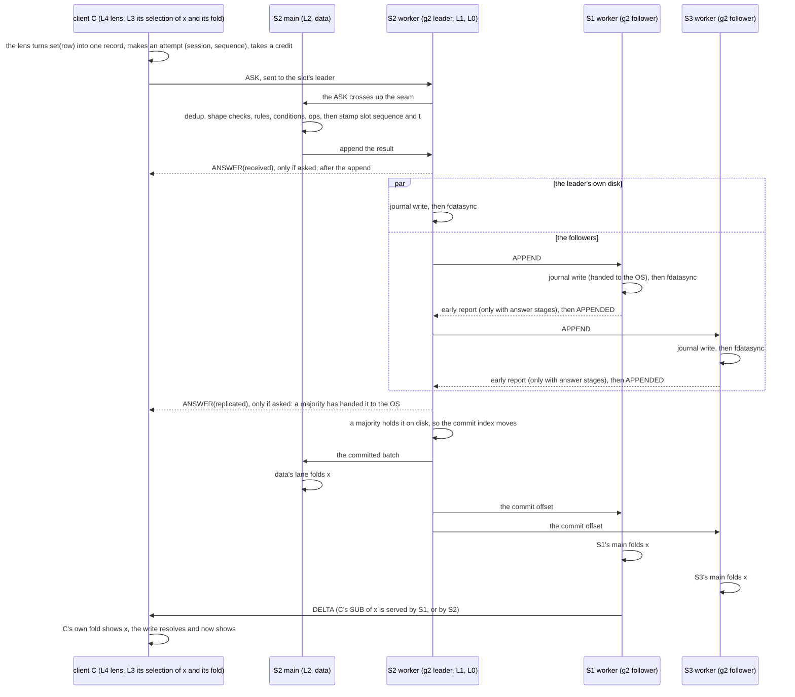
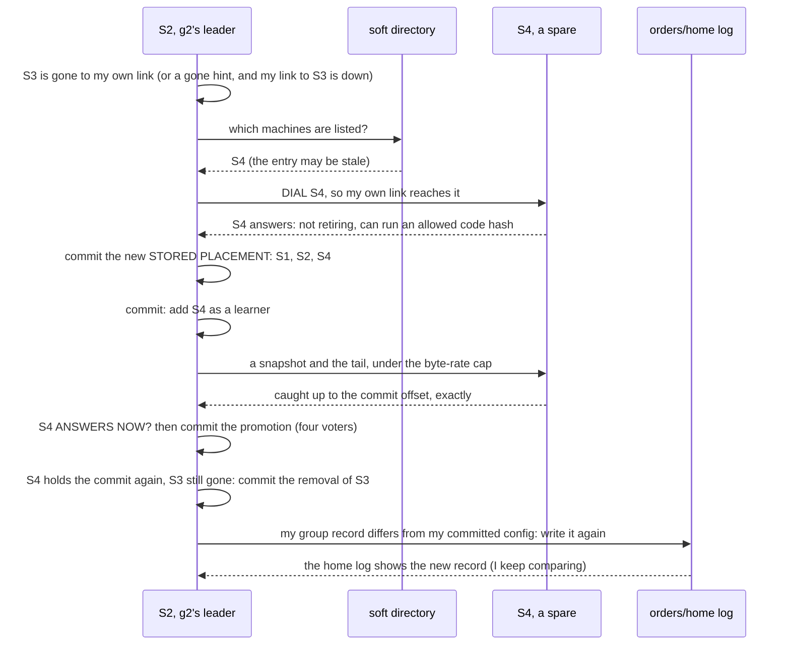
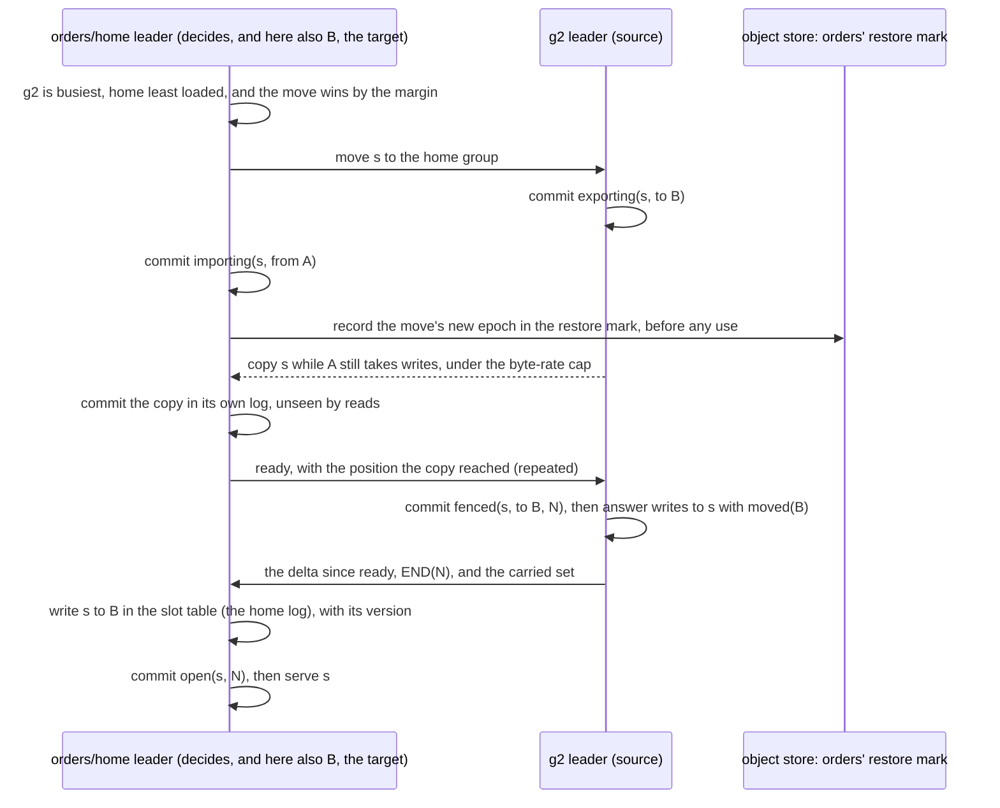
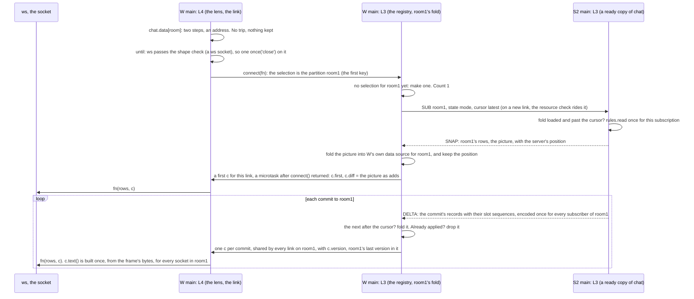

# fero v5: the layers of the chosen design

Rewritten 2026-11-16 for the design the owner chose ([DECISIONS V5-1 to V5-11][dec]; [VERDICT 11.7][v117]). Updated 2026-11-18 for V5-12, the connect lens ([LENS.md][lens]). **Updated 2026-11-20 for V5-13 to V5-15**: how code reads data (V5-13: [CONNECT.md][connect], with [READS.md][reads]'s picks 3 to 6), where transformations run (V5-14: [TRANSFORMS.md][transforms]), and reads and writes at any path (V5-15: [ANYPATH.md][anypath]). Amended the same day for V5-16: a sync read is `.value`, and only where it is sure. **Amended 2026-11-21 for V5-17**, the owner's answers to API.md's open questions: `past` comes in the first build, so its +3 rules join the first build's count (0.2), and the API.md picks this page carried are now decisions (section 10). The table "What V5-12 to V5-17 changed" below says where each change lands. **Amended 2026-11-23 for V5-20 to V5-22**: work over every row (the merger of [MERGE.md][merge]; `scan()`, folds and the `memory` bound of [EVERYROW.md][everyrow]), the thread that judges, exactly once from app code, where served views live, and a clean stop (V5-20, after [E-59] to [E-63]); compact rows (V5-21: none in the first build, six seams kept now; [COMPACT.md][compact]); and the merger's rule 4 and its rebuild floor (V5-22, [E-67]). The table "What V5-20 to V5-22 changed" below says where each lands. V5-18 (many groups from the first build) asks for a rewrite of this page for many groups; that rewrite is still owed. Until then this page names V5-18 where V5-20 to V5-22 change it or lean on it, and where its picks settle an item this page had open: the slot move in the slice, DEP-04 on a cold wake, the hand-back's cap and form, and readings of section 10. The page says what each layer does, what it keeps, its rules, its interface, its cost, and what is still owed. A builder should be able to work from it.

**This page replaces the COMP2 version** of 2026-11-11. Git history keeps that one (`git log -- docs/v5-space/LAYERS.md`). COMP2 was the study's earlier pick: Raft groups owned by the project, a `#meta` group, and one central loop. The owner set it aside (V5-2, V5-6).

**What changed from the COMP2 page.**

| COMP2's page | This page | Decision |
|---|---|---|
| Groups belong to the project and hold slots of many resources | Each resource has its own Raft groups. Its first group is its **home group** | V5-2 |
| `#meta` holds members, the catalogue, the slot table and the group records | No `#meta`. A resource's settings, slot table and group records are entries in its own **home log** (the home group's log) | V5-2 |
| One loop on `#meta`'s leader heals copies and moves slots | Each group's leader heals its own copies. The home group's leader moves the resource's slots | V5-2 |
| Members join `#meta`; clients find things through it | A **soft directory**: servers announce, it keeps no log and decides nothing, and a client learns the rest from the resource itself | V5-3 |
| One cluster id, created once | One id per resource, created on its first open. The opener writes a candidate id to disk first | V5-2, V5-10 |
| The `memory` rung as COMP2's next step | Every write commits on disk at a majority. Answer stages come second. The `memory` rung comes third, only for a timed need | V5-5, V5-11 |
| A write is forwarded to the leader | A linked client sends straight to its slot's leader. Forwarding stays for one-link clients | V5-9 |
| A crc32c per entry, in JavaScript | One native checksum per batch (CRC-32/IEEE), with the headers covered | V5-9 |
| Bulk work shares links and the disk freely | Bulk work is held to a byte rate, on the link and the disk | V5-9 |
| Hand-back at ten a second per member | At most 8 hand-back transfers in flight per member, busiest groups first, with one rule for a stalled transfer; 4 by default, pulled by the taker, since V5-18 pick 11 | V5-7, V5-10, V5-18 |
| DEP-13's 100 MB counted whatever a copy holds | An empty copy holds no resources. An idle resource has its own budget: about 8 KB resident, 2.5 KB dormant | V5-8 |
| Counted by mechanisms, novel ones and pairs (VERDICT's rule 3) | Counted by rules a builder must get right ([SIMPLICITY][simp]): 416 for this design | V5-6, V5-10 |

**What V5-12 to V5-17 changed on this page** (2026-11-18 to 2026-11-21). V5-12 made a path an address: a **lens** such as `orders.data.x` names a resource and a path in it and does no work, and reads, live links, methods and server work hang off it. V5-13 gave the lens four read verbs and positions. V5-14 said where each transformation runs. V5-15 said what reads and writes mean at any path. V5-16 kept a sync read only where it is sure. V5-17 answered API.md's open questions. Each row is one change; the last column says where this page has it.

| Before | Now | Decision | Where |
|---|---|---|---|
| L4 had no rules of its own | L4 has the read surface's rules: the lens, the read verbs, how links end, the line, methods by name, data's rule on every state form | V5-12, V5-13, V5-15 | 0.2, 5.4 |
| 416 rules | 416 counted, plus about +33 to +90 reasoned for the first build, and 13 items of V5-15 not yet priced: **449 to 506** (V5-20 to V5-22 add +51 to +86: 500 to 592; the next table, 0.2) | V5-12 to V5-17 | 0.2, 12 |
| A partition: a row key, a prefix, or a function | The first key. `depth: 1` (the default) makes it the row; `depth: 2` puts rows under it. The function comes later | V5-12 | 0.1, 3.2 |
| `follow`, a method's `.open()`; then (V5-12) `here()`, `tap`, a weak `connect(target, fn)` and `scope` | Four read verbs: `get()` once, `connect()` live (a handle, `connect(fn)`, or a loop), `changes()` the log, `past(pos)` as it was. Every link is strong and ends by the app's code: `disconnect()`, `{ signal }`, `{ until }`, `break`, or the count with a linger. No weak links; the collector never ends a link | V5-12, V5-13 picks 1 to 3 | 4, 5.4, 7, 8.10 |
| A commit has no id | Positions: inside one partition a **version** (short text such as `38S9`, `c.version`); across partitions a **cursor** (`c.cursor`); `-N` and a `Date` on the log forms. No Merkle trees | V5-13 pick 4 | 3.2, 4.2, 4.3 |
| A partition's rows read after its link ended: not said | They throw `ended` | V5-13 pick 5 | 5.4 |
| `asOf(position)`, a reader, outside the first build | `past(pos)`, a value inside one partition, walked with `for…of` and `step(n)`, with nothing to end; in the first build | V5-13 picks 1, 4; V5-17 | 0.2, 6.3 |
| `near`, a hint a client learns; root calls on `f.methods` | A call on a path goes to that path's leader. Root calls are `f.data.x(arg)`. A method declares where it may be called (`at:`), and a name that clashes with a fero word is refused where it is declared (`bad-name`) | V5-12, V5-13 pick 6 | 2.3, 3.3, 5.2, 7 |
| A served view as a method's call made live; `f.snapshot` | A served view is declared `{ view }`, and calling it gives an address. `f.snapshot` goes; `f.rows` stayed, until V5-16 | V5-13 pick 6 | 5.2, 7 |
| `f.rows` on a server and with `hold: 'all'`; `f.cluster.snapshot()`; `ctx.rows` | One sync read, `.value`, only where it is sure: a live handle, a `past`, and `f.cluster.value` (this process's own state). Every row is read in sync through `f.data.connect()`'s handle, on any role; a handler reads with `get()` | V5-16 | 0.2; 5.1, 5.2, 5.4, 5.6, 5.7; 6.3; 9.1, 9.4; 10 items 27, 45, 46; 12 |
| A cap on live served views per client and per resource | A cost-weighted cap of 64 per copy, with headroom. Each served view lives on one copy, chosen by a hash over every copy but the leader (V5-20 item 13 changes where: the next table) | V5-14 picks 2, 3 | 4.2, 4.3, 8.11 |
| Served views of any size | An ordered served view over 5,000 rows, or `{ pages }` over 2,000, is refused at build until data 5's ordered index (D8c). `{ pages }` is a third kind of method | V5-14 picks 1, 4 | 4.3, 5.2 |
| The source mark set by `derive`'s `out`; one form of `derive` | A write option `{ from: e }`, read back by `marks()`; the mark also carries the write's number in its record. `derive` has two forms: the record form, now also with rows, and the view form with a bump, a read barrier and the code version | V5-12, V5-14 pick 5, V5-15 pick 4 | 3.3, 6.3, 8.8 |
| Who runs a `derive`: open | The app's choice: `derive()` and `consumer()` split the source's shares, or the app takes a lock | V5-12 | 6.3, 8.8 |
| `changes()` takes the records "under" a lens | Every lens, a field too, has every read verb. The log forms take the records on the lens's path: at, below or above it. The state forms follow data's rule | V5-15 picks 1, 2 | 4.3, 5.4, 8.12 |
| A room cannot be written | `room.set(rows)` and `room.remove()`: one batch the leader expands into row records. The root stays refused | V5-15 pick 3 | 3.3, 8.12 |
| `if:` on a field judged by the row's version; data's fill-in of missing parents | One version per row. On a field, `equals`, `absent` and `present` are compared at the leader. One shape rule: `absent-path`, `bad-shape`, `bad-key` | V5-15 picks 5, 6 | 3.3, 8.12 |
| data owes D1 to D8 | data 5.0.0, one major version in TypeScript: D1 to D9 (D5 dropped), the merge contract C1 to C10, new operators and exports N1 to N9, and fixes | V5-12 pick 9, V5-14 pick 6 | 3.7, 11 |
| A `SUB` carried "a follow set" | A `SUB` carries a selection: a partition, the whole resource, or a served view; a log reader's start; later `{ path, ops }`. No new verb | V5-12 to V5-14 | 4, 7 |
| API.md's own picks where the records left room (its 11.1) | Decisions: the leader serves views when it is the only copy; `field-ttl` and `room-too-large`; the open links at `f.cluster.value.links`; `linger.ms` and the view caps kept as guesses | V5-17 | 5.2; 10 items 23, 30, 40, 43, 45, 46 |

**What V5-20 to V5-22 changed on this page** (2026-11-23). MERGE.md and EVERYROW.md designed work over every row past one process; E-59 to E-63 closed the models section 11 owed; COMPACT.md studied compact rows; E-67 ran the merger's rule 4 on seeds. The owner answered their questions one at a time. Each row is one change.

| Before | Now | Decision | Where |
|---|---|---|---|
| A whole-resource view: one entry on one copy, over that copy's rows; past one process, "E-23's merger", not covered (9.4) | The **merger** ships in the first build for every whole-resource view that merges: a partial per group, next to its rows, and one merger that adds them by key, at one cut. Rule 4 passed in form (a): a picture names every half of a slot move between its floor and its own place, and the merger installs it with each half's partner at one cut. A rebuilt merger starts every picture from one cut of the old merger | V5-20 item 1; V5-22 items 1, 2 | 0.2, 4.2, 4.3, 8.6, 8.11, 9.4 |
| One store fed by slot for every view over every row (R0 to R2, later) | No feature has a fixed row ceiling. A sync read of every row (`hold: 'all'`, a whole `connect()`) is bounded by this process's `memory`, counted as RSS: health warns at 80 %, a hold that will not fit is refused at open, a live hold past the line ends `not-held` and its rows are removed; near the line, whole-resource holds end first, then a server refuses writes `read-only`. A leader may hold a big full copy; health warns once a full collection there passes 0.5 s | V5-20 items 3, 8 | 3.2, 3.5, 5.2, 5.3 |
| One-time work over every row through a hold | **`scan()`**, a new read verb: pages from one copy of each group, no row ceiling, the asker's memory flat, at one cut by default (`cut: false` opts out) | V5-20 item 4 | 4.2, 4.3, 5.2 |
| Live code over every row through a hold; a live median on a hold | A **fold** per group: `emit` with one of fero's combines, added by the merger, checked now and then by an audit. A live median or quantile: a sorted column of that field at the merger, exact. Slow live views on a big hold are fixed in `data` 5 (chunked ordered views and quantiles) | V5-20 items 5, 6, 7 | 3.7, 4.3 |
| `derive`'s view form and `{ pages }` with no stated limit | A stated bucket limit for the view form and a fold (about 1.6e5 at 16 groups), then the record form; O4 next. `{ pages }` asks every group in one round. At a slot move the merger waits about one move window; keys by blocks of slots or a part for the moving slot are the fallbacks | V5-20 items 10, 11, 12; V5-22 item 5 | 4.3, 6.3, 9.4 |
| A group down: reads over every row wait (V5-18 pick 5) | A live merged view keeps serving with that group's part frozen at its last place; health names it; a one-time fresh read waits. It holds while the merger that holds the frozen part lives: a merger rebuilt while a group is down serves nothing new until the group is back. A pair whose partner is down waits | V5-20 item 2; V5-22 items 3, 4 | 4.3 |
| A served view on one copy, never the leader (V5-14 pick 3) | On any server that holds its rows, preferring one that leads no group of its resource; until `data` builds views in slices, a build can stall a leader's writes | V5-20 item 13 | 0.4, 2.4, 4.1 to 4.3, 7, 8.11, 10 item 40 |
| Judging on main: this page's reading, with a kill row | Judging stays on main, with a watchdog that hands a group's leadership to a peer when main stops answering. F-14 takes the loose reading. P-01 keeps its absolute bar on a quiet machine, with a relative pin on shared machines | V5-20 items 14, 15 | 0.4, 2.3, 3.4, 3.6, 10 item 1; 11 |
| A marked write skipped at its mark is "answered as done"; app code's loop shape not stated | A write refused on the row raises the mark and is final; refused `fenced` or `forbidden`, it leaves no mark. A skip answers `skipped`. `derive()` and `run()` await `fn`; a deriver joins each output slot in `#groups` before its first write there | V5-20 items 16 to 19 | 3.3, 6.2, 6.3, 8.8 |
| `view-too-big` "stays until the code changes"; the `view` selector owed, +4 to +6 | END `view-too-big` ends that served instance; after a reload or a failover a view may be built again, and if it fits it is served. The `view` selector, modelled by E-60, counts +7 (2 to 9) in the first build | V5-20 item 20, and E-60's pick | 0.2, 4.3, 7, 8.11 |
| A folded resume, modelled first | Modelled by E-60; it comes later, when restarted screens matter | V5-20 item 21 | 4.3, 9.4 |
| A clean stop: exit at `leave.ms`; a leave with no spare left open | The leaver stays in the config, absent. It exits once the voters left have the new config, can commit without it and hold every committed entry; at `leave.ms`, if nothing can carry the group without it, it stops as a crash would and the group waits for its restart; otherwise it waits while a hand-over can still finish. A leader that has appended its own removal takes no new write. Growth writes a placement of three whenever the placement names fewer | V5-20 items 22, 23 and its consequences | 2.3, 8.2, 8.9, 10 items 20 and 25; 11 |
| The row version's store owed, "beside the rows"; PA-1b's snapshots "in V8's format" | No compact row store in the first build, and six seams kept: fero reads rows only through `data`; snapshots and pictures name their format (rows as key, version and bytes); the row version is a column of `data`'s store; `data` 5's operators keep keys, not rows; `===` for object rows, `version` on compact sources; `data` 5's key index in small tables. A compact backing, later, sits inside `data` | V5-21 | 1.2, 3.2, 3.5, 3.7, 4.2, 9.2 |

**How each claim is marked.**
- **Model-checked**: every reachable state of a small model was explored (TLC, or an exhaustive Python model). **Simulated**: seeded runs. **Measured**: timed on the study's box. **Spec**: taken from etcd's Raft spec and code. **Code**: read in v4's or a prototype's source. **Checked**: a seeded run on a prototype, a probe, or tsc ran it, and its line is in that experiment's results. **Reasoned**: an argument; nothing ran it. **A guess**: nobody measured it.
- **E-NN** names an experiment; **V5-N** a decision; **PA-N** a finding of [PATHS][paths]; **A-NN** an amendment of [AMENDMENTS](AMENDMENTS.md). **LENS n**, **READS n**, **CONNECT n**, **TRANSFORMS n** and **ANYPATH n** are sections of those pages. **Claim n** is one of [E-55]'s 27 claims (the lens built small on `data`'s real engine). **E-56 probe n**, **E-57 A1** or **XB-1**, and **E-58 part n** name the parts of [E-56], [E-57] and [E-58]. A rule a prototype checked is still counted as reasoned: a prototype is not a model.
- **This page's reading** marks a gap the records leave, filled in here. Section 10 lists every one, with what the records leave unclear or say two ways.
- **Nothing here is built.** Section 11 lists what is owed before the first build slice.
- **API.md was rewritten for V5-13 to V5-15 the same day as this page.** This page works from the decisions and from CONNECT, TRANSFORMS and ANYPATH. Where it names an API.md section or question, that is the rewritten API.md, whose sections kept their numbers (section 10 item 45).

## 0. The stack at a glance

### 0.1 Words

- **Resource**: one `fero(name)`. It is its own small cluster (V5-2). **Project**: machines plus a name lookup (V5-2 point 5).
- **Slot**: one of 4,096 fixed hash buckets per resource ([A-16][a12]). A partition's key hashes to a slot. The user never sees slots. **Partition**: the unit of order: the rows one leader keeps in one order. It is always the first key of a row's path (V5-12 item 4). With `depth: 1`, the default, the first key is the row, so each row is its own partition. With `depth: 2`, `chat.data.room1.m7` is a row and `room1` its partition, called a **room** on this page. The user's function comes later (V5-2; V5-12).
- **Group**: one Raft group, holding some of a resource's slots. **Home group**: the resource's first group. **Home log**: its log. A small resource has only its home group (E-49).
- **Copy**: a full replica of a group. It stores and folds every record, as a **voter** or a **learner** (a copy that follows but does not vote; API.md's "standby"). **Member**: a process holding copies.
- **Fold**: `data` applying committed records to its rows. **Lane**: `data`'s fast entry for a batch of records.
- **Batch**: the records one leader appended together, under one header. **Record**: one change to one row: a key path and a value.
- **Soft directory**: a lookup table rebuilt from what servers announce (V5-3). **Seed**: a directory address a client starts from.
- **Preferred member**: the member that should lead a group when all are up. **Hand-back**: giving leadership back to it.
- **Main** and **worker**: a server's two JavaScript threads. The kernel (L0 and L1) runs on the worker. `data`, judging, flow and user code run on main (judging there by V5-20 item 14). A **watchdog** on the worker hands a group's leadership to a peer when main stops answering (3.4).
- **Lens** (V5-12): an address. `orders.data.x` names a resource and a path in it. Building it sends nothing, reads nothing and keeps nothing, and it is never a promise. A property read on it is a **step**; `f.at(key)` is the **key step**, for a key from input; a call on it is a **verb** or a method.
- **The four read verbs** (V5-13). `get()` reads once and holds nothing. `connect()` keeps the lens's partition live here: a handle, a callback (`connect(fn)`, which calls `fn(value, c)` on the picture and then once per commit) or a loop (`for await`). `changes()` is the log: every record from a place, then live; it waits for its reader. `past(pos)` is one partition as it was: a value, with nothing to end. `get`, a link's value and callback, a loop turn and `past(pos).value` are the **state forms**; `changes()`, a count back and stepping through a `past` are the **log forms**. V5-20 item 4 adds a fifth at the root, `scan()`: every row once, in pages (below).
- **Selection**: what one subscription brings into a process: a partition, the whole resource, or a served view. Equal lenses in one process share one selection.
- **Link**: one live connection from a selection to code, made by `connect`. Every link is strong. It ends only by the app's code (`disconnect()`, a `signal`, `until`, `break`) or when its selection's count reaches zero after a **linger**, a short wait. The collector never ends one (V5-13 pick 2).
- **Held on purpose**: rows a process keeps because it is a server, because of `hold: 'all'`, or because a live link names them (and while a `get({ when })` waits). Only these rows serve a read here.
- **Picture**: a selection's rows when a link starts. **Frame**: one commit's records on the wire. **Commit**, as a link sees it: one leader's batch, cut down to the rows the link reads.
- **Version** (V5-13 pick 4): a record's place in its partition's log, its slot's (epoch, sequence), written as short text that keeps log order under plain `<`, such as `38S9`. A row's version is that of its last write. A commit's id is the version of its last record in the partition (`c.version`). **Cursor**: a reader's place, the resource's id and one (epoch, sequence) per slot it reads (`c.cursor`). **`-N`**: N commits back, as a start for the log forms.
- **data's rule** (V5-15 pick 1): how `data`'s per-path reader treats a write. At or below the lens: a change relative to the lens. Above it: a change only when the lens's value changed (a new object counts). Beside it: nothing. **On the path** (V5-15 pick 2): the records at, below or above a lens, never beside it.
- **Served view** (V5-12, V5-14): a view over every row that the server names in `methods:` as `{ view }`, kept once for every equal call, on a server that holds its rows, preferring one that leads no group of its resource (V5-20 item 13). **`{ pages }`**: one sorted list the server names, read a page at a time. **Entry**: a copy's record of one served view. **Seen**: the highest position a client has seen, per slot.
- **Mark**: how far a reader got in a source, written in the same log entry as the output it caused (`{ from: e }`; [E-30]). Since [E-57] B5 it also carries the write's number within its source record.
- **Bump** and **read barrier** (V5-14 pick 5): a bump is a fenced no-op write that raises a deriver's lock token at a target group; a read barrier is a source position a new deriver folds up to before it writes.
- **The merge contract** (V5-14): rules in data 5 (C1 to C10) that make a view a function of its rows only, not of the order they came in.
- **Merger**, **partial** and **cut** (V5-20 item 1; [MERGE 1][merge]). A whole-resource view that merges is kept as one **partial** per group, worked out next to that group's rows, and one **merger** that adds the partials up by key. A **cut** is one position per group; the merged answer is the view over the rows at one cut, so no commit shows in part. A slot move reaches the merger as two **halves**: the source's fence and the target's open (or the source's unfence, when the target gives up). A partial's **host** is the copy that runs it; a **takeover** is another copy becoming the host, and a **rebuild** is a new merger. A host's **picture** is its whole partial at its place, sent after a takeover or to a rebuilt merger (a selection's picture, above, is the same idea for a link). Its **floor** is the place the halves it names start from: the merger's place for that group at a takeover, and one cut of the old merger at a rebuild ([E-67]). This floor is not a client's floor (4.2) or a source's (8.8).
- **`scan()`** (V5-20 item 4): a read verb for one-time work over every row: every row once, in pages, from one copy of each group, at one cut by default.
- **A fold over every row**, a **`{ fold }`** method (V5-20 item 5): live code over every row that the server names, written as `emit` (what one row adds) with one of fero's combines (`sum`, `count`, `min`, `max`, `top(k)`, `distinct`). Each group folds its piece and the merger adds the pieces. It is not a copy's fold of records (above).
- **`memory`** (V5-20 item 3): this process's memory bound, counted as RSS, the memory the box sees the process use, garbage and all.
- **"Follows"**, below the surface, means "subscribes to": one `SUB`, as when a writer follows `#sessions`. The app's `follow` verb is gone (V5-12).

### 0.2 The layers, with their rules

A **rule** is one thing a builder must get right ([SIMPLICITY 1][simp]). The design has 55 rule records and **416 rules** (318 to 524 at the records' low and high counts). 413 are fero's to write and 3 the operator's ([SIMPLICITY 3.1][simp31]; V5-10). By how each rule is known: 197 model-checked, 128 reasoned, 64 from Raft's spec, 26 read in code, 1 measured.

**The read surface and transformations add about +33 to +90 rules to the first build, so 449 to 506** (reasoned; summed on this page from the pages' own counts). Since V5-17 the `past` reader's +3 is among them. **V5-20 to V5-22 add about +51 to +86 more, so the first build is about 500 to 592** (this page's sum of the studies' counts, in the third table below; E-59's, E-60's and E-61's shares checked by their models, the rest reasoned). The 416 are the counted base, and stay as counted. The rest are not records in [simplicity.json][sjson]. **V5-15's changes are not priced yet**: 13 items, listed by layer. **GROUPS' +6 to +26 for many groups (V5-18) are not in this page's sum yet**: they come with the rewrite for many groups. The table gives the counts per layer; the next ones give them by source page.

| Layer | Its job | Thread in TypeScript | Records | Rules, counted (low to high) | How the rules are known | Read surface, V5-12, V5-13, V5-16 and V5-17 (reasoned) | Transformations, V5-14 (reasoned) | V5-20 to V5-22 (third table) | V5-15 (not priced) | First build, low to high |
|---|---|---|---|---|---|---|---|---|---|---|
| L0 storage and I/O | one journal per process, segments, the object store, links, the handshake, disk checks | kernel worker; a journal thread or pool hop for the fsync; a lease thread | 11 | 78 (54 to 97) | 54 reasoned, 12 model-checked, 12 code | 0 | 0 | 0 | 0 | 78 |
| L1 the log | Raft per group; the home log's records; founding and growth; the soft directory; healing; hand-back; a clean stop; slots and moves; routing; the watchdog's hand-over | kernel worker | 26 | 183 (139 to 238) | 89 model-checked, 64 spec, 29 reasoned, 1 measured | 0 | 0 | +10 to +12 | 0 | 193 to 195 |
| L2 fold and ops | judging writes, sessions, writer time, `data`'s fold, answer stages, marks, a call's path, the shape rule, room writes, field guards | main (V5-20 item 14; section 10 item 1) | 11 | 72 (56 to 92) | 38 reasoned, 34 model-checked | +1 to +4 | 0 to +1 | +3 to +4 | 5 items | 76 to 81 |
| L3 flow | subscribe, credits, the `none` rung, shared selections, positions, log readers, served views, the merger, scans, folds | main, or a link-and-flow thread (open; section 10 item 2) | 3 | 33 (24 to 40) | 26 model-checked, 7 reasoned | +5 to +12 | +15 to +31 | +29 to +57 | 2 items | 82 to 133 |
| L4 the surface | `fero()`, the lens, the read verbs and links, writes, methods, `memory`, config ([API.md][api]) | main | 0 | 0: no record of its own in the base | — | +6 to +24 | +2 to +5 | +4 to +7 | 5 items | 12 to 36 |
| L5 libraries | locks, sagas, queues, consumer groups, `derive` in two forms, the `past` reader, gateways, the CLI | main | 4 | 50 (45 to 57) | 36 model-checked, 14 code | 0 to +5 | +4 to +8 | +5 to +6 | 1 item | 59 to 69 |
| **All** | | | **55** | **416 (318 to 524)** | | **+12 to +45** | **+21 to +45, about +26** | **+51 to +86** | **13 items** | **500 to 592** |

**By source page** (each count is the page's own, marked reasoned there; the split by layer is this page's reading, section 10 items 26 and 36):

| Source | Against | L2 | L3 | L4 | L5 | Net |
|---|---|---|---|---|---|---|
| [LENS 4.4][lens], the first build (V5-12) | API.md's earlier shape | +1 to +4 | +3 to +4 | +8 to +10 | 0 | +12 to +18 |
| [READS 7][reads] (V5-13 takes its picks 3 to 6, and its base) | LENS 4.4's rows | 0 | +1 | −3 to +6 | 0 | −2 to +7 |
| [CONNECT 8.5][connect] (V5-13) | READS's pick | 0 | +1 to +7 | +2 to +7 | −3 to +2 | 0 to +16 |
| V5-16, this page's count (5.4) | CONNECT's pick | 0 | 0 | −1 to +1 | 0 | −1 to +1 |
| the `past` reader, LENS 4.4's `asOf` row (V5-17 puts it in the first build; 6.3) | — | 0 | 0 | 0 | +3 | +3 |
| *the read surface, summed* | the 416 | *+1 to +4* | *+5 to +12* | *+6 to +24* | *0 to +5* | ***+12 to +45*** (CONNECT 8.5's own sum, +10 to +41, with V5-16's and the `past` reader's) |
| [TRANSFORMS 8.3][transforms], the first build (V5-14) | the 416, without LENS's rows | 0 to +1 | +15 to +31 | +2 to +5 | +4 to +8 | **+21 to +45**, about +26 |
| [ANYPATH][anypath] (V5-15) | — | 5 items | 2 items | 5 items | 1 item | **not priced** |
| **the read surface and transformations** | | **+1 to +5** | **+20 to +43** | **+8 to +29** | **+4 to +13** | **+33 to +90: 449 to 506** |

**V5-20 to V5-22, by source** (each count is the study's own; the layer is this page's reading, section 10 item 47):

| Source | Layer | The rules, in short | Rules | How known |
|---|---|---|---|---|
| [E-59]: growth from one voter and a clean stop (V5-20 items 22, 23 and its consequences; 2.3, 8.9) | L1 | growth's four rules (2.3 rules 1 to 4, rule 1 as V5-20 changes it); the exit with its checks and its bound at `leave.ms` (8.9 B4); the only voter's leave; V4-60's dead voter removed first; a leader that has appended its own removal takes no new write. E-59 needs 9 of this page's rules; 8.9 B1 is `meta-members`', already in the 416 | +8 | checked: E-59, each dropped whole, at this page's grain |
| [E-63]'s watchdog, M3 (V5-20 item 14; 3.4) | L1 | main pinged from the worker; a leader whose main is silent for W hands its leaderships over; a stalled main takes no leadership; the hand-over's waits; a deposed leader drops its main's late results | +2 to +4 | reasoned (E-63); the gap measured |
| [E-61]: refusals and skips (V5-20 items 16, 17; 3.3) | L2 | a write refused on the row raises the mark; a write at or below the mark is never judged again; a skip answers `skipped` | +3 | checked: E-61, each needed alone |
| V5-21: fero reads rows only through `data` (COMPACT 5 fix 1; 3.2) | L2 | no fero code keeps `data`'s row objects, compares rows by identity, or dumps them | 0 to +1 | reasoned |
| [E-60]: the `view` selector (V5-20 takes E-60's count; 4.3) | L3 | `seen` from the write's answer, a picture, a ring resume and a frame; END told apart, ending the link, never followed by a new `SUB` | +7 (2 to 9) | checked: each needed alone in the design |
| MERGE, the merger (V5-20 item 1; V5-22; 4.3) | L3 | partials and the merger; rule 2's real form; rule 4 in form (a); the rebuild floor; a pair whose partner is down waits; health names held groups | +11 to +18 net (V5-22 item 6) | reasoned; E-67 checked the rules on seeds |
| EVERYROW: `scan()` at one cut, with its image budget (V5-20 item 4; 4.3) | L3 | pages from one copy of each group, each group pinned; a pin keeps before-images up to an image budget, past it `scan-lost` | +9 to +19 | reasoned |
| EVERYROW: folds with fero's combines, and the merger audit (V5-20 item 5; 4.3) | L3 | `emit` with one of fero's combines, a piece per group, added by the merger; an audit rebuilds the answer now and then | +4 to +6 | reasoned |
| EVERYROW: the sorted column at the merger (V5-20 item 6; 4.3) | L3 | one field's values in sorted chunks, a part per group, at the merger | +3 to +5 | reasoned |
| EVERYROW: the budget by RSS (V5-20 item 3; 5.2), less MERGE's one-process ceiling rule | L4 | the guard, its order with a server's `read-only`, `gc()` without a node flag, which hold ends when several share it | +4 to +7 | reasoned |
| [E-61]: the loop's rules (V5-20 items 18, 19 and the picks it took; 6.3) | L5 | `derive()` and `run()` await `fn` (2); run()'s cursor never moves back; an `expired` reader reads its marks again and jumps to them (2); joined slots (0 to 1) | +5 to +6 | checked (E-61), the joined slots reasoned |
| **V5-20 to V5-22** | | | **+51 to +86** | |
| **the first build** | | | **+84 to +176: 500 to 592** | |

- **With TRANSFORMS' central +26** the read surface and transformations come to about 454 to 487 (416 + 12 + 26 and 416 + 45 + 26; arithmetic).
- **Where V5-20 to V5-22's counts overlap** (reasoned). MERGE's count overlaps GROUPS' rows V1, G5 and P4 (MERGE 6), which this page does not carry yet. EVERYROW counts over MERGE's pick, and takes away MERGE's one-process ceiling rule. MERGE and EVERYROW counted against "446 to 503", the first build before V5-17 put the `past` reader in; this page adds their nets to its own 449 to 506. E-61's issue order for refusals and bare marks is inside `issue-order`'s owed 3 rules (below).
- **Where the counts overlap** (section 10 item 37). LENS's "closable kinds" row and READS's `until` shape check are one rule counted twice, by 0 to 1. TRANSFORMS counts no row LENS already counts: the cap's base row stays LENS's (now per copy), and TRANSFORMS adds only its weighting, placement and headroom; the order channel moves from LENS's later class B into the first build, and class B later drops to +4. READS's "a version on each diff entry" and CONNECT's `c.version` both rest on a per-row version store that neither prices (CONNECT 3.6); V5-21 makes it a column of `data`'s store, at 0 new rules (COMPACT 5 fix 3; 3.2). CONNECT's five `past` rows (−3 to +2, L5) change a reader whose own +3 (LENS's `asOf` row) V5-12 left outside the first build. V5-17 puts that reader in the first build, so its +3 counts there too: the `past` reader is 0 to +5 on its own, inside the read surface's +12 to +45.
- **Not yet priced** (V5-15; ANYPATH 5). L2: the shape rule (`absent-path`, `bad-shape`, `bad-key`); a room write expanded at the leader, with a size rule; field guards compared at the leader; `op.merge` as field records; no `ttl` or `while` on a field write. L3: the "on the path" log reader below a row; `-N` on a field, found by reading the row's log back. L4: data's rule on every state form, with a link that skips a value equal to the last; `partition` on every diff entry; a depth-2 commit cut to the link's rows; `c.recs()` from the log's bytes; `room.set` and `room.remove` as the only room writes. L5: the record form with rows, and its dev warning. At 0 to +1 rule each they would add about 0 to +13 *(a guess)*. The per-row version store, unpriced by CONNECT 3.6, is a column of `data`'s store since V5-21: 0 new rules (COMPACT 5 fix 3), timed by E-62 (3.2). (TRANSFORMS listed the record form with rows as later and did not count it; it is the L5 item above.)
- **Outside the first build** (each reasoned): class B (+4, 3 to 6; TRANSFORMS 8.3); the past folded per data build (+1, 1 to 2); a folded resume, `connect({ resume })` (+2 to +3; CONNECT 10 Q3; modelled by E-60 at +2 by DEV-10, +3 grouped; later by V5-20 item 21); the browser build (+1); and V5-20 to V5-22's later steps: author-written combines, histograms per group, O4, the two-round `{ pages }`, a fallback for the move's wait, a standby merger and a compact backing (9.4). The `view` selector is now modelled and in the first build's count (E-60; 4.3). R0 to R2 come into the first build with several groups (V5-18 pick 1), for a sync read of every row and for live code that is not a fold (V5-20 items 3 and 5; EVERYROW 5; 3.2); their +2 (1 to 4) is inside GROUPS' +6 to +26.
- **A user learns seven rules to read** (CONNECT 8.5) **and ten for transformations** (TRANSFORMS 8.4). V5-20 adds about +2 to +5 (EVERYROW 5: a hold is bounded by `memory`; one pass over every row is a scan; live code over every row is a fold), and E-61's two rules for app code in a `derive()` or `run()` loop: for one record, the same writes in the same order on every run, and every write made before `fn`'s promise settles (in the docs, with a dev check later; V5-20's picks). They are not builder rules and are in no count here.
- **Two records are owed and not in the 416.** With them the base has **421 rules** ([SIMPLICITY 3.4][simp]).
  - `issue-order` (3 rules: each writer numbers its writes to a partition, O.seq, A-10). **The first build owes it, whatever the answer stages.** A client that sends writes without awaiting each one needs it under `persisted` alone (model-checked, [E-48]). The prototype broke the order in 12 of 100 seeds ([E-45]). API.md promises this order from the first build (its section 7, "Order of issue").
  - `timeline-merge` (2 rules: V5-4's viewer).
- **More rules are counted in no record**: growing a group from one voter to three, two voters stepping back to one, and dropping a gone learner (2.3, "Growing from one voter"), and a clean stop's exit (8.9). E-59 model-checked them, and this page counts them in V5-20's row above (+8); they are still not records in simplicity.json. `slot-table`'s count is also up to 4 low for this shape (2.3).
- **"Model-checked" is SIMPLICITY's basis field.** It counts `writer-time`'s 6 rules, which ran as seeded simulations and not over every state ([E-21]). So L2's 34 is 28 rules explored in full and 6 simulated, and the 197 holds those 6 too.
- **Pairs are not recomputed.** The COMP2 page counted interacting pairs. The closure tool has no record for the soft directory, answer stages or the hand-back, and V5-6 compares designs by rules. So this page gives rules only.
- **At a native step** (section 9) L0 and L1 would move to Rust. L2 to L5 and `data` stay JavaScript (V5-14 pick 6: data 5 needs no Rust).

### 0.3 Where each decision lands on this page

| Decision | In short | Where |
|---|---|---|
| V5-1 | The log is the truth; state is its fold | 2.1, 3.1, 4.1 |
| V5-2 | A resource is its own cluster | 2.2 to 2.4; walk-throughs 8.2, 8.4, 8.6, 8.8 |
| V5-3 | A soft directory | 2.3 (soft directory), 8.3 |
| V5-4 | One timeline by writer time | 3.3 (writer time), 4.4 |
| V5-5 | One commit point; answer stages second; the `memory` rung third | 3.3 (answer stages), 8.1, 9.1 |
| V5-6 | The base, counted by rules | 0.2, every rules table |
| V5-7, V5-10 | Random timers; hand-back cap 8 with its rule (4 by default since V5-18 pick 11) | 2.3 (hand-back), 2.5 (DEP-04), 8.5 |
| V5-8 | Budgets per idle resource | 2.5 |
| V5-9 | Direct routing, the batch checksum, the byte-rate cap | 2.3 (routing), 1.3, 1.4 |
| V5-10 | Nine fixes from the models | the table below |
| V5-11 | Answer stages are progress reports | 3.3 (the eight rulings), 8.1 |
| V5-12 | The connect lens: a path is an address; reads, live links, methods and server work hang off it | 0.2; 2.3 (a call routed by its path); 3.2, 3.3 (keys under `depth`, marks, a call's path); 4.2, 4.3 (shared selections, coverage, resume); 5; 6.3 (who runs `derive`); 7; 8.1, 8.3, 8.8, 8.10; 11 |
| V5-13 | Four read verbs; links ended by the app's code, no weak links; positions; `ended`; root methods on `f.data`; `{ view }`; `f.snapshot` gone | 0.2; 2.3 (root calls); 3.2 (the row version); 4.2, 4.3 (positions, `-N`, a `Date`, log readers); 5 (the verbs, lifetimes, `ended`); 6.3 (`past`); 7; 8.1, 8.10; 9.4; 10 items 36 to 45; 11 |
| V5-14 | Where each transformation runs; served views on one copy off the leader, a cost-weighted cap with headroom, refusals until data 5's index; `{ pages }`; `derive`'s view form; data 5.0.0 | 0.2; 3.2, 3.7 (the merge contract, data 5); 4.2, 4.3 (served views, pages); 5.2 (`lookup`, bucket answers); 6.3 (`derive`'s two forms); 7; 8.8, 8.11; 11 |
| V5-15 | data's rule for the state forms; the log forms on the path; room writes; the record form with rows; field guards; one shape rule; the small ones | 0.2; 3.2, 3.3 (room writes, guards, the shape rule, `op.merge`); 4.3 (the reader on the path, `-N`); 5.4 (data's rule; diff entries; `c.recs()`); 6.3 (the record form with rows); 8.12; 11 |
| V5-16 | One sync read, `.value`, only where it is sure: `f.rows`, `ctx.rows` and the cluster's `snapshot()` go; `f.cluster.value` | 0.2; 5.1 (removed); 5.2 (the handle, `cluster`); 5.4 (V5-16's rows); 5.6, 5.7 (the hot read, owed items); 6.3 (`past`); 9.1, 9.4 (the counts); 10 items 27, 45, 46; 12 |
| V5-17 | The owner's answers to API.md's open questions: `past` in the first build; `field-ttl` and `room-too-large`; `f.cluster.value.links`; the leader serves views when it is the only copy. A service's thrown request is taken again: a library rule, API.md's | 0.2, 6.3, 9.1, 9.4, 12 (`past` and the counts); 5.2 (`cluster`); 10 items 23, 30, 32, 33, 37, 40, 43, 45, 46; 11 |
| V5-18 | Many groups from the first build. This page is not yet rewritten for it. It is named where V5-20 to V5-22 change or lean on it (pick 5 for live merged views; pick 1, several groups, for R0 to R2 and a merged `best`), and where its picks settle an item this page had open: the slot move in the slice (picks 1 and 4), DEP-04 (pick 10), the hand-back's cap and form (pick 11), system resources (pick 12), the door's secret (pick 13), and this page's protocol readings (pick 14) | 0.2; 2.3 (hand-back), 2.5, 2.6; 3.2; 4.3; 5.3; 8.5, 8.6, 8.11; 9.4; 10 (its opening, items 6 and 12); 11 |
| V5-20 | Work over every row: the merger, no row ceiling, `memory`, `scan()`, folds, a live median, chunked views in `data` 5, big holds on leaders, the bucket limit, `{ pages }` in one round, the wait at a move; where served views live; judging on main with a watchdog; P-01; marks from app code; END per entry; the folded resume later; a clean stop; growth writes three | 0.1, 0.2, 0.4; 2.3 (growth); 3.2, 3.3, 3.4, 3.5, 3.6, 3.7; 4.1 to 4.6; 5.2, 5.3, 5.4, 5.7; 6.1 to 6.4; 7; 8.2, 8.6, 8.8, 8.9, 8.11; 9.1, 9.4; 10 items 1, 20, 21, 25, 40, 46 to 50; 11; 12 |
| V5-21 | Answers V5-20 item 9's study ([COMPACT.md][compact]): no compact row store in the first build; six seams now; a later one inside `data` | 0.2, 1.2, 3.2, 3.5, 3.7, 4.2, 9.2, 9.4, 11 |
| V5-22 | The merger's rule 4 passes in form (a); a rebuilt merger's floor; a pair whose partner is down waits; the gap through a rebuild; a second fallback for the move's wait; MERGE's count | 0.2, 4.2, 4.3, 4.6, 8.6, 9.4, 11 |

**The nine fixes of V5-10.**

| # | Fix | From | Where |
|---|---|---|---|
| 1 | An opener writes a candidate id to disk before the store's create, and founds only if the stored id is its own | E-51 | 2.3 (founding), 8.2 |
| 2 | A client asks the directory again once every member it learned has failed | E-51 | 2.3 (soft directory), 8.3 |
| 3 | A group's leader writes its record whenever the home log's record differs from its committed config | E-51 | 2.3 (group records), 8.4 |
| 4 | The design states how the home group's own recovery window ends | E-51 | 2.3 (group records) |
| 5 | The seed mark goes: the seed rides the founding entry | E-51 | 2.3 (founding, settings) |
| 6 | Promote only a learner that answers the leader now | E-52 | 2.3 (healing), 8.4 |
| 7 | When the preferred member leaves, a placed voter becomes preferred | E-52 | 2.3 (hand-back), 8.5 |
| 8 | Dial a spare the directory lists before using it | E-52 | 2.3 (healing), 8.4 |
| 9 | A lead hint moves leadership itself, never to a draining or leaving machine | E-52 | 2.3 (hints) |

**Build traps** ([PATHS 0][paths0]; and since V5-12, the prototypes). The design's text already avoids these. A builder who ports v4's code, or a prototype's shortcut, would bring them back. Each is noted where it bites.

| Trap | Where |
|---|---|
| The leader's fsync before its sends | 1.4, 8.1 step 6 |
| A record encoded again for each link, the journal and each subscriber | 1.4, 4.4 |
| A lane call per record | 3.4 |
| v4's kernel copy of every cell and its state hash (about 2 µs a record on every copy, PA-10) | 2.4 |
| Two pool hops per flush (PA-2) | 1.4 |
| Crossings through main for bytes nobody on main reads (PA-3) | 4.4 |
| 7 to 8 KB of garbage a record (PA-13) | 5.6 |
| A lens that keeps its children: `data`'s handle today keeps 318 to 1,333 B per key for its parent's life (LENS 2.1) | 5.6 |
| A dense slot table, a timer or a socket per resource, v4's directory as written (E-49) | 2.5 |
| A listener per link on one signal: 1.9 to 7.2 µs to add one at 1,000 links, 19 µs at 10,000, where one listener per signal costs 0.11 to 0.16 µs a link (E-56 probe 4b) | 5.6 |
| `get()` built as a one-time `connect`: 65,671 B and 1,000 rows folded to read one number, against 1 B by a GET (E-56 probe 1) | 5.4 |
| A served view per page cursor: 0.7 to 8.3 MB a page, refused by the 17th page (E-57 XA-7) | 4.3 |
| A view built in one block, or on a group's leader: 0.49 to 1.9 s of one thread at 10^6 rows (E-57 XA-1) | 4.3 |
| `c.recs()` built from `data`'s merged rows instead of the log's bytes (ANYPATH T10) | 4.4, 5.5 |

### 0.4 The processes and threads of one project

One project with three servers. Each server is the app's own Node process with fero inside it. The resources here are `orders` (two groups) and `totals` (one group, derived from `orders`).

```
 clients: other app processes with a bare fero(name), browsers and edge workers over WebSocket
          each one folds with data what its live links hold (connect): nothing until then
          a linked client sends each write, and each call on a path, to its slot's leader;
          a one-link client is forwarded. A served view's SUB goes to the one server its key hashes to
          (a merged view's to its merger); a scan reads pages from one copy of each group
                                    │ ASK · SUB · ANSWER · DELTA
 ┌──────────────── server S1: the app's own Node process (S2 and S3 are the same) ───────────────┐
 │ main thread    app code, the lens and methods (L4), L5 libraries and gateways, L3 serving,    │
 │                served views and partials placed on S1 (preferring a server that leads         │
 │                no group of their resource), mergers placed on S1, scans' pages and pins,      │
 │                L2: judging on groups S1 leads, data's fold of every group S1 holds            │
 │ kernel worker  L1: Raft for every group S1 holds; for groups it leads: healing, hand-back,    │
 │                    its group record; for home groups it leads: slot moves                     │
 │                    the watchdog: main silent for W -> hand the groups S1 leads to a peer      │
 │                L0: the journal, segments, member links, link pings, the recorder              │
 │                the soft directory: announces S1's copies to every seed; may host a directory  │
 │ other threads  one hop for fdatasync (a journal thread or libuv's pool) · a lease thread      │
 │ dir            journal + reserve · segments · snapshots · boot record · lock file             │
 │                per resource: its id (or a candidate id, before founding)                      │
 └────────────────────────────────────────────────────────────────────────────────────────────────┘
 groups (each one Raft log; 3 voters on S1, S2, S3, plus learners up to `standbys`):
   orders/home   S1 leads   settings, slot table, group records, version; and some of orders' slots
   orders/g2     S2 leads   the rest of orders' slots
   totals/home   S3 leads   every slot of totals; its outputs carry how far it read in orders
 object store (S3 or compatible; a local folder on one box):
   per resource: its id · its restore mark · old segments · snapshot layers
 soft directory (any machine can host it; clients start from seeds):
   project + resource name → the addresses of the servers that hold a copy; and each machine
```

- **What resources share**: the machines, the journal and its fsync (E-12), the links, the directory (V5-2), and fero's system resources.
- **`#sessions` is a dependency of every resource.** A group's writer applies a write only while the write's session lives in `#sessions`, and follows `#sessions` to remove a lapsed session's rows (`client-sessions`' `apply.live` and `expired.dead`; `presence-rows` rule 6). So while `#sessions` has no majority, no new client can start writing to any resource (reasoned; section 10 item 5). `#calls` serves every `once` call and `#locks` every lock, for all resources (API.md section 7); a write that uses neither does not wait on them. A deriver's lock row lives in `#locks` too (6.2).
- **On one box** the founder is a group's only voter until other server processes of that name join. With three such processes the group has three voters, as in v4's example 01 ([DESIGN-V5 4.2][d42]; API.md 3.1). The store is a local folder. With three processes a served view lives on a copy that holds its rows, preferring one that leads no group of its resource (V5-20 item 13; 4.3). With one, the leader is the only copy, and it serves the views (V5-17; section 10 item 40).
- **System resources** (`#sessions`, `#locks`, `#sagas`, `#groups`, `#calls`) are resources like any other, each with its own home group. Any process that serves a resource serves them too (this page's reading and API.md's; section 10 item 5).

## 1. L0: storage and I/O

### 1.1 What it does

L0 keeps bytes safe and moves them. It writes every group's entries into one journal per process and fsyncs them in batches. It talks to peers and to the object store, runs the handshake, and checks the disk at boot ([DESIGN-V5 4.1][d41]).

### 1.2 The state it keeps

| Record | Fields | Where it lives | Who writes it |
|---|---|---|---|
| Journal row | a row header (group, kind: batch, term and vote, cut; a chained sequence number; its own small checksum), then the batch bytes | the process's journal, in preallocated segments | L0, for L1 |
| Batch | a header (term, base offset, group, writer time), the records, and one CRC-32/IEEE over all of it | the journal row; the wire carries the same bytes | the group's leader, once |
| Cut record | group, last offset kept | the journal | a follower whose tail a new leader replaces |
| Group segment | a group's entries, with indexes by offset, slot and partition | files per group in the dir, as drafted (2.5 gives the cost) | L0, after the journal fsync that covers them |
| Reserve segment | at least 1 MiB kept for removes, votes, member changes, handovers and retention marks | the dir | L0 ([E-29]) |
| Local snapshot | the folded rows at one offset, with L2's tables beside them, in a format the snapshot names: rows as key, version and bytes, never a dump of V8's objects (V5-21 item 1) | the dir | each copy, for its own restarts |
| Boot record | per dir: the lease epoch, the retired folder and its end offset, a disk incarnation (a random id) | the dir | each new lease holder |
| Resource id | per resource: nothing, a **candidate id**, an adopted id, or the id of a copy it holds | the dir | the opener (2.3, founding) |
| Dir lease | a lock file (pid, host, start), touched from its own thread; the epoch in every file name; `retired-<epoch>` folders | the dir | the process that holds the dir |
| Bad mark | per batch whose checksum failed | the copy | L0, when it reads a bad batch |
| Recorder tape | every kernel input; bulk bytes by journal reference | per process | the kernel, before it steps on each input |
| Resource id object | one object per (project, resource name), created once with `If-None-Match` | the object store | the founding opener |
| Restore mark | per resource: the highest slot epoch ever used; a session generation | the object store | a slot move (before it uses a new epoch); a restore |
| Old segments, snapshot layers | named by (group incarnation, offset); a layer names its format, as a local snapshot does (V5-21 item 1) | the object store | the group's leader, put-if-absent, then named in the group's log |
| Not durable | link state per member pair; the byte-rate cap's budget; the durable mark (the journal offset the last fsync started from) | memory | the kernel |

Sources: [DESIGN-V5 4.1][d41]; V5-9; [simplicity.json][sjson]. That the restore mark is per resource is this page's reading (section 10 item 8).

### 1.3 Its rules

Counts are "rules (low to high)" from [simplicity.json][sjson], where each record lists its rules in full.

| Record | The rules, in short | Rules | How known |
|---|---|---|---|
| `journal` | One write stream, so batches never land swapped. An fsync covers only bytes written before it began. A chained sequence number per batch; recovery stops at the first gap. A torn tail is cut. A cut record before a replaced tail. Segments are written from synced entries. The journal is cut only once segments cover it. Folder fsyncs. One failed fsync condemns the store. The reserve takes no data. An unreadable row taints every group after it | 16 (10 to 18) | reasoned; measured in part: 2,640 power cuts lost 0 of 10,020 acknowledged batches ([E-29]); [E-12], [E-02] |
| `batch-checksum` (V5-9) | One CRC-32/IEEE per batch (Node's native `zlib.crc32`), made where the batch is made and checked once per receiver. It covers the term, base offset, group and writer time. The journal row header has its own small checksum and keeps the chain. So every byte that boot, `par` or the disk check trusts sits under a checksum | 1 (1 to 2) | reasoned (PA-1a); no model yet |
| `disk-incarnation` | A checksum finds damage below the tail, and the copy marks it bad for `par`. A new or wiped disk never votes as the copy it replaced (that rule is counted in `raft-config`) | 1 (1 to 3) | model-checked ([E-37]) |
| `par-repair` | A copy with a bad batch grants no vote and does not stand. It repairs only from a peer whose own copy is good and whose commit covers it. The repair copies the batch and clears the mark | 6 (6 to 8) | model-checked on three voters, with "entry" where this page says "batch": 8 of 9 mutants caught ([E-37]) |
| `bulk-rate-cap` (V5-9) | Bulk work (a catch-up, a snapshot install, a move's copy, a roll's catch-up) is held to a byte rate on the link and on the disk. On a member link it goes in chunks of 64 KB or less, queued behind live frames | 1 (1 to 3) | reasoned (PA-6); no run yet |
| `dir-lease` | One process per data folder. The lock is taken atomically, before the boot record is read. A holder is judged by its pid or its lease. The toucher runs on its own thread. A takeover runs under a marker. Each holder writes only files of its own epoch and reads the old epoch's read-only, never past its end | 18 (12 to 22) | code: v4's `shell/runtime.ts` and V4-59's 20 mutations |
| `tier` | Uploads are put-if-absent, and named in the log only after the put is confirmed. Layers carry removal markers. Only a merged base or a full snapshot lets the log be dropped. Nothing a move, a fork or a reader still names is deleted | 10 (6 to 13) | reasoned; not modelled |
| `restore-mark` | A move records its new epoch in the mark before use. A restore takes an epoch above the mark and a new session generation. A retry from an older session and a cursor the history lacks are refused | 5 (5 to 6) | model-checked, every mutant caught, the store always up ([E-33]) |
| `input-recorder` | Every kernel input is recorded whole, in order, before the kernel steps on it. Bulk bytes go by journal reference, and the journal is kept for the recorder's window | 4 (3 to 5) | reasoned; measured: 18 of 18 recordings replayed byte for byte ([E-42]) |
| `link-pings` | Two members that share a group ping every `ping.ms` when no other frame went that way. Any frame is a sign of life. A peer silent past `evict.after` is gone to this member, until it answers again | 4 (3 to 5) | reasoned; measured cost ([E-11], [E-25], [E-49]) |
| `cluster-credentials` | The handshake: a nonce each way, an HMAC proof that cannot be replayed, a constant-time check, a secret refused against none. Member verbs only on links that passed the door. Certificates and revocations checked at every handshake. The CA key, join tokens and revocations are the operator's (3 of the 12) | 12 (6 to 12) | reasoned; rules 1 to 4 are v4's `kernel/door.ts` (V4-30) |

**V5-9's guards**, as [PATHS 7.1 and 7.2][paths7] state them:
- **The checksum is per batch, never per record.** Called once per 100 B record, the native checksum costs 213 to 231 ns, as slow as JavaScript (measured, E-50). It is a format change from v4's crc32c (DEV-09). Only the wire's per-link fields sit outside it, under the frame header's own checksum.
- **`par`'s unit becomes a batch.** E-37's model must be read again with "entry" as "batch", with a damaged header among its cases (owed).
- **The cap goes on both the link and the disk.** A side file is taken only if a run shows it helps. The run is owed: a 4 MB catch-up beside live writes ([PATHS 7.3][paths7]).

### 1.4 Its interface

- **Up to L1.** L0 hands the kernel its input events: a frame received (after `HELLO` and `DOOR`), a tick, an fsync done, a store call done, the boot replay, a bad batch found. L0 to L3 take events and return effects, so the simulator runs them unchanged ([DESIGN-V5 4][d4]).
- **Down from L1.** Write a batch, a term and vote, or a cut. Read from an offset, or one slot's entries for a move. Cut or install a snapshot. Upload a segment. Send a frame.
- **The object store** has five calls: put, get with a byte range, list, delete, put-if-absent. A local folder stands in on one box.
- **Transports.** TCP, TLS, WebSocket and in-process. A Raft batch is at most 1 MB, a catch-up frame at most 4 MB, cut into 64 KB chunks under the cap.
- **One link per machine pair**, shared by every group the two share, and one listen port per process (E-49).
- **L0 never sees rows.** It moves bytes only.
- **Reads by time** (V5-13 pick 4). A `Date` on the log forms is found per group by a binary search over segments by their first batch's writer time, from the batch headers L0 already keeps; no time index is needed (CONNECT 3.5; PATHS). `-N` and a version read back by key through the same segments (4.3).
- **A room write is one entry** (V5-15 pick 3), so it must fit a Raft batch, at most 1 MB. Its size rule is owed (3.3, 3.6).

Build notes, all from [PATHS 7.2][paths7]; none changes a rule:
- **Send beside the fsync (a build trap).** The leader's journal write runs beside its `APPEND`s, never before them ([DESIGN-V5 4.2][d42]). An in-place fsync in the same run as corked sends breaks this silently.
- **Encode once (a build trap).** The batch is encoded once. The same bytes go to each follower (`writev` of a small per-link header plus the batch), to the journal, and to subscribers where bytes can route. The client's record bytes become the batch only after a strict decode shows them canonical; otherwise the leader re-encodes them (one build rule, PA-5).
- **The flush.** One hop off the kernel thread (a journal thread or one pool hop), never v4's two. A sync `writev` on arrival. Batches are cut when the disk is free, never on a timer. The durable mark is the file offset the fsync started from (`journal` rule 2).
- **Flushing in place is an option, off by default.** It needs guards: the corked sends leave first; never on a process that may get a batch holding a `replicated` write; after one slow flush the hop takes over.
- **For answer stages** (built second), the journal must write each batch on arrival and fsync in the background, so a follower can report "handed to the operating system" early (MEMORY 9.4).

### 1.5 Size and cost

- **The bar.** C, the study's commit bar, is 0.73 ms on this box: the three-writer fsync p99 (676 µs) plus the round-trip p99 (58 µs) ([E-01]). A commit must stay under C + 5 ms = 5.73 ms at p99 in TypeScript.
- **One journal.** Commit p99 2 to 6.6 ms, against 9 to 854 ms for a file per group, from 256 groups up ([E-12]).
- **The pipeline without Raft** (E-02's `ts-w1`): 6.9 µs of CPU per committed append at 50,000 a second, p99 3.68 ms ([E-02]).
- **A flush**: 80 µs of CPU through one hop, 106 through v4's two, 30 in place (measured, E-50).
- **A checksum**: v4's crc32c in JavaScript 2.2 to 2.9 ns a byte; the native one 0.19 to 0.23 ns a byte once per batch (measured, E-50).
- **A link message** of 150 B under TLS: 8.7 to 9.6 µs alone, 0.58 to 0.60 µs when 64 are corked in one write (measured, E-50).
- **Bulk beside live work**: a 4 MB frame holds a 1 Gb/s link for 34 ms (computed). Big records raised other partitions' commit p99 1.18 to 1.59 times ([E-35]). A small fsync beside bulk writes waited 250 to 300 ms ([E-01]). These are why the cap exists.
- **Disk per resource.** As drafted, a set of files per group costs 12 KB and 3 inodes per resource, whatever its size. One shared segment per process costs about 300 B (measured, [E-49]). The journal's founding rows are about 300 B per resource per member.
- **The recorder**: 1.1 to 1.7 % of a core ([E-42]).
- **The object store**: a 1 KB conditional PUT to MinIO took 1.37 ms at the median; S3 Standard is about 30 ms (cited, [E-28]).
- **Client links**: 10,000 idle TLS links take 538 MB in one Node server ([E-27]).

### 1.6 Not built yet, and owed

- **Models:** `par` on batches with a damaged header, with a voter change, and on one journal per process (G-15, K-24), with `REPAIR` and `REPAIRED` as messages that can be lost, late or doubled. The dir lease. The tier.
- **Runs:** the catch-up beside live writes, with and without the cap ([PATHS 7.3][paths7]). E-10's Raft port inside the v5 shell at 50,000 writes a second, under the 5.73 ms bar.
- **Deferred by V5-9, until the first slice is timed:** one shared log per process in place of journal plus segments (PA-7, about +4 to +6 rules). As drafted every entry is written twice.
- **Tests** ([VERDICT 5.4][v54]): F-10's failed-fsync and lost-folder-entry cases; F-15 with the store down for an hour; OPS-09 (V4-59's tests ported); OPS-11's replay of a recorded run.

## 2. L1: the log

### 2.1 What it does

L1 orders and copies each group's log with Raft, and so decides who writes. The log is the truth (V5-1): a row's state at a position is the fold of the log up to it. L1 also holds everything a resource knows about itself, as entries in its home log, and the rules by which a resource is founded, found, healed and rebalanced. There is no controller and no `#meta` (V5-2).

### 2.2 The state it keeps

| Record | Fields | Where it lives | Who writes it |
|---|---|---|---|
| Group log | entries (index, term, batch): a committed part and a tail | each copy's journal and segments | the group's leader appends; followers copy |
| Term and vote | fsynced before any message that depends on them | the journal | each copy |
| Configuration | voters, learners, one pending change | entries in the group's log | the group's leader |
| **Stored placement** | the machines the group's voters should be on. The first one names the founder alone (this page's reading; 2.3, "Growing from one voter") | an entry in the group's log | the group's leader (a pick), or a place hint |
| **Preferred member** | the member that should lead when all are up | with the group | a re-pick, or a lead hint (section 10 item 9 on where) |
| Commit index | the highest index a majority holds on disk | memory; stamped on later messages | the leader |
| Snapshot | the folded state at one index | the copy's disk; the store | each copy; the leader uploads |
| **Settings record** | the first open's options, the allowed code hashes, the write gate (open or read-only) | the home log; the first one rides the founding entry, with the seed | the founder; an `alter` |
| **Slot table** | per slot, the group that holds it open or is about to, with a version (slot epoch, move name, writer incarnation, step) | the home log; run-length coded, and nothing at all while every slot is in the home group | the target group, before it opens; a write-back after an abort (`slot-table`'s high rules, 2.3) |
| **Group record** | per group: its members, its leader (a hint), its incarnation | the home log | the group's leader, whenever the record differs from its committed config |
| **Version** | the protocol version the resource's entries and frames use | the home log | a roll, once every copy can speak it |
| Move entries | `exporting`, `importing`, `fenced(N)`, the copy and `END(N)`, `open`, `cancel`, `abort`, `unfenced`; the carried set | the source's and the target's logs | the two groups' leaders |
| Fork record | per group, the parent's snapshot and segments and the start position | the fork's home log | a fork |
| **Directory table** | (project, resource name) → the addresses that announced a copy; each machine, with its room and the code it can run | memory at each directory host; rebuilt from announcements | servers announce; an entry dies with its announcer's link |
| Not durable | link state and peers' clocks; what each peer last said (draining, retiring); gone marks and gone hints; "quiet at i"; election timers; pending read indexes; hand-back transfers in flight; each client's view of members, slot table and leaders | memory | the kernel; the client |

The bold records are new or moved against the COMP2 page. Sources: V5-2, V5-3, [E-51], [E-52], [DESIGN-V5 4.2][d42].

### 2.3 Its rules

**Raft (80 rules, 63 to 91).**

| Record | The rules, in short | Rules | How known |
|---|---|---|---|
| `raft-log`, `raft-term-vote`, `raft-commit`, `raft-snapshot` | etcd's Raft, ported to TypeScript: one vote a term, log matching, commit by a majority on disk counting only an entry of the leader's own term, snapshots | 10, 17, 8, 10 | spec. The port passes 41 of 41 of etcd's test files and 4,000 random scripts ([E-10]); 26 clean Maelstrom runs were linearizable ([E-46]) |
| `raft-config` ([A-01][a11]) | Membership applies on commit, one change at a time. No member stands while a committed change is unapplied. Only a voter of its own applied config stands. Learners grant votes. A lost disk never returns under its old id | 15 (14 to 16) | model-checked: 0 stuck states; 12 of 13 behaviour-changing mutants caught ([E-14], [E-14b], [E-14c]) |
| `learners` | A learner's ack never counts. It is promoted only once caught up to the commit offset | 3 (2 to 3) | spec; rule 3 model-checked ([E-52]) |
| `raft-prevote-checkquorum` ([A-02][a11]) | PreVote before a term is raised. A leader that hears no majority within an election timeout steps down. On a quiet group, link pings count as heard | 7 (5 to 9) | spec; simulated ([E-38]); measured on etcd ([E-38c]) |
| `raft-leader-transfer` | While a transfer runs the leader takes no new writes, and refuses them with the target's name, never drops them. TimeoutNow only once the target holds the whole log. A transfer not done within an election timeout is given up | 6 (4 to 6) | spec; measured ([E-13]) |
| `raft-readindex` | A leader serves a read index only after committing an entry of its own term, confirms it still leads with one majority round, and answers once its fold reaches the index | 4 (3 to 6) | spec; checked end to end by Maelstrom ([E-46]) |

**Leaders (V5-7).** Leaders are elected by Raft's random timers and PreVote. No rank and no campaign at boot. A copy whose fold is behind can win and answer late; voting before the fold (PA-16) is the deferred answer.

**The judging watchdog (V5-20 item 14; [E-63]'s M3).** Judging runs on main (3.4), so a main thread stuck in code would hold every new write of the groups its server leads. The worker pings its main every 20 ms. A leader whose main has not answered for W (500 ms in E-63) hands each group it leads to a healthy follower that holds every entry, by a transfer once its appended tail commits, and clients get `moved`; with no such follower within W it leads on. A server whose main has not answered for W refuses a leadership (a transfer, an election, a hand-back), and a follower's answers tell the leader whether its main is healthy. A deposed leader drops the results its main sends late. Once main answers again, the hand-back brings the leaderships home under its cap. +2 to +4 rules (reasoned, E-63; in V5-20's row of 0.2). E-63 measured one gap of 0.52 to 0.55 s at W = 500 ms, with 99.9 % of the stall's writes answered; at W = 200 ms it once fired with no stall, during a table rebuild on main at 1e6 rows. On one server, or a group with one voter, there is no peer to hand to (reasoned). W's key is not named yet.

**Many groups (16 rules, 10 to 23).**

| Record | The rules, in short | Rules | How known |
|---|---|---|---|
| `quiet-groups` ([A-12][a11]) | A leader goes quiet only when nothing is in flight and every live voter holds its commit offset. It says "quiet at i" and stops sending. A follower below i asks it to wake. Any write or read index wakes the group. A quiet follower whose link to the leader is silent for `election.ms` wakes the group and may stand. When a link comes back, each side reports its log ends | 7 (5 to 8) | reasoned; idle cost measured ([E-11], [E-49]); failure detection on quiet groups not run (G-30, K-22) |
| `handback` (V5-7, V5-10) | (1) Once a group's preferred member has been live and caught up for `settle.ms`, the group's leader hands it leadership by a transfer. (2) Only to a voter. (3) At most **8** hand-back transfers in flight per member, busiest groups first by recent writes (4 where F-05's 10 ms must hold). V5-18 pick 11 makes 4 the default, so F-05 holds, and the taker pulls its leaderships back, at most the cap at a time. (4) **A group with a transfer in flight does not go quiet**, so Raft's own abort ends a transfer whose taker died within `election.ms`. (5) The preferred member is re-picked only once it has left the group's placement. (6) The re-pick makes the placement's first voter preferred | 6 (3 to 10) | 4 model-checked ([E-52]); rule 4 measured on real Raft code ([E-53]); rule 3 reasoned |
| `slow-leader-self` ([A-03][a11]) | A leader whose latency stays k times its followers' hands the lead to its most caught-up fast follower, and takes none back until it has been normal for a hold time | 3 (2 to 5) | reasoned; not built or modelled (K-17) |

- **The stalled-transfer rule, both forms** (V5-10). Counted at the giver, it is rule 4 above. Counted at the taker, it is: a transfer not won within `election.ms` plus jitter frees its slot. Without the taker's rule, groups were never handed back, in every run (measured, [E-53]). At the giver, the stuck quiet transfers were measured in 22 of 22 runs; that they would hold a giver's place for good is reasoned, since a cap per giver was not built ([E-53]). Section 10 item 6 says what the records left open here, and how V5-18 pick 11 settles it.
- **`settle.ms`** stays 30 s.

**The resource's own records, in its home log (17 rules, 11 to 21).**

| Record | The rules, in short | Rules | How known |
|---|---|---|---|
| `meta-catalog` (settings) | A later open whose options differ is refused, naming the difference. An `alter` changes the record online, by an entry; a roll adds the new code hash first and removes the old only after the roll. A server becomes a copy only if it can run an allowed code hash. While the gate is read-only, every group refuses every write | 4 (3 to 5) | model-checked ([E-51]) |
| `meta-directory` (group records) | (1) **Whenever the home log's record of a group differs from the group's committed config, the group's leader writes it again, and it keeps comparing** (fix 3). (2) An operator recovery raises the group's incarnation: in its record, and for the home group in its own log and its members' `HELLO`. (3) A copy that sees a higher incarnation for its group, in the home log or a `HELLO`, stops and comes back as a new copy. (4) A removed copy deletes its data only once the record shows the config without it. (5, 6) A group's record is deleted only after the slot table shows none of its slots, and its history is safe | 6 (4 to 7) | model-checked ([E-51]) |
| `cluster-version` | Every frame carries its sender's protocol version. A resource's version is raised only once every copy can speak it, and never lowered past a format change. A server that cannot speak it is refused as a copy | 5 (3 to 6) | reasoned |
| `meta-members` | A leaving server says "retiring" first, in its pings. Healing never picks, adds or promotes a machine that said it is retiring | 2 (1 to 3) | model-checked ([E-51], [E-52]) |

- **Where the records say `HELLO` for one resource, this page reads the resource check** (section 7; section 10 item 11). That is the first `SUB` or `ASK` for a resource on a link. One link serves every resource a machine pair shares (E-49), so a `HELLO` cannot name each one. It touches `meta-directory` rules 2 and 3, `cluster-version` rule 3, `soft-directory` rule 8 and fix 4. The tables keep the records' word.
- **How the home group's recovery window ends** (fix 4). A data group's old copies learn a raised incarnation from the home log. The home group has no second log, only what its members say on a link. So after an operator recovers the home group, an old home copy that returns cannot learn the bump while the recovered copy is down, and two old copies can elect under the old incarnation. The window ends when the recovered copy is back (model-checked, [E-51]). It also ends at the first resource check from any member of the resource that has read the bump in the home log, so every resource check carries the home group's incarnation (reasoned in E-51, which says "every `HELLO`"; not modelled). The recover command says so before it runs.

**Founding (6 rules, 6 to 11).** `genesis-conditional-create`, model-checked ([E-51]: 14 of 14 rules needed at the model's grain).
1. The create of the resource's id in the object store succeeds only while no id is stored under that project and name (`If-None-Match`).
2. **An opener first writes a candidate id to its own disk, only while its dir holds no id, and only then asks the store to create that id** (fix 1).
3. **After the create answers, or after a restart, the opener founds only if the stored id is its own candidate.** Otherwise it drops its candidate and adopts the stored id.
4. The founder makes the home group with itself as the only voter. Its first entry holds the id, the settings record and the seed (fix 5: no seed mark; a joining copy never applies a seed).
5. Every other opener adopts only the id it finds stored, under a key that carries the project and the name.
6. An opener adopts only while it holds no id, keeps that id in its dir, and joins as a copy through healing.

- **On one box** an exclusive file create stands in for the store. A resource first founded on one box and later opened across boxes can end with two ids (E-33's `onebox1`, 3 steps, carried over per resource). It needs E-33's rule per resource: other boxes join a resource that holds a one-box id and never found it themselves. Not modelled again ([E-51]).
- **The founding placement names the founder alone** (this page's reading; the records do not say). The group grows to three voters by rules that no record counts, checked by E-59 ("Growing from one voter", below).
- **A lost disk between the create and two more voters** is F-12: the operator clears or restores the name.

**The soft directory (12 rules, 11 to 14).** `soft-directory`, model-checked ([E-51]), ported from v4's `api/directory.ts`.
1. A server announces each resource it holds a copy of: project, name, its own address.
2. It also announces itself as a machine, with its room and the code it can run, so a leader can find a spare.
3. It announces everything again on every new link to a directory, so a fresh host rebuilds the table from announcements alone.
4. An entry lives only while its announcer's link lives: a closed link, or one silent for 20 of the host's beats, drops every entry it made.
5. A server takes back an entry as soon as it stops holding that copy.
6. When a machine's directory host stops, the other servers there try to host it after a short random delay.
7. Across machines, a server links and announces to every seed, so whichever seed a client asks knows every copy.
8. **A client keeps an address only if the `HELLO` there names the same project and resource.** Any other answer drops it, and the client tries the next.
9. A client learns members, slot table and leaders from the resource itself, and again when they change. **It does not stop asking the directory after a first address** (fix 2).
10. A lookup that fails or finds nothing is asked again after a growing delay. It is never given up.
11. A later announcement of the same entry takes it over, and only its current announcer's link may drop it.
12. A server that announces is marked seen at once, so a clean leaver leaves no dead address behind.

- **Rule 8's check is the resource check** on this page (section 7). An entry carries no id (rule 1), so a client takes the id from its first check and holds later links to it (reasoned).
- **Rule 1 lists any copy, not only a home copy.** With more than three machines, the address a client gets can be a server that holds only g2. Every copy must then serve the home group's records or point to them (2.4; owed).
- **While the directory is down**, connected clients keep working. Only first lookups wait (V5-3; model-checked as CONN).
- **The seed addresses need a config key** (V5-3). API.md proposes v4's `rendezvous`, which then also takes a list of directory addresses across machines (its section 9, pending the owner). Its row in `api/config.ts`'s `LEAVES` is owed.

**Healing and hints (23 rules, 19 to 29).**

| Record | The rules, in short | Rules | How known |
|---|---|---|---|
| `healing-self` | One change at a time, each a config entry. Add only a machine not in the config, as a learner. Promote only a learner, only from three voters to four. Remove only a voter that is gone to the leader's own links, only from four. A surplus removal takes the voter the stored placement leaves out, and waits until the voters left answer and hold the commit offset. **(14) Promote only a learner that answers the leader now** (fix 6). **(15) When a placed machine is gone or retiring, the leader picks a machine not already placed and writes the new placement into the group's log before any add; it adds and promotes only machines the placement names.** (16) A pick or an add takes only a machine the leader's own link has reached within `evict.after`. **(17) To use a spare, the leader first dials a machine the soft directory lists** (fix 8) | 17 (15 to 21) | model-checked: up to 3.7 million states, 46 of 48 mutants caught, 2 undecided ([E-52]) |
| `planner-hints` | (1) A leader whose own link to a machine is up ignores a gone hint for it. (2) A gone hint it takes makes the machine gone at once. (3) A lead hint also sets the preferred member. **(4) A lead hint moves leadership itself, at once, by a transfer** (fix 9). (5) A place hint is written into the group's log as its stored placement. (6) A draining process says so in its pings and hands over every group it leads; **no hand-over, hand-back or lead hint moves leadership to a draining or retiring machine** (fix 9) | 6 (4 to 8) | model-checked ([E-52]) |

- **Why the fixes.** "Not gone" in place of "answers now" let a learner that caught up and then crashed be promoted, leaving committed entries on 2 of 4 voters (13 steps, one crash). Without the re-pick (fix 7, `handback` rules 5 and 6) no hand-back ever runs again once the preferred member leaves. Links run only between members of a group, so a spare is found only through the directory, and its entry can be stale: hence the dial ([E-52]).
- **Placement across resources has no central loop.** Each leader reads the machines' loads and picks among the quieter ones (V5-2; reasoned, not modelled). Two leaders may rank machines differently; the stored placement keeps that safe ([E-52]).
- **Pacing.** Each member loads at most two snapshots at a time and refuses more. [DESIGN-V5 4.2][d42] names that answer `busy`; API.md uses `busy` for a server whose main thread is stalled, so this answer needs another name (section 10 item 23). Bulk bytes run under the byte-rate cap (1.3).
- **Growing from one voter: checked by E-59, in no record.** Every group starts with one voter (founding rule 4). But `healing-self` rule 4 promotes only from three voters to four, and rule 15 fires only for a placed machine that is gone or retiring. So no counted rule takes a group from one voter to three. The record's notes leave out "growth from one voter and two voters stepping back to one" and "dropping a gone learner". E-52's groups start at three voters, and E-51 took the growth as one atomic step. This page takes the rules from [DESIGN-V5 4.2][d42], with rule 1 as V5-20 changes it. [E-59] model-checked all four in E-52's world with groups that start at one voter: 19 complete bounds in each of E-59's two options (the leaver kept in the config, absent, or the config shrunk; 8.9), up to 1,832,195 states, and 5,900 seeded walks, none failing; each rule, dropped whole, breaks a property. This page counts them in V5-20's row (0.2).
  1. **Learners first.** **A group whose stored placement names fewer than three machines writes a placement of three**, whenever that is so, not only while it has one voter (V5-20's consequences). While it has one voter it adds the other machines as learners, and stays at one voter while they catch up. Why "whenever": the only voter's leave (8.9) picks into a placement of one, and growth then promotes past it, so a group can have three voters and a placement of one; with the "one voter" guard nothing writes three again, and a dead voter is never replaced (checked, E-59 finding 2: 24 of 300 seeded walks).
  2. **Then two promotions, back to back**, only once both learners hold the commit offset and answer the leader now. The group passes through two voters only for the moment of the change. It never rests at two, and healing never raises a voter count to an even number: two voters need both to commit, so one crash would stop the group. E-59 checks "back to back" as a property of its own (B2B): a first promotion while the second learner is behind breaks it in 8 steps.
  3. **Two voters step back to one.** A group can still end at two: a crash between the two promotions, or a leave from three with no learner. With fewer than three live candidates and neither voter retiring, the leader makes the other voter a learner again.
  4. **A learner gone to the leader is dropped** from the config (undecided in E-52's model, left out as in E-16; needed in E-59's).
  - E-14b's two-voter window shows in growth (E-59: 72 of 14,304 states on one bound); no rule here closes it, and E-14c bounds it.
  - API.md's `copies` default ("1 while fewer than three servers exist") rests on this path. It runs at every founding and for every new group (8.2, 8.6), so the first slice needs it (section 11).

**Slots and moves (19 rules, 14 to 33), and forks (7, 4 to 9).**

| Record | The rules, in short | Rules | How known |
|---|---|---|---|
| `slot-table` | A group takes a write only for a slot its committed log holds open; otherwise it answers `moved` (the record also names `wrong-shard`, which API.md does not have). The table is never behind an open (high rules; below) | 3 (3 to 7) | model-checked ([E-15], [E-17c]) |
| `slot-move` ([A-17][a12]) | The source takes no write to the slot once its fence is in its log, committed or not. Fenced once, opened once. The final copy goes only once the fence has committed, carries the rows, records and highest lock token, and ends with `END(N)`. Before the fence only the source cancels; after it only the target gives up | 13 (11 to 21) | model-checked: TLC agrees with `slot_move.py` on 74 runs; only 39 % of mechanical mutants caught against an 85 % bar (G-07) ([E-15]) |
| `move-policy` ([A-18][a12]) | Move from the busiest group to the least loaded, the slot nearest half the gap. Move only when it wins by a margin. Shrink a group only after it has been quiet for `shrink.after` | 3 (0 to 5) | reasoned; simulated ([E-18]) |
| `forks` | A fork writes one record per group naming the parent's files; it copies nothing. The parent drops nothing a committed fork record names | 7 (4 to 9) | reasoned; cost measured ([E-06](experiments/E06-fork-rewind/README.md)) |

- **The table rules are `slot-table`'s high rules, and this shape needs them.** The 3 counted rules are the write guard and its two answers. "The table is never behind an open" stands for four rules in the record's high count of 7: the target writes s to B before it opens; after an abort it writes s back to A before A reopens; a recovery writes the row at the slot's new epoch; the table keeps the highest version of each row ([E-15]). The record's notes say they are needed wherever the table and the slot's data sit in different groups. Here that is every slot outside the home group. So the 416 is up to 4 rules low on this record, and 8.6 steps 5 and 6 rely on them.
- **Only the home moves** against the study's form: the slot table and the move's decider sit in the home group, not `#meta`. The home group's leader is the one mover per resource, so the policy needs no lease ([SIMPLICITY 3.2][simp]).
- **Where they meet.** E-32's composed model ran a move with a leader change, a voter swap and a log drop, with the dedup state carried. Every property held on 28 bounds ([crossing]). It ran in `#meta`'s world; the home-log form is not run (section 11).

**Routing (3 rules, 1 to 7).**

| Record | The rules, in short | Rules | How known |
|---|---|---|---|
| `route-smart` (V5-9) | A linked client sends each write to the cached leader of its slot. On `retry` or `no-leader` it waits the retry-after and resends the same attempt; it never treats that answer as final. (The cache update on `moved` is the soft directory's rule 9, so it is not counted twice) | 1 (0 to 3) | reasoned (PA-4); both paths modelled for dedup ([E-20]) |
| `route-forward` ([A-02][a11]) | A member that cannot forward a write refuses it at once with a redirect; it never drops or holds it. On `moved` it takes the new owner from the answer or the home log and forwards there | 2 (1 to 4) | reasoned; measured: etcd dropped writes caught in a handover in 8 of 15 ([E-13]) |

- **Refusal names are API.md's.** The rule records keep older ones: `no-writer` for `no-leader`, `unknown-log` for `bad-cursor`. Section 10 item 23 lists the names the two pages still do not share.
- **Direct routing's guard**: the forward path stays, for browsers and other one-link clients, so `forward.once` (counted in `client-sessions`) stays too.
- **A call on a path is routed like a write** (V5-12 item 3; LENS 2.4). `shop.data.widgets.sell(1)` goes to the leader of the slot that `widgets`' partition hashes to, so the call costs one trip and one commit (PA-25). API.md's `near` hint, which a client had to learn from the settings, goes. A root call has no path (`f.data.x(arg)`, V5-13 pick 6) and goes to any server, as before. A served view is not a call: its `SUB` goes to the one copy its key hashes to (4.3). **No rule is added in L1**: the client hashes the path's first key and uses the same cache, `moved` and `retry` handling as for a write. LENS 4.4 counts "route by the path" in its method row, which this page puts in L4 (5.4). Measured on a stand-in, where the leader table and the forwarding were written in the bench: one trip and one commit per call, one redirect after a leader moved, and with no path an extra trip on 0.66 of calls with three servers ([E-55] claim 18).

### 2.4 Its interface

- **Up to L2: five operations.** Append, read from a cursor, snapshot, change members, hand over leadership. L2 and L3 are a library on top.
- **Events up to L2.** Committed batches in offset order. The commit offset. Leadership gained or lost; on a loss, pending answers become `unknown`. A read index confirmed. A snapshot to install. Each step of a slot move.
- **The worker crossing.** The seam carries byte batches: 27 to 40 ns a record at batch 256; one record at a time costs 0.8 to 2.2 µs ([E-07]).
- **Down to L0.** As in 1.4.
- **How a group's leader reads its resource's records.** It follows the home log, as a subscriber, and compares (`meta-directory` rule 1). A group that is the home group reads its own log.
- **How a client reads them.** After the directory gives one address, the client subscribes to the home group's records and gets members, slot table and leaders (56 to 196 B run-length coded, [E-36]). **A client also places served views by them** (V5-20 item 13, which changes V5-14 pick 3): a hash of the view's key over the servers that hold its rows, preferring those that lead no group of its resource, so it needs each group's learners as well as its voters, and each group's leader hint, from the group records (reasoned; 4.3). L1 adds no rule for it: the records and their leader hints already exist (2.2).
- **Every copy must serve those records or point to them** (this page's reading; not in the records, not modelled). The directory lists any server that holds a copy of any of the resource's groups (`soft-directory` rule 1). Only a group's leader follows the home log. With three machines every server holds the home group, so the gap never shows. With more, a client can land on a follower of g2, on a machine with no home copy. So every copy knows the home group's members and answers with them. How a follower learns them is open: each copy follows the home log's records too, or its leader passes the home members down in the group's own log.
- **How a writer reads `#sessions`.** A process follows `#sessions` once, for all the groups it leads (reasoned; the records say "each group's writer follows `#sessions`"). A follow per group would cost memory per resource (2.5).
- **Do not port v4's kernel state (a build trap, PA-10).** v4's kernel keeps its own copy of every cell and a state hash: about 2 µs a record on every copy. v5's kernel needs only headers. Nor v4's digest heartbeat or compaction rescans.

### 2.5 Size and cost

**Per resource (V5-8, [E-49]).**

| State of an idle resource, per member | Budget | Measured |
|---|---|---|
| Resident, once V8 has collected | about 8 KB | 6 to 8 KB; live heap 5.4 KB, 3.1 KB of it the Raft group |
| In the first minute after a boot | about 30 KB, stated beside the budget | about 28 KB at 1,000 to 2,000 resources per process, 19 KB at 10,000 |
| Dormant (the group dropped to disk) | about 2.5 KB | 1.2 to 2.4 KB |
| On each machine that hosts a seed directory | not stated by V5-8 (section 10 item 7) | 1.5 KB more |

- **The budget does not yet count the follow of `#sessions`.** Every group's writer needs it (0.4), and E-49's 5.4 KB did not measure it. With one follow per process the cost is per process and per live session, not per resource (reasoned). The memory pin per idle resource must be taken with that follow running (section 11).
- **An empty copy** is a process holding no resources. It stays at or under 100 MB (DEP-13 as V5-8 reads it).
- **The budget holds only in the cheap form (a build trap).** A one-run or implicit slot table and packed per-slot state: 5.4 KB live. The drafted dense form costs 120 KB per resource, 95 % of it slot table and per-slot state (measured, [E-49]).
- **Nothing per resource may tick or listen (a build trap).** One ticker and one listen port per process. A timer per resource, as v4 has, costs 1.3 % of a core at 10,000 resources (measured, [E-49]).
- **Idle, a resource sends nothing.** The frames are link pings, per machine pair: 2.4 to 4.0 a second per process, whatever the count. Idle CPU stays at Node's floor, 0.1 to 0.2 % of a core (measured, [E-49]).
- **The knee is about 10,000 resources per process.** Past it, dormant groups are a choice (+4 rules; V5-8). A full garbage collection stops JavaScript for 19 to 44 ms at 10,000 quiet groups and 110 to 261 ms at 100,000 (measured, [E-49]).
- **v4's directory as written does not scale (a build trap).** It refuses more than 4,096 entries per process, and is quadratic to register (30 s for 10,000) and to drop a dead link's entries (21 s). An index fixes both, with no rule (measured, [E-49]).
- **Writes spread thin cost more.** 10,000 groups at one write a second each used 72 % of a core, against 49 % for 16 groups at the same total rate, and p99 rose from 10 to 121 ms ([E-11]).

**Boot, failover, hand-back.**

- **A whole-project cold boot** by random timers: 3 to 5 s at 1,000 resources per process, 7 s at 10,000. About two thirds of leaders land off their preferred member (measured, [E-49]).
- **A cold wake misses DEP-04 by random timers** (reasoned from the timer's floor and E-49). DEP-04 is a MUST: a small project is writable within 1.5 s of waking ([REQUIREMENTS][req]). With no campaign at boot (V5-7), a woken group's first election waits `election.ms` plus jitter: 2.0 to 2.5 s with API.md's defaults, before any other work. Only the preferred-leader start that V5-7 rejected met it: 0.47 to 0.53 s up to 100 groups (measured, [E-49]). V5-18 pick 10 settles it: small and sleeping projects take a smaller `election.ms`, its risk of needless elections measured before it ships (section 11).
- **Failover** is the election timer plus about 5 ms. The bar is p99 at or under 2.5 s. Measured on etcd at `election.ms` = 2 s it took 2.03 to 3.36 s, over the bar ([E-13]). That range comes from etcd's jitter, which spreads the timer over [E, 2E). The bar holds only with A-02's smaller jitter of 0.25 E (API.md: `election.jitter` 500): 2.0 to 2.5 s, right at the bar. That sum is reasoned; no run used the smaller jitter ([E-13]; AMENDMENTS D7).
- **A handover** pauses only its own group, by about 4 ms over a quiet window ([E-13]).
- **The hand-back at cap 8** (measured on E-10's port, [E-53]): after one member restarts, its third of the leaders is back in 0.1 to 0.2 s at 1,000 resources per process and about 1.5 s at 10,000 (at most 2.2 s under load). So leaders are even about 31 to 32 s after the member is back, most of it `settle.ms`. Ten a second took 33 s and 5.6 minutes. No transfer failed in 150 timed hand-backs.
- **What it costs writes.** While it runs, other writes are 2 to 13 ms slower at p99. Against F-05's 10 ms, cap 8 after a restart is near the bar (+6 to +8 ms at the median, over it in up to 3 of 10 runs); cap 4 at 10,000 was inside in 10 of 10 (+3.8 ms). After a cold boot cap 8 is over it (measured, [E-53]). So V5-18 pick 11 makes 4 the default.
- **Catch-up**: 5.2 to 6.9 s per GB on etcd ([E-13]); a folding TypeScript copy is bound by its decode and fold (3.5).

**Create, moves, cursors.**

- **A create** is about 5 ms on one box and about 35 ms across boxes with S3 (measured parts summed; the store cited) ([E-49]).
- **A move's unwritable window** is three commits as drafted: 2.7 to 4.1 ms at the median and 16.7 ms at p99 under 10,000 writes a second, against a 10 ms bar ([E-13]).
- **So the three-commit move already misses SC-08(b) under load** (measured, [E-13]). It fits only on lightly loaded groups: 5.0 ms at 2,000 writes a second. One commit fits everywhere measured, two up to 2,000 a second. E-13 says to cut the move to one or two commits, or to restate SC-08(b), before phase 1 (DEV-09); V5-18 pick 4 takes the one-commit cut and keeps SC-08(b). [VERDICT 9 step 2d][v9] owes the model of the cut move with its carried set (K-03, K-25). 8.6 draws the three-commit form, the only one modelled.
- **Writers per resource.** 4,096 slots give 135 effective writers ([E-18]).
- **Cursors.** A whole-resource cursor at 4,096 slots is about 4 to 13 KB by reasoning, against an 8 KB bar (G-06).
- **The Raft port's own cost** is the widest unknown: 47 to 55 µs of CPU a write at 50,000 a second in E-11's simple host, with that host at its limit (measured, E-50). Nobody has timed it inside a v5 server.

### 2.6 Not built yet, and owed

- **Models owed** (section 11 has the full list): founding and the directory together; the one-box-then-many founding; partitions and stale messages for the clean stop's exit rules, which E-59 checked with neither (8.9; V5-20); the home group's records read from a copy of another group; the slot move cut to one commit (V5-18 pick 4; K-03, K-25); the slot move with the table in the home log, and a move meeting a membership change at two faults (K-01); E-15's mutants re-run (G-07); quiet groups with failure detection (K-22); placement by load; the home group's recovery window with resource checks from other groups' members.
- **Done by E-59** (V5-20): growth from one voter to three, with the step back from two (2.3), and a clean stop, the leave with no spare among it (8.9).
- **Runs owed:** the watchdog built and run in a real group (2.3; E-63's M3 was a probe); a roll of three copies at 1,000 and 10,000 resources per process; R/3 elections at once after a crash (not measured in TypeScript). The hand-back in the push form is no longer owed: V5-18 rejects it, and the taker pulls (pick 11).
- **Deferred by V5-9:** a copy that votes before its fold is done (PA-16, +1 rule); a short retry-after during a move or a handover (PA-20); a move by reference (PA-15).
- **Kill rows** ([VERDICT 9][v9]): a move's window over 10 ms at p99, which the three-commit form already trips at 10,000 writes a second (2.5); failover p99 over 2.5 s, which holds only with the 0.25 E jitter (2.5); a whole-resource cursor over 8 KB, which means falling back to 1,024 slots.

## 3. L2: fold and ops

### 3.1 What it does

L2 turns records into rows, and judges writes. On a group's leader it checks each write against the newest state, in a fixed order, and appends only results. On every copy it hands committed records to `data`, which folds them into rows ([DESIGN-V5 4.3][d43]). Every write commits at `persisted`: on disk at a majority, before anyone else can see it (V5-5). Since V5-12 it also takes a source mark as an option of any write, reads the marks back, and checks the path a method was called on.

**What V5-13 to V5-15 add to L2.** The leader now:
- **checks a write's shape** before it judges anything else (V5-15 pick 6): a missing parent field is `absent-path`, as before; a parent that is a string, a number or `null`, an index past an array's end, or a named step on an array is `bad-shape` (new); a key `__proto__` at any step is `bad-key`;
- **expands a room write** (V5-15 pick 3): `room.set(rows)` and `room.remove()` arrive as one batch, and the leader turns them into one row record per row, from the rows it holds;
- **compares a field guard** (V5-15 pick 5): on a field lens, `if: { equals }`, `absent` and `present` test that field's value, also inside `set(fn)`. `if: { version }` stays the row's;
- **appends a row's `op.merge` as one field record per merged key** (V5-15 pick 7), and refuses `ttl` and `while` on a field write;
- **keeps one version per row** (V5-13 pick 4; V5-15 pick 5), which a guard, a diff entry and `get({ version: true })` read. It is a column of `data`'s store (V5-21 item 1; 3.2);
- **stamps a mark with the write's number in its record** (E-57 B5; TRANSFORMS 3.4), and **refuses a write to a derived target from anyone but its deriver** (`derived`, TRANSFORMS 3.4; the rule is L5's, 6.3).

**What V5-20 and V5-21 add to L2.**
- **Judging stays on main**, beside `data`'s rows, with a watchdog on the worker that hands a group's leadership to a peer when main stops answering (V5-20 item 14; 2.3, 3.4).
- **A refused marked write** (V5-20 item 16): refused on the row (a condition about the row, a shape check), it raises the mark and is final; refused `fenced` or `forbidden`, it leaves no mark. **A write skipped at its mark answers `skipped`**, "handled before", never `applied` (item 17; 3.3).
- **Rows only through `data`** (V5-21 item 1): the judge reads rows through `data`'s handle and operators, keeps none of `data`'s row objects in its own tables, and compares no rows by identity; the log-end overlay keeps records.

### 3.2 The state it keeps

| Record | Fields | Where it lives | Who writes it |
|---|---|---|---|
| Batch header | the leader's term, the base offset, the group, writer time `t` | the group's log, under the batch checksum | the writer |
| Record | the slot's sequence, the attempt id (session, sequence), the writer's issue number (O.seq; owed by the first build, 0.2), and `data`'s change record `{ type, key, value, at? }`. The key is `[row, ...fields]` under `depth: 1` and `[partition, row, ...fields]` under `depth: 2` (V5-12). Either way the partition is the first key, and its hash picks the slot; a partition hash in the header, if PA-3 b adds one, is that same hash. **A record's version** is its slot's (epoch, sequence), so every record already carries it (V5-13; CONNECT 3.1). **A room write** is one entry whose records the leader made, one per row (V5-15). **A row's `op.merge`** is appended as one field record per merged key; on a missing row, as the whole row (V5-15; ANYPATH T11) | the group's log | the writer; the change record's shape is `data`'s |
| Rows | `data`'s rows of every partition this copy's groups hold. fero reads them only through `data` and keeps none of its row objects (V5-21 item 1). Two reads of an unchanged row give the same object (`===`), as today (V5-21 item 4) | memory on main, in `data`'s one store; snapshots | `data`'s lane, from committed records only |
| **Row version** (V5-13, V5-15 pick 5; V5-21 item 1) | per row, the version of its last write: what `if: { version }`, `get({ version: true })`, a lock token and each diff entry's `version` read. One per row, never per field | **a column of `data`'s store**, by slot, read by key: never a field of the row handed out, never a separate `Map`; snapshots | the fold: the record's version rides `data`'s lane into the column, and `data` 5 tags each diff entry with it (N7). The column is owed by `data` 5 (3.7) |
| Log-end overlay | the judged, uncommitted tail | memory on the writer; never shown | the writer |
| Slot sequence | per slot, the last sequence, read with the slot's epoch | group state; snapshots; carried by a move | the writer |
| Session tables | the `#sessions` registry (per client life, a lease); per group and slot, each session's outcomes at or above its floor, and the floor | `#sessions`; group state; snapshots; carried | the writer, from committed entries |
| Fence table | per group, the highest token seen per lock. A deriver's **bump** raises it at each target group (V5-14 pick 5) | group state; snapshots; carried, merged by max | the writer |
| Caller-key table | per caller key: the first answer and its lapse | group state, per slot; carried (this page's reading) | the writer |
| Source marks | per reader (a name), source slot and output slot: the highest source sequence applied, **with the write's number within that source record** (E-57 B5). Packed as sequence × 256 + w, a mark stays 29 B; past 2^45 a slot's marks take the pair form, 93 B (TRANSFORMS 3.4; arithmetic) | in the output's own entry, or in a bare mark's entry; group state; carried by a move | the output slot's leader, from a write's `{ from: e }` or a `mark(e)` (V5-12) |
| Fold version | the fold version in force from an offset: `data`'s exact build (N6, 3.7) and fero's way in | an entry in each group's log | a roll |
| Two marks on the leader (answer stages) | the commit mark (disk reports) and the replicated mark (memory reports) | memory | the leader; **commit never reads the replicated mark** |
| Client side | pending writes with their bytes, until they commit. When the queue is full (4.2), a marked write waits in it and pauses the reader its `e` came from, where a plain write is refused `backpressure` (V5-12) | client memory; shown as `pending` rows of `cluster.writes` | the client |
| **A whole-resource hold** (V5-14; TRANSFORMS 3.9; V5-20 item 3) | a process that reads every row in sync (`hold: 'all'`, a whole `connect()`) keeps one `data` store fed by every group (R0); per slot, a record at or below the store's position is dropped (R1); an importing group's copy of a slot feeds nothing before the slot opens there, and is kept apart per (slot, importing group) (R2). Only a sync read of every row, and live code that is not a fold, keep one; views that merge, scans and folds do not (4.3) | memory of that process, bounded by its `memory`, counted as RSS (5.2) | its fold. With several groups from the first build (V5-18 pick 1), R1 and R2 fire there; their rules are in GROUPS' +6 to +26, not yet in this page's count (0.2) |

- **The row version's cost** (measured). As a column of `data`'s store, as V5-21 puts it, a version costs a write nothing E-62's harness could see, and 8 to 16 B a row. A separate `Map` costs +8 to +397 ns a write, +33 to +476 once versions pass 2^31 (any slot that has moved), and 29 to 53 B a row ([E-62] item 4, on a patch of `data`'s store; E-56 positions had +10.5 to +276 ns and 29 to 37 B with small versions). Read alone by key, the column is 4 to 100 ns slower than the `Map`; a guard that reads the row too gets both from one probe (reasoned).
- **No compact row store in the first build** (V5-21 item 1). Rows take about 700 B of RSS a small row, against DEP-13's 2 KB, and a leader's full collection passes V5-20 item 8's 0.5 s only near 2e6 to 3e6 small rows (COMPACT 0; reasoned from E-65). The first build keeps six seams so that a compact store stays a cheap addition: fero reads rows only through `data` and keeps none of its row objects (the judge, pictures, warm pictures, pages, scans, pins, served views, `.value` and `get()`, folds); snapshots and pictures name their format, rows as key, version and bytes, never a dump of V8's objects (1.2; 9.2); the row version is a column of `data`'s store (above); `data` 5's operators keep keys, not rows; the read promise allows a row made on read for a compact source; and `data` 5 splits each source's key index into small tables (3.7). COMPACT counts this at 0 to +1 rule in fero (V5-20 to V5-22's row in 0.2).
- **When a compact store comes, it sits inside `data`**, as a second backing behind its own store, so every operator still runs (V5-21 item 3). It is designed to cover servers' own group rows too, not only big holds (item 6). A resource turns to it only by an explicit setting its author chooses, reading field types from its schema (P-20); nothing switches by size, or by declaring a schema alone (item 7). Its setting is named when it is built.
- **What a read promises** (V5-21 item 4). Two reads of an unchanged row give the same object (`===`) for `data`'s object rows, as today. On a compact source a row is a frozen value, new at each write, and code compares `version`.
- **No version per field** (V5-15 pick 5). A version per field path refused only true conflicts in E-58 part 5's model, but it needs a version per ancestor per write on top of the row store (reasoned; ANYPATH T5).
- **No Merkle tree, and no hash chain** (V5-13 pick 4). Every partition has one leader and one order, so a position already says what a copy or a client lacks. No Merkle way kept per write came under 0.2 µs in any run; a SHA-256 chain costs 1.6 to 1.7 µs a one-record commit (measured, E-56 positions; CONNECT 4).

### 3.3 Its rules

| Record | The rules, in short | Rules | How known |
|---|---|---|---|
| `writer-judging` ([A-04][a11]) | Judge dedup, shape checks, rules and conditions against the log-end state. Send a refusal or a decision only once the log end it was judged on has committed. A deposed writer answers `unknown`. Append only results. A new leader folds its whole log before it judges. A batch to one partition is judged as one | 6 (2 to 9) | reasoned; simulated: Porcupine on 183,159 histories ([E-22]); Knossos agrees ([E-22b]) |
| `client-sessions` ([A-21][a12]) | Apply an attempt only if it is not among the session's outcomes, is at or above its floor, and the session lives. A restarted process takes a new session. A move's fence and open carry outcomes and floors. A relay forwards a copy only once | 14 (13 to 16) | model-checked ([E-20]); E-32 added the snapshot and move rules ([crossing]) |
| `slot-sequence` | Stamp each record with the slot's next sequence. The final copy of a move carries it, so it never goes back | 2 (2 to 3) | model-checked ([E-15], [E-17c]) |
| `fence-tokens` | A partition refuses a step whose token is below the highest it has seen for that lock, and raises its highest to the token of a write it takes | 2 (2 to 3) | model-checked ([E-24]) |
| `writer-time` ([A-23][a12]; V5-4) | `t` is the median of the members' clocks, never going back, across a handover too. TTLs and leases lapse by `t`, as records in the log | 6 (6 to 8) | simulated on seeded runs, not every state ([E-21]) |
| `srchi-marks` ([A-05][a11]) | Apply an output only above the mark. The output's entry records its source sequence. The consumer's cursor moves only after every output is answered. A move carries the marks. (Since V5-12 the app sets the mark as a write option, `{ from: e }`: the table below) | 5 (5 to 6) | model-checked, 6 of 6 mutants; Elle agrees on 2,800 histories ([E-30]) |
| `fold-all` | Every copy applies each committed record once, in offset order, through `data`'s lane. Readers see only the committed state. The fold reads only the record and the rows, never the local clock. A user function that throws is reported as a fault and never stops the fold (V4-47) | 4 (3 to 6) | reasoned |
| `fold-version` | An entry names the fold version in force from its offset: `data`'s exact build and fero's way in. A copy never folds under another version, and refuses to serve until it can run it | 7 (4 to 9) | reasoned; measured need ([E-43]) |
| `presence-rows` | A row written `while: 'session'` carries its session's id. Each group's writer follows `#sessions` and removes a lapsed session's rows by entries in its own log | 6 (4 to 7) | reasoned; E-22's fixes |
| `caller-keys` | A call with a key (API.md's `once` name) claims the key's row before its handler runs. A retry gets the first stored result. A new run starts only after the lease lapses, under a fence | 8 (7 to 12) | reasoned; keys beside sessions not modelled (G-12) |
| `ack-stages` (V5-5, V5-11; built second) | W1: fero's own lock, saga and transaction steps act only on committed answers (4 rules). Y: a writer's read waits until its last early-answered write is committed and visible, or known lost. A follower reports "in memory" only after it handed the batch to the operating system. The leader counts its own copy only after its own write call. A `replicated` answer comes only from the replicated mark, and commit never reads it. A `received` answer comes only after the append. The client keeps the write pending and resends it after a failover. Only a write that cannot be refused takes an early stage | 12 (8 to 13) | W1's four parts and Y model-checked on TiKV's shape ([E-48]); the other 7 reasoned (MEMORY 9.4) |

**Answer stages are progress reports** (V5-11). The eight rulings, as rules for a builder:
1. A stage adds no durability rung. A benchmark line is won at the commit.
2. "Acknowledged" (F-01) means the committed answer. `received` and `replicated` are named weaker answers.
3. A read that waits sees the writer's own early-answered writes (Y). A sync read shows a write only from its commit (V4-7: no optimistic copy).
4. No value and no decision leaves before the commit. A gateway's Redis INCR and JetStream PubAck answer at commit.
5. `replicated` means a majority has handed the write to the operating system. It survives any process crash, not a power loss of that majority.
6. Only a write that cannot be refused takes an early stage. That is a whole-row `set` or `remove` with no `if`, no `once` name and no `from`, on a resource with no `rules.write` (API.md 3.5). A conditional write, an op, a field write, a write with a `once` name (the name can be taken, so it can be refused `call-diverged`), `set(fn)`, a `batch`, a method call, a marked write (`{ from: e }`, which the leader may skip at its mark; LENS 2.8), and any write that returns a value answer at commit only. A field write is on that list because it can be refused `absent-row` (MEMORY 9). So an early answer is never followed by a refusal on the row's state.
   - **One gap is left** (API.md Q-B1; reasoned). After a failover the resent write is judged again. By then the write gate may be read-only, or a disk full. API.md's pick: fero keeps retrying an early-answered write through those two, so its handle ends at the commit, at `timeout` or at `unknown`, never at a refusal. That is one more rule. It is owed and not modelled (3.6).
7. A-04 holds for values, decisions and refusals: each waits for the commit it was judged on.
8. Answer stages are part of the base, built second.

- **Since V5-15, a field write can also be refused `absent-path` or `bad-shape`, and a room write is a batch.** Both answer at commit only, as ruling 6 already says of a field write and a `batch`. So no early stage is ever followed by a shape refusal (reasoned).

**The read surface's rules in L2** (V5-12; LENS 4.4's rows; READS and CONNECT add none here). Reasoned, none modelled, none in the 416.

| LENS 4.4 row | The rules, in short | + | − | Net | How known |
|---|---|---|---|---|---|
| `{ from: e }`, `marks()`, `mark()` | Any write may carry a mark: the write and "source record `e` is applied" land in one log entry of the target. The output slot's leader skips a marked write at or below its stored mark, and answers it `skipped`, "handled before", never `applied` (V5-20 item 17). `target.marks(name)` reads the marks back as a cursor: per source slot, the lowest mark over the output slots. `target.mark(e)` writes a bare mark, for a source record that writes nothing. `srchi-marks`' 5 rules (above) already hold the mark itself. **Since E-57 B5 the mark also carries the write's number within its source record, and a record's outputs to one slot go out in that order**: E-30's model widened to two outputs of one record in one slot held on all 12 bounds, and without the number, or the order, an output was lost (checked, E-57 B5). LENS 4.4 says the option must compose with `once` and `if`. API.md 3.11 composes it with `if` and `ttl` and forbids a `once` name on a marked write: the mark already counts the write once. That is the low end of this row. **Since E-61 (V5-20 items 16 and 17)**: a write refused on the row (a condition about the row, a shape check) raises the mark and is final, so a copy sent again is skipped; one refused `fenced` or `forbidden` leaves no mark and is not final, so the right writer's copy still lands; a write at or below the mark is never judged again; and a refusal and a bare mark keep issue order, as an apply does (inside `issue-order`, 0.2). The three new rules count in V5-20's row (0.2) | 0 to 2 | 0 | 0 to +2 | reasoned; the mark rule model-checked as `srchi-slot` with the deriver as writer ([E-30]); the write's number model-checked on 12 bounds (E-57 B5); from app code, model-checked by [E-61] on 42 bounds and 4,000 seeded runs: 25 rules, 23 shown needed, 8 new to the docs. Without the row refusal's mark a refused write was later applied (10 steps); with a mark on a `fenced` refusal a stale owner vetoed the new owner's write (15 steps); a skip answered `applied` broke the answer property (10 steps) |
| `depth` for `{ before }` | A record's key is `[row, ...fields]` under `depth: 1` and `[partition, row, ...fields]` under `depth: 2`. The partition is the first key, and every process routes by hashing it, with nothing to learn. Gone: `{ before }`'s text rule and its escape. PA-17's index from partition to rows was owed anyway, and a two-level store is that index (`data`'s D3) | 1 | 1 to 2 | −1 to 0 | reasoned; partitions of 100 rows and more fold at 0.78 to 1.10 times a flat store with PA-17's index, one-row partitions at 1.3 to 1.5 times until D3 (claim 19) |
| a marked write waits (review F2) | A marked write is never refused `backpressure`. When the client holds 512 waiting writes or 64 MB (4.2), it waits in line, and the `changes()` reader its `e` came from stops yielding until the line is short again. `e` knows its reader, so there is no option to write. A marked write that fails for another reason (a lost link, a leader that saw a gap) ends the loop with that error; started again, the loop resumes from the marks | 1 | 0 | +1 | reasoned; seeded stand-in: the four lines as written lost outputs in 998 of 1,000 seeds, paced 0 lost and 0 doubled (claim 21) |
| a method declares its path shape (review F8) | A call carries its path: none at the root (`f.data.x(arg)`, V5-13 pick 6), or the lens's. A bare function may be called only at the root. `{ at: 'row' \| 'partition' \| 'any', run }` says where else. The leader that gets the call checks the path's shape against `depth` (a row, a partition, or anything) and refuses any other with `bad-path`, before the handler runs. The handler gets the lens it was called on as `ctx.at`. A `{ view }` or `{ pages }` is never run by a leader: its call is a `SUB` or a page read at one copy (4.3) | 1 | 0 | +1 | reasoned; on the prototype, 202 of 202 calls on an undeclared path refused, 0 commits (claim 18, a stand-in) |
| **L2's sum, the read surface** | | | | **+1 to +4** | |

**V5-14's rule in L2** (TRANSFORMS 8.3; reasoned):

| TRANSFORMS 8.3 row | The rules, in short | Rules | How known |
|---|---|---|---|
| the mark's packing limits | A record whose `fn` writes more than 256 outputs to one slot is refused `too-many-outputs`. Past 2^45 a slot's marks take the pair form, 93 B | 0 to +1 | arithmetic (TRANSFORMS 3.4) |

**V5-15's rules in L2, not priced** (ANYPATH 4 and 5; V5-15 picks 3, 5, 6 and 7). Each was checked on E-58's stand-in leader, in one process, with no Raft.

| V5-15 item | The rules, in short | Evidence |
|---|---|---|
| one shape rule at the leader (pick 6) | Before the other checks, the leader walks the write's path in the row it holds. A missing parent field: `absent-path`, as [DESIGN-V5 4.3][d43] has. A parent, or the row, that is a string, a number or `null`; an index past an array's end; a step on an array that is not an index (a named field, `length`): `bad-shape`. A key `__proto__` at any step: `bad-key`, at `at()` too. A remove that finds nothing commits nothing and answers as done (ANYPATH 4, reasoned) | each of the five shapes broke the state or the wire, and three got past `data`'s own rule: a read through a string missed 34 changes, an array's `length` 80 and 35, a `__proto__` key 242 and 125 (checked, E-58 shape and edge runs). The rule refused 13,420 and 14,386 field writes under a missing parent in E-58's made-up mix, about 1 commit in 9 (checked; the share is the mix's) |
| a room write, expanded at the leader (pick 3) | `room.set(rows)` and `room.remove()` are one batch. The leader expands them into one row record per row, from the rows it holds: a set for each row given, a remove for each row held and not given, and a remove for every row on `remove()`. The batch is all or none, and one log entry. The root stays refused. **A size rule is owed**: one room write is one entry, and an entry must fit a Raft batch, at most 1 MB (1.4). Open: whether the leader skips rows equal to those it holds (a deep compare per row), since a row sent again whole wakes links on an object field on every copy but the leader (ANYPATH T4, T11) | a two-row reader saw a half-done state in 0 of 20,000 room replaces done as one batch, and in 63.1 % of root replaces split one partition at a time, with a loop waking every 1 to 4 commits (checked, E-58 part 3) |
| field guards compared at the leader (pick 5) | `if: { version }` is the row's. On a field lens, `if: { equals: v }` compares that field's value, deeply, and `absent` and `present` test the field. `set(fn)` on a field sends `if: { equals: now }`, or `if: { absent: true }` when it read `undefined`. This amends API.md 3.7, where `set(fn)` needed no new rule at the leader | the row version refused 7.7 %, 23.3 % and 45.4 % of guarded field writes only because a sibling field changed, with 20 %, 50 % and 80 % sibling writes (checked, E-58 part 5: a model of the leader's guard, on a made-up mix). An `equals` compare costs 1 ns for a number, 0.23 µs for a 108 B row, 0.35 to 0.40 µs for 1 KB and 24 µs for 11 KB, plus decoding the old value, which rides the request as JSON; a hash of the value costs the leader more and refused equal values whose keys came in another order, so it is not worth it (measured and checked, [E-62] item 5; no decision takes it yet) |
| `op.merge` as field records (pick 7) | A row's `op.merge` on a row that exists is appended as one field record per merged key; on a missing row, as the whole row | 100 merges sent as whole rows ran a link on an unchanged field 100 times on a client; as field records, 0 (checked, E-58 probe F) |
| no `ttl` or `while` on a field write (pick 7) | A ttl, a lease and a session tie belong to a row. The leader refuses them on a field write and on a field `batch` item | reasoned (ANYPATH T9). The refusal's code is not named (section 10 item 23) |

- **Why the server checks the path.** Under V4-5 a method is the only door, and a client picks the path. In E-55's first build every method was on every lens: `widgets.left.sell(1)` ran on the field `left` and turned `left: 5` into `{ left: {…} }`. Types do not stop an untyped or hostile client (LENS 2.4).
- **Why the shape rule sits at the leader.** `data` fills in a missing parent and takes a write under a string. Under one leader per partition that is not about copies agreeing, it is about intent: a write under a removed field must not bring it back silently (H-192, DESIGN-V5). With the leader refusing those shapes first, `data`'s rule is exact on every write v5 takes, and fero needs none of `data`'s five path-rule holes fixed (reasoned; ANYPATH 5).
- **Why the pacing.** The four-line loop does not await its writes. A plain write refused `backpressure` on the client is never sent, so no leader can see the gap. A later write to the same output slot then commits and moves the mark past the lost record, and it is lost for good (LENS 1.7). The pacing rule needs `issue-order` too: with the leader's order rule off, a write lost in a slot move and a later one delivered lost outputs in 756 of 1,000 seeds (claim 21).
- **What a marked write needs from the rest of L2** (LENS 2.8; reasoned from E-30): order per writer per output slot (`issue-order`, owed by the first build, 0.2); marks that move with their slot and ride snapshots (`srchi-marks`' carry rules: a move that drops them doubled outputs in 1,000 of 1,000 seeds, claim 21); and a source that keeps its log back to the marks (8.8).

### 3.4 Its interface

- **Down to L1:** the five operations and the events of 2.4.
- **The data seam.** Records cross into `data`'s hot lane verbatim, as fero's change records ([CLAUDE.md, "The two seams"][claude]). User code that throws while `data` closes a commit goes to the composer's fault printer, never into the kernel (V4-47).
- **One lane call per batch (a build trap).** v4 calls the lane per record, 3 to 10 times dearer ([E-05]). No buffer, log object or key string per record.
- **The leader folds the committed bytes**, not the objects it judged. Else its fold can differ from the followers' wherever a value does not survive encode and decode (PA-12).
- **Which thread judges: main, beside `data`'s rows** (V5-20 item 14; section 10 item 1). The worker holds L0 and L1, and the watchdog that hands a group's leadership to a peer when main stops answering (2.3). F-14 takes the loose reading: one hand-over gap of about 0.5 s during a 5 s main-thread stall counts as keeping writes going. Judging on the kernel worker is rejected, and with it a worker copy of the rows (V5-20).
- **L2 reads rows only through `data`** (V5-21 item 1). The judge, a picture, a page, a scan's pin and a partial read rows through `data`'s handle and operators; no fero table keeps `data`'s row objects.
- **Up to L3:** the committed rows, each delta with its slot sequence (so each record's version, and each partition's last version in the commit), and readiness (the fold has reached the commit offset). For a partial and a scan's pin, each changed row before and after the change, which `data` already hands to every fold (MERGE 0 item 3).
- **From L4:** a write or a call, as an `ASK`. A write carries its path and value, its guard, and its mark when it has one. A room write carries the room's path and the rows, or a remove. A call carries its method, its argument and its path, which the leader checks before the handler runs. A value, a decision or a refusal goes back only after commit. A write's answer carries its version (`ack.version`), in the same text as a link's `c.version` (V5-13 pick 4).
- **`marks(name)`** is a read of the target's group state: per source slot, the lowest mark over the output slots. A copy that is behind gives lower marks; a restart then reads more source records, and the leader skips each at its mark (reasoned).
- **What `data` owes** is 3.7: data 5.0.0.

### 3.5 Size and cost

- **The fold**: 0.22 to 1.90 µs a record in batches of 256, up to 1e6 rows. 315 to 338 B of heap per small row ([E-05]).
- **The decode is dearer than the fold**: 2.7 to 3.2 µs a small row in v4's codec; a field record, the commonest write, about 0.4 µs (measured, E-50).
- **Fold-all's price.** Every copy, and every client with a live selection of the partition, decodes and folds every write: a quarter to a third of a busy write's lower bound. It buys reads on every copy, warm failover, served views on servers that lead no group where they can (4.3), and the fold check ([PATHS 2.9][paths]).
- **One small write, all processes** (computed from measured parts; nothing ran end to end, [PATHS 0][paths0]):

| | Built in v4's habits | Lean: the design built well | The lower bound |
|---|---|---|---|
| Quiet, CPU | 640 to 665 µs | 415 to 430 µs (1.45 to 1.5 times the bound) | about 285 µs |
| Busy (50,000 a second), CPU | 66 to 116 µs | 40 to 87 µs (1.2 to 1.5 times) | 27 to 71 µs |
| Round trips; fsyncs on the caller's path | 3; 1 or 2 | 2 with direct routing; 1 | 2; 1 |

- **Answer times by stage** (reasoned from E-02's measured stages, MEMORY 9.3; p50 / p99 in TypeScript): `received` 0.15 / 0.20 ms; `replicated` 0.36 / 0.69 ms; committed 0.97 / 4.45 ms.
- **The write budget** (TRANSFORMS 8.2; arithmetic): PERF-09's 50,000 writes a second on one core leave 20 µs a write for everything. The fold is 0.63 to 1.5 µs at 1e3 to 1e5 rows (measured, E-57 A1) and a decode about 0.7 µs (measured, E-03), so about 18 µs are left for served views on the copies that keep them (4.5).
- **A room write** folds as one batch: 2.3 to 5.9 times less fold work than the same rows as separate local commits (measured, E-58 T1, `data`'s fold only). In v5, writes made together already share a frame and a disk sync, so speed is not its reason (reasoned; ANYPATH T4).
- **Pauses.** Main-thread GC paused at most 45 ms under 10,000 to 50,000 steady writes a second ([E-07]). A big hold pauses its process for longer: one full collection took 0.9 to 1.3 s at 5e6 small rows ([E-65]; EVERYROW 0 item 8), past F-06's 1 s. A process that leads groups may still hold a big full copy under its `memory`; health warns once a full collection there passes 0.5 s (V5-20 item 8). By E-65's numbers that is near 2e6 to 3e6 small rows (COMPACT 0; reasoned).
- **`data`'s key index stalls as it grows** (measured, [E-66]). One key `Map` per source rebuilds in one step when it fills: 249 to 304 ms at 4.2e6 keys and 631 to 688 ms at 8.4e6, and stops at 16,777,216. E-63 saw the 1e6 rebuild as a leader's p99 of 140 to 441 ms. 64 small tables chosen by the key's hash kept every rebuild under 20 ms and passed 16,777,216; `data` 5 makes that its first storage piece (V5-21 item 2; 3.7).
- **Limits.** One `data` source holds at most 16,777,216 rows today; `data` 5 lifts the cap with its key index in small tables (V5-21 item 2). A whole-resource hold is bounded by `memory`: about 1.4 M small rows a GB of RSS (EVERYROW X1; V5-20 item 3). 10 GB of 2 KB rows wakes in 86 to 122 s in one process, over the 60 s bar ([E-34]).
- **Sessions and marks**: 309 B per active client ([E-20]); 29 B per source mark ([E-30]), with the write's number packed in (TRANSFORMS 3.4).
- **The row version**: as a column of `data`'s store (V5-21), nothing measurable a write and 8 to 16 B a row; as a separate `Map`, +8 to +397 ns a write and 29 to 53 B a row (measured, E-62 item 4; E-56 positions; 3.2).

### 3.6 Not built yet, and owed

- **Owed by `data`:** data 5.0.0 (3.7).
- **The kill row for judging on main fired, and V5-20 item 14 answers it** (section 10 item 1). [E-63] reran E-07's 5 s main-thread stall: with judging on main the leader answered 0 of about 250,000 writes in the stall, in every run. The watchdog hands over after one gap of 0.52 to 0.55 s (W = 500 ms), which F-14's loose reading counts as keeping writes going. No form met P-01's 5.73 ms on that box, the no-judging control included (p99 5.7 to 13.2 ms at 900,000 rows), and judging on main added about what judging on the worker did. **Owed:** the watchdog built and run in a real group (2.3); P-01 on a quiet machine with P-01's own small shape, and the relative pin (V5-20 item 15; 11).
- **For the first build: `issue-order`.** Its 3 rules, and a model of O.seq across a slot move and through a forwarding hop (MEMORY 9.7 item 5; the record's high rule). E-48 checked it on TiKV's shape, with no move.
- **Models for answer stages** (MEMORY 9.7; none run): a client that stops while it holds early-answered writes; order between groups; feeds and subscribers; W1 for sagas on Raft (E-48 ran on TiKV's shape); an early-answered write that meets a closed gate or a full disk after a failover (API.md Q-B1: E-48's model with a gate). A simulation monitor for "commit never reads the early mark".
- **Other models:** a restore with removes (F-08); writer time with moves and a changing member set (K-11); sessions with a restore (K-13); caller keys beside sessions (G-12).
- **For the lens (V5-12; section 11):** E-30's model with the mark set from app code is done: [E-61] ran it with `{ from: e }`, bare marks, the pacing rule, refused writes, lost log tails, slot moves and share moves (42 bounds, 4,000 seeded runs), and V5-20 items 16 to 19 take its picks. Still owed: the pacing rule in a real client, with the 512 cap; E-61's engine mutants, 84 % caught against the 90 % bar, and its two undecided rules (`fence.oseq`, `bmark.above`); no seeded run of E-61 reaches a `fenced` refusal.
- **For V5-13 and V5-15 (section 11):** the row version's store as a column of `data`'s store, in `data` 5 (V5-21 item 1; E-62 item 4 timed it on a patch); the cost of an `equals` guard at the leader, and its size on the wire (V5-15): timed by [E-62] item 5 (3.3), and no decision takes it yet; a size rule for a room write, with E-35's big-record run on a 10,000-row room (V5-15; ANYPATH 6); E-58's oracle run against the first build's leader, for the shape rule, room writes and field guards.
- **Deferred by V5-9:** the value as JSON with a tagged escape (PA-1b); validation at the writer only (PA-12); session renewals in memory (PA-9).

### 3.7 What `data` owes: data 5.0.0

V5-14 pick 6 makes `data`'s changes one large major version, **data 5.0.0, in TypeScript, with no Rust**. It names D1 and D2 first, then the merge contract (C1 to C10), the new operators (N1 to N5) and D3, D4, D6 to D9. TRANSFORMS 9.1 orders the work: D1 and D2, then D3 and D4 (as V5-12 pick 9 said), then the contract with its SCHEDULE clause and version bump, D6 and D7, then D8, D9 with N9, the other new operators and the fixes. It is about 33 changes, 20 of them breaking, and about 5,000 to 10,000 lines written or changed against an engine of 7,699 (a guess, against a count; TRANSFORMS 9.2). V5-20 and V5-21 add the items of the second table below. `data` stays a library of its own: each change is useful to it alone, with no network. Nothing here edits `data`; the seam stays fero's `api/substrate.ts`. The last column says which fero layer meets each change.

| # | Change | Breaking? | Why fero needs it | Layer |
|---|---|---|---|---|
| D1 | path subscriptions through a keyed index | no | K = 10,000 path lenses cost 1.09 to 1.52 times no lens on the prototype (median 1.25, bar 1.3), against about 120 times today (claim 8) | L3, L4 |
| D2 | the handle becomes the lens: callable steps, `at()`, `get()`, no child kept for life; and V5-13's verbs `connect`, `changes`, `past` where it had `here`, `tap`, `asOf` | yes | today 318 to 1,333 B per key for its parent's life; 0 to 0.3 B on the prototype (claim 2) | L4 |
| D3 | two-level stores and operators at a partition; whole-resource views at depth 2 keyed, tied and paged by (partition, row) | new for depth 2 | a one-row partition costs about 0.9 KB more and 1.3 to 1.5 times the fold without it (claim 19); E-57 XB-6 | L2 |
| D4 | one sink shape by reference: `(value, c)` with `c.diff`, and `c.order` for ordered views; `recs()` and `text()` shared | yes | `data`'s delivery to any sink is the floor under every callback: 63 to 122 ns a commit (claim 10); E-57 XA-5. A diff entry's `version`, `partition`, `c.version` and `c.cursor` come from fero's frame, not from `data` (CONNECT 8.4). A later compact backing makes the rows it hands to sinks (COMPACT 6; V5-21) | L4 |
| D5 | a weak `connect` with the net | **dropped** by V5-13 pick 2 | — | — |
| D6 | views end with the handle, or the handler call, they were made in | yes | 0 calls after the end in 59,958 view sinks (claim 26), 59,941 again on `connect` (E-56 probe 4); a handler's views end with its call (E-57 A6) | L4 |
| D7 | operator chains as plain data, with the order channel on the wire | no | a plain keyed copy of an ordered view was wrong in 239 of 1,000 seeded runs (claim 17); E-57 A7 | L3 |
| D8a | the lazy freeze, for rows handed to sinks too (DATA-07) | no | a sink must not corrupt the store or another sink's view (LENS 2.7). A later compact backing needs a cache of made rows, one per slot, to freeze each row once (COMPACT 6 and its O1; V5-21) | L4 |
| D8b | `group` emits per-row deltas into a bucket (DATA-05) | yes | `group(fn)` costs 78 to 94 ms a change at 10^6 rows today (E-57 B2) | L3 |
| D8c | an ordered index in O(log N), for single writes and the batch path, with a cache-friendly layout; it also serves a page reader with no window | no | ordered served views and `{ pages }` wait for it (V5-14 pick 1). A chunked index cut a leaderboard to 9.5 to 15.1 µs a write at 10^6 rows, from 1,305 to 1,385, still above a guessed 3 (XB-1, a missed bar) | L3 |
| D9 | every view builds resumably, in slices, with a stated readiness rule | yes | a build over 10^6 rows stalls its copy 0.49 to 1.9 s in one block (XA-1, a missed bar) | L3 |
| C1 | ties by row key, in UTF-16 code units | yes | E-23; E-57 A3, B1, XB-2 | L3 |
| C2 | one total order per direction | yes | E-57 XB-2 | L3 |
| C3 | an exact sum over every finite double; `-0` kept; `NaN` and the infinities counted apart | yes | float sums differed from the exact sum in 97 to 99 % of E-23's checks; E-57 XB-4 | L3 |
| C4 | `distinct` keeps the smallest key's value | yes | E-23 | L3 |
| C5 | buckets drop when empty | yes | E-23; E-57 B2 | L3 |
| C6 | each call states in `exportContract()` whether it is plain data, its merge class and its cost class | no | the line per call (5.4) and the cost-weighted cap (4.3) read it; fero's operator types are generated from it | L3, L4 |
| C7 | `limit` and `reverse` over unordered rows marked "arrival"; `limit` over a sorted parent reads its order | yes | today's `limit` fails 1,000 of 1,000 seeds over a sorted parent (XB-13) | L4 |
| C8 | `top(n)` over object rows throws | yes | today it acts as `limit(n)` | L4 |
| C9 | one numeric projection for sums, extremes, quantiles, stepped buckets and the range filters | yes | today `'60' > 50` passes, and `min`, `max` over a mixed column depend on arrival (E-57 probes) | L3 |
| C10 | typed bucket keys and SameValueZero for `by`, `eq`, `in`, `distinct` | yes | E-57 XB-5; bucket answers are a `Map` with typed keys (V5-14 pick 7) | L3, L4 |
| N1 | `eq`, `in` | yes: two new reserved names | plain-data filters (E-57 B2) | L3, L4 |
| N2 | `by(field, { step })` with one aggregate per bucket; the answer a `Map` with typed keys | yes: a new reserved name | dashboards move from `group(fn)` at 78 to 94 ms a change to about 1 to 2 µs at 10^6 rows (E-57 B2); `derive`'s view form keeps buckets (6.3) | L3, L5 |
| N3 | the field forms of `group`, `distinct`, `some`, `every` as plain data | no | E-57 B2 | L3 |
| N4 | `az`/`za(field, n, { after })` and a page reader over one shared ordered node | no | `{ pages }` (E-57 B2, XA-7) | L3 |
| N5 | `lookup(otherSource, field)` with a reverse index | yes, as `lookup` | the one join (E-57 B4; 5.4) | L4 |
| N6 to N9 | the exact build id exported (for `fold-version`); a version tag on each diff entry; an ordered mirror source for wire records with `at` and `move`; a resumable key iterator | no | `fold-version` (3.3); READS's `c.diff`; operators right of a served ordered view (XA-6); sliced builds (XA-1) | L2, L3, L4 |
| F1 to F3 | `distinct()` folds object rows into one bucket; the 3-argument `reduce` shares an object `init`; the source operator modules must be marked as having side effects | F1, F2 yes | the ground probe; E-57 group B | L4 |
| V1 | publish SCHEDULE_VERSION 5 (fero v4 needs it), then the contract's bump, in both repos (G-23) | yes | E-23; E-43 | L2 |

**Owed to `data` 5 since V5-20 and V5-21** (no letters yet; each is the decision's):

| Change | Breaking? | Why fero needs it | Layer |
|---|---|---|---|
| each source's key index split into small tables chosen by the key's hash, as `data` 5's **first storage piece**; it lifts the 16,777,216 cap a source | no | one key `Map` stalls 249 to 304 ms at 4.2e6 keys and 631 to 688 ms at 8.4e6 as it grows, and stops at 16,777,216; 64 tables kept every rebuild under 20 ms and passed it (measured, E-66). V5-21 item 2; it meets the lifted cap V5-20 owes | L2, L3 |
| **operators keep keys and the values they project, never whole rows**; full passes go through `each` or a key iterator, never a new `snapshot()` caller on a hot path | yes: 4 classes change, and 3 keep a key where they kept a whole-row projection | so a later compact backing stays a cheap addition (V5-21 items 1 and 5; COMPACT 5 fix 4) | L3, L4 |
| **the row version as a column of the store**, by slot, with a version argument on `write` and `lane()`; N7 tags each diff entry from it | no | V5-21 item 1; 3.2. Kept there it costs a write nothing measurable and 8 to 16 B a row (E-62 item 4) | L2 |
| **chunked ordered views** (`az`, `za`, `top`) and **chunked quantiles** | no | slow live views on a big hold are fixed here, so every operator keeps working over every row (V5-20 item 7): on today's `data` a top 10 costs 2.5 to 2.6 ms a write at 1e6 rows and a median 0.15 to 0.19 ms (measured, E-65). Stores per group inside the asker are the measured fallback | L3, L4 |
| free a dropped source | no | a hold that ends `not-held` removes its rows (V5-20 item 3; EVERYROW 5) | L4 |
| the merger's pieces: C6 read by fero; an exact sum hands out its whole state, to add and to take away; a partial is a view over one group's rows | no | the merger (V5-20 item 1; MERGE 5.5 pick 6, 6 item 4). A partial whose max and distinct keep an index per bucket, as `data`'s views do, is owed (4.6) | L3 |
| **a compact backing, later**, behind `data`'s own store, covering holds and servers' own rows, turned on only by an explicit setting that reads field types from the schema | no | not in the first build (V5-21 items 1, 3, 6, 7) | — |

- **What `data` does not need** (reasoned; TRANSFORMS 9.1): no Rust, no hash tree and no version structure (E-54), no expression language, no join engine beyond `lookup`, and no merger across groups: the merger is fero's (4.3), and `data` owes only its pieces (above).
- **Snapshots and pictures name their format** (V5-21 item 1). A local snapshot, a snapshot layer and a picture carry a format id and hold rows as key, version and bytes, loaded and written through `data`'s store, never a dump of V8's objects (`v8.serialize` of a store). PA-1b's "V8's format" is read as per-row values only (9.2). Column blocks may come later, as a second format that loads whole. No new rule: it is the format's choice (COMPACT 5 fix 2).
- **`data`'s five path-rule holes** (V5-15; ANYPATH 5): a row add sends `undefined` to a path the row lacks; a path read below a string gives a character; a string row spreads into junk; a reader on an array's `length` misses an append; a write at `__proto__` sets the copy's prototype. They are listed in STATUS for `data`'s owner. **fero needs none of them fixed** if its leader refuses those shapes first (3.3; reasoned).
- **The merge contract is what makes served views, `derive`'s view form and two copies agree as values**, not as bytes (TRANSFORMS 0). Built small, every check held with 0 unequal, and each planted bug failed 159 to 1,000 of 1,000 seeds (checked, E-57).

## 4. L3: flow

### 4.1 What it does

L3 moves committed rows and records out to readers. One verb, subscribe, serves them all: a `connect` link, a one-time read (`get`), a `changes()` reader, a `past` reader, a served view, a page read, relays, consumers, derivers and the viewer. A subscription is a selector, a mode and a cursor, and it reads the log from a position (V5-1). L3 also meters writes in, with credits ([DESIGN-V5 4.4][d44]).

**The `SUB` protocol keeps its verb** (V5-12; LENS 4.3 item 2). What the read surface adds is state in each process that subscribes: the selections its links share, with their counts and a linger; whether a whole resource it holds covers a partition; and where to resume. **What V5-13 to V5-15 add:**
- **Positions** (V5-13 pick 4). Every frame carries the slot sequence of each record, so each record's version, the version of each partition's last record (`c.version`), and the slot positions that make a cursor (`c.cursor`). A log reader starts at a version, a cursor, `-N` or a `Date`, and stops at `to`.
- **The log on the path** (V5-15 pick 2). A `changes()` reader, a count back and a `past` walk take the records at, below or above their lens, never beside it. Below a row the reader folds its own part.
- **Served views on copies** (V5-14 picks 1 to 4; V5-20 items 11 and 13). Each served view lives on one server that holds its rows, chosen by a hash, preferring a server that leads no group of its resource. A `{ pages }` index lives on each group's partial's host, and a page asks every group in one round (V5-20 item 11). The copy keeps it under a cost-weighted cap of 64, with headroom, and refuses an ordered view over 5,000 rows, or pages over 2,000, until data 5's ordered index.

**What V5-20 and V5-22 add: work over every row, past one process.** No feature has a fixed row ceiling (V5-20 item 3).
- **The merger** (V5-20 item 1; [MERGE.md][merge]'s O1, built small in [E-64]). A whole-resource view that merges is a partial per group, on a server that holds that group's rows, and one merger that adds the partials up by key and serves the answer at one cut, as a served view. Its rule 4 passed in form (a) ([E-67]; V5-22 item 1). While a group's part cannot be reached, the view keeps serving with that part frozen (V5-20 item 2).
- **`scan()`** (V5-20 item 4): one-time work over every row reads pages from one copy of each group, at one cut by default.
- **Folds** (V5-20 item 5): live code over every row is `emit` with one of fero's combines, folded per group and added by the merger. A live median or quantile is a sorted column at the merger (item 6).
- **A sync read of every row** keeps one store at the asker, bounded by its `memory` (V5-20 item 3; 3.2, 5.2).

### 4.2 The state it keeps

| Record | Fields | Where it lives | Who writes it |
|---|---|---|---|
| Cursor | the resource's id and incarnation, and per slot the epoch and last sequence seen; or `latest`, `earliest`. As text (V5-13) it is base64url, built only when read: 28 to 35 characters for one partition (checked, E-56 positions), about 4 to 13 KB for a whole resource (reasoned) | the subscriber; durable only as a consumer's committed cursor, or as the marks in a derived resource's own log | the subscriber |
| Subscriber index | partitions to subscribers, per group | server memory | the serving copy |
| Credits | per link, bytes granted; per client, writes outstanding | memory | the server grants; the client holds |
| Pending writes | at most 512 writes or 64 MB. Past that a plain write is refused `backpressure`; a marked write waits and pauses its reader (L2's rule, 3.3) | client memory | the client |
| `none` rung | no state: messages go straight to current subscribers | — | — |
| **Selection registry** (V5-12, V5-13) | per process, one entry per distinct selection (a partition, the whole resource, a served view): its links; a **count** of its links and of the `get({ when })` reads waiting on it; a **linger** timer, started when the count reaches zero; its `SUB`; its fold. Every link is strong, so a selection with a count above zero is held on purpose (V5-13 pick 2) | memory of the subscribing process | L3, for L4's links |
| **Coverage** (V5-12; E-55) | a partition selection inside a live whole-resource selection: it sends no `SUB` of its own while the whole lives | the same registry | L3 |
| **Resume cursor** (V5-12; E-55) | per selection, the server's position from its last frame. Never the client's own commit number | the same registry | L3 |
| **Highest position seen** | per process and per slot, the highest position in any frame or answer. Every one-time read carries it ([DESIGN-V5 4.4][d44]: "a client's reads carry the highest position it has seen per slot"). A served view's `SUB`, `SYNC` and page read carry it as `seen` (V5-14) | memory of the subscribing process | L3 |
| **Warm pictures** (V5-12; reasoned, not built) | with `hold: '200MB'`: closed selections' rows, each with the server position it was good at, least recently used first, kept as a `data` source or as bytes, never as `data`'s row objects (V5-21 item 1). Not held on purpose and not subscribed | client memory | L3, for L4's `hold` |
| **Positions on a frame** (V5-13) | per record its slot sequence; per partition the version of its last record in the commit; the positions of the slots the commit touched | the frame | the serving copy, from the log's bytes |
| **A log reader** (V5-13, V5-15) | its lens's path; its start (a version, a cursor, `-N`, a `Date`, `'earliest'`, `'latest'`, fixed at the call) and its end (`to`); its credit; and, below a row, the value of its part, kept so it can fold a record below it and compare after a record above it | the reading process | L3 |
| **Served-view entry** (V5-14; TRANSFORMS 3.8) | one per served view on the server its key hashes to: the key (the method's name, the argument's canonical bytes, the method's version, the data build); the instance (copy, incarnation, counter); the `data` view, owned by the entry, or for a merged view its merger (below); its holders and counts, weighed against `views.client` and `views.max` by `data` 5's cost class; the linger; a ring of the last 64 frames, with the frame sequence | server memory, on one server that holds its rows, preferring one that leads no group of its resource (V5-20 item 13) | the serving copy |
| **Shared page index** (V5-14 pick 4; V5-20 item 11) | one per `{ pages }` method and argument and per group: an ordered index of that group's rows, shared by every cursor, kept up on every write while it lives; a page asks every group in one round and keeps the first `size` (4.3); each page read pushes its linger forward. It counts in the cap as an ordered view | server memory, on that group's partial's host | the serving copy |
| **Headroom** (V5-14 pick 2) | with k serving copies, k of 2 or more, `views.max / k` kept free on each for clients that held a view on a copy that died; none when one copy serves | derived from the group's copies | the serving copy |
| **A client's served view** (V5-14) | one selection per distinct call; an **ordered mirror** (rows and their order); the instance and frame sequence it reached; the highest version of the method it has seen (the **client floor**) | client memory | L3 |
| **Partial** (V5-20 item 1; MERGE 2) | per merged view and group: the view's piece over that group's rows (a `data` view; owed, 4.6), its frames, and the halves of slot moves it has passed since the merger's floor | memory of one server that holds that group's rows, placed as a served view is | its host, from each changed row before and after |
| **Merger** (V5-20 item 1; V5-22 items 1, 2) | per merged view: one part per group, each at its place; the cut it serves; each group's window and filter rows kept apart; the halves still waiting for their partners; the entry, ring, pictures, `seen` and caps of a served view | one server, by a hash (MERGE 5.2; section 10 item 49) | the merger, from the partials' frames and pictures |
| **The merger's last cut, kept per group** (V5-22 item 2) | each ack of the merger carries its whole cut (a place per group); each group's copies keep the last one acked to them | memory of every copy of the group | the copies, from the merger's acks |
| **A scan's pin** (V5-20 item 4) | per scan at one cut, per copy that serves it: the group's pinned position, and the before-image of each row that changed since, up to the copy's image budget | memory of that copy, until the scan ends; past the budget the scan ends `scan-lost`, never the writes | the copy, from each change's `prev` |
| **A sorted column** (V5-20 item 6) | per live median or quantile over every row: that field's values in sorted chunks of 512 to 1,024 numbers, one part per group | the merger's memory: 12.8 B a value at 1e7 values (measured, E-65) | the merger, from the groups' changes |

### 4.3 Its rules

| Record | The rules, in short | Rules | How known |
|---|---|---|---|
| `subscribe` ([A-06][a11]) | A server sends a snapshot or a record only from a loaded fold, never before its fold reaches the cursor, and only committed records. A server that cannot serve yet answers `retry`. A copy that lacks the next record answers `END`; only the leader of the group that holds the slot says `expired`. A snapshot replaces the subscriber's view. A record is taken only if it is the next after the cursor. A write resolves only once it has committed and the client's own subscription has passed it | 26 (22 to 29) | model-checked on ten bounds, up to 7.6 million states; 31 of 32 mutants ([E-31]) |
| `admission-credits` ([A-07][a11]) | A client keeps at most its grant outstanding; the rest wait and fail at their deadline. The server shrinks the grant under load | 3 (0 to 5) | reasoned; measured with a fixed client window ([E-39]); the server's grant was not built |
| `none-rung` | One ordering point per subject. At most once, in order. Never logged. A subscription ends with a notice when its slot moves or its server goes | 4 (2 to 6) | reasoned; its failover rule is unwritten (K-10) |

**The read surface's rules in L3** (V5-12, V5-13; the rows of LENS 4.4, READS 7 and CONNECT 8.5 that land here). Reasoned, none modelled, none in the 416. `subscribe`'s 26 rules are unchanged.

| Source and row | The rules, in short | Net | How known |
|---|---|---|---|
| LENS: coverage (found by E-55) | A partition held inside a held whole resource sends no `SUB` of its own. When the whole ends, the partition subscribes again from the whole's server position | +1 | reasoned; on the prototype, with the rule planted out, 536 sinks ended unequal in 300 seeds (claim 7) |
| LENS: resume (found by E-55) | A resume cursor is always the server's position, never the client's own commit number. A client drops a frame it already applied, as when one partition reaches it through two selections around a hand-over | +1 | reasoned; without it 75 frames were applied twice in 1,000 seeds over a real port; with it, 0 wrong across 4,337 disconnects (claim 7) |
| LENS: a cap on live served views (review F7) | A client may hold at most a set number of live served views; past it the `SUB` is refused `too-many-views`, with a hint. The door (V4-5) says which views a client may ask for; the cap says how many. **Since V5-14 the cap is per copy**, and its weighting, placement and headroom are TRANSFORMS' rows below | +1 to +2 | reasoned; built small in E-57 A5: 28,211 admissions, 0 unlike an independent count (checked) |
| READS: a version on each diff entry (half of its "+2" row; the other half, `get({ when })`, is L4's) | Each diff entry carries the row's version, taken from the record's slot sequence in the frame | +1 | reasoned |
| CONNECT: `-N` | The serving copy counts back, from the call's "now", the commits that reached the lens, and starts there. A count is refused on a lens wider than one partition. Past what `history` keeps, `expired`, with the earliest kept cursor. **V5-15 pick 2 sets what reaching the lens means** (below) | +1 to +2 | reasoned |
| CONNECT: a `Date` | A time names the place just before the first batch, in log order, stamped after it. Ties inside a millisecond; a slot's times may step back at a slot move, so a cut is approximate | 0 to +1 | reasoned; E-21's simulated runs put the error at 100 ms early to 300 ms late with 250 ms of skew |
| CONNECT: `c.version` | Inside one partition, the frame carries the version of the partition's last record in the commit | 0 to +1 | reasoned |
| CONNECT: a version against a cursor | `from` a version starts **at** the commit that holds it (it comes again, whole); `from` a cursor starts **after** it. A saved text is told apart by its length: a cursor carries the 16-byte resource id | 0 to +2 | reasoned; the text forms kept order in 1,000,000 seeded pairs (checked, E-56 positions) |
| CONNECT: `bad-position` | A version whose record lies in another partition is refused `bad-position`. One case slips through: a version from another slot can land on a record of this very partition (CONNECT 3.2; not priced) | 0 to +1 | reasoned |
| **L3's sum, the read surface** | | **+5 to +12** | |

**Transformations' rules in L3** (V5-14; TRANSFORMS 8.3's rows that land here). Reasoned; each row's evidence is E-57's prototype, 1,000 seeds a claim, with a planted bug that its oracle caught.

| TRANSFORMS 8.3 row | The rules, in short | Rules | Evidence |
|---|---|---|---|
| served-view entries | One entry per (method, canonical argument, method version, data build) per copy. No caller inside a `{ view }`: `allow(arg, claims)` runs on every `SUB`. `views.rows` is checked on every commit the entry folds; past it the entry ends `view-too-big` (V5-20 item 20). At the linger's end the entry leaves the map, then its view is disposed. A new method version ends old entries `redeployed`. Builds are paced | 6 (5 to 8) | A1, A4, A6, A8 |
| the order channel in frames and pictures | An ordered view's frames carry each added row's place and `move` records (LENS's class B counted it later; it moves here) | 1 (1 to 2) | A1; claim 17 |
| placement | One server by a hash of the view's key over the servers that hold its rows, preferring those that lead no group of its resource (rendezvous hashing; V5-20 item 13, which changes V5-14 pick 3). A `SUB` at another server gets `END moved`, naming the right one. Headroom `views.max / k` with k of 2 or more serving copies, none with one | 1 to 2 | XA-1, XA-2 and their reruns, all with one group (GROUPS V1 asks them again at 4 and 16 groups) |
| the cap weighted by cost | `data` 5's cost class of each call (O(1), O(log n), O(n) per change), summed per copy; refused by cost, not only by count | 1 (1 to 2) | XA-9, on guessed classes |
| `PAGE { after, seen }` | Once the store passes `seen`, the next `size` rows after the cursor from the shared index, and the next cursor. It builds the index if none lives, counted and paced like a `SUB`, and holds nothing | 1 (1 to 2) | XA-7; pagecost |
| the row guards until D8c | An ordered `{ view }` over 5,000 rows, or a `{ pages }` over 2,000, ends `view-too-big` at build | 1 (0 to 1) | pagecost (guesses at the edge of the budget) |
| the data build in served keys, lock rows and the client's floor | So no old build's answer shows after a new one's (a data upgrade is a `fold-version` change, 3.3) | 1 (1 to 2) | reasoned; not run |
| an instance unique across copies | (copy, incarnation, counter) | 0 to 1 | XA-3: per-copy counters planted, 319 of 1,000 seeds failed |
| a new picture is one commit of differences | After a failover, a ring miss or a redeploy the client applies the new picture as one commit, with one sink call | 1 | XA-4: a wholesale replace planted, 969 failed |
| a version per method and a client floor | A client never shows an older version of a method than it has seen; an older typed client gets `stale-client` | 1 | XA-10: without the floor, 15 of 1,000 seeds went back in a rolling deploy |
| builds in slices; no hidden build in `get()` | One build at a time per resource per copy; a `get()` with no live entry builds like a `SUB`, counted and paced | 1 | XA-1 |
| `view-too-big` ends the entry (V5-20 item 20) | An entry that met a too-big commit never serves again while it lives, so no rebuild loop. The END ends that served instance only: after a reload or a failover the view may be built again, and if it fits it is served | 0 to 1 | XA-12: 1,641 ends, 0 rebuilds; [E-60]: the END per entry holds (E1 to E3), and the docs' END for the view failed in 15 steps |
| pages read one shared index | No entry per cursor | 0 to 1 | XA-7: one entry per cursor was refused by the 17th page |
| `SYNC { seen }` | Read-your-writes on a served view: an empty frame once the view's store passes `seen` | 0 to 1 | XA-13: 1,965 answers, 0 early |
| a resume answer carries its ring frames | If `resume` names this entry's instance and the ring reaches back, the missed frames ride **inside** the answer; else a picture at or past `seen` | 1 | found by A7; A2, A3 |
| a frame goes to every selection on its instance | | 1 | found by A7 |
| refinements | A frame's position is set before its sink runs; a reused entry moves no count; a join counts in the cap; a client that held a view may evict lingering entries; an empty aggregate travels as "no value" | 0 to 3 | found by A1, A5, A7, XA-2 |
| **L3's sum, transformations** | | **+15 to +31** | |

**The `view` selector, modelled** (V5-20, which takes E-60's pick for this count; [E-60]). Reasoned before; now checked, and in the first build's count (V5-20 to V5-22's row of 0.2).

| Row | The rules, in short | Rules | How known |
|---|---|---|---|
| the `view` selector in E-31's model | `seen` is raised by the write's answer, by a picture, by a ring resume and by a frame, and a picture waits for it; END is told apart from other ends, ends the link, and is never followed by a new `SUB` | +7 (2 to 9) | checked: every property but the docs' END held on thirteen complete bounds, up to 2,650,788 states, through a failover, a reload, a slot move, a slow reader, a resume by a new picture and the leader serving when it is the only copy. +7 is each rule needed alone in the design; 2 is DEV-10's smallest model on E-60's script; about 9 with the docs' END and a link that can reorder |

**The merger and work over every row in L3** (V5-20 items 1 to 6, 10 to 12; V5-22). Each count is its page's own; this page puts them in L3 (section 10 item 47).

| Row | The rules, in short | Rules | How known |
|---|---|---|---|
| the merger (MERGE's O1) | A partial per group, per merged view, next to that group's rows; one merger per view, used by clients exactly as a served view. **Rule 2, the pairing, in its real form**: a slot move's two halves are taken together at one cut; each half met on the way to a partner brings its own (the **closure**); each group's window and filter rows are kept apart. **Rule 4, form (a)**: a picture names every half between its floor and its own place, with rows or not, and the merger installs it with each half's partner at one cut. **The rebuild floor**: each ack carries the merger's whole cut; each group's copies keep the last one acked to them; a new merger takes the oldest of the up groups' cuts and tells every host before the pictures; a removed group counts as past every half it held. **A pair whose partner is down waits**, frozen at one exact cut; MERGE's listed rule "give up a pair when its partner is down" is not built. Health names a down group and each group it holds | +11 to +18 net (V5-22 item 6); E-67's form (a) with the floor is +4 to +6 of it, plus health | the count reasoned. Checked ([E-67]): under O1's three rules 114 to 923 of 1,000 seeds failed in four worlds; form (a) failed 0 of 1,000 in each (2,066,979 checks, through 93,389 moves, 46,257 takeovers, 7,395 outages and 9,061 rebuilds); each group starting a rebuild from its own place wedged 107 and 732 seeds; giving up a pair whose partner is down failed 81 to 611 |
| `scan()` at one cut | Pages from one copy of each group; each group pinned, so no commit shows in part; `cut: false` opts out. A pin keeps the before-image of each row that changes; past the copy's image budget the scan ends `scan-lost`, never the writes | +9 to +19 | reasoned (EVERYROW 5); EVERYROW's X2 ([E-65]) built a scan with a seeded oracle; the lease, the image budget and `scan-lost` are owed |
| folds with fero's combines, and the merger audit | `emit` with `sum`, `count`, `min`, `max`, `top(k)` or `distinct`; a piece per group, added by the merger; an audit rebuilds the answer now and then. Author-written combines come later, behind a build-time self-check and the audit | +4 to +6 | reasoned; EVERYROW's X3 (E-65) checked with planted bugs |
| the sorted column at the merger | One field's values, a part per group, replaced on a resync, moved with a slot, removed loudly; exact | +3 to +5 | reasoned; the column measured (probe) |

**V5-15's rules in L3, not priced** (ANYPATH T1 to T3; V5-15 pick 2).

| V5-15 item | The rules, in short | Evidence |
|---|---|---|
| the log on the path | A log reader takes the records at, below or above its lens, never beside it. Below a row, it takes its part from a record above (the part of `e.rec.value` at the path below the record's key), folds a record below into the value it kept, and gives an entry only when that value changed: `data`'s rule applied to the log. The entry carries that value (V5-17, API.md's question 25). At a row or wider nothing in the log is above the lens, since a room write is expanded into row records (3.3), so there the reader is the plain key test | 0 missed, and the value right after all 240,000 commits; "under" missed 74.0 % and 78.2 % of the changes below a row (checked, E-58 part 1). A run-time rule the types cannot show (V5-15) |
| `-N` and replay below a row | `-N` counts the commits whose records reached the lens: at or under it, or above it and changing its value. At a row or wider that is the count by key. On a field it is found by reading the row's log back; replaying a field from an old place starts with a `past` read of its row (6.3) | the key count and a callback's count landed on different commits at `-5` in 27.6 % and 29.8 % of lenses at a row or above (checked, E-58). V5-15 left reading back unpriced. Read back by the serving copy with a key filter, a field's `-5` cost 9 to 41 µs warm when the field changes once in 10 writes of its row, and 0.15 to 0.39 ms once in 1,000; folded forward through `data`, 7 to 41 times that (measured, [E-62] item 6; no decision takes it yet) |

- **The counts and the linger are L4's rules, kept in L3's registry** (LENS 4.3 items 1 and 2; section 10 item 26). Every `connect` on one selection in a process shares one `SUB` and one fold. When the count reaches zero, the unsubscribe is sent after a short linger. On the prototype: exactly one `SUB`, one decode and one `c.text()` per commit for 2,000 links (claim 9).
- **A GET carries the highest position seen.** A one-time read (`lens.get()` on rows not held on purpose) carries the process's highest position for the slot it reads, and also waits for the process's own early-answered writes (rule Y). A copy that is behind waits before it answers. So a process never reads backwards when a link ends and the next read goes to another copy (reasoned; the prototype had one server, which cannot be behind). [DESIGN-V5 4.4][d44] already has this for reads after a write. `get({ fresh })` asks the leader through a read index (L1).
- **Counting back costs** (CONNECT 3.4, reasoned; timed by [E-62] item 2, which no decision takes yet). A slot's sequence also counts every other partition in the slot, so the copy reads keys back: about 5 × P / 4,096 records for `-5` over P partitions when writes spread evenly, once, when the reader opens. CONNECT reasoned 0.6 to 2 ms at 10^6. With a slot index and each key compared as bytes, it took 0.35 to 0.43 ms cold (p90 0.65 to 0.69 ms) and 42 to 43 µs warm (measured, E-62); with v4's decoder it would be back in CONNECT's range (reasoned, E-62). A cold partition that shares its slot with a hot one may need all of `history`, across a slot move and into the object store: up to 27 to 32 ms in E-62's log. A cheap bound: each record carries the gap back to its partition's previous record, 1.0 to 1.5 B a record, and any count back is then 5 reads, 17 to 23 µs cold (measured, E-62). The slot index, the gap and the key's place in the record go to DEV-09 and PA-12 (E-62).
- **Finding a time** is per group a binary search over segments by their first batch's writer time; no time index (L0; CONNECT 3.5).
- **Where a served view lives** (V5-20 item 13, which changes V5-14 pick 3; GROUPS question 6). On any server that holds its rows, preferring one that leads no group of its resource. The leader takes the writes, so a view's build stall lands on writes only when its server leads a group; until `data` builds views in slices (D9, N9), a build can stall that leader's writes, and the page states it. When the leader is the only copy, it serves its views, and health says so (V5-17; section 10 item 40). Serving only on servers that lead nothing is rejected (V5-20): once leaders spread over servers, most servers lead some group, and that rule would leave no host (GROUPS V1). The evidence below ran with one group. "Standbys first" put every view on one standby, and a client that held a view was refused in 377 of 1,000 seeds; with every copy but the leader serving, 6 and 5 of 1,000 with one and two standbys (checked, E-57 xa2sb, xa2sbx, xa2s2x). The price: a new leader hands its views on, 608 to 3,644 hand-offs per 1,000 seeds with three voters and 1,796 to 3,271 with standbys (checked, E-57 A3, xa2s2x, xa2sbx). Each hand-off is a trip and a rebuild; values never went back. Whether a live view moves when its server becomes a leader is this page's reading (section 10 item 48).
- **Why a cap per copy, weighted by cost** (V5-14 pick 2). Every live served view sees every write to its resource. After the fold and the decode about 18 µs a write are left for views (3.5): about 3 to 10 bucket or sum views per copy, one leaderboard at 5,000 rows, none at 100,000 on today's `data` (arithmetic on measured costs, TRANSFORMS 8.2). `views.max` (64) is a memory guard; the cost weight is the real bound. Keys and defaults: `views.client` 16 per client per copy, `views.max` 64 per copy, `views.rows` 1,000, a ring of 64, the two row guards, `views.shapes`: all guesses (TRANSFORMS 10 item 17).
- **What headroom does not cover** (a missed bar, XA-2). With k serving copies the copies together admit about (k − 1) × `views.max` fresh views (arithmetic). A client that held a view was still refused in 1 to 21 of 1,000 seeds by configuration while copies came and went (checked, E-57 XA-2 and its reruns; TRANSFORMS 3.8; V5-14's consequences quote 5 to 21, its standby and leader-kill runs). This page says so, as V5-14 does: a failover may refuse a held view, rarely.
- **Why a refusal until D8c** (V5-14 pick 1). On today's `data` a served leaderboard costs 17.4 to 20.6 µs a change at 10,000 rows and 134 to 155 at 100,000; a page index 29 to 33 and 509 to 525 (measured, E-57 A1, pagecost). A build over 10^6 rows stalls its copy for 0.49 to 1.9 s in one block, and 0.21 to 0.24 s cut into slices from outside `data` (measured, XA-1, a missed bar). So `data` 5 owes D8c, D9 and N9 (3.7).
- **A view's answer is a function of its rows only** once `data` 5's merge contract holds (C1 to C10, 3.7), and a served view must be a function of its argument and the rows: no clock, no random number, no module state. A view with a `Date.now()` threshold gave another answer after a failover in 822 of 1,000 seeds (checked, XA-8). The types cannot catch this; it is a user rule (TRANSFORMS 8.4).
- **A merged view while a group is down** (V5-20 item 2; V5-22 items 3 and 4). The view keeps serving with that group's part frozen at its last place; health names the group, and a one-time fresh read waits. This changes V5-18 pick 5 for live merged views; other reads over every row still wait while a group is down, as pick 5 says. A group whose next half needs a half from the down group is held too, frozen at the same exact cut, and health names the down group and each group it holds (checked, E-67: 354,490 checks against the oracle, 0 wrong; naming only the down group failed 428 and 771 seeds). The pair waits: giving it up failed 81 to 611 of 1,000 seeds (E-67), so MERGE's rule "give up a pair when its partner is down" is not built (V5-22 item 3). The wait ends when any copy of the down group hosts its partial again: a takeover, under rule 4.
- **The gap through a rebuild is stated, not closed, in the first build** (V5-22 item 4). A merger rebuilt while a group is down has no part for that group: the frozen part lived in the old merger's memory. So it serves nothing new until the group is back; the view stays at the old merger's last frame, one exact cut, and health says why. In E-67, 2,313 of 9,061 rebuilds came while a group was down, and such a merger served again after 60 sim steps on average (at most 409), against 15.9 with every group up (counted). V5-20 item 2 therefore holds while the merger that holds the frozen part lives. A standby merger is studied later; a client that treats a rebuild as a pause is rejected for now.
- **At a slot move the merger waits** (V5-20 item 12). O1's pairing takes a move's two halves together, so the two groups' part waits about one move window, and a group with a move queued to or from an unreachable partial waits with it (MERGE 5.4 item 7). Two fallbacks, neither in the first build, are chosen on the timed fence-to-open window: keys by blocks of slots, or (c), a part for the moving slot (V5-22 item 5). In E-67, (c) failed 0 seeds in every world and groups waited at a move 2.3 to 13 times less, at a cost of about 2 rules more than (a), 0.4 to 31.2 ms and 1.1 to 830 KB a move, and the slots' rows kept on every copy of the source until the move is closed at every cut a new merger could start from (measured and checked). O3's slot key, which tears a commit, is rejected.
- **What form (a) costs at a takeover** (measured, E-67). The group's part stays frozen while the new host builds its partial and picture: 27.6 to 30.5 ms at 1e4 rows, 312 to 409 ms at 1e5, 5.92 to 7.84 s at 1e6 on O1's six-view prototype partial; at one fold's cost a row, about 0.6 to 1.5 s at 1e6 (reasoned). The merger's install blocks every group: with groups kept apart, 0.74 to 1.24 ms at 1e4 rows a group and 7.78 to 14.0 ms at 1e5. A ring of frames on every copy (MERGE 3.7) passes only with (a) behind it, never reaches a rebuild, and costs the partial's work on every copy for every record; it is rejected as the fix (V5-22).
- **A partial's max and distinct** rescan a bucket as built: 514 to 559 µs a record at about 2,000 rows a bucket (measured, E-67). A partial needs an ordered index per bucket for them, as `data`'s views keep (owed, 4.6).
- **One-time work over every row is `scan()`** (V5-20 item 4): a read of every row, `migrate`, `export`, and root code and `ctx.data` loops run once. It reads pages from one copy of each group, with no row ceiling, and the asker's memory stays flat (groups × 2 pages). By default it reads at one cut: each group pinned, no commit seen in part; `cut: false` opts out. Its limit is time: 0.75 to 0.83 M rows a second at one asker (measured, EVERYROW X2). One-time work through a full copy, and no cut by default, are rejected.
- **Live code over every row is a fold per group** (V5-20 item 5), served as a view: the author declares `emit` with one of fero's combines, each group folds its piece, and the merger adds them; a merger audit rebuilds the answer now and then. A max or top k over many groups costs the merger about 18,000 to 26,000 writes a second at 256 groups (measured, EVERYROW 6). Author-written combines come later, behind the build-time self-check and the audit. Live code that is not a fold needs every row in one process: a hold, under `memory` (5.2).
- **A live median or quantile over every row is exact first** (V5-20 item 6): a sorted column of that one field at the merger, 12.8 B a value. Histograms per group come later. A median read once is O1's selection at the scan's cut: 17 to 39 trips to every group (MERGE 5.4).
- **`derive`'s view form, and a fold, have a stated bucket limit** (V5-20 item 10): every group's sums per bucket, up to about 2.5 million buckets × groups in 1 GB, about 1.6e5 buckets at 16 groups and 1e4 at 256 (MERGE 5.4 item 3; the 1 GB a guess). Past it, `derive`'s record form (with rows, MERGE 5.4 item 3); O4 (shards by output key) comes next, beside the merger, not in the first build.
- **`{ pages }` asks every group in one round** (V5-20 item 11): an index per group on its partial's host; a page asks every group for its next `size` entries and keeps the first `size`: about 400 to 860 pages a second per asker at 256 groups (MERGE 5.4 item 5). The two-round form comes once a pinned read exists; a global range index is rejected.

**Owed, and not in the first build's count.**
- **Later, class B: +4 (3 to 6)** (TRANSFORMS 8.3: LENS's +5 less the order channel, now in the first build). Plain-data operators inside one partition, run on a copy (`chat.data.room1.gt('stars', 0).za('stars', 10).connect(draw)`). The first build sends the partition and runs the chain here. Pushing it down buys bytes, not CPU: 0.1 to 28 B a change on the wire against 108 to 113 B, and 1.2 to 3.2 µs a shape on the copy (measured, E-57 A7). Past `views.shapes` the copy serves the `SUB` as class A, with the same answer (checked, A7: 79,209 checks, 0 unequal).
- **Later, a folded resume on a live link, `connect({ resume: cursor })`: +2 to +3** (CONNECT 10 Q3; V5-13 pick 7). It sends only the rows changed since a saved place, then goes live, and needs tombstones kept for a window. [E-60] modelled it in E-31's model with a client-held base: it keeps every property, at +2 rules by DEV-10 (+3 grouped), and a resume after 1 to 100 missed writes cost 0.01 % to 10 % of a picture (checked); when the client missed about as many writes as there are rows, the copy sends the picture instead. **V5-20 item 21: it comes later, when restarted screens matter**; per-row versions are owed anyway (3.2). "Rows newer than mine plus tombstones" was the smallest resume in all 8 of E-56's cases (checked: exact bytes).

### 4.4 Its interface

- **Down:** `data`'s rows and deltas from L2, with each changed row before and after for partials and pins (3.4); a read index through L1 for a `fresh` read; segments by time from L0 for a `Date`; L0's transports. WebSocket is first class ([A-11][a11]).
- **Up to L4:** the frames of each live selection (a picture, then one frame per commit), with their positions; one-time reads; a log reader's entries, each with its version, writer time and `partition`; `fresh` reads; the answers to writes. For a served view: its picture and frames, with `c.order`; for `SYNC`, an empty frame; for a page read, the page and the next cursor. For a merged view, the merger's picture and frames, each at one cut. For a scan, its pages, one group at a time, at the scan's pins. L4 makes one commit object per selection per commit and hands it to every link on it (5.5).
- **From L4:** a selection to open or to drop (the registry counts it); a one-time read (`get`, `get({ fresh })`, or `get({ when })`, which holds a selection until its test passes); a `changes()` reader with its lens's path, start and end; a `past` reader's log-mode `SUB` from the nearest kept snapshot; a served view's `SUB`; a `SYNC`; a page read. Section 7 says which message carries each.
- **The timeline viewer (V5-4)** is a subscriber of every resource's log. It merges batches by writer time `t`, read from batch headers only. Within a group it uses the log's exact order. Across groups, of one resource or of several, it merges by `t`, with ties by resource name, group and position (PA-35 adds "group" to V5-4's wording). A derived record goes after the source record whose position it carries. Its 2 rules are owed (0.2).
- **Encode once (a build trap).** A delta is the log's bytes where bytes can route. v4 encodes each record again per subscriber: 1.7 to 2.0 µs each. A served view's frame is encoded once and shared by every subscriber: 288 encodes for 288,000 sends (checked, E-57 A1). **`c.recs()` is built from the log's bytes** (V5-15 pick 7), cut to the link's rows, never from `data`'s merged change per row: two field writes to one row in one commit are two records, as `changes()` gives them (ANYPATH T10).
- **No needless `ANSWER`.** Where a live selection of the client covers the partition, the committed stream answers the write (PA-27), except for results that carry a value.
- **Thread** (open, section 10 item 2). Client links should end off main: on a link-and-flow thread of their own, or on the kernel worker only behind a TLS terminator and a handshake budget. A reconnect storm took 0.8 of a core for 7 s ([E-39]), and must not land on Raft's thread. Served views run on main, beside the copy's fold; so do partials, mergers, a scan's pages and pins, and a sorted column (this page's reading, section 10 item 50: partials and a scan's pins read `data`'s rows, which live on main, and a merger and its sorted column sit with the served views they answer for).

### 4.5 Size and cost

- **Relays.** One Node relay core pushed 0.57 to 1.50 million deliveries a second. With 1,000 subscribers p99 was 1.2 ms; with 10,000 it was 0.22 to 0.25 s ([E-08]).
- **Overload.** A client credit window kept 79 to 82 % goodput at twice capacity. 10,000 subscribers resubscribed in 1.5 s over TCP and 5.6 to 7.1 s over TLS ([E-39]).
- **Browsers.** `data` plus a client is 27.9 KB gzipped. A cold browser client made its first committed write in 13 to 17 ms ([E-40]).
- **Resume** after a reconnect sends only the records since the cursor: at the lower bound ([PATHS 0][paths0]).
- **Shared selections** (E-55, on `data`'s engine in one process, and over a real `MessagePort`). A second link on a held selection is a lookup and a count: 39 to 45 ns (claim 6). 2,000 links on one selection made exactly one `SUB`, one decode and one `c.text()` per commit (claim 9).
- **Positions** (V5-13). A version is 2 to 10 characters in the examples, 14 at most; a one-partition cursor 21 to 26 bytes, 28 to 35 characters (checked, E-56 positions). Against a bar of 50 ns a commit (READS), `c.version` costs 24.9 to 50 ns at epoch 0 and 60.3 to 77.1 ns once its slot has moved, or 34.6 to 57.4 ns with the epoch's digits made once per slot; a diff entry's `version` costs the same. A one-partition `c.cursor`, kept and made one string, costs 61.9 to 106 ns at epoch 0 in the two text forms tried, so it misses; a whole-resource one costs 18,624 to 26,768 ns a read, so it is built only when read, and read rarely (measured, [E-62] item 1). A `-5` count back costs 0.35 to 0.43 ms cold at 10^6 partitions with a slot index (measured, E-62 item 2; 4.3). No decision takes these yet; the text forms go to DEV-09 (E-62).
- **A served view** (measured, E-57 unless named; prototype operators on today's `data`):

| What | Per change | Memory | On the wire |
|---|---|---|---|
| a bucket or sum view | 1.8 to 4.9 µs with its frame, flat from 10^3 to 10^5 rows | 118 to 399 B a bucket | 56 to 66 B a frame |
| a leaderboard | 5.7 to 6.7 µs at 1,000 rows, 12.2 to 15.7 at 5,000, 17.4 to 20.6 at 10,000, 134 to 155 at 100,000; with D8c's chunked index 3.0 to 4.6 at 10^5 and 9.5 to 15.1 at 10^6 (XB-1) | 1.1 MB at 10^4 rows, 9.1 MB at 10^5, whatever n is | 135 to 137 B a frame, only when the top changes |
| a `{ pages }` index | 8.3 to 9.1 µs at 1,000 rows, 18.7 to 19.5 at 5,000, 29 to 33 at 10,000, 509 to 525 at 100,000; D8c's 3.8 to 5.1 at 10^5 | an index of every row of its group (one group in E-57; V5-20 item 11) | — |
| a page read | 10 to 16 µs | 32 B | one page |
| one more subscriber | 2.0 to 2.1 µs to join, plus 4.4 to 5.2 µs to encode its picture | 496 B | its picture, 87 B to 1.8 KB |
| a resume | from the ring 1.4 to 1.7 µs, a picture 5.8 to 6.2 µs at 10^4 rows; for small bucket views a picture is smaller (179 B against 543 B) | | |
| a build | at 10^6 rows: `best(10)` 1,440 to 1,521 ms, buckets 643 to 720, a sum 498 to 523 (A3); 0.49 to 1.9 s of one thread in one block (XA-1) | | |

  Timed ranges moved 10 to 25 % between sessions (TRANSFORMS 3.8).
- **Work over every row** (measured; EVERYROW, E-65, E-67). A scan reads 0.75 to 0.83 M rows a second at one asker. A whole-resource hold takes about 1.4 M small rows a GB of RSS, and RSS ran 2.3 to 2.6 times the live heap. Its fold rate is set by the slowest live view on it: about 0.28 M writes a second with none, and on today's `data` a few hundred a second with a top k over 1e6 rows and a few thousand with a median, until `data` 5's chunked views (3.7). A sorted column keeps 12.8 B a value. A merged view's takeover and install costs are in 4.3.
- **A link nobody ends** runs until the process stops: the server sends, and this process decodes and folds. 1,000 such links cost 0.80 to 0.90 ms a commit (measured for uncollected weak targets, claim 12; the same work here, reasoned). `f.cluster` shows them (5.2).

### 4.6 Not built yet, and owed

- **Owed:** the `none` rung built, with its failover rule modelled (K-10). E-39 rerun with a server grant (F-19). Credits with forwarding, failover and moves (K-18). A reconnect storm of 10,000 TLS clients while Raft heartbeats run, on both thread layouts ([PATHS 7.3][paths7]).
- **Deferred by V5-9:** deltas sent from the committed bytes, off main (PA-3 b), which needs E-31 run again.
- **For the read surface (V5-12, V5-13; section 11):** the `view` selector in E-31's model is done ([E-60]; V5-20), and E-60's END wording is owed in the docs: END `view-too-big` ends the entry a client follows, and after a failover a view that fits may be served again (V5-20 item 20; API.md 3.10, TRANSFORMS 3.8). The cost of `c.version`, `c.cursor` and a diff entry's `version`, and counting back for `-N` on a real log with a cold partition beside a hot one, are timed by [E-62] (items 1 and 2; 4.3, 4.5), and no decision takes them yet: `c.version` misses the 50 ns bar once a slot has moved unless the epoch's digits are made once per slot, a one-partition `c.cursor` misses it in both forms tried, and a count back with a slot index is under CONNECT's estimate. Owed: the choices E-62 hands DEV-09 (the cursor's and the version's text, a slot index, a gap in each record). A folded resume is modelled (E-60) and comes later (V5-20 item 21). Coverage and the resume rule ran only on E-55's prototype, with one server and no failover or slot move.
- **For transformations (V5-14; section 11):** paging across a failover (a seeded walk with a failover between fetches); a data upgrade under live served views (XA-10's rolling deploy with a data build in the key); held views while copies come back one at a time (XA-2); the cost classes the cap weighs by, timed on `data` 5. E-57 ran in one process: logs were lists and links queues.
- **For V5-15 (section 11):** E-58's oracle against the first build's log reader on the path. Reading a row's log back for `-N` on a field is timed by [E-62] item 6 (4.3), and no decision takes it yet.
- **For V5-20 and V5-22 (section 11):** the seeded merger on real sockets, with partials on other processes, a slow host and a merger that falls behind; `data`'s views as the partials; the move's fence-to-open window timed, which picks the fallback for the wait (V5-22 item 5); the rebuild gap while a group is down, and the standby merger study (V5-22 item 4); a partial whose max and distinct keep an index; the merger audit, run against EVERYROW X3's planted bugs; the scan's lease, image budget, `scan-lost` and its pin on the wire; the sorted column seeded in O1's world; the fold with a network decode; and XA-1, XA-2 and A3 again at 4 and 16 groups, for where served views live (GROUPS V1). E-67 ran in one process, in sim steps.

## 5. L4: the surface

### 5.1 What it does

L4 is what an app writes against. The exact surface is [API.md][api], rewritten for V5-13 to V5-15 the same day as this page; this page works from the decisions and from [CONNECT.md][connect], [TRANSFORMS.md][transforms] and [ANYPATH.md][anypath]. It names what the surface provides, and API.md declares it.

**The surface is the lens** (V5-12; [LENS.md][lens]). A path such as `shop.data.widgets.stock` is an address: building it does no work. One address reads once (`get()`), keeps its partition live (`connect()`), reads the log (`changes()`), reads the past (`past(pos)`), writes (`set`, `remove`), and calls a method (V5-13 pick 1). `connect()` is **the line**: left of it stands plain data only, which a server may run; right of it is the app's code, here (V5-14). So L4 has **rules of its own**: the lens, the read verbs and how links end, positions as the app sees them, the line, methods and views by name, and `data`'s rule on every state form (5.4). They are reasoned, not modelled, and not in the 416 (0.2).

**What V5-13 to V5-15 change in L4.**
- **Added:** `connect` in three forms with `disconnect()`, `{ signal }`, `{ until }` and `break`; `changes({ from, to })` with versions, cursors, `-N` and a `Date`; `past(pos)` as a value; `c.version`, `c.cursor`, `c.diff` with `prev`, `version` and `partition`; `get({ fresh })`, `get({ when })`, `get({ version: true })`; `ended`; root methods on `f.data`; `{ view }` and `{ pages }`; `lookup`; `c.order`; `room.set(rows)` and `room.remove()`; field guards (`equals`, `absent`, `present`); every read verb on every lens, a field too.
- **Changed:** a link's lifetime is an option, never a target the collector watches; a served view is an address; the sink is `(value, c)`; a method that clashes with a fero word is refused where it is declared, where before fero's word won.
- **Removed:** `here()`, `tap`, the weak `connect(target, fn)` with its net and `closes`, `scope`, `asOf`, `f.methods`, `f.snapshot`, `c.now` and `c.changes` (V5-13; CONNECT 2.1, "Gone"); and, by V5-16 the same day, `f.rows`, `ctx.rows` and the cluster's `snapshot()`.

### 5.2 What it provides

- **`fero(name, opts)` and its handle**: `name`, `data`, `cluster`, `destroy`, plus `set(path, v)`, `at(...keys)`, `marks(name)` and `mark(e)` (LENS 2), and the verbs API.md keeps on the handle, such as `batch` and the queue's `claim` (API.md section 6). `f.methods` and `f.snapshot` go (V5-13 pick 6), and `f.rows` goes too (V5-16). `data` is the root lens: the address of everything, and where root methods are called (`f.data.low(5)`). **The one sync read is `.value`, only where it is sure** (V5-16): a live handle's `h.value`, a `past`'s `value`, and `f.cluster.value`. Every row read in sync is `f.data.connect()`'s handle, on any role: on a server and with `hold: 'all'` it shares the rows already held, under this process's `memory` (V5-20 item 3). v4's `snapshot` copied the whole resource on every read, 0.47 to 0.53 s at 1,000,000 rows (measured, E-50; PA-8); it goes, and old code reads `h.value[k]` or copies with a spread it writes.
- **The four read verbs** (V5-13 pick 1; CONNECT 2.1), **and a fifth at the root, `scan()`** (V5-20 item 4).
  - `await lens.get()` reads once and holds nothing: one GET, or no trip where the rows are held on purpose. `{ fresh }` asks the leader; `{ when: test }` holds the partition until the test passes, then reads; `{ version: true }` gives `{ value, version }`. `get` refuses a key or a time as its argument (`bad-arg`; the past has its own verb).
  - `lens.connect()` keeps the lens's partition live here and gives a handle `h`: `h.value` (the state now, a sync read; `not-ready` before the picture, `ended` after the end), `h.ready`, `h.closed` (made only when first read; a failure nobody reads prints one stderr line, never an unhandled rejection), `h.cursor` and `h.disconnect` (bound, safe twice). `lens.connect(fn)` also calls `fn(value, c)` on the picture and then once per commit, a microtask after the call. `for await (const [value, c] of lens.connect())` gives the newest state each turn, with the diff merged since the last turn; `break` ends the link.
  - **The log and the past keep their own verbs** (V5-13 pick 3). `from`, `at` and `once` on `connect` are type errors, whose messages name `changes()`, `past()` and `get()`. The handle has no `then` (5.4).
  - `lens.changes({ from, to, credit, signal, until })` is the log: every record on the lens's path from a place, then live; it waits for its reader. `r.cursor` is a bookmark.
  - `await lens.past(pos, { to })` is one partition as it was: a value with `value`, `version`, `cursor`, `step(n)` and `for…of`. `step(n)` gives a new value, or `undefined` past the window's edge. Nothing to end.
  - **`scan()`, a fifth read verb** (V5-20 item 4): every row once, in pages, from one copy of each group, at one cut by default (`cut: false` opts out). It keeps nothing, and the asker's memory stays flat. It is the way for one-time work over every row: a read of every row, `migrate`, `export`, root code and a handler's `ctx.data` loops. Past a copy's image budget it ends `scan-lost`. API.md has its shape.
- **A commit `c`**: `c.first`; `c.diff`, one entry per changed row, each with `prev`, the row's `version` and its `partition` (V5-15 pick 7); `c.version`, inside one partition only; `c.cursor`; `c.order` for an ordered served view; `c.recs()` and `c.text()`, built once per commit from the log's bytes and shared. A loop turn has neither `recs()` nor `text()`.
- **Positions** (V5-13 pick 4): a version inside one partition (`38S9`, the same text as `ack.version`, a diff entry's version and `if: { version }`); a cursor across; `-N` (a negative literal) and a `Date` on the log forms. A version and `-N` work inside one partition only, and the types refuse them wider.
- **Every lens has every read verb, a field too** (V5-15 pick 2). The state forms follow `data`'s rule; the log forms take the records on the lens's path (4.3).
- **Writes**: `lens.set(v)`, `remove`, `touch`; `f.set(path, v)` is the array form. A room is written only by `room.set(rows)` and `room.remove()`, one batch the leader expands (V5-15 pick 3); assignment, `f.set([room], rows)` and a `batch` item at a room key are refused `bad-path`. The root stays refused, with a message that names the way. On a field lens, `if: { equals }`, `absent` and `present` test the field, also inside `set(fn)` (V5-15 pick 5). A field write takes no `ttl` and no `while` (V5-15 pick 7).
- **Methods** (V5-13 pick 6; V5-14 pick 4; V5-20 item 5). Four kinds: a handler, `{ view }` (a live view over every row the server names; across groups a view that merges is merged, V5-20 item 1), `{ pages }` (one sorted list read a page at a time) and `{ fold }` (live code over every row: `emit` with one of fero's combines, a piece per group). Each says where it may be called with `at:` (V5-12 pick 13). Root calls are `f.data.x(arg)`. A method named like a fero word is refused where it is declared (`bad-name`), and an unknown name is refused here with no trip (`no-such-method`), from the method table a client gets at open. `lens.call(name, arg)` reaches a method by a name in a variable. Calling a `{ view }` gives an address you `get()` or `connect()`, never a promise; a `{ pages }` gives `page(after)`.
- **What a process holds** (V5-12 pick 1). A bare `fero(name)` holds nothing until a `connect`, or while a `get({ when })` waits. `hold: 'all'` holds everything, as does `f.data.connect()`. A size (`hold: '200MB'`) is a cache of pictures that is not subscribed (4.2).
- **A hold of every row is bounded by `memory`** (V5-20 item 3). No feature has a fixed row ceiling. A sync read of every row (`hold: 'all'`, a whole `connect()`) is bounded by this process's `memory`, counted as RSS: about 1.4 M small rows a GB. Health warns at 80 %. A hold that will not fit is refused at open. A live hold that passes the line ends `not-held`, and its rows are removed. Near the line, whole-resource holds end first, then a server refuses writes `read-only`. Keeping a live hold past its line with only a warning is rejected. **A process that leads groups may hold a big full copy** under its `memory`; health warns once a full collection there passes 0.5 s (V5-20 item 8; refusing it is rejected). RSS, not the live heap, since the box kills on RSS, which ran 2.3 to 2.6 times the live heap (EVERYROW 5).
- **The wire sends whole partitions** in the first build (V5-12 item 2). A lens on one field of a partition holds that partition. With `depth: 1`, the default, a row is its own partition, so the first build is exact. At `depth: 2` a field link downloads its room: a cost, not a wrong answer (ANYPATH T8).
- **Where a transformation runs** (V5-14; TRANSFORMS 3). Right of `connect()`, any code, here, on rows held on purpose. Left of it, plain data whose answer depends on the rows only (`data` 5 says per call, C6): the first build sends the partition and runs the chain here; later a copy may run it (class B). Over every row, a client gets only a view or a fold the server named, `{ pages }`, or `scan()` (V5-20 items 4 and 5). `lookup(other, field)` is the one join, right of the line: for each key the left rows name, fero opens one link on `other.data[key]`, counted, lingered and ended with the view; `other` is `undefined` while loading and `null` when there is none, with no common cut (TRANSFORMS 6.1). Bucket answers are a `Map` with typed keys (V5-14 pick 7). Into another resource: `derive` (6.3).
- **Roles by declared act**: a bare `fero(name)` is a client; a server role founds or joins the resource. API.md's section on roles.
- **Kept from v4**: `methods:` is the door (V4-5), and shows in the types: the typed client of a resource with methods has no `set`, `remove`, `touch` or `batch`, and no `mark` or `claim` (API.md 3.4). A write shows only once it commits (V4-7). Ctrl-C is a clean stop (V4-8), which in v5 is "retiring first", then a leave, or only a hand-over under `FERO_SUPERVISED` (8.9). `fero.spawn` (V4-9); the one config seam (V4-10); user code's throws go to the fault printer (V4-47).
- **Answer stages per call** (built second): the handle of a whole-row `set` or `remove` with no `if`, no `once` name and no `from` may be awaited at `received`, `replicated` or committed. Every other write answers at commit only: one that can be refused (a `once` name among them), a field write, a room write, a `batch`, a marked write, or one that returns a value or a decision (V5-11; 3.3 ruling 6). The typed lens knows where it points, so an early stage on a judged write does not compile (claim 5).
- **`cluster`**: members, leaders, health, `cluster.writes`, where an in-flight write is a `pending` row, and **the live links by path, with counts**, at `f.cluster.value.links` (V5-17's name), so a leak shows (V5-13; CONNECT 2.3). It is a live link the open holds: on a client it follows the home group's records (8.3 step 5). Read as `f.cluster.value`, a sync read of this process's own state, where `id`, `members` and `groups` are `undefined` until a server answers; `ended` after `destroy()` (V5-16); and `connect((shape) => …)` on each change, under a lens's link rules (V5-17). Its value is frozen, and the types make every field read-only.
- **Discovery**: nothing to call. `fero(name)` finds the resource through the soft directory (8.3). Across machines it needs seed addresses (`rendezvous` as a list, in API.md).
- **Admin**: `alter`, `restore`, `recover`, the platform's hints (`gone`, `lead`, `place`, `drain`). API.md's section on starting, stopping and restoring.
- **Refusal codes**: V5-12's `unencodable`, `bad-path`, `bad-key`, `too-many-views`; V5-13's `ended`, `not-ready`, `bad-name`, `bad-target`, `bad-arg`, `bad-position`, `no-such-method`, `no-rows`; V5-14's `view-too-big`, `redeployed`, `stale-client`, `derived`, `bucket-collision`, `too-many-outputs`, and `END moved` for a view; V5-15's `bad-shape` (new), `bad-key` also for `__proto__`, and `bad-path` also for a room written another way and a lens that steps into an array by name; V5-17's `field-ttl` and `room-too-large`; V5-20's `scan-lost`, and two older codes with a new use: `not-held` (the line's code, 5.4) also ends a hold past its `memory` line, and `read-only` refuses writes on a server near it (V5-20 item 3). A skipped marked write answers `skipped`, an answer, not a refusal (V5-20 item 17). Section 10 item 23 lists the names the pages do not share yet.
- **Rules a user learns.** They are not builder rules. Seven to read, in CONNECT 8.5's words, with `pages` added to rule 7 (V5-14 pick 4), "first build" to rule 5 (V5-12 item 2), and `scan()` to rule 2 and `fold` to rule 7 (V5-20 items 4 and 5), as API.md words them:
  1. **A path is an address.** Building one sends nothing. It is never a promise, and neither is a handle.
  2. **`get()` reads a value once. `connect()` keeps the newest state here, and calls you or loops. `changes()` is every record from a place, and it waits for you. `past()` is one partition as it was: a value. `scan()` reads every row once, in pages, and keeps nothing.**
  3. **A version names a record, and so the commit that holds it; a cursor, a time and `-N` name a place. `from` starts at it, `past` reads right after it, `to` stops after it.** A version and `-N` work inside one partition; save the cursor to resume.
  4. **Left of `connect()`: plain data, which may run on a server. Right of it: your code, here.**
  5. **The wire sends whole partitions** (first build).
  6. **Every live thing ends by your code:** `disconnect()`, `break`, a signal, `until`, or the count. Never the collector. A link's rows are read only while it is live; after the end, `ended`. A `past` is a value: nothing to end.
  7. **A method says where it may be called (`at:`, `view`, `pages` or `fold`), never takes a fero word, and checks what it is given.**

  And ten for transformations (TRANSFORMS 8.4). Paths follow `data`'s rule and one shape rule at the leader (V5-15 picks 1 and 6); no record counts them as user rules. V5-20 adds two for app code in a `derive()` or `run()` loop: for one record, `fn` makes the same writes in the same order on every run, and makes every write before its promise settles (6.3); in the docs, with a dev check later. And a hold of every row is bounded by `memory` (above).

### 5.3 State and config keys

- **State.** L4 keeps little of its own. A lens keeps nothing: 0 to 0.3 B per key after 100,000 keys, one and two steps deep (claim 2). A link keeps its function strongly, its place in its selection, and its ends: one listener per signal with a set entry per link, never a listener per link (5.6), and one `once('close')` per `until` target. **No `WeakRef` and no finalizer per link** (V5-13 pick 2). In development only, the handle carries a finalizer entry that warns, with the path, when an open link's handle was collected with no `signal`, no `until` and no parent; it never ends the link. A partition's value is one live view, guarded per link, so after the end any read throws `ended`. A handle keeps the views made from it, which end with it (D6). A loop keeps the diff merged since its last turn. A `past` value keeps its window, 103 to 285 B a version, until the code drops every value of it (measured, claim 23). The selections the links share, with their counts and the linger, are L3's state (4.2). A resource's config is its settings record in its home log (2.2). Node keys come from the config cascade.
- **Config keys this design adds or changes** (each a row in `api/config.ts`'s `LEAVES` when built): the seed addresses (V5-3; API.md proposes v4's `rendezvous`, as a list); the hand-back cap, default 4 (V5-18 pick 11; V5-10 had 8; `handback.max`); `settle.ms`; the bulk byte rate (V5-9; `bulk.rate`). Keys are nested lowercase words. For served views (V5-14; TRANSFORMS 3.8 and 10 item 17; all guesses): `views.client` 16 per client per copy, `views.max` 64 per copy, `views.rows` 1,000, a ring of 64, the row guards 5,000 and 2,000 until D8c, `views.shapes`. The linger: `linger.ms`, a process key, 1000, API.md's guess (section 10 item 30). **`memory`** (V5-20 item 3; API.md 9): this process's memory bound, counted as RSS; near it, whole-resource holds end first, then a server refuses writes `read-only`. One key, one meaning, one order of actions; a process key. A store setting for a compact backing is named when one is built (V5-21 item 7). The watchdog's wait W has no key yet (2.3).
- **Where the timing keys live** (API.md Q-B4 asks this page; reasoned). A value that every copy of a resource must agree on goes in the resource's settings record, and changes by `alter`. That holds for `skew.max` (A-23 gives writer time no window, so no member clamps by it now; in [E-21] it is still the clock gap the time bounds allow, and part of a lock holder's margin), and for `lag.max` and `catchup.max` (leadership moves, and each leader must judge "caught up" the same way). `session.ms` is in `#sessions`' own settings record, since `#sessions` lapses the leases. A value one process applies alone stays a node key: `ping.ms`, `evict.after`, `settle.ms`, `leave.ms`, the hand-back cap. This agrees with API.md section 9.
- **The CLI's flags** are handed to this page by API.md, and are not written yet (section 10 item 24).

### 5.4 Its rules

Before V5-12, L4 had no rule of its own; it showed the lower layers' rules (`ack-stages`' client rule, `subscribe`'s resolve rules, `caller-keys`). It still shows those. **The read surface adds the rules below**, in four steps: LENS 4.4's rows (V5-12), READS 7's changes to them, CONNECT 8.5's changes to READS (V5-13), and V5-16's. Each count is reasoned; none is modelled, and none is in the 416. Where a prototype checked the behaviour, the claim or probe is named.

**LENS 4.4's rows in L4, and what V5-13 leaves of each.**

| LENS 4.4 row | The rules, in short, as they stand now | Net | How known |
|---|---|---|---|
| the lens and the call space | A step does no work and keeps no state. A call pops its last step as the verb, so `a.b.set(5)` is the verb `set` on `a.b` and `a.b.set.set(5)` writes the field `set`. Seven probe names read as `undefined`: `then`, `toJSON`, `constructor`, `$$typeof`, `asymmetricMatch`, `nodeType`, `subscribe`. So a lens is never a promise, and `await lens` gives the lens back. Since V5-13, "fero's own verbs and operators win over a method's name" becomes "a method may not take a fero word" (READS 4) | +3 | reasoned; 47 of 47 cases on the prototype, with five ways to resolve a lens making 0 trips (claim 4) |
| `get` holds nothing; read through the handle | `get()` is one trip on a miss, and keeps no subscription. A sync read goes through the handle `connect()` gave (`h.value`) | −1 | reasoned; 100,000 misses made 100,000 one-time reads, 0 subscriptions, 0 rows kept (claim 20) |
| writes on a path | `lens.set(v)`, `f.at(…).set(v)` and `f.set(path, v)` make the same record, the same `ASK` and the same handle | −1 | reasoned |
| a method on a path | A call on a path goes to that path's leader (2.3), and the handler gets the lens it was called on as `ctx.at`. Root calls are `f.data.x(arg)` (V5-13) | 0 | reasoned; a stand-in: one trip and one commit per call (claim 18) |
| `here`, `connect`, lifetimes | **V5-13 replaces it.** Kept: a link ends at the first of its ends, and the count's linger. Gone (READS's −3 below): the weak target, the check before each delivery, the net | +3 | — |
| the line | A function left of `connect()` is refused `unencodable`; in typed code it does not compile. A whole-resource operator left of `connect()` on a client (not a server, and not `hold: 'all'`) is refused `not-held`, with a hint naming a `{ view }`, or `f.data.connect()` with the operator right of it. On a server that lacks some of the resource's groups, a spare among them, it first takes what it lacks as `hold: 'all'` does, under this process's `memory` (API.md 3.3, reading TRANSFORMS R0; V5-20 item 3); that reuses `hold: 'all'`'s link, so this page adds no rule for it. One pass over every row with no download is `scan()` (V5-20 item 4) | +2 | reasoned; checked by claims 4 and 5 |
| `tap`'s one shape | One argument shape per commit, by reference, now `(value, c)`: `c.first`, `c.diff` (with `prev`), and `c.recs()` and `c.text()`, built once per commit and shared by every callback. Gone: `data`'s choice of mode from the function's source text | −1 | reasoned; the rule removed is `data`'s (D4) |
| a `connect` function changes only its target (E-55) | **Gone with the weak link** (READS's −1 below) | +1 | — |
| a read only from rows held on purpose (review F1) | `get()` is served here only when its partition is held on purpose: a server, `hold: 'all'`, or a live link on it or on the whole resource. Since every link is strong, every row a link holds is held on purpose. The trip carries the highest position seen (4.3). A sync read is a live handle's `value` (V5-16) | +1 | on the first build a program made 0 one-time reads or 1, by when the collector ran: 9.7 here-or-trip patterns per program over 1,000 seeds; with the rule, 1 (claim 14) |
| a warm closed selection is not subscribed (review F14) | Under `hold: '200MB'`, a closed selection's rows stay in memory, least recently used first, with the server position they were good at. They are not held on purpose: no read is served from them. A re-open sends that position, and gets the changes since (a resume) or a new picture | +1 | reasoned; not built |
| `at()` keys (review F23) | `at()` turns a finite number key into its string, as a property step does, and refuses any other key type with `bad-key`. Since V5-15 it also refuses `__proto__` | 0 to +1 | on the first build `f.data[1].n` and `f.at(1, 'n')` reached different rows; fixed, claim 4 |
| the closable kinds (review F19) | **Becomes `until`'s shape check** (READS's row below): a Node socket, stream or HTTP response, the `ws` library's socket, a WebSocket. Counted again there, by 0 to 1 (section 10 item 37) | 0 to +1 | by reading E-55's code |
| frozen rows to sinks | A row handed to a callback is frozen deeply on its first hand-out | 0 here | owed by `data` (D8a, DATA-07) |
| **LENS's sum in L4** | | **+8 to +10** | |

**READS 7's rows in L4** (against LENS's rows; V5-13 takes READS's base and its picks 3 to 6).

| READS 7 row | + or − |
|---|---|
| go: a weak target passed in; a check of the target before each delivery; "the net is safe at any time, and twice" | −3 |
| go: "a `connect` function changes only its target" | −1 |
| go: `f.snapshot`'s walk | 0 to −1 |
| kept, smaller: a link ends at the first of its own ends (READS: `close`, `signal`, `until` or the count; CONNECT adds `break` for a loop), not V5-12's five | 0 |
| come: one listener per signal; the first call a microtask after the call returns | 0 to +2 |
| come: `{ view }` with the method table at open; an unknown name refused here (`no-such-method`); the table's version in each answer, and a fetch when a newer one shows | +1 to +3 |
| come: a clashing name refused at open (`bad-name`; it replaces "fero's names win") | 0 to +1 |
| come: `get({ when })` (the other half of READS's row, a version on each diff entry, is L3's) | +1 |
| come: `closed` carries a later failure; `ctx.signal` and the lock's signal | 0 to +2 |
| come: `until`'s shape check; the dev warning's exemptions; a callback that is not a function refused | 0 to +1 |
| **READS's sum in L4** | **−3 to +6** |

**CONNECT 8.5's rows in L4** (against READS's pick; V5-13 picks 1 to 5).

| CONNECT 8.5 row | The rules, in short | + or − | How known |
|---|---|---|---|
| one `connect`, three forms | A handle, a callback and a loop. A loop turn merges what came since the last turn (one change per row, the first `prev` kept); `break` ends the link; a handle made with a callback is not a loop | +1 to +2 | checked on E-56's `connect`: 0 wrong over 73,789 links in 1,000 seeds (probe 4) |
| `disconnect`; the log's end is `to` | names only | 0 | — |
| `c.cursor`, `h.cursor`, `p.cursor` | built only when read | +1 | reasoned |
| a version refused on a wider lens | the types refuse it, and name a cursor or a `Date` | 0 to +1 | checked (CONNECT 11, wrong.ts) |
| `get` refuses a non-object argument | `bad-arg`: a key belongs to `at()`, a time to `past()` | 0 to +1 | reasoned |
| a stream's lenses offer only `changes()` and `set()` | `no-rows` from the server | 0 | checked for the types |
| a loop turn has no `recs()` or `text()` | its records would be made-up whole rows | 0 | checked for the types |
| **`ended`** (V5-13 pick 5) | A partition's value is guarded per link: after the link ends, any read of it throws `ended`, and so does `h.value`. To keep rows, copy them while the link is live, at O(rows) | 0 to +1 | checked: as first built, a read after the end gave another answer on a client, with a linger, on a server, and with a second link; with the guard, every such read threw `ended` in all four (E-56 probe 4) |
| `until` refuses an HTTP request | it said it closed at 19 ms while its client stayed until 315 ms; pass the response (`bad-target`) | 0 to +1 | checked (E-56 probes 4 and 5) |
| **CONNECT's sum in L4** | | **+2 to +7** | |

**V5-16's rows in L4** (against CONNECT's pick; this page's count, reasoned).

| V5-16 row | The rules, in short | + or − |
|---|---|---|
| `f.rows` and `ctx.rows` go | the whole-resource lookup with its own held check, its probe names and its print class; every row is read through `f.data.connect()`'s handle, which has the link's rules already | −1 to 0 |
| `f.cluster.value` | this process's own state as a new frozen object per change; `id`, `members` and `groups` `undefined` until a server answers; `ended` after `destroy()` | 0 to +1 |
| the cluster's `connect((shape) => …)` | a lens's link rules, on the cluster's own link | 0 |
| **V5-16's sum in L4** | | **−1 to +1** |

**L4's sum, the read surface: +6 to +24** (8 + (−3) + 2 + (−1) = 6; 10 + 6 + 7 + 1 = 24).

**Transformations' rules in L4** (TRANSFORMS 8.3; reasoned):

| TRANSFORMS 8.3 row | The rules, in short | Rules | Evidence |
|---|---|---|---|
| `c.order` at the sink, and an ordered mirror | A callback on an ordered served view gets the order changes; operators right of it run on a mirror that keeps the order | 1 | XA-5, XA-6: planted, 981 and 958 of 1,000 seeds failed |
| the line, per call | Left of `connect()` only what `data` 5 marks plain and mergeable (C6). `limit` and `reverse` over unordered rows stay right of it | 0 (0 to 1) | reasoned |
| the link manager behind `lookup` | On top of `data`'s N5: one link per key the left rows name, opened, counted, lingered and ended with the view; three states for `other` (`undefined` loading, `null` none, a row) | 1 (1 to 3) | B4, XB-11: 537,670 checks, 0 unequal; links equal the keys named after every step |
| **L4's sum, transformations** | | **+2 to +5** | |

**V5-15's rules in L4, not priced** (ANYPATH; V5-15 picks 1, 2, 3 and 7).

| V5-15 item | The rules, in short | Evidence |
|---|---|---|
| `data`'s rule on every state form (pick 1) | `get`, a link's value and its callback, a loop turn and `past(pos).value`: a write at or below the lens gives a change relative to the lens; a write above it counts only when the lens's value changed (a new object counts); a write beside it gives nothing. A link skips a value the same as the one it last gave (`Object.is`) | 0 wrong states and 0 missed changes on 13 lenses over 2,000 seeds, on a server and on a client (checked, E-58 parts 1 and 2). E-55's link ran a field link 2.60 and 2.32 times per change, for writes beside it too (checked) |
| `partition` on every diff entry, and a depth-2 commit cut to the link's rows (pick 7) | At depth 2 an entry otherwise does not say its room; E-55 handed a row link commits that held other rows of its room | 52,493 such hand-outs (checked, E-58 part 1) |
| `c.recs()` from the log's bytes (pick 7) | Two field writes to one row in one commit are two records, as the log holds them (4.4) | both roads kept every client exact once shapes were valid (checked, E-58 road 2) |
| room writes on the surface (pick 3) | `room.set(rows)` and `room.remove()` are the only room writes; a row named `set` or `remove` in a room is reached with `at()` only. The root's refusal names the way: write each row or room, or `fero.drop(name)` | reasoned |
| every lens has every read verb (pick 2) | A field lens has `changes()`, `-N` and a `past` walk, served on the path (4.3) | reasoned; the types are API.md's |

- **Why no weak links** (V5-13 pick 2). The collector cannot end links: in a headless Chromium, 0 of 1,000 links to removed DOM nodes ended within 30 s (claim 13), and a weak link cost 2.2 times a strong sink (claim 11, the one claim of E-55 that missed). So every link ends by the app's code. What V5-12 needed to make the net harmless (the check before each delivery, a `connect` function that changes only its target) goes with it.
- **The three rules that make several ends safe** (checked, E-56 probe 4; taking away any one broke a case). (1) Every end is safe twice and removes the other ends' listeners: without it, a planted double release broke 28,137 checks. (2) `until` takes only a thing that can say it already closed, and never an HTTP request (`bad-target`): without it, a plain emitter that had closed never ended its link. (3) The first call comes a microtask after `connect()` returns, so `const h = lens.connect((v) => { if (done(v)) h.disconnect() })` is safe: without it, `h.disconnect()` inside the first call threw, the link leaked, and every later write threw `data`'s `AggregateError`. With it, E-55's rules "bornseq" and "settled" were never reached (0 of 73,789 first calls), so a builder may drop them (−2 to 0, not counted; CONNECT 8.5).
- **Why the handle has no `then`** (V5-13 pick 3). A thenable handle lost every link that passed through code that resolves values: 1,000 of 1,000 links left open with 0 handles to end them (checked, E-56 probe 1). And `get()` stays a GET: built as a one-time `connect` it moved the partition's whole picture, 65,671 B and 1,000 rows folded, to read one number, against 1 B (checked, E-56 probe 1; a build trap).
- **What "changed" means** (V5-15 pick 1). A new object counts. On every copy but the leader, and on a client, a record that crossed the wire is a new object, so a link on an object value runs again after a whole-row write that left it equal: 3,454 and 1,220 times below a row in E-58's mix on the client, against 2,916 and 1,115 on the server (checked, E-58 merge runs). `op.merge` sent as field records (3.3) removes the case it makes. A deep compare before each call is open (ANYPATH 6).
- **A merged loop's state can run ahead of its turn's diff.** The loop reads the live view when its turn runs: 5,640 of 196,267 merged turns (2.9 %) on a partition or the whole resource, a row's never (checked, E-56 probe 4's seeded run). Taking the turn's diff when the loop body resumes would fix the plain case (reasoned only; owed, 5.7). A callback runs inside the commit and never sees this.
- **The dev warning is only a net, and it often stays silent.** It needs the collector to run, which in Chromium may be never; a handle kept in a variable is never collected. What always shows a leak is `f.cluster`'s live links by path (CONNECT 2.3).
- **`data`'s own rule now holds for costs too.** `data` keeps `WeakRef` only as a dev-mode leak detector: "GC timing can never change observable results" (code data:kernel/scope.ts:1-3). V5-12 kept that sentence for results only, since how long a dropped weak link kept costing hung on the collector. With no weak links it holds for costs too (reasoned).

### 5.5 Its interface

- **Down to L3.** A selection to open (one `SUB`, shared by every equal lens in the process) or to drop (after the linger). A one-time read. A `changes()` reader with its lens's path and its start. A `past` reader's log-mode `SUB`. A served view's `SUB`, a `SYNC`, a page read, a scan (V5-20 item 4). Section 7 has the messages.
- **Down to L2.** A write as an `ASK`: its path, its value and options (a field guard among them), and its mark when it has one. A room write as an `ASK`: the room's path and the rows, or a remove. A call as an `ASK`: its method, its argument and its path. Each is encoded once at the issuer (PA-13).
- **Up from L3.** A selection's picture, then one frame per commit, with its positions. L4 makes one commit object `c` per selection per commit, cut to each link's rows at depth 2, shared by every link on it, and hands each link its own first `c`, whose `diff` is the picture as adds. `c.version` and `c.cursor` are built from the frame's positions when first read. `c.recs()` and `c.text()` are built from the frame's bytes.
- **To `data`** (V5-14 pick 6; 3.7). The lens is `data`'s handle made into an address with V5-13's verbs (D2), with path subscriptions through a keyed index (D1), two-level stores for `depth: 2` (D3), one sink shape `(value, c)` (D4), views that end with their handle (D6), `lookup` (N5) and an ordered mirror (N8). D5, the weak `connect`, is dropped. `data` alone has no `c.version`, `c.cursor`, diff-entry version or `partition`: they come from fero's frame (CONNECT 8.4).

### 5.6 Size and cost

From [E-55] (on `data` 63fea66, in one process; the lens's and `data`'s share, never a whole fero write: v4's issue path is 7.7 to 8.3 µs, PATHS 2.6), [E-56] (V5-13's `connect` built on E-55's prototype) and [E-58]. All measured unless marked.

| What | Cost | Source |
|---|---|---|
| a step | 49 to 99 ns with one key; with keys spread over 1,000,000 rows 162 to 222 ns over seven runs, median 205, against a 150 ns bar. A plain object with no `Proxy` costs 71 to 106 ns there. `at()` costs −79 to +33 ns over the direct read | claim 1 |
| what a step keeps | 0 to 0.3 B per key; `data`'s handle today keeps 318 to 1,333 B per key for its parent's life | claim 2; LENS 2.1 |
| a write through a lens | +0.18 to +0.73 µs over `f.set(path, v)` with two steps; a kept lens −0.03 to +0.42 µs | claim 3 |
| a sync read through a lens | two steps and a verb 0.17 to 0.29 µs with one key; a `Map` read 0.014 to 0.06 µs. So a handle's `value` is the hot read (V5-16), and `at()` the form for hot loops | claim 1 |
| K path lenses on K rows, per write | 1.09 to 1.52 times no lens at K = 10,000 over 15 runs, median 1.25 (bar 1.3); `data` today about 120 times. This is `data`'s D1 | claim 8 |
| a second `connect` on a held selection | a lookup and a count, 39 to 45 ns; a second handle 163 to 169 ns (measured for V5-12's verbs) | claim 6 |
| a callback, per commit | 92 to 198 ns over no sink, of which `data`'s delivery to any sink is 63 to 122 ns (D4); 161 to 189 ns on E-56's build. Reading `c.diff` and each `prev`: −39 to +32 ns; `prev` alone 8.2 to 11.5 ns a change | claim 10; E-56 probes 2, 3 |
| a loop over `connect()`, per commit | +166 to +241 ns over a callback when commits merge in bursts; +874 to +910 ns over a writer that awaits each commit with no link, when each commit is its own turn. With a loop 10 times slower than the writes: 1 to 50 rows waiting, 0.3 to 0.4 MB | E-56 probe 2 |
| `c.recs()` and `c.text()` | the records 137.6 to 170.3 ns a change, their JSON 278.6 to 376.9 ns; built once per commit and shared: 100 builds for 100,000 deliveries | E-56 probe 3; claim 9 |
| `{ signal }` and `{ until }` | one listener per signal and a set entry per link: 0.11 to 0.16 µs to join and 0.05 to 0.07 µs to leave, at 1,000 to 10,000 links on one signal (the mechanism alone). `until`: +0.39 to 0.59 µs a link, with 10 links on one socket-like thing (on the prototype) | E-56 probe 4b |
| freezing a row handed to a callback | 163 to 220 ns per changed row, on first hand-out | claim 10 |
| `data`'s rule on a link, over E-55's rule | −2.6 to +8.0 ns a link a commit at 10 links, +6.7 to +11.2 at 100; it calls the function 0.59 times a commit instead of 10, and 5 instead of 100 (number fields; object fields run more) | E-58 T2 |
| `ended` | one flag check inside the read trap the view already has: +2.6 to +15 ns a read with a trap per handle or one shared handler, with one key; inside the noise with keys spread at 10^5 and 10^6 rows | [E-62] item 3, on E-55's trap; no decision takes it yet |
| `c.version`, `c.cursor`, a diff entry's `version` | built only when read; the bar is 50 ns a commit. `c.version` 24.9 to 50 ns at epoch 0, 60.3 to 77.1 once its slot has moved (34.6 to 57.4 with the epoch's digits made once per slot); a diff entry's `version` the same; a one-partition `c.cursor` 61.9 to 106 ns at epoch 0, over the bar in both forms tried; a whole-resource one 18,624 to 26,768 ns a read, so read it rarely | [E-62] item 1, on E-55 claim 10's harness; no decision takes it yet |
| a `past` value | to open, a snapshot load, O(rows of the partition), then 3.6 to 4.4 µs a record with the version lists; a step 10 to 12 ns plus one small object; a room's rows at a step 0.6 to 1.4 µs a row; 103 to 285 B a version held until dropped | claim 23 |
| `lookup` | 2.9 to 3.9 µs a left change; a right change 1.9 to 3.3 µs when one left row names it, 39 to 48 at 100; 161 B a left row | E-57 B4 |

- **Garbage (a build trap, PA-13).** v4 makes 7 to 8 KB of garbage per small-row record. Encode at issue and keep the bytes for a resend; make a Promise only when one is awaited.
- **A lens that keeps its children (a build trap).** `data`'s handle today keeps every child for its parent's life: at 1,000,000 keys that is 0.3 to 1.3 GB no line shows (LENS 2.1). D2 removes it.
- **A listener per link (a build trap).** E-56's prototype added a listener per link to a signal: 1.9 to 7.2 µs to add one at 1,000 links and 19 µs at 10,000, and its `connect()` plus `disconnect()` cost +2.7 to 3.0 µs a link with `{ signal }` at 1,000 links, +25 to 28 µs at 10,000 (measured, E-56 probe 4b). One listener per signal costs 0.11 to 0.16 µs.
- **No weak link, so no 2.2 times.** V5-12's weak link cost +28 to +35 ns per link a commit, and 10,000 of them 2.2 times 10,000 strong sinks (claim 11, its one miss). V5-13 removes it.
- **Measured.** The prototype API covered all 22 patterns on the kernel's five operations ([E-22]). The drivers need five API changes ([E-45]). In the lens's spelling the 22 key lines compile (claim 5), but they have not run end to end (claim 25).

### 5.7 Not built yet, and owed

- **For the read surface** (V5-12, V5-13; section 11):
  - the 22 patterns end to end in the new spelling (claim 25);
  - the cost of `c.version` and `c.cursor`, and of the `ended` guard (V5-13's owed list): timed by [E-62] (items 1 and 3; 5.6) on E-55's prototype; no decision takes the results yet, and the cursor's and the version's text forms go to DEV-09;
  - `past` as a value, built on E-56's `connect` and timed (claim 23's harness);
  - a merged loop's turn taken when the loop body resumes;
  - how often real apps leak with no net: count open links through `f.cluster` at a clean stop of the 28 examples and the 22 patterns;
  - whether the dev warning fires in a browser, and whether React needs `useSyncExternalStore` (CONNECT 9; READS 8);
  - the method table in a rolling deploy, and before any server answered (READS 8);
  - the freeze of rows handed to callbacks, done in `data` (D8a; the prototype's sinks did not freeze).
  - for V5-16: how often `lag` makes a new cluster shape (at every commit, a screen would redraw per commit); what replaces v4's `peers` (`me.peers`, V5-19, lists only members; v4's also counted clients), `me.uuid`, `me.hosts` and `me.origin` (API.md 5.1); the `ended` guard on `f.cluster.value` in a real build; the promise's cost on a real `get()`, measured only on a stand-in; and what an operator over every row costs on a spare server, which first takes every row as `hold: 'all'` does, now under its `memory` (API.md 3.3; TRANSFORMS 10 item 10; V5-20 item 3).
- **For V5-20** (section 11): the guard by RSS (EVERYROW 8 item 2): two holds and the app's own garbage in one budget, a long steady state near the line, and how often it forces a collection; the order of a hold's end and a server's `read-only` near the line.
- **For V5-15** (section 11): E-58's oracle against the first build's link (data's rule, the skip of an equal value); a deep compare for object values before a call (ANYPATH T11, open; [E-62] reasons about 0.23 µs a link a whole-row record for a row-sized value).
- **Later** (V5-12 item 12): a browser build of fero in which a server role throws, beside `import type` and a type check before bundling. It costs one rule (LENS 7 Q12), and is not in the first build's count.
- **Owed** ([VERDICT 5.4][v54]): bind tests on the config layer (TEST-04); door and TLS tests (OPS-06); the hostile-client suite (OPS-10). That suite should also try a call on an undeclared path, a client that opens served views in a loop, a key `__proto__`, a write under a string, and a write to a room or the root another way (reasoned, from LENS 2.3 and 2.4 and ANYPATH T8).

## 6. L5: libraries

### 6.1 What it does

L5 builds the patterns from L4's calls only. Each library is a file with its own tests, and none adds a wire verb ([DESIGN-V5 4.6][d46]). It holds locks, sagas, queues, consumer groups, `derive`, the `past` reader, the protocol gateways and the `fero` CLI. Since V5-12, `derive` and a consumer's `run` are loops of public calls, not primitives. **What V5-13 to V5-15 change in L5:**
- **`derive` has two forms** (V5-14 pick 5). The **record form**, `derive(source, target, fn)`, runs `fn` once per source record, by marks, and needs the source's history. Since V5-15 pick 4 it also comes **with rows**, `derive(…, { rows: true })`, in the first build: `fn` gets the row after the record and before it. The **view form**, `derive(view, target)`, keeps the target's rows equal to a bucket view of the source, with one value per bucket, and needs no history.
- **`asOf` becomes `past`** (V5-13 pick 1): one partition as it was, a value walked with `for…of` and `step(n)`, with nothing to end. Its reader is L5's.
- **The lock row of a deriver** carries its code version and its data build (V5-14 pick 5), so a deriver never takes over from newer code.

**What V5-20 changes in L5.**
- **`derive()` and `run()` await `fn`** before the next record, and run()'s cursor passes a record only once `fn` has returned; the app makes every write before `fn`'s promise settles (V5-20 item 18). A refusal nobody awaits is logged once, and the loop goes on (V5-20's pick from E-61).
- **A deriver joins each output slot in `#groups`** before its first write there; `marks()` reads only joined slots, and bare marks go only to them (item 19). The app never names the slot of a bare mark.
- **run()'s cursor keeps its fence and moves only up, and a reader re-reads its marks before it stops `expired`** (V5-20's picks from E-61).
- **`derive`'s view form has a stated bucket limit** (item 10), and its source may be a merged view across groups (4.3).

### 6.2 The state it keeps

| Record | Fields | Where it lives | Who writes it |
|---|---|---|---|
| Lock row | holder, lease end, version (the version is the fence token) | `#locks` | the claimant, by a condition |
| **Deriver's lock row** (V5-14) | a lock row named `derive:<target>`, plus the deriver's code version and data build. After a rollback an admin resets the version; until then health warns that the target has no deriver that may take it | `#locks` | the deriver that takes the lock |
| Saga intent | per unit: its steps and its direction (run, undo, then done or undone) | `#sagas` | the unit's holder |
| Consumer group | per member, a row bound to its session; per share, an owner with a lease and a cursor under a fence, which moves only up (V5-20's pick from E-61) | `#groups`, `#locks` | members |
| **Joined slots** (V5-20 item 19) | per (reader name, source slot, output slot): a row committed before the reader's first write to that output slot, and one home slot before its first record. `marks()` reads only these slots, and bare marks go only to them | `#groups` | the deriver, once per row |
| Queue message | its claim's lease end and delivery count; a dead-letter resource past the limit | the queue's rows | `take` and `ack` |
| **A deriver's store** (V5-14, V5-15) | the view form: the view over its share of the source, folded; across source groups, the merged view's parts, one per group: the deriver is a merger, holding the buckets and never the source rows (V5-20 items 1, 10; MERGE 5.2); the record form with rows: its share of the source's rows, folded, about 330 B a row (measured, E-05) | the deriver's memory | the deriver, from a log-mode `SUB` of the source |
| **A `past` value's window** (V5-13) | from the nearest kept snapshot at or before the position, the partition's rows and a sorted list of versions per row, up to `to` | the reading process's memory, until every value of the window is dropped | the `past` reader |

### 6.3 Its rules

| Record | The rules, in short | Rules | How known |
|---|---|---|---|
| `saga-intents` ([A-24][a12]) | Write the intent only if the unit has none. Run each step in its turn, under its fence. A holder resolves another unit's unfinished intent first, in its recorded direction. A failed run undoes every step, backwards. The direction and the end are refused when a token is below its lock row's version. Readers may see half a unit | 30 (30 to 31) | model-checked on seven bounds, up to 2.9 million states; 41 of 44 mutants ([E-24]); Elle found no G0 ([E-22b]) |
| `lock-rows` | Claim a unit's locks one at a time, in key order. The claim's new row version is the token. A holder that learns its token is old releases every lock and starts again | 6 (6 to 8) | model-checked ([E-24]); simulated under clock faults ([E-21]) |
| `consumer-groups` | A member keeps its row alive by its lease. A new owner reads the share's committed cursor fresh, and writes it once under its own fence before it reads the source, so an older owner's late commit is refused. Every cursor commit carries a fence | 6 (4 to 8) | code: E-22's group library, where 40 of 40 zombie commits were refused ([E-22]); membership not modelled |
| `queue-claims` | A claim takes only rows with no live lease, in order. An ack needs the claim's token. Past the delivery limit a row goes to the dead-letter resource first. A take hands over what it has at once | 8 (5 to 10) | code: E-22's queue library; the pattern ran on JetStream ([E-44]) |

- **W1** (`ack-stages`) binds these libraries: their own steps wait for committed answers, never early ones.
- **The record form and a consumer's `run` are loops of public calls** (V5-12; LENS 1.7, 2.8). Each reads its source with `changes({ from: target.marks(name) })` and writes each output with `{ from: e }`, without awaiting the write. **Each awaits `fn` before the next record, and run()'s cursor passes a record only once `fn` has returned** (V5-20 item 18): an async `fn` whose writes were not made before its promise settled lost records in 327 to 485 of 1,000 seeded runs (checked, E-61). `derive()` also sends bare marks, so that idle output slots keep up, only to the output slots it has joined in `#groups` (V5-20 item 19). A consumer's `run` has no target to send one to, so it sends none: it restarts from its share's cursor, which moves only after every output is answered (`srchi-marks`, 3.3) and only up, and a write made again is skipped at its mark and answers `skipped`. The mark is `srchi-marks` (L2, counted), and the pacing rule is L2's (3.3). E-61's loop rules are L5's: the table below. A derived resource is exactly once only while its source still keeps the log back to its marks; below them the reader reads its marks again, then stops `expired` and skips nothing (8.8). Walk-through 8.8.
- **Who runs a deriver is the app's choice** (V5-12; LENS 4.3 item 4). This closes API.md's Q-B8. `derive()` and `consumer()` split the source's shares through `#groups`, so three servers of the target do the work once. The four lines written by hand derive in every process that runs them: the marks keep the result right (two derivers under one name doubled nothing on E-55's stand-in), but the work is done N times, so the app takes a lock (P-10). That is why the docs show `derive()` first (LENS 1.7).

**`derive`'s view form** (V5-14 pick 5; TRANSFORMS 3.4). `derive(orders.data.by('user').sum('cents'), totals)` keeps `totals`' rows equal to a bucket view of `orders`, one value per bucket, over a string or a number field. Each bucket names one target row: a string bucket by the string, a number bucket by its decimal form. It reads rows, not history, so compaction does not touch it. It runs in five steps:
1. Take the lock `derive:<target>`, whose row carries the code version and the data build. Never take over from newer code.
2. **Bump** every target group: one fenced no-op write each, and wait for each answer. The fence table is per group (3.2), so a bump refuses every older deriver's later write there.
3. Read the source's commit position **after** the bumps: that is the **read barrier**; across source groups it is a cut, each source group's place (MERGE 5.5). Fold up to it silently, sending no writes.
4. Read the target, then write the difference: a set for each changed bucket, a remove for each bucket that went. Every write carries the lock token.
5. Follow the source: one fenced write per changed bucket per commit.
- **Why the three fixes.** As first planned (a lock, fenced writes, a full difference on takeover) it left the target wrong at idle in 28 of 1,000 seeds and handed it back to older code in 452: 514 seeds failed, 796 when every stale write counts. With the bump, the barrier and the code version: 0 of 1,000, through 11,810 deriver changes and 7,475 starts after the source's log was cut, with 0 step-backs (checked, E-57 B3, XB-8, XB-9, XB-10).
- **What it does not promise.** A stale write can still land at a target group between the lock change and the bump's arrival there: 1,389 did, all repaired by the next difference (checked, XB-8 as restated). Its log is a log of **states**, each restart's difference in it, so a consumer that counts records there miscounts; events go through the record form (TRANSFORMS 3.4, 6.3).
- **Its stated limit** (V5-20 item 10). The view form keeps every source group's sums for each bucket: buckets × groups up to about 2.5 million in 1 GB, about 1.6e5 buckets at 16 groups and 1e4 at 256 (MERGE 5.4 item 3; the 1 GB a guess). Past it, the record form with rows; O4 comes next.
- **Only the deriver writes the target.** Any other write to it is refused `derived` at the target's leader, since a stray write would stay until the next restart's difference. Two buckets with one name at run time (`1` and `'1'`) stop the deriver with `bucket-collision`, named in health (reasoned; not run: B3's buckets were strings only).

**The record form with rows** (V5-15 pick 4; ANYPATH T6). `derive(source, target, (e, { row, prev }) => …, { rows: true })`. The deriver folds its share of the source, so `fn` also gets the row after the record and the row before it. A field write and a remove carry no row in `e.value` (it is set only for a whole-row write), so without rows a filter on row content keeps the wrong set wherever fields are written: in E-58's mix it never saw 28 % and 42 % of the rows entering the filter, and its final set was wrong in 582 and 584 of 1,000 seeds; folding the row was exact (checked, E-58 part 4). In development fero warns when `fn` reads `e.value` on a field record, and a plain `changes()` loop gets the same warning. P-16 and P-17, facts written whole once, stay on `e.value` with the warning. On a restart the deriver opens the source's `past` at its mark and folds forward, which needs the history the record form needs anyway (TRANSFORMS 3.4; reasoned; not built).

**The `past` reader** (V5-13 pick 1; CONNECT 2.1, 3.3). `await lens.past(pos, { to })` opens one log-mode `SUB` from the nearest kept snapshot at or before `pos`, folds the window here once, and resolves to a value: `value`, `version`, `cursor`, `step(n)` and `for…of`. No server keeps versions, and no write pays for a reader it does not have (V5-12; E-54). It works inside one partition only. It keeps no `SUB` and no link after it resolves, never changes (`step(n)` gives a new value, or `undefined` past the window's edge), and never serves `get()` or a handle's value, so dropping it changes nothing anyone can read (reasoned). Its memory, 103 to 285 B a version, goes when the code drops every value of the window. `past(ack.version)` shows the row as its whole commit left it. Past what the log keeps (`history`, or the tier), `expired`. Since V5-15 a `past` on a field steps through the commits whose records reached the lens: at or under it, or above it and changing its value. Its `-N` is found by reading the row's log back, and replaying a field from an old place starts with a `past` read of its row (V5-15 pick 2; 4.3).

**L5's rules from V5-12 to V5-17** (reasoned, none modelled, none in the 416):

| Source and row | The rules, in short | + or − | How known |
|---|---|---|---|
| CONNECT: `seek` goes | a new `past` does it | 0 to −1 | reasoned |
| CONNECT: a `past` is a value | its window is read before the promise resolves; it keeps no `SUB` and needs no end | −1 to 0 | reasoned |
| CONNECT: `for…of` and `{ to }` | the walk yields exactly the commits `changes({ from: pos, to })` would, each with the state right after it and its diff | 0 to +1 | checked for the types (CONNECT 11) |
| CONNECT: only inside one partition | no fold across partitions; the types refuse it wider | −1 to 0 | checked for the types |
| CONNECT: `step(n)` gives a new value | it shares the window, or is `undefined` past its edge | 0 to +1 | reasoned |
| LENS 4.4: the `asOf` reader, now `past`, in the first build (V5-17) | a reader library: one log-mode `SUB`, the window folded here, a value | +3 | reasoned |
| **L5's sum, the read surface** | | **0 to +5** | |
| TRANSFORMS: the view form's whole difference, every write fenced | | 1 (1 to 2) | B3 |
| TRANSFORMS: the bump at every target group | | 1 | XB-8: planted, 898 of 1,000 seeds failed |
| TRANSFORMS: the read barrier, read after the bumps, folded silently | | 1 | XB-9: planted, 995 |
| TRANSFORMS: never take over from newer code | | 0 to 1 | XB-10: planted, 225 |
| TRANSFORMS: only the deriver writes the target; a rollback resets the lock row's version; `bucket-collision` | | 1 (1 to 3) | reasoned; not run |
| **L5's sum, transformations** | | **+4 to +8** | |
| V5-15: the record form with rows, with its dev warning | the deriver folds its share; `fn` gets `{ row, prev }`; a restart opens the source's `past` at its mark | not priced | E-58 part 4 for the need; not built |
| E-61: `derive()` and `run()` await `fn` (V5-20 item 18) | the loop awaits `fn` before the next record; run()'s cursor passes a record only once `fn` returned | +2 | checked: without either, an async `fn` lost records (4 and 5 steps) |
| E-61: run()'s cursor never moves back | a cursor write is applied only above the row's value; its fence stays | +1 | checked: 18 steps |
| E-61: an `expired` reader reads its marks again | it stops only when its marks, or cursor, are below the source's floor too; else it jumps to them | +2 | checked: 9 and 11 steps |
| V5-20 item 19: joined slots | `marks()` reads only joined slots, and bare marks go only to them; a slot is joined before the first write there | 0 to +1 | reasoned; E-61's `marks-joined` held on all 42 bounds; reading only the slots that hold a mark lost records |
| **L5's sum, V5-20** | | **+5 to +6** | |

- **The `past` reader is in the first build** (V5-17). LENS 4.4 counted `asOf` as +3, in a reader library, outside the first build's count, and V5-13 did not say when `past` is built. V5-17 puts it in the first build, so its +3 joins CONNECT's five rows above in the first build's count (0.2; section 10 item 33).

### 6.4 Its interface, size and debts

- **Down:** L4's calls only. **Up:** apps, and the rivals' own tools through the gateways.
- **Gateways.** RESP, NATS, Kafka and etcd gateways took about 1,300 lines of TypeScript ([E-45]). Under V5-11 a gateway never answers a value or a sequence number before the commit.
- **Costs.** The view form: the view's own cost, plus 0.748 target writes per source commit; a restart at 10^5 source rows and 10^3 buckets 48.7 to 51.8 ms (measured, E-57 B3). The record form: one run of `fn` and a share of a commit per record; 29 B a mark (E-30); a joined slot, one commit per (reader name, source slot, output slot), once (E-61); with rows, one fold per record, 0.63 to 1.5 µs at 10^3 to 10^5 rows (measured, E-57 A1), and about 330 B a row of its share (measured, E-05). A `past`: to open, a snapshot load and 3.6 to 4.4 µs a record with the version lists; a step 10 to 12 ns; 103 to 285 B a version (measured, claim 23).
- **Owed:** the consumer group's rebalance pin (P-08); request and reply on the `none` rung (P-21); sagas with the dedup horizon, a move and real leases (K-16); every rival timed through its gateway (PERF-02 to PERF-07).
- **Owed for the read surface and transformations** (section 11): E-30's model with the mark set from app code is done (E-61, with E-57 B5's full ablation: 6 of 6 rules needed, 7 of 7 mutants caught); `derive()` and `consumer().run()` written over the public calls, and timed with outputs not awaited (claim 21's stand-in made 122,000 to 134,000 marked writes a second, against 239 to 240 awaited); `past` as a value, built and timed (V5-13's owed list); the view form over a merged view of several source groups, with its read barrier as a cut (B3 ran on B1's store), with mixed bucket types, and across a `fold-version` change (TRANSFORMS 10 items 9, 18, 21).
- **Owed for V5-15:** a build of the record form with rows (V5-15's owed list): a model run in B5's style, and E-58 part 4 run again on it, with field writes and removes.

## 7. The wire

DESIGN-V5's 18 verbs in four families stay ([DESIGN-V5 4.7][d47]):
- **link,** in L0: `HELLO`, `DOOR`, `PING`, `DIAG`;
- **Raft,** in L1: `VOTE`, `VOTED`, `APPEND`, `APPENDED`, `SNAPSHOT`, `TIMEOUT-NOW`, `QUIET`;
- **ask,** for L2 to L4: `ASK`, `ANSWER`;
- **flow,** in L3: `SUB`, `SNAP`, `DELTA`, `END`, `CREDIT`.

**What the chosen design puts on them.**
- **`HELLO`** names the project and the sender's protocol version. It is sent once per link, and one link serves every resource a machine pair shares (E-49). So it names no resource.
- **The resource check** rides the first `SUB` or `ASK` for a resource on a link, and its answer (this page's reading; not modelled: E-51's client model had one resource). Each side gives the resource's name, its id, the protocol version it speaks for that resource, and the home group's incarnation. Three rules the records put "at `HELLO`" land here: `soft-directory` rule 8, fix 4, and `cluster-version` rule 3's refusal. A client on first contact holds no id, since a directory entry carries none: it checks the project and the name, takes the id from the answer, and holds every later link to that id (reasoned). **The method table** a client needs to refuse an unknown name here (`no-such-method`, V5-13 pick 6) rides that answer too, and each later answer carries the table's version, so a client fetches it again when it sees a newer one (READS 4 rule 3; where it rides is this page's reading, section 10 item 38).
- **`PING`** carries the sender's clock (for writer time) and what it says of itself: draining, retiring.
- **`APPEND`** carries a batch with its one checksum. With answer stages it also carries a flag when the batch holds a `replicated` write, so `persisted` traffic pays nothing (PA-28).
- **`ANSWER`** carries a stage: `received`, `replicated`, or the committed result. A stage answer goes out only on the link its `ASK` came in on. A committed write's answer carries its version (`ack.version`, V5-13).
- **`TIMEOUT-NOW`** serves hand-overs, the hand-back and lead hints.
- **`ASK`** carries writes, calls, an `alter`, a recover, and the platform's hints to a group's leader. A write carries its path and value, and its guard: `if: { version }` on a row, `equals`, `absent` or `present` on a field (V5-15). A marked write also carries its mark (V5-12). **A room write** carries the room's path and the rows, or a remove; the leader expands it into row records (V5-15). **A deriver's bump** is a fenced no-op write, one per target group (V5-14). **A call carries its path** (V5-12; LENS 4.3 item 5): none for a root call `f.data.x(arg)`, or the lens's path for `shop.data.widgets.sell(1)`. The client sends it to that path's leader (2.3), and the leader refuses a path the method did not declare with `bad-path` (3.3).
- **`SUB`** carries a selector, a mode and a cursor ([DESIGN-V5 4.4][d44]). The selector is one of these:
  - **a partition or the whole resource** (class A): one `SUB` per distinct selection per process, shared by every `connect` on it. A partition covered by a held whole sends none (4.3).
  - **a served view, `{ view: { method, arg }, resume?, seen, minVer }`** (class C; V5-14): sent to the one server its key hashes to, among the servers that hold its rows, preferring one that leads no group of its resource (V5-20 item 13), or to the leader while it is the only copy (V5-17). For a merged view that server is its merger (V5-20 item 1). Another server answers `END moved`, naming the right one. `allow(arg, claims)` runs on every such `SUB`. The answer is the missed ring frames inside it, or a picture at or past `seen`. Refusals: `too-many-views`, `no-such-method`, `bad-arg`, `retry` (a copy behind or still building), `stale-client` (4.3).
  - **later, `{ path, ops }`** (class B): plain-data operators inside one partition, run on a copy. Its order channel is already on the wire for ordered served views (V5-14).
  - **a one-time read** (`lens.get()` on rows not held on purpose): a `state`-mode `SUB` of the partition that ends after its picture, and carries the highest position seen as its floor (this page's reading, section 10 item 28; [PATHS 4.4][paths] already sends a miss as a `SUB` with the client's floor).
  - **a partial's feed to its merger** (V5-20 item 1; this page's reading, section 10 item 50): the merger subscribes to each partial's host; frames and pictures ride the flow family, a picture names the halves it passed (V5-22 item 1), and each ack of the merger carries its whole cut (V5-22 item 2). Not modelled on a wire: E-67's links were queues.
  - **a scan's page** (V5-20 item 4; this page's reading, section 10 item 50): a one-time read of one group's next page at the scan's pin, sent to one copy of each group; the pin on the wire is owed (EVERYROW 8 item 4).
  - **a log-mode read from a place**: a `changes()` reader, from a version, a cursor, `-N`, a `Date`, `'earliest'` or `'latest'`, with `to` and its lens's path (V5-13, V5-15); a deriver from its marks; a `past` reader from the nearest kept snapshot.
  - and, below the surface: a client's read of the home group's records, a group leader's read of its home log, a writer's read of `#sessions`, and a slot move's copy.
- **`SYNC { seen }` and `PAGE { method, arg, after, seen }`** (V5-14; TRANSFORMS 3.8) ride the flow family: a `SYNC` is answered by an empty frame once the view's store passes `seen`, and a `PAGE` is a one-time read that waits for `seen` and answers one page and the next cursor (this page's reading, section 10 item 38). With several groups the asker sends a `PAGE` to every group's index in one round and keeps the first `size` (V5-20 item 11; 4.3).
- **`DELTA`** carries a commit's records with their slot sequences, so each record's version, the version of each partition's last record, and the positions of the slots it touched (V5-13). An ordered served view's frame carries its order changes after its row changes (V5-14).
- **`END`** from a server ends a subscription: a slot moved, the server stops serving it, or, for a served view, `moved`, `redeployed` or `view-too-big`. `view-too-big` ends that served instance; after a reload or a failover the view may be built again, and if it fits it is served (V5-20 item 20). **A subscriber's own unsubscribe**, sent after its selection's linger, is the same `END` sent the other way, naming the `SUB` (this page's reading, section 10 item 28: no record names how a subscriber ends a `SUB`).
- **No new verb for the read surface, for transformations, or for work over every row** (V5-12; LENS 2.3, 4.3 item 5; this page's reading of TRANSFORMS 3.8 and of V5-20, section 10 items 38 and 50). A one-time read, a served view, a page read, a `SYNC`, the unsubscribe, a partial's feed and a scan's page all ride the flow family.
- **A slot move's order and its `ready`** map to no verb in the records. This page reads: the home leader's "move s" is an `ASK` to the source group's leader; the copy is a `SUB` of the slot ([DESIGN-V5 4.7][d47]); `ready`, the delta and `END(N)` ride that subscription. Open (section 10 item 10).

**New verbs** (this page's readings; section 10 items 3 and 4).
- **`REPAIR` and `REPAIRED`**, in the Raft family, carry `par`'s repair from any peer. Raft's `APPEND` cannot, since only a leader sends it, and repair only from the leader left 4 to 9 % of two-damage states stuck ([E-37]).
- **An early report from a follower**, for `replicated`: "handed to the operating system", before its fsync. It may be a second `APPENDED` with a flag. The records name the report, not its verb.
- **The directory's messages**: announce, take back, look up. The records do not put them on the wire. v4 runs its directory as a system resource with methods; a soft directory keeps no log, so an `ASK` whose answer waits for a commit does not fit as written.

So the wire has 20 verbs for sure: DESIGN-V5's 18, plus `REPAIR` and `REPAIRED`. Up to four more are open: the follower's early report, and the directory's announce, take back and look up. The move's order and `ready` are open too, and may need none. The read surface, transformations and work over every row add none.

## 8. Walk-throughs

Each uses the setup of 0.4: three servers, resource `orders` with groups `orders/home` (S1 leads) and `orders/g2` (S2 leads).

### 8.1 One write, from `orders.data.x.set(row)` to every fold and each answer stage

Client C is another Node process with a bare `fero('orders')`. `orders` has no methods, so its clients may write (V4-5). C holds row `x` live, by `const link = orders.data.x.connect()`: with `depth: 1`, the default, `x` is a row and its own partition. Then C writes `await orders.data.x.set(row)`. Row `x` hashes to a slot of g2, which S2 leads. C has learned the slot table and leaders from the resource, so it sends straight to S2 (V5-9).



1. **L4 (C).** fero owns the write surface. `orders.data.x` is an address; the verb `set(row)` turns it into one record, encoded once, before `data` sees anything. On an untyped handle a plain assignment, `orders.data.x = row`, makes the same record; `orders.set(['x'], row)` is its array form. The write gets an attempt id from C's session, and an issue number (O.seq). It does not show until it commits (V4-7). It is a `pending` row of `cluster.writes`.
2. **L3 (C).** A credit lets the write out ([A-07][a11]).
3. **L1 (C).** C hashes the partition key to one of 4,096 slots, finds g2 and its leader in its cached table, and sends the `ASK` to S2. A browser or other one-link client sends to its one server, which forwards once and refuses at once if it cannot.
4. **A stale route** costs one `moved`: C takes the new owner from the answer and resends the same attempt. On `retry` or `no-leader` it waits the retry-after and resends; that answer is never final (`route-smart`). A write that arrives after one that was lost is refused `gap`, and C sends again in order from the first lost one (`issue-order`, owed by the first build).
5. **L2 (S2, main).** The writer decodes strictly and judges in its fixed order on the log-end state. It stamps the slot's next sequence and writer time `t`, and appends only the result. Canonical record bytes are reused; anything else is re-encoded (PA-5).
6. **L1 and L0 (every voter).** One Raft entry per batch. The leader sends the batch to both followers and writes its own journal **beside** the sends, never before them (a build trap). Each copy checks the batch's one checksum once. One `fdatasync` covers every group queued while the last ran.
7. **L1 (S2).** The batch commits when a majority of voters, the leader counted only after its own fsync, hold it on disk. The leader sends the commit offset at once if nothing else is in flight.
8. **L2 (S2).** `data`'s lane folds the committed bytes, one lane call per batch. The session's outcome is now group state.
9. **Every copy.** S1 and S3, and any learners, hand the committed batch to `data`, in offset order.
10. **L3 (C).** C's link holds x's partition, so the write resolves only once C's own fold shows it (`subscribe`'s resolve rules). The committed stream itself answers the write; no separate `ANSWER` is needed unless the result carries a value. Had C held nothing (a bare client holds nothing until a `connect`: V5-12, V5-13), the `ANSWER` after the commit would resolve the write, and C would keep no row.
11. **L4 (C).** The answer carries the write's version, `ack.version`, in the same text as `c.version`: on a commit that holds only this write the two are equal (`===`). It is what `if: { version }` and `past(ack.version)` take (V5-13 pick 4).

**Each answer stage** (built second; V5-5, V5-11). The write commits exactly as above. Only the caller's answer moves.

| Stage | When it is sent | What it promises | p50 / p99 (reasoned from E-02) |
|---|---|---|---|
| `received` | after the leader's in-memory append, never on arrival | the leader took it. It can be lost on any leader change | 0.15 / 0.20 ms |
| `replicated` | when a majority has handed the batch to the operating system; the leader counts its own copy only after its own write call | it survives any process crash, not a power loss of that majority | 0.36 / 0.69 ms |
| committed | when a majority holds it on disk and the caller's own fold shows it | the acknowledgement (F-01). It is never lost | 0.97 / 4.45 ms |

- **Who may ask for an early stage:** only a whole-row `set` or `remove` with no `if`, no `once` name and no `from` (ruling 6; API.md 3.5), as `orders.data.x.set(row)` is here. A field write (`orders.data.x.total.set(5)`), a write with a `once` name, a `batch`, a method call and a marked write answer at commit only. The typed lens knows where it points, so an early stage on any of them does not compile (claim 5).
- **What the client does:** it keeps the write pending, with its bytes, until it commits, and resends it after a failover. If the resend meets a closed gate or a full disk, it keeps retrying (API.md Q-B1; owed). Its reads that wait, wait for it (Y). fero's own library steps never act on an early answer (W1).
- **What the leader must never do:** let the commit read the replicated mark. A bug there silently turns `persisted` into `memory`. A simulation monitor is owed.

**What the write costs.** No `persisted` commit on this box can beat 0.323 ms at p99, the second-fastest of three fsyncs with no network (RR-15, [VERDICT 2][v2]). Built well, the write takes 2 round trips and 1 fsync on its path, which is the lower bound, and about 1.2 to 1.5 times the lower bound's CPU when busy (3.5). Judging on main (V5-20 item 14) adds main's event-loop delay to every write: 1.5 to 14 ms at p99 under load ([E-07]). [E-63] found it adds about what judging on the worker does: +0.9 to +10.2 ms over a no-judging control at 900,000 rows, against +1.7 to +8.8 for judging on the worker off the heap (E-63's B2; section 10 item 1).

### 8.2 Creating a resource (genesis)

The first `fero('orders', opts)` with a server role, on S1. Nothing of `orders` exists yet.

```
 1  L4  S1 checks the options
 2  L0  S1's dir holds no id for orders, so S1 writes a CANDIDATE id to its disk, and fsyncs
 3  L0  S1 asks the store: create (project, 'orders') -> that id, only if absent
 4  L0  the answer comes, or S1 restarts: S1 reads the stored id
          it is S1's candidate   -> S1 founds (step 5)
          it is another id       -> S1 drops its candidate, adopts the stored id, joins (step 8)
 5  L1  S1 makes the home group with itself as the only voter. Its first entry holds
        the id, the settings record, the seed (the data: start value) and the first placement,
        which names S1 alone
 6  L2  S1's main makes the data source and folds the first entry
 7  L1  S1 announces (project, 'orders', its address) to every seed directory
 8      S2 and S3 open orders: each finds the stored id, adopts it, keeps it in its dir, and announces
        itself as a machine
 9  L1  GROWTH FROM ONE VOTER (rules in no record, checked by E-59; 2.3):
          the placement names S1 alone, fewer than three, so S1, the home group's leader, dials
          S2 and S3, writes a stored placement of S1, S2, S3, and adds both as LEARNERS.
          The group stays at one voter while they catch up
          once BOTH hold the commit offset and answer now: promote S2, then S3, back to back
          the group has two voters only for that moment; it never rests at two
          a crash between the two promotions, and no third candidate: two voters step back to one
          only one other server ever opens: it stays a learner, and the group stays at one voter
10      each group's leader writes its group record into the home log, and keeps comparing
```

- **Why the candidate comes first** (fix 1). The create and the first entry are a store round trip and then a log write. If the opener held the id only in memory, a plain crash between them would leave the name stuck for good: the store holds an id that nobody holds, and every opener adopts it and waits (6 steps, model-checked, [E-51]). Writing the id to disk when the create answers is not enough: a crash can fall between the answer and the write.
- **Why the compare.** Two openers may each hold a candidate. Only the one whose candidate the store kept founds.
- **Why not promote each joiner as it arrives.** A group of two voters needs both to commit, so one crash stops it. The counted healing rules also forbid it: they promote only from three voters to four (`healing-self` rule 4). So step 9 uses [DESIGN-V5 4.2][d42]'s growth: learners first, then both promotions together. Those rules are in no record, and E-52's groups start at three voters. [E-59] model-checked them in E-52's world with groups that start at one voter, with rule 1 widened: growth writes three whenever the placement names fewer (V5-20's consequences; 2.3). Every founding rests on them, so the first slice owes them as records too.
- **An open with other options** is refused, naming the difference (`meta-catalog` rule 1).
- **The seed** is applied once, by the founding entry. A joining copy never applies one, so no mark is kept (fix 5).
- **What it costs.** About 5 ms on one box; about 35 ms across boxes with S3, most of it the store (measured parts summed, [E-49]). The store's create is the floor: no other shared authority is left, and the directory decides nothing. The other copies join behind the create, off its path.
- **Not modelled:** step 9 with the directory, dials and hints (E-59 modelled growth in one group without them; E-51 took it as one atomic step); founding and the directory together; founding when an opener cannot reach the store; one box first, many boxes later ([E-51]).

### 8.3 Finding a resource

A new client C runs a bare `fero('orders')`.

```
 1  C reads its config: the seed addresses (across machines), or the box's rendezvous (one box)
 2  C links to a seed and asks for an address of (project, 'orders')
        nothing found, or the lookup fails -> ask again after a growing delay; never give up
 3  C dials the address it was given: TCP, TLS, HELLO, DOOR. The HELLO must name C's project
 4  THE RESOURCE CHECK: C's first SUB names (project, 'orders'). The answer must name the same
    resource. It gives the resource's id, which C keeps and checks on every later link
        any other answer -> drop the address, try the next one
 5  C subscribes to the home group's records: members, slot table, leaders
        the server holds no copy of the home group -> it points C to the home group's members
 6  C registers its session, and gets the method table with the resource check's answer. It subscribes
    only to what its live links name (a bare client holds nothing until a connect: V5-12, V5-13).
    It sends writes, and calls on a path, straight to slot leaders; a served view's SUB to one copy
 7  later: a member dies, a slot moves, a leader changes
        C learns the new members, table and leaders from the resource itself, over the links it has
 8  every member C learned has failed (all dead, or none holds a copy any more)
        -> C ASKS THE DIRECTORY AGAIN, and keeps retrying the members it knew
```

- **Where the check sits** is this page's reading of `soft-directory` rule 8, which says "the `HELLO`" (section 7; section 10 item 11). E-51's client model had one resource, so it could not tell a link from a resource.
- **Step 5's pointer** is this page's reading too, and is owed (2.4). With three machines every server holds the home group.
- **Why the check at step 4.** A directory entry is soft. An address can go stale and be taken by another project's server, or by a server that no longer holds a copy. With the check, a client never takes another project's or resource's copy for its own (D1, model-checked, [E-51]).
- **Why step 8** (fix 2). V5-3 said a client asks the directory once. A client whose learned members all died, while the directory listed a live copy, was then stranded (5 steps). So it asks again. It must also keep the members it knew: a version that forgot them broke clients during a directory blackout (10 steps) ([E-51]).
- **While every directory host is down**, a connected client keeps working as long as one member the resource told it of is alive (CONN).
- **What it costs.** Done one step after another: 7 to 9 round trips and two commits before the first write. One flight after the door could bring it to 2 to 3 round trips and one commit (PA-21, a build note). A cold browser client made its first committed write in 13 to 17 ms ([E-40]).

### 8.4 One heal

A voter of g2 sits on S3. S3's link to g2's leader, S2, stays down past `evict.after` (10 minutes), or the platform sends a gone hint. S4 is a spare: it holds no copy of g2.



- **Stored placement first.** The leader writes its pick into the group's log before any add, and adds and promotes only machines the placement names (`healing-self` rule 15). Two leaders may rank machines differently; the stored target keeps them from churning. A place hint from the platform writes the same entry.
- **Dial.** Links run only between members of a group. A spare is known only through its directory entry, which can be stale, so the leader dials it and uses it only if its own link reaches it (fix 8; rules 16 and 17).
- **Promote only a learner that answers now** (fix 6). "Not gone" is not enough: `evict.after` is ten minutes, and a learner that caught up and then crashed would be promoted, leaving committed entries on 2 of 4 voters (13 steps, one crash, [E-52]).
- **Grow before shrink.** A swap adds a learner, promotes it, then removes the old voter in the very next step, and only once the new voter holds the commit again. A surplus voter is removed only when the voters left answer.
- **The group record** (fix 3). The write to the home log is a proposal that can be lost: g2's leader may die after its config commits, or the home leader may change. So g2's leader writes whenever the home log's record differs from its committed config, and never stops comparing (9 steps to break a version that stopped, [E-51]). S3's copy deletes its data only once the record shows the config without it.
- **Every group heals on its own.** Each group S3 held runs this by its own leader, with nothing shared but the machines and the directory. No heal waits on another resource's groups. (Writes still need `#sessions`, 0.4.)
- **If the home group has no majority**, g2 still heals and still takes writes. Only the group record waits (reasoned).
- **What it costs.** Three config commits plus the placement entry. The new copy's catch-up is bound by its decode and fold: about 36 s per GB of small rows with v4's codec ([E-05]); etcd caught up at 5.2 to 6.9 s per GB ([E-13]).
- **Not modelled:** more than one group at once; `par` repairing a batch during the voter change (G-15); two hints with a fault ([E-52]).

### 8.5 A restart, and the hand-back

S2 stops and starts again with its disk. It leads a third of the groups it holds. In a planned roll it drains first; a crash skips steps 1 and 2. 8.9 says how a roll is told from a leave.

```
 1  L1  S2 says "draining" in its pings and hands over every group it leads, by transfers
          a write caught in a handover is refused at once with the target's name, never dropped
 2      S2's client links close; clients reconnect elsewhere and resubscribe each selection from
        the server position it reached, dropping any frame they already applied (4.3)
 3  L0  S2 boots: take the dir lease (a new epoch; the old folder becomes retired-<epoch>)
 4  L0  replay the journal: check each batch's checksum and the chain
          a torn tail that no fsync covered   -> cut it (it was never acknowledged)
          a bad batch inside the log          -> mark it; par copies it from a peer
 5  L2  per group: load the newest local snapshot into data, then replay the tail through the lane
 6  L2  check the fold version in force; refuse to serve the group if it cannot run it
 7  L1  rejoin each group as a follower; PreVote keeps S2 from unseating a leader
        links come back; each side reports its log ends; leaders wake quiet groups that are behind
 8  L1  each leader sends the missing tail, under the byte-rate cap
 9  L3  ready per group once the fold reaches the commit offset; until then S2 answers `retry`
10  L1  S2 announces every copy again to every seed directory
11  L1  THE HAND-BACK. For each group whose preferred member is S2: once S2 has been live and
        caught up for settle.ms (30 s), S2 pulls leadership back: it asks the group's leader for
          a transfer, at most the cap in flight (4 by default; V5-18 pick 11), busiest groups first
          a group with a transfer in flight does not go quiet, so a transfer whose taker died
          is ended by Raft's own abort within election.ms, and its place is freed
          never to a machine that says it is draining or retiring
```

- **The crash case.** The followers of the groups S2 led miss it for `election.ms` plus jitter, run PreVote, and elect by Raft's random timers. That takes 2.0 to 2.5 s with the slice's jitter of 0.25 E, right at F-05's 2.5 s bar (reasoned). etcd's own jitter gave 2.03 to 3.36 s (measured, [E-13]; 2.5). In-flight writes at S2 were never answered as committed; clients get `unknown` and retry.
- **How long leaders stay uneven.** `settle.ms` plus the hand-back: about 31 to 32 s after S2 is back, up to 10,000 resources per process (measured, [E-53]). The 30 s is there so leadership does not flap.
- **If S2 is gone for good** and was a group's preferred member, the re-pick makes the placement's first voter preferred, once S2 has left the placement (fix 7). Without it no hand-back would ever run for that group again ([E-52]).
- **The rule the cap needs** (V5-10). Without it, a transfer whose taker died stayed set on a quiet group in 22 of 22 runs, holding its place among the cap's transfers for good ([E-53]).
- **What it costs.** 1e6 small rows replay in 4.5 s ([E-05]); 10 GB of 2 KB rows wakes in 86 to 122 s ([E-34]). As drafted S2 can neither vote nor ack until its fold is done, so each of its groups runs on two of three copies for that long; voting before the fold (PA-16) is deferred. Local open work is about 21 µs per resource (measured parts, [E-49]).
- **DEP-04 is missed on a cold wake** (reasoned). It is a MUST: a small project is writable within 1.5 s of waking ([REQUIREMENTS][req]). By random timers with no campaign at boot, the first election alone waits 2.0 to 2.5 s. E-49 measured 3 to 5 s for a whole-project boot at 1,000 resources. The choice was restating DEP-04, a smaller `election.ms` for small projects, or the boot campaign V5-7 rejected (+1 rule; 0.47 to 0.53 s up to 100 groups, [E-49]); V5-18 pick 10 takes the smaller `election.ms` (section 11).

### 8.6 One slot move

`orders/g2` is busier than `orders/home`. Slot s moves from g2 (A) to the home group (B). The home group's leader decides.



1. **Who decides.** The home group's leader, one move at a time per resource. It moves from the busiest group to the least loaded, only when the move wins by a margin ([A-18][a12]). Being the one mover, it needs no lease.
2. **The mark, then the copy.** Right after `importing`, the target records the move's new epoch in the resource's restore mark ([A-08][a11]). Only then does the copy start. Until `open` commits, the target answers writes to s with `retry`.
3. **The fence.** From the moment `fenced` is in A's log, committed or not, A takes no write to s. It sends the delta since the ready position, `END(N)`, then the carried set, only once the fence has committed.
4. **The carried set** ([A-17][a12]): the slot's sequence and epoch; session outcomes and floors; the lock fence table, merged by max; the source marks; the names of the segments that hold s's older records.
5. **The open.** The target writes s to B in the slot table, in the home log, then commits `open`. The table is never behind an open. These are `slot-table`'s high rules, outside its counted 3 (2.3). When the target is not the home group, that table write is a proposal to the home group's leader and one more commit.
6. **Giving up.** Before the fence only A cancels. After it only B gives up, by `abort`, and A reopens by `unfenced`. After an abort the table row is written back to A before A reopens (a high rule too).
7. **Readers.** A `state` subscriber gets `END` at the fence and resubscribes at B: a lens's selection does so from the server position it reached (4.3). A `log` reader below N is sent back to A's segments. A client with a stale route gets one `moved`, for a write or for a call on a path. **A served view merged across groups** (V5-20 item 1) sees the move as two halves, A's fence and B's open (or, if B gives up, A's unfence), which the merger takes together at one cut (rule 2's pairing; V5-20 item 12): the two groups' part waits about one move window, and a half met on the way to its partner brings its own (the closure). **A partial's takeover** during the move carries the halves it passed: its picture names every half between its floor and its own place, with rows or not, and the merger installs it with each half's partner at one cut (rule 4, form (a); V5-22 item 1). **A new merger starts every picture from one cut of the old merger**: the oldest of the up groups' kept cuts, told to every host before the pictures (V5-22 item 2). E-67 checked all three with three-step moves; V5-18 pick 4's one-commit move shows the merger the same halves (E-67, reasoned). A sync read of every row reads every slot from its one store (R1 and R2, 3.2).

- **The unwritable window** is three commits: 2.7 to 4.1 ms at the median and 16.7 ms at p99 under 10,000 writes a second, against a 10 ms bar ([E-13]). The mark's write sits before the fence, so it adds no store PUT to the window.
- **This form already misses SC-08(b) under load.** The drawing is the three-commit move, the only form the models ran. E-13 asks for a cut to one or two commits before phase 1. Its sketch: A's fence carries the hand-off, and B opens on the table row it watches. Nobody has modelled a cut form. V5-18 settles it: SC-08(b) stays 10 ms at p99, so the move is cut to one commit (E-17b's fused core, the carried set sent before the fence), modelled and timed with a real carried set before it ships, and it comes last in the first slice (picks 1 and 4; section 11). That model is still owed ([VERDICT 9 step 2d][v9]; K-03, K-25).
- **The messages.** "move s" and `ready` have no verb in the records; section 7 gives this page's reading.
- **What waits.** The move waits while the home group has no majority, and while the store is down. Writes to s go on at A until the fence, so neither outage stops them (reasoned). No other resource's groups wait.
- **Bulk bytes.** As drafted, the slot's state is sent 3 times and folded 3 times. With three machines every copy of B sits beside a copy of A, so a move by reference could send none (PA-15, deferred; +2 to +4 rules).
- **A new group** for a growing resource is made by a group record in the home log, with the creating leader's process as its first voter. It then grows from one voter to three by the growth rules (2.3; 8.2 step 9), which no record counts and E-59 checked (this page's reading of [DESIGN-V5 4.2][d42]'s shard rule; section 10 item 10).

### 8.7 A restore from the store

A restore brings a resource back from the object store, after every disk is lost or to a past position. It is `fero restore`, an admin step, and it runs per resource.

```
 1  read the resource's restore mark: the highest slot epoch ever used, the session generation
 2  find each group's objects: snapshot layers (a merged base, then layers) and the segments after
 3  take an epoch above the mark and raise the session generation; write both to the mark before use
 4  each new copy fetches the base, the layers and the segments up to the chosen position
 5  check the checksums; write them locally as the copy's base; fsync
 6  load the base and each layer into data, then replay the segments up to the position
 7  found each group again: first entries; the slot table at the new epoch in the home log
 8  open every slot at the new epoch, so no (epoch, sequence) names two records
 9  answer a retry from an older session generation `restored`, never re-run it;
    refuse a cursor the history lacks with `bad-cursor`
```

- **Why the mark.** Read as "the backup's epoch plus one", a restore reuses an epoch after a later slot move. A lock token and a version then repeat, in 5 and 6 steps ([E-33]).
- **A derived resource** is restored at the source positions it had read by the cut, which its own log records (V5-2 point 4; V5-4).
- **A whole project at time T** is each resource cut at T, and each derived resource cut at the source positions it had read by then. It is a view, not an exact cut: unrelated writes within the clocks' gap may fall on either side (V5-4, reasoned).
- **Checked:** the mark's rules, every mutant caught, with one slot and one restore; the store is always up in that model ([E-33]).
- **Not modelled:** a restore with removes (F-08); sessions with a restore (K-13); the mark with a move while the store is down (K-23); how the home group itself is rebuilt; a restore of a source below what its derived resource has read.

### 8.8 A derived resource reading its sources

`totals` is derived from `orders`. Since V5-12, `derive` is not a primitive (LENS 1.7, 2.8): it is a library over public calls, and the docs show it first. Since V5-14 it has two forms (6.3). **The record form**, once per source record, by marks:

```ts
await derive(orders, totals, (e) => { if (e.value) totals.data[e.value.user].set(op.incr(e.value.cents), { from: e }) })
```

What it is made of, on a process that serves `totals`:

```ts
for await (const e of orders.data.changes({ from: totals.marks('totals') }))
  if (e.value) totals.data[e.value.user].set(op.incr(e.value.cents), { from: e })   // not awaited: the writes pipeline
```

`e.value` is set only for a whole-row write. Where `orders` is also written by fields, the app asks for rows, which V5-15 pick 4 brings into the first build: `derive(orders, totals, (e, { row, prev }) => …, { rows: true })` (6.3). **The view form**, `await derive(orders.data.by('user').sum('cents'), totals)`, keeps `totals` equal to the view instead; its steps follow the record form's.

**Who runs it is the app's choice** (V5-12; LENS 4.3 item 4). This closes API.md's Q-B8. `derive()` splits the source's shares through `#groups`, as `consumer()` does, so three servers of `totals` do the work once. The four lines written by hand derive in every process that runs them: the marks keep the result right, but the work is done N times, so the app takes a lock (P-10). Below, D is one deriver that owns some of the source's shares.

```
 THE RECORD FORM
 1  D is a CLIENT of orders: it finds it through the directory, passes the resource check, and learns
    orders' members and slots from orders itself. It knows nothing else about orders
 2  D reads totals.marks('totals'): per source slot of its shares, the lowest mark over the
    output slots D has JOINED in #groups (V5-20 item 19). That is its cursor; it keeps no other
 3  D opens orders.data.changes({ from: that cursor }): a log-mode SUB of its shares' slots
        if D's process also holds a copy of orders, it reads the records in-process (a build note)
        with { rows: true }: D also folds its share of orders, opening orders' past at its marks
        orders no longer keeps the log that far back -> orders' leader answers `expired`; D reads
          its marks again and jumps to them if they are past the floor; else D stops, skips nothing
 4  for each source record e, D runs fn and AWAITS it before the next record (V5-20 item 18).
    fn makes every write before its promise settles. Each output is a write with { from: e },
    NOT awaited. The mark carries e's position and the write's number within e; a record's
    outputs to one output slot go out in that order (E-57 B5)
        a first write to an output slot -> D first joins that slot in #groups, once
        a record with no output -> derive() sends a bare mark, totals.mark(e), to each joined slot,
          so idle slots keep up
 5  each write goes to its output slot's leader. If its mark is at or below the slot's stored mark
    (for this reader and source slot), the leader skips it and answers `skipped`, never `applied`
    (V5-20 item 17). Otherwise it applies the output and raises the mark IN THE SAME ENTRY
        refused on the row (a condition, a shape) -> the refusal raises the mark, and is final
        refused `fenced` or `forbidden` -> no mark; the right writer's copy still lands (item 16)
        a refusal nobody awaits -> logged once; the loop goes on
 6  the entry commits at totals' majority, on disk
 7  PACING: once D's process holds 512 waiting writes, a marked write is NOT refused `backpressure`.
    It waits, and changes() stops yielding until the line is short again
        a marked write that fails for another reason (a lost link, a gap) ends the loop with its error
 8  D restarts, its share moves to another owner, or the loop ended: the next run reads marks() again

 THE VIEW FORM (V5-14 pick 5)
 1  D takes the lock derive:totals in #locks; its row carries D's code version and data build.
    A row with newer code -> D does not take over
 2  BUMP: D sends one fenced no-op write to every group of totals, and waits for each answer.
    Each group's fence table now refuses any older deriver's later write
 3  READ BARRIER: D reads orders' commit position AFTER the bumps (with several groups of orders,
    a cut: each group's place), and folds orders up to it silently, sending no writes
 4  D reads totals, then writes the difference: a set for each changed bucket, a remove for each
    bucket that went. Every write carries D's lock token
 5  D follows orders: one fenced write per changed bucket per commit
        another writer of totals -> `derived`; two buckets with one name -> `bucket-collision`
```

- **Exactly once without coordination** (the record form). The mark rides the output's own entry, so "applied" and "how far read" commit together. A restart resumes exactly (V5-2 point 4). `srchi-marks`: 5 rules, model-checked, 6 of 6 mutants; Elle agrees on 2,800 histories ([E-30]). E-30's model wrote the mark from the deriver itself. [E-61] ran it with the mark set from app code, writes not awaited, bare marks, the pacing rule, refused and `fenced` writes, lost log tails, slot moves and share moves: each source record changed the target exactly once on 42 bounds and in 4,000 seeded runs, after the fixes V5-20 items 16 to 18 take (checked). It takes 25 rules, 23 shown needed, 8 of them new to the docs (3.3, 6.3).
- **Why step 7.** The loop does not await. Without pacing, a write refused `backpressure` on the client is never sent; a later write to the same output slot commits, and moves the mark past the lost record for good. As written, the four lines lost outputs in 998 of 1,000 seeds; paced, 0 lost and 0 doubled (claim 21; 3.3).
- **Order per writer per output slot.** The leader takes D's write n only after its write n−1 (`issue-order`, owed by the first build). With that rule off in the stand-in, a write lost in a slot move and a later one delivered lost outputs in 756 of 1,000 seeds (claim 21). Its model across a slot move is owed (3.6).
- **One record with two outputs in one output slot** (settled; section 10 item 31). With the mark on each write, the second write of the same `e` to the same slot would be "at" the mark the first one raised, and would be skipped. TRANSFORMS 3.4 takes E-57 B5's answer: the mark carries the write's number within its record, and the outputs to one slot go out in that order. E-30's model, so widened, held on all 12 bounds; without the number, or the order, an output was lost (checked, E-57 B5). Packed, the mark stays 29 B up to 256 outputs of one record to one slot (`too-many-outputs` past it; 3.3).
- **Without bare marks the four lines restart from far back.** `marks()` is the lowest mark over the output slots. A slot that got no output for a while holds the cursor back, so a restart reads again every source record since then (each is skipped at its mark), and the source must keep its log that far (LENS 2.8).
- **What the source must keep** (this page's reading; checked by E-61). E-30's model kept the source's whole log. API.md's `history` defaults to 0, and the tier is out of the first slice. A source cannot keep its log for readers it does not know (V5-2 point 4). So after a long stop, D's `SUB` from its marks can meet a cut log. For API.md P-17's exactly once to hold across a long stop, the owner of `orders` must set its `history`, or the tier, to reach back past the longest stop of any deriver. Before it stops, D reads its marks again and jumps to them if they are past the source's floor: without that, a share move and a cut log stopped a reader that had lost nothing (E-61, 11 steps; V5-20's pick). Then on `expired` D stops and says so. It never skips ahead, since one skipped record breaks exactly once: a reader that skipped to the earliest kept record lost records in 258 and 206 of 1,000 seeded runs (checked, E-61). The way back is a rebuild of `totals`, which no record describes. The view form needs none of this: it reads rows, not history (7,475 deriver starts after the source's log was cut, 0 unequal; checked, E-57 B3). Section 10 item 21.
- **Why the view form's three fixes** (6.3). As first planned it failed 514 of 1,000 seeds; with the bump, the barrier and the code version, 0 (checked, E-57 B3, XB-8 to XB-10). A stale write may still land at a group before the bump reaches it, and the next difference repairs it (1,389 did, all repaired). Its log is a log of states: count events with the record form.
- **No machinery between the two.** `orders` does not know `totals` exists. If `orders` loses its majority, `totals` stops getting new records and keeps serving what it has. Both still need `#sessions` to take writes (0.4).
- **On the timeline** a derived record is placed after the source record whose position it carries. Optionally the output's leader stamps no earlier than its source's time, a local rule (V5-4).
- **A slot move in `totals`** carries the marks with the slot; a move that dropped them doubled outputs in 1,000 of 1,000 seeds on the stand-in (claim 21). A slot move in `orders` ends D's subscription at the fence, and D resubscribes at the new group, from its marks. With several groups of `orders`, the view form follows a merged view: one part per source group, and a slot move in `orders` reaches it as two halves taken at one cut (4.3; V5-20 items 1, 10 and 12).
- **What it costs.** Awaited, the loop runs one source record per commit: 239 to 240 a second with a commit every 4 ms. Not awaited, 122,000 to 134,000 a second (claim 21; E-55's commit is a 4 ms timer, not a disk). A mark is 29 B in the target's state ([E-30]) and adds 29 B to the write (LENS 3). With rows, one fold per record, 0.63 to 1.5 µs, and about 330 B a row of D's share (measured, E-57 A1, E-05). The view form: 0.748 target writes per source commit, and a restart at 10^5 source rows in 48.7 to 51.8 ms (measured, E-57 B3).
- **A consumer's `run`** is the same loop over its share, writing to a target the app chooses: `invoicing.run((e) => invoices.data[e.partition].set({ order: e.value, at: e.time }, { from: e }))` (LENS 2.10, P-08).

### 8.9 A clean stop: a roll or a leave

S2 gets Ctrl-C or SIGTERM, or its last handle of a resource is destroyed (V4-8). What happens next hangs on one thing: is a restart coming? `FERO_SUPERVISED` says so, as in [DESIGN-V5 4.2][d42]'s `leave` and `restart` rows and API.md section 7.

```
 A  FERO_SUPERVISED is set: a restart is coming. DRAIN ONLY
 1    S2 says "draining" in its pings and hands over every group it leads (8.5 step 1)
 2    S2 stays a voter of every group, and exits. Its groups run on two of three until it is back (8.5)

 B  not supervised: A LEAVE
 1    S2 says "retiring" in its pings, before anything else. No leader picks, adds or promotes it again
 2    S2 hands over every group it leads; no transfer goes to a draining or retiring machine
 3    each group's leader sees a placed machine retiring (healing rule 15):
        a spare exists -> pick it, dial it, write the new placement, add it as a learner, promote it
                          (four voters), then remove S2 as the voter the placement leaves out (8.4)
        no spare       -> there is nothing to pick. S2 STAYS IN THE CONFIG, ABSENT (V5-20 item 22)
        S2 is the group's only voter -> it first promotes a caught-up learner, hands over, and is
                          removed from two voters (DESIGN-V5 4.2)
      a leader that has appended its own removal takes no new write
 4    S2 EXITS as soon as, in every group it is in, the voters left have the new config, can
      commit without S2, and hold every committed entry (V5-20 item 23)
        at leave.ms, a group that nothing can carry without S2 (no live majority, or no live
          machine that could stand in) -> S2 STOPS AS A CRASH WOULD; that group waits for its restart
        at leave.ms, otherwise -> S2 waits while a hand-over can still finish
```

- **With a spare, the leave is healing's own swap.** The leaver is picked out of the placement, and a surplus removal takes it. This is model-checked, with one and with two leavers ([E-52]).
- **With no spare, the leaver stays in the config, absent** (V5-20 item 22; this page's reading, now decided). The page's own setup has three machines and no spare. Rule 15 finds no machine to pick. Rules 7 and 8 remove only a voter that is gone, and only from four. So a live, retiring voter is never removed. S2 exits and stays in the config as an absent voter. The group commits on two of three and says it is under-replicated. When a spare shows up, healing swaps S2 out; a second leave first removes the absent voter as dead (V4-60). [DESIGN-V5 4.2][d42] says the same of a gone voter with no replacement.
- **Shrinking the config is rejected** (V5-20). DESIGN-V5's leave removed the leaver whenever the live voters left were still a majority. From three that rests a group at two voters, where one more crash stops it, and the growth rules then step it back to one (2.3). [E-59] ran both readings on one model: both hold every property and need the same rules, so its bar did not pick. The measures it reported favour absent: absent stayed writable through a stop with one crash (0 stuck states on two complete bounds, against 16,324 of 25,624 for shrinking), kept each commit on two disks after a stop with no crash, and stopped in 3 steps against 8 (checked).
- **Why the exit has its checks, and its bound** (V5-20 item 23; checked, E-59). "Exit once no config names it, or at `leave.ms`", as this page and DESIGN-V5 4.2 had it, is wrong: an only voter that has promoted its learner but is not yet removed exits and leaves a two-voter config that cannot commit (3 steps). So S2 exits only once the voters left have the new config and can commit without it, and only once they hold every committed entry (without that, a write committed on the leaver and one other was left on one disk, 6 steps). Waiting past `leave.ms` for ever is wrong too: a one-machine server never stops. So at `leave.ms`, a leaver that nothing can carry the group without stops as a crash would, and the group waits for its restart; otherwise it waits while a hand-over can still finish. A hard exit at `leave.ms` is rejected (V5-20). In real time the wait past `leave.ms` lasts as long as the voters left take to commit one or two config changes (reasoned).
- **A leader that has appended its own removal takes no new write** (V5-20 item 23). Otherwise its log holds writes the voter left lacks, the voter left cannot win, and the group is stuck with no fault (checked, E-59: 8 steps). etcd takes proposals until the leader applies its removal; fero must not.
- **The leave of an only voter** promotes a caught-up learner first, then hands over, is removed from two voters, and exits (DESIGN-V5 4.2; needed in E-59's model, 12 steps).
- **`leave.ms`** is v4's key, and DESIGN-V5 sets it to 4 s. It bounds how long a clean stop waits before a leaver that nothing can carry the group without stops.
- **In no record, checked by E-59 on one group, counted in V5-20's row (0.2):** the exit with its checks and its bound, the only voter's leave, V4-60's dead voter removed first, and a leader that takes no new write once it has appended its own removal (E-59's `write.stay`). **Not needed on E-59's bounds:** the hand-over in step B2 (a leaving leader may remove itself, and Raft elects another), a leaving learner dropped from the config, and "a retire with no replacement stays pending" (`planner-hints`' high rule), which harms nothing. **Not testable there** (time is order only): `leave.ms` itself, and "a retiring voter is left to its own leave until `leave.ms`" (`meta-members`' high rule).
- **Owed** (V5-20): partitions and stale messages for the exit rules. E-59's model reads global facts a real leaver must learn from messages: a leaving leader can check its followers' match offsets from its own acks; a leaving follower must ask the leader; behind a partition a leaver cannot learn that a live machine could carry the group, so it would wait. Also a bound with a leave, a retire hint and a crash together.
- **What it costs.** A hand-over pauses only its own group, by about 4 ms ([E-13]). A swap costs what a heal costs (8.4).

### 8.10 A live link: from a lens to a `SUB`, to frames, to the callback, and how it ends

This one adds a resource `chat` to the setup of 0.4, opened by the servers with `depth: 2` and `history: '1d'`. So `chat.data.room1` is a partition (a room) and `chat.data.room1.m7` a row in it. `chat` has one group, which S1 leads, with copies on S1, S2 and S3. W is a webserver: another Node process with a bare `fero('chat')`, so a client that holds nothing yet. A browser socket `ws` joins room1, and W runs:

```ts
const link = chat.data[room].connect((rows, c) => ws.send(c.text()), { until: ws })   // one JSON text per commit, shared by every socket in the room
```



1. **L4 (W). The lens.** `chat.data[room]` is two steps: an address. It sends nothing and keeps nothing (claim 2).
2. **L4 (W). The ends.** `until: ws` is checked for its shape: the `ws` library's socket can say it already closed, so it is taken, and fero adds one `once('close')` on it. An HTTP request, a DOM element or a plain emitter would be refused `bad-target` (5.4). `link.disconnect` is bound, so a framework's cleanup can return it.
3. **L4 to L3 (W). The selection.** `connect` finds the selection its lens names. Under `depth: 2` that is the partition `room1`. A lens on `room1.m7.text` would also select all of room1: the first build sends whole partitions (V5-12 item 2). L3's registry has no selection for room1, so it makes one, with a count of 1. Every link is strong, so room1 is now held on purpose.
4. **L3 (W). One `SUB`.** Its selector is the partition room1, its mode `state`, its cursor `latest`. The hash of `room1` names the slot, the slot table names the group, and W sends to a ready copy of that group, here S2. If this is W's first `SUB` or `ASK` for `chat` on that link, the resource check rides it (section 7).
5. **L3 (S2). The picture, then the changes.** E-31's rules hold: S2 serves only from a loaded fold that has reached the cursor, and answers `retry` until it can. `rules.read`, if the resource has one, runs once for the subscription. S2 sends the picture as a `SNAP` with its position, then each commit to room1 as one `DELTA`, encoded once for every subscriber of room1: 0.01 to 0.46 µs per record per reader ([PATHS 0][paths0]).
6. **L3 (W). The fold and the cursor.** W folds the picture into its own `data` source for room1, and keeps S2's position as the resume cursor. It takes a `DELTA` only if it is the next after the cursor, and drops a frame it already applied (4.3).
7. **L4 (W). The callback.** One commit object `c` per commit, shared by every link on room1: `c.first`; `c.diff`, by reference, one entry per changed row with `prev`, the row's `version` and its `partition` (each row frozen on its first hand-out); `c.version`, room1's last version in the commit; `c.cursor`, built only when read; and `c.text()`, the commit's records as JSON, built once from the frame's bytes. The first call comes a microtask after `connect()` returned. 2,000 links on one selection made one `SUB`, one decode and one `c.text()` per commit (claim 9).
8. **A second socket** in room1 makes a second `connect`: a lookup and a count, 39 to 45 ns, and no new `SUB` (claim 6).
9. **Reads while the link lives.** Room1 is held on purpose, so `await chat.data.room1.m7.get()` on W reads W's own fold with no trip, and `link.value` is room1's rows now. After the link ends, `link.value` and any rows read through it throw `ended` (V5-13 pick 5), and the next `get()` takes a trip that carries the highest position W has seen (4.3).

**How it ends: at the first of these, and only by W's code.**

| Way | What happens | When |
|---|---|---|
| `link.disconnect()` | the link leaves room1's selection, and the count drops by one. Safe twice | at once |
| `ws` **closes** | fero heard `close` on it, ends the link, and removes its other ends' listeners | at once |
| a **signal** aborts | the same, for `connect(fn, { signal })` | at once |
| **`break`** | for a loop, `for await (const [rows, c] of chat.data[room].connect())` | at once |
| the **count** reaches zero | after a short linger, W sends the unsubscribe (its `END` for that `SUB`; section 7) and drops the selection. Rows that no live selection names are let go, unless `hold` gives a size: then they stay as a warm picture with their position, not held on purpose and not subscribed (4.2) | after the linger |
| the process's **clean stop** | every link ends (V4-8) | at the stop |

- **The collector never ends a link** (V5-13 pick 2). Had W dropped `link` with no `until` and no signal, the link would run until the process stops: S2 keeps sending, W keeps decoding and folding room1, and `fn` keeps running. 1,000 such links cost 0.80 to 0.90 ms a commit (measured for uncollected weak targets, claim 12; the same work here, reasoned). In development fero warns, with the path, if the handle is collected; `f.cluster` lists live links by path, with counts, so a leak shows.
- **If W also holds the whole resource** (`chat.data.connect()`), room1's selection sends no `SUB` of its own: the whole covers it. When the whole ends, room1 subscribes again from the whole's server position (4.3).
- **A reconnect, a failover, a slot move.** W resubscribes elsewhere with the server position it reached. It gets the changes since then (S2 resumes from its log, which `history: '1d'` keeps), or a new picture that replaces room1's rows. A slot move ends the `SUB` at the fence with `END`, and W resubscribes at the new group (8.6). Either way W drops a frame it already applied. A folded resume from a saved cursor, after a restart, is later (`connect({ resume })`, V5-13 pick 7; modelled by E-60, and later by V5-20 item 21, when restarted screens matter).
- **What it costs W.** `until`: +0.39 to 0.59 µs a link with 10 links on one socket-like thing (measured on the prototype, E-56 probe 4b). Per commit, a callback: 92 to 198 ns, of which `data`'s delivery is 63 to 122 ns (claim 10); 161 to 189 ns on E-56's build. The weak link's +28 to +35 ns per link is gone with it.
- **The rules it rests on.** `subscribe`'s 26 rules for the `SUB`, the picture and the deltas: model-checked ([E-31]). L3's coverage and resume rules, and L4's link rules: reasoned, and not in the 416 (0.2). E-55 and E-56 checked them on their prototype, in one process and over a real `MessagePort`: picture then changes equal in 1,000 seeds, and in 1,000 seeds across 4,337 disconnects (claim 7); 0 wrong over 73,789 `connect` links ended by every way, some twice (E-56 probe 4); 0 calls after a link's end in 59,941 view callbacks (E-56 probe 4).
- **Not modelled:** any of the read surface's rules; the prototypes had one server, no failover and no slot move. The unsubscribe as an `END` sent upstream is this page's reading (section 10 item 28).

### 8.11 A served view: from `fans.data.best(10).connect(fn)` to one copy, and back

A resource `fans` (`depth: 1`) has one group with copies on S1, S2 and S3; S1 leads. Its servers name a view in `methods:` (the exact declaration is API.md's): `best: { view: (n, ctx) => ctx.data.za('points', n), allow: (n) => n >= 1 && n <= 100 }`. `fans` holds 4,000 rows, under the 5,000-row guard for an ordered view (4.3). Client C runs:

```ts
const top = fans.data.best(10).connect((rows, c) => draw(rows, c.order))   // the picture, then each change, with its rank changes
```

```
 1  L4 (C)   fans.data.best(10) is an address. The method table C got at open says `best` is a { view }
             (an unknown name would be refused here, `no-such-method`, with no trip)
 2  L3 (C)   one selection per distinct call: (best, 10). C hashes the view's key over the servers that
             hold fans' rows, PREFERRING those that lead no group of fans (V5-20 item 13): here S2
             and S3. It lands on S3
 3  L3 (C)   SUB { view: { method: 'best', arg: 10 }, seen, minVer } to S3
                 sent to S2 by a stale table -> S2 answers END moved, naming S3
 4  L3 (S3)  allow(10, C's claims): yes. The cap: C's live views on S3 against views.client (16);
             S3's views, weighted by cost class, against views.max (64), less headroom (64 / 2: two
             serving copies); a refusal is `too-many-views`
 5  L3 (S3)  an entry for (best, canonical 10, the method's version, the data build)?
                 yes   -> join it: a count, 2.0 to 2.1 µs, and C's picture encoded, 4.4 to 5.2 µs
                 no    -> build one, one build at a time per resource, in slices; until then `retry`.
                          Over 5,000 rows before D8c -> END view-too-big: that served instance ends;
                          after a reload or a failover it may be built again, and served if it fits
 6  L3 (S3)  wait until S3's store is at or past C's seen; then the picture: the rows in rank order, their
             order, the instance, the frame sequence and the slot positions
 7  L3 (S3)  each commit that changes the top 10: one frame, encoded once for every subscriber, the order
             changes after the row changes, with the positions of the slots the commit touched
 8  L3 (C)   apply it to C's ordered mirror; a frame from another instance, one already applied, or one
             below the method's highest version C has seen is dropped
 9  L4 (C)   one c per frame: c.diff and c.order. Operators right of it (top.map(…)) keep the order
10  L4 (C)   after C's own write: await top.sync(), a SYNC { seen }: S3 answers once its store has it
11  L4 (C)   top.disconnect(): the selection's count reaches zero; after the linger C sends END.
             On S3 the entry's count drops; at zero its linger starts; at its end the entry leaves the
             map, then its view is disposed
```

**When things change** (TRANSFORMS 5; checked on E-57's prototype unless marked):

| Event | What happens | Evidence |
|---|---|---|
| C's link drops and comes back | `SUB` with `resume: { instance, seq }`: the missed frames ride inside the answer if S3's ring reaches back; else a picture at or past `seen` | 12,870 disconnects, 6,166 ring resumes, 5,909 pictures: 0 doubled, missed, unequal or back in time (A2) |
| S3 fails | C's next `SUB` goes to the next copy by hash, S2, which builds the view or joins one, and sends a picture at or past `seen`. C applies it as **one commit of differences**, with one callback call. Headroom keeps room on S2 for C, mostly | 5,371 kills, 0 unequal (A3); held views still refused in 1 to 21 of 1,000 seeds by configuration (XA-2, a missed bar; 4.3) |
| S1 fails and S3 becomes the leader | S3 is no longer preferred, since it now leads a group of `fans`: its views move with `END moved` to S2, which leads none, and are built there; with no such server S3 would keep serving them, and a build there could stall its writes (V5-20 item 13; that the preference moves a live view is this page's reading, section 10 item 48) | 608 to 3,644 hand-offs per 1,000 seeds with three voters (A3), under V5-14 pick 3's rule, with one group |
| a deploy changes `best` | its entries end `redeployed`; C never shows an older version than it has seen; an older typed client gets `stale-client` | 0 frames from an old version over 1,000 deploys (A8); rolling, 0 back in version (XA-10) |
| a data upgrade (`fold-version`) | the entry's key holds the data build, so at the offset each entry ends `redeployed` and is built once more | reasoned; not run (TRANSFORMS 10 item 18) |
| `fans` grows past 5,000 rows | the next build is refused `view-too-big` until data 5's D8c | picked by V5-14 pick 1; the guard is a guess |

- **What it costs** (measured, E-57): the leaderboard at 4,000 rows sits between 5.7 to 6.7 µs a change at 1,000 rows and 12.2 to 15.7 at 5,000, out of the 18 µs a write leaves for views (3.5); 135 to 137 B a frame, sent only when the top 10 changes. A served view costs S3 every write to `fans`, whether or not the top changes.
- **What it rests on.** The `view` selector is now modelled: E-31's model with it held every property but the docs' END (E-60; 4.3), and V5-20 item 20 takes the entry's END, as step 5 has it. The rest ran on E-57's prototype, in one process, with lists for logs and queues for links. The cap's numbers are guesses.
- **With several groups** (V5-18 pick 1), `best` is a merged view (V5-20 item 1): a partial per group, each a top 10 of that group's rows on a server that holds them, and one merger that adds the top 10s by key and serves C exactly as a served view: one cut, never back. C's `SUB` goes to the merger. A slot move reaches the merger as two halves taken at one cut (8.6). A group whose partial cannot be reached is frozen at its last place, and health names it (V5-20 item 2; 4.3). A top k over many groups costs more as groups × k nears the row count (MERGE 5.4 item 4).

### 8.12 Below a row: a room write, a field guard, a field link and the field's log

The same `chat` as 8.10, `depth: 2`. The two writes run on a server of `chat` (a client of a resource with methods writes only through them, V4-5); the two reads run on W, the client of 8.10:

```ts
await chat.data.room1.set({ m1: { text: 'hi', by: 'ada' }, m2: { text: 'yo', by: 'bo' } })  // server: a room write, the only way to write a room
await chat.data.room1.m1.text.set('hello', { if: { equals: 'hi' } })                         // server: a field guard, compared at the leader
const shown = chat.data.room1.m1.text.connect((text) => draw(text))                         // W: a field link, by data's rule
for await (const e of chat.data.room1.m1.text.changes({ from: -3 })) log(e)                 // W: the field's log, on the path
```

```
 1  L4   chat.data.room1.set(rows) is a room write: one batch. chat.data.room1 = rows,
         chat.set(['room1'], rows) and a batch item at the room key are refused `bad-path`; a write to the root
         is refused with a message that names the way
 2  L2   room1's leader runs the shape rule, then expands the batch into row records from the rows it
         holds: a set for m1 and m2, a remove for every other row of room1. One entry, all or none
         (a size rule is owed). Every link on room1 gets one commit, never a half-done room
 3  L2   the field write: the shape rule walks room1 -> m1 -> text. Then the guard compares m1.text's
         value with 'hi'. A write to m1.by in between does not refuse it; if: { version } would
           chat.data.room1.m1.text.x.set(1)    -> `bad-shape` (a step under a string)
           chat.data.room1.m1.meta.x.set(1)    -> `absent-path` (meta is missing)
           chat.at('room1', 'm1', '__proto__') -> `bad-key`, at at() already
 4  L4   the field link holds room1 (whole partitions on the wire). By data's rule its callback runs for a
         write at or below m1.text, or for a write to m1 or room1 that changed text's value; never for m1.by.
         It skips a value the same as the last one it gave
 5  L3   the field's log takes the records on its path: at m1.text, below it, or above it (a whole-row
         write to m1, or the room write's record for m1). From a record above it takes its part, and it
         gives an entry only when the value changed
 6  L3   -3 is the 3rd last commit whose records reached m1.text: at or under it, or above it and changing
         it. On a field it is found by reading m1's log back; the replay starts with a past read of m1
```

- **Why the leader expands a room write.** The leader knows the keys: no race with a writer that adds a row between a read and its removes, and no need to hold the room to learn them (ANYPATH T4). A root write is refused for good: partitions share no order, so a reader of two rows would see one changed and the other not (E-58 part 3's counts are in 3.3).
- **Why `equals` on a field.** One version per row moves on every sibling's write, so it refuses guarded field writes only because a sibling changed (E-58 part 5's shares are in 3.3). `equals` passes after a change and back: safe for `set(fn)`, which reads only the field, not for code that read other fields too (reasoned).
- **Why "on the path".** "Under", as the log forms were first written, missed every change a whole-row write above the field made; on the path missed none (E-58 part 1's counts are in 4.3).
- **A record form on this resource** gets a dev warning if its `fn` reads `e.value` on a field record such as step 3's; with `{ rows: true }` it gets the row (6.3).
- **Not priced, and not built:** every rule in this walk-through is V5-15's (0.2). E-58's stand-in leader ran in one process, with no Raft, loss or reordering. [E-62] has since timed `equals` (item 5; 3.3) and a field's `-5` read back (item 6; 4.3), and no decision takes either yet. Owed: the room write's size rule (section 11).

## 9. What comes later

### 9.1 The order of building (V5-5)

1. **First:** every write commits on disk at a majority. Callers get the committed answer. `issue-order` (O.seq, 3 rules, owed) is built here, not with the stages: writes sent without awaiting each one must commit in the order made, and `gap` is its refusal (API.md 3.6 and section 7; [E-48]).
2. **Second: answer stages** per call (`ack-stages`, 12 rules, in the 416). They need the early report from followers, a journal that writes on arrival, two marks on the leader, and W1 and Y. They lean on `issue-order` harder: with an early answer, even a client that awaits each write needs it ([E-48]). One more rule is owed: an early-answered write keeps retrying through a closed gate or a full disk (API.md Q-B1).
3. **Third, and only for a timed need answer stages cannot meet: the `memory` rung** per resource (14 rules, not in the 416). It costs 20 to 34 more interacting pairs and an operator step after a power cut, against 0 to 8 for answer stages (MEMORY 9). Until it is built, `fero()` refuses `durability: 'memory'`.

**The read surface and transformations come with the first build** (V5-12 items 2 and 14; V5-13; V5-14; V5-15 picks 3 to 7). Its +33 to +90 rules (0.2) are the first build's: the lens and its four read verbs, `get`, `connect`, `changes` and `past` (V5-17), with links ended by the app's code, positions, whole partitions on the wire (class A), served views on one copy each, with their cap and their refusals until D8c, `{ pages }`, methods on a path and at the root, marked writes with pacing, `derive` in both forms (the record form with rows among them), `lookup`, and V5-15's rules below a row. **Ordered served views and `{ pages }` over a few thousand rows wait for `data` 5's ordered index** (V5-14 pick 1).

**Work over every row comes with the first build too** (V5-20 items 1 to 6): the merger for every whole-resource view that merges, now that its rule 4 has passed (V5-22 item 1), `scan()` at one cut, folds with fero's combines and the audit, the sorted column for a live median, and holds bounded by `memory`. So do growth from one voter and the clean stop's exit (E-59; V5-20 items 22 and 23), the judging watchdog (V5-20 item 14) and E-61's rules for marks from app code (items 16 to 19). With them the first build's rules are about 500 to 592 (0.2). No compact row store: the six seams instead (V5-21). 9.4 lists what is left for later.

### 9.2 The rest of PATHS 7.1, after the first slice is timed (V5-9)

Each waits for the first slice's measurements ([PATHS 7.3][paths7]). The nine rows below add about 9 to 16 rules (summed from the rows), plus one or two build guards. PATHS 7.1's own total, 14 to 25, covers all of its rows, the three changes V5-9 already took among them.

| Change | Layer | Rules | Needs first |
|---|---|---|---|
| Deltas from committed bytes, off main (PA-3 b) | L3 | 0 to +1 | E-31 again |
| The value as JSON with a tagged escape; snapshots in V8's format (PA-1b). V5-21 reads "V8's format" as per-row values only: a snapshot or a picture names its format, rows as key, version and bytes, never a dump of V8's objects (3.7) | L0, L2 | +1 | E-43's check; a fuzz of the escape |
| A copy votes and acks before its fold is done (PA-16) | L1 | +1 | a check that an unfolded copy never stands |
| One shared log per process (PA-7) | L0 | +4 to +6 | a model of retention across groups in one file |
| A short retry-after during a move or a handover (PA-20) | L1 | 0 to +1 | a storm test |
| Session renewals in memory (PA-9) | L2 | 0 | E-20 again |
| Validation at the writer only (PA-12) | L2 | 0 to +1 | a round-trip check in the simulator |
| Parked queue takes (PA-18) | L5 | +1 | E-22's checks again |
| A slot move by reference (PA-15) | L1 | +2 to +4 | E-15, E-17c, E-32, E-23 again |

### 9.3 Dormant groups, and a native step

- **Dormant groups** (+4 rules) are a choice for a process past about 10,000 resources (V5-8). A dormant group is written to disk and dropped from memory; the next message wakes it in 3.3 to 3.5 ms ([E-26]).
- **A native step** is TypeScript first, and Rust only for a benchmark row TypeScript does not win (V5-6; [VERDICT 9 step 8][v9]). L0 and L1 would go to Rust; L2 to L5 and `data` stay JavaScript. Records cross in batches: 52 ns a record at batch 256 by a thread-safe call ([E-03]). A TypeScript and a Rust kernel must give the same bytes over 1,000 seeds ([A-30][a12]; [E-04]).
- **Neither the lens nor `data` 5 needs Rust** (V5-12 item 9; V5-14 pick 6; LENS 4.5; TRANSFORMS 9.2). A user's function is JavaScript, and a call into it from Rust costs 107 ns to 3.8 µs. Building a row object through napi costs 888 ns a record, more than JavaScript's own decode at 712 ns (measured, E-03), and a plain Rust map fold measured no faster than Node's (E-54). The one place native code might help, the ordered index's memory layout (XB-1 misses at 10^6 rows), may yield to a typed-array layout in TypeScript first (not tried). The line `connect()` draws is also the clean cut for a native step later: what stands left of it is plain data only, so a server-side engine for served views would never call back into JavaScript for it.

### 9.4 The read surface's and transformations' later steps

None of these is in the first build's 500 to 592 except the merger's row ("A resource larger than one server's memory"), which is counted there (0.2). R0 to R2 also move into the first build, but their +2 sits inside GROUPS' +6 to +26, which is not in the sum yet.

| Step | Layer | Rules | Needs first |
|---|---|---|---|
| Class B: plain-data operators inside one partition, run on a copy | L3 | +4 (3 to 6): LENS's +5 less the order channel, now in the first build | a cap that covers shapes (the `view` selector is modelled, E-60). What it buys: bytes, not CPU (0.1 to 28 B a change against 108 to 113 B; E-57 A7) |
| A folded resume on a live link, `connect({ resume: cursor })` | L3 | +2 to +3 (CONNECT 10 Q3; E-60: +2 by DEV-10, +3 grouped) | modelled by E-60; V5-20 item 21: when restarted screens matter. Per-row versions (3.2) and tombstones kept for a window |
| R0 to R2: one store fed by slot, for several groups per resource | L2 | +2 (1 to 4), inside GROUPS' +6 to +26 | **moved into the first build**: several groups from the first build (V5-18 pick 1), for a sync read of every row and for live code that is not a fold (V5-20 items 3 and 5; EVERYROW 5; 3.2) |
| The past folded per data build | L5 | +1 (1 to 2) | B6 on two real `data` versions (TRANSFORMS 10 item 11) |
| A browser build of fero in which a server role throws | L4 | +1 (LENS 7 Q12) | V5-12 item 12: later, beside `import type` and a type check before bundling |
| The partition function | L1 and L2: API.md 3.2's table prices it as a text check across servers, a forward for a process without the function, and an index | not counted by LENS or any record | V5-12 item 4: "built later", for partitions a key level cannot say |
| A resource larger than one server's memory (SC-06) | L3 | the merger with rule 4 in form (a), checked on seeds ([E-67]): +11 to +18 net (V5-22 item 6), counted in the first build (0.2) | **moved into the first build** for every view that merges (V5-20 item 1; V5-22 item 1), with `scan()` and folds. For SC-06: views that merge, scans and folds have no row ceiling, and a sync read of every row stays bounded by one process's `memory` (V5-20 items 1, 3 to 5). SC-06's own run, a resource bigger than one server, is owed (GROUPS R4) |
| Author-written combines in folds (sketches, custom pieces) | L3 | not counted | V5-20 item 5: behind the build-time self-check and the merger audit |
| Histograms per group for a live median or quantile | L3 | not counted | V5-20 item 6: after the exact sorted column |
| O4: shards by output key, for views with very many keys | L3 | +8 to +12 (MERGE 7 question 3) | V5-20 item 10: next, beside the merger; hot keys, the front, the shard map, ranges and barriers under load (MERGE 6) |
| `{ pages }` in two rounds | L3 | not counted | V5-20 item 11: once a pinned read exists |
| A fallback for the merger's wait at a slot move: keys by blocks of slots, or (c), a part for the moving slot | L3 | (c) about +2 over form (a) (E-67) | V5-20 item 12; V5-22 item 5: chosen, if either, on the timed fence-to-open window |
| A standby merger fed the same frames | L3 | not counted | V5-22 item 4: studied later; until then the gap through a rebuild is stated (4.3) |
| Stores per group inside the asker | L2, L3 | not counted | V5-20 item 7: the measured fallback, if `data` 5's chunked views slip |
| A compact row store, inside `data` as a second backing | `data` | 0 to +1 in fero now (the seams, 0.2) | V5-21: not in the first build; an explicit setting its author chooses, reading field types from its schema (P-20); it covers holds and servers' own rows |

## 10. This page's readings, and what the records leave unclear

Each needs a check before code. Where two records disagree, both are named. **V5-18 took several of these** (this page is not yet rewritten for it, so most items below keep their text; items 6 and 12 say how V5-18 settles them): pick 14 took this page's readings in items 3, 11, 28, 38, 39, 42 and 43, each to be modelled before the build; pick 11 settles item 6 (cap 4 by default, and the taker pulls); pick 12 item 5; pick 13 item 17; picks 1 and 4 item 12. **V5-20 settles items 1 and 25**; its consequences change item 20, its item 13 widens item 40, and its items 1, 3, 4 and 5 close item 46's question 28. E-61 checked item 21.

1. **L2 judges on the main thread, beside `data`: settled by V5-20 items 14 and 15.** The study's design rule makes `data`'s rows the rows writes are judged by ([VERDICT 3.3][v33]), and PATHS walks every path that way. DESIGN-V5 4.3 ran the writer's rules on the kernel thread.
   - **It put F-14 at risk, and the kill row fired.** F-14 says a 5 s main-thread stall keeps writes going. With judging on main, [E-63]'s leader answered 0 of about 250,000 writes in such a stall; heartbeats went on, so there was no false failover. Judging on the worker met F-14 for a stall on main (99.9 %), but moved the stall to user rules: a rule that looped stopped the kernel thread and its heartbeat for 5 s, unless a time budget for each turn cut it, at about 0.3 of a core.
   - **V5-20 item 14**: F-14 takes the loose reading, in which one hand-over gap of about 0.5 s during a 5 s main-thread stall counts as keeping writes going. Judging stays on main, beside `data`'s rows, with a watchdog that hands a group's leadership to a peer when main stops answering (2.3; E-63 measured 0.52 to 0.55 s at W = 500 ms). Judging on the kernel worker is rejected, and with it E-63's questions on a worker copy of the rows.
   - **P-01** (V5-20 item 15): no form met its 5.73 ms on E-63's box, the no-judging control included (p99 5.7 to 13.2 ms at 900,000 rows), and judging on main added about what judging on the worker did. P-01 keeps its absolute bar, checked on a quiet machine with P-01's own small shape; on shared machines a relative pin (judging's p99 over a no-judging control in the same run) catches regressions; E-07's million-row churn is a separate stress pin. A relative-only P-01 is rejected.
2. **Which thread ends a client link is open.** PATHS recommends a link-and-flow thread, or the kernel worker behind a TLS terminator and a handshake budget, chosen after a timed reconnect storm.
3. **The directory has no wire verbs in the records** (section 7). V5-3 and `soft-directory` give its rules, and v4 runs it as a system resource with methods. A soft directory keeps no log, so it needs an answer that waits for no commit, or its own verbs.
4. **`REPAIR`, `REPAIRED` and the follower's early report** are named here; the records give the messages, not the verbs.
5. **System resources are resources like any other.** `#sessions`, `#locks`, `#sagas`, `#groups` and `#calls` each have their own home group, founded by the first server that opens them. The records do not say who founds them or where their copies go. API.md reads the same, and adds that any process that serves a resource serves them too (its Q-B3).
   - **So `#sessions` is a dependency of every resource** (0.4). Each group's writer is a client of it (sessions' `apply.live` and `expired.dead`, presence rule 6). While `#sessions` has no majority, new sessions cannot register, so no new client can write anywhere, and lapses cannot commit. That this leaves live sessions writing is reasoned, not modelled. `#calls` and `#locks` are needed only by `once` calls and by locks.
   - **A process follows `#sessions` once, for every group it leads** (reasoned). The records say "each group's writer follows". E-49's 5.4 KB per resource has no such follow in it, so V5-8's budget does not cover a follow per group.
6. **The hand-back's cap: per which member, and in which form?** V5-7 and `handback` rule 3 say "per member". The design pushes the hand-back from each group's leader (the giver); E-53's harness pulled it from the taker. SIMPLICITY counts the giver's rule (no quiet group while a transfer is in flight). V5-10 allows either form. A cap per taker in the push form would need a `busy` answer and a back-off, about 3 to 4 rules, not 1 (reasoned, [E-53]; [SIMPLICITY 8.6][simp]). The push form was not run. **Settled by V5-18 pick 11**: the cap is 4 by default, so F-05 holds, and the taker pulls its leaderships back, at most the cap at a time; the push form is rejected. So the cap is the taker's, as in E-53's harness, and its stalled-transfer rule is the taker's form (2.3; this page's reading).
7. **V5-8's 8 KB does not say whether it covers the directory.** E-49's 6 to 8 KB is the group plus the resource's other parts. A machine that hosts a seed directory holds 1.5 KB more per resource. With all three machines as seeds, the live figure is 6.9 KB, still inside the budget, but the budget's text does not name it.
8. **The restore mark is per resource**, in the store beside the resource's id. A-08 and E-33 had one per cluster. PATHS 5.8 says a restore "runs per resource" and does not place the mark.
9. **Where the preferred member is stored.** E-52's model sets it "at once, not through a log entry". A value that must survive a leader change needs a home: this page puts it with the group's stored placement, in the group's log. Not modelled as an entry.
10. **Who makes a new group, and who gives a move up.** DESIGN-V5's shard rule had each shard's leader grow by one `#meta` record. SIMPLICITY 3.2 says the home leader is the one mover. This page reads: the home group's leader decides moves and grows; a new group is a group record in the home log. E-15's decider rule (before the fence the source, after it the target) is unchanged. None of this was run with the table in a home log. A new group starts with one voter, so it needs the growth rules of item 20. The move's order ("move s") and its `ready` message have no verb in the records; section 7 reads them as an `ASK` and as messages on the copy's `SUB`.
11. **One link per machine pair, but a `HELLO` that names one resource.** E-49 measures one link per pair, shared by every resource. Three record rules lean on a `HELLO` per resource: `soft-directory` rule 8 (it names the project and the resource), fix 4 (it carries the home group's incarnation), and `cluster-version` rule 3 (a server is refused "at `HELLO`"). One `HELLO` cannot do that for thousands of resources. This page reads, in every place: the `HELLO` names the project only. The **resource check** rides the first `SUB` or `ASK` for a resource on a link, and its answer: the name, the id, the protocol version and the home group's incarnation (section 7). A client on first contact has no id to check, since a directory entry carries none; it takes the id from that answer. The records do not say this, and no model ran it: E-51's client model had one resource.
12. **The first build slice is not defined for the chosen shape.** [VERDICT 9 step 4][v9] defines it for COMP2's shape, with one slot move. [DESIGN-V5 11][d11] puts moves in phase 4 and runs one group per resource until then. This page's reading (section 11) was: the slice has positions in the slot shape and one group per resource, and the move comes in once its cut form is modelled, or SC-08(b) is restated. **V5-18 settles it the other way**: every resource is founded with several groups in the first build, tested on 6 or more servers, and the slot move comes last in the same slice, cut to one commit, modelled and timed with a real carried set before it ships (V5-18 picks 1 and 4; SC-08(b) stays 10 ms at p99). The rewrite of this page for many groups is owed.
13. **`par`'s unit.** The records still say "entry": `par-repair`'s rules, `disk-incarnation`'s text ("a checksum on every entry"), and E-37's model. V5-9 makes the checksum per batch, and PATHS 7.1 says the unit becomes a batch. This page writes "batch".
14. **Consumer groups: a generation, or a token per share?** The `consumer-groups` record counts a generation (its rules 2, 3 and 6 in [simplicity.json][sjson]). E-22's library and the earlier API dropped it for a token per share. Section 6 follows the library; the count is the record's.
15. **Segments as drafted cost 12 KB and 3 inodes per resource** (1.5). V5-8 budgets memory only, and V5-9 defers the shared log. So the disk cost per idle resource has no stated budget.
16. **The rule count moved between decisions.** V5-9's text says the base comes to about 407 to 408 rules. V5-10 counts 416 from the models, and supersedes it.
17. **Credentials per resource.** `cluster-credentials` keeps the handshake in fero and moves the CA, join tokens and revocations to the operator, and SIMPLICITY calls that "an open choice". With no `#meta`, where a project's door secret and revocation list live is not written. This page puts the handshake in L0 and leaves the store of secrets open.
18. **The layer of each record** (0.2) is this page's. Notably: `ack-stages` is counted in L2 though its rules span L0 to L5; `cluster-credentials` in L0; the soft directory, routing and forks in L1; `caller-keys` in L2. The layer of each row of LENS, READS, CONNECT and TRANSFORMS, and of each V5-15 item, is this page's too (items 26 and 36).
19. **The caller-key table is carried by a move with its slot.** A-17's carried set does not name it (G-12).
20. **How a group grows from one voter to three.** Founding makes one voter. The counted healing rules promote only from three to four, and start a change only for a gone or retiring machine. `healing-self`'s notes put growth, the step back from two voters and dropping a gone learner outside the count; E-52 starts at three voters; E-51 grows in one atomic step. This page takes DESIGN-V5 4.2's rules (2.3), and reads two things the records do not say: the founding placement names the founder alone, and the leader writes a placement of three before it adds the learners. [E-59] checked the rules, and found the second reading too narrow: growth writes a placement of three **whenever the stored placement names fewer than three machines**, not only with one voter (V5-20's consequences; 2.3 rule 1).
21. **What a source keeps for a derived resource.** E-30's model kept the whole source log. API.md's `history` defaults to 0, and V5-2 point 4 says a source does not know its readers. This page reads: exactly once holds only while the source's `history`, or the tier, reaches back to the deriver's marks; on `expired` the deriver stops (8.8). API.md P-17 and 3.11 now say so, and LENS 1.2 and 2.8 item 7 say the same. [E-61] checked it: the reader stops `expired` and skips nothing; before it stops it reads its marks again and jumps to them if they are past the floor, which V5-20 takes.
22. **Who can hand a client the home group's records.** The directory lists any copy; only leaders follow the home log. This page reads that every copy serves those records or points to the home group's members (2.4). How a follower learns them is open.
23. **Names this page and API.md do not share yet.**
    - `busy`: DESIGN-V5 4.2 uses it for a member that is already loading two snapshots, and item 6 for a taker at its cap. API.md uses it for "every server tried has a stalled main thread". One of the two needs another name.
    - `wrong-shard`: the `slot-table` record names it beside `moved`. API.md has no such code, and lists COMP2's `wrong-group` as gone. This page uses `moved` alone.
    - `stale-plan`: settled. E-52 found the check not needed, `planner-hints@per-resource` dropped it, and API.md now drops the code too: a hint only writes a target or a mark, and the leader's own guards check every step that follows.
    - The rule records keep `no-writer` and `unknown-log`, which API.md renamed `no-leader` and `bad-cursor`. This page uses API.md's names.
    - V5-12 adds `unencodable`, `bad-path`, `bad-key` and `too-many-views` (LENS 4.2 item 11). This page uses them as LENS names them, and API.md's error table (its section 8) has them. API.md lists `bad-path` under L2 for a method's path, as this page counts it, and under L4 for a write above a row.
    - V5-13 adds `ended`, `not-ready`, `aborted`, `bad-name`, `bad-target`, `bad-arg`, `bad-position` and `no-such-method`, and widens `no-rows` to `get`, `connect` and `past` on a stream's lenses (CONNECT 8.3; READS 7). V5-14 adds `view-too-big`, `redeployed`, `stale-client`, `derived`, `bucket-collision` and `too-many-outputs`, and `moved` as an `END` reason for a served view (TRANSFORMS 3.4, 3.8). V5-15 adds `bad-shape`, widens `bad-key` to `__proto__`, and widens `bad-path` to a room written another way and a lens that steps into an array by name (ANYPATH 5). This page uses them as those pages name them, as API.md's error table (its section 8) does.
    - Two refusals had no code in the records: a `ttl` or `while` on a field write (V5-15 pick 7), and a room write too big for one entry (item 43). V5-17 gives each a code of its own, `field-ttl` and `room-too-large`; this page uses those.
    - `old-fold`, which TRANSFORMS 5 names for a client refused past a `fold-version` offset, is not in this page's `fold-version` record (3.3), which says only that a copy refuses to serve until it can run the version.
24. **Two things API.md hands to this page.** Where the timing keys live (its Q-B4): 5.3 gives a reading. The CLI's flags: not written here; they need the hints' final shape and the directory's wire (item 3).
25. **A clean leave with no spare machine: settled by V5-20 items 22 and 23.** API.md says the last handle's destroy retires and then leaves. With three machines and three voters there is no machine to take the leaver's place, and no counted rule removes a live voter. This page read: the leaver exits at `leave.ms` and stays in the config, absent. V5-20 keeps the leaver in the config, absent, and rejects shrinking the config (DESIGN-V5's other answer). It changes the exit: the leaver exits as soon as the voters left have the new config, can commit without it and hold every committed entry; at `leave.ms`, if nothing can carry the group without it, it stops as a crash would and the group waits for its restart; otherwise it waits while a hand-over can still finish. A leader that has appended its own removal takes no new write. [E-59] checked all of it (8.9). Still owed: partitions and stale messages for the exit rules.

**Readings for the read surface and transformations** (V5-12 to V5-15; LENS, READS, CONNECT, TRANSFORMS, ANYPATH). Those pages give the shapes, the rows and the costs. These are the places where they, or the decisions, leave a builder's question open, and what this page reads.

26. **Which layer each V5-12 row lands in** (0.2). LENS 4.3 names the layers in words, and LENS 4.4 gives the rows without layers. This page puts each row in one layer, by where its code runs. Where a row spans two:
    - **Counts and the linger**: the rules are L4's (LENS 4.3 item 1 lists "counts" under L4), and the registry that keeps them is L3's state (item 2).
    - **"A read only from rows held on purpose; a GET carries the highest position seen"** is one row (+1). This page counts it in L4, since "held on purpose" is a surface rule. The GET's position rides L3, and [DESIGN-V5 4.4][d44] already had it for reads after a write.
    - **A method on a path**: the first form's row (route by the path, `ctx.at`) is L4; the routing reuses L1's cache and adds no L1 rule (2.3). The review's path check is L2, since the leader checks it before the handler runs (LENS 4.3 item 3).
    - **The pacing rule** is L2 (LENS 4.3 item 3), though the 512-write queue it waits in is L3's state.
    - **`tap`'s one shape** (−1) is L4, though the rule it removes is `data`'s source-text check. Since V5-13 the shape is `(value, c)`.
27. **Each page counts against a different base** (0.2). LENS 4.4 counts against API.md's earlier shape: every rule it removes (the follow hidden in `get`, `near`'s two forms, `{ before }`'s text rule, `f.data.set`, `data`'s tap mode) was API.md's or `data`'s, and no record of the 416 holds it. READS 7 counts against LENS's rows, and CONNECT 8.5 against READS's pick; CONNECT sums the chain itself, "+10 to +41 on 416". TRANSFORMS 8.3 counts against the 416 and leaves out every row LENS counts. ANYPATH prices nothing. This page adds the read surface's +10 to +41, V5-16's −1 to +1, the `past` reader's +3 (V5-17) and transformations' +21 to +45 to the 416, and says what that is: the counted base plus reasoned nets over the surfaces they replace, **449 to 506**.
28. **A one-time read and the unsubscribe on the wire.** LENS says "no new verb", names a GET, and says "the unsubscribe is sent", but no record says which message carries either. This page reads:
    - **a GET** is a `state`-mode `SUB` of the partition that ends after its picture (a `SNAP`, then `END`), with the highest position seen as its floor. [PATHS 4.4][paths] already sends a miss as a `SUB` with the client's floor; with `get()` holding nothing, the `SUB` ends at once.
    - **the unsubscribe** is the flow family's `END`, sent by the subscriber and naming its `SUB`.
    Neither is modelled.
29. **"The highest position seen" is per slot.** LENS says "the highest position this process has seen"; a position in this design is a slot's (epoch, sequence). This page reads it as [DESIGN-V5 4.4][d44] does: per slot, and a one-time read carries the entry for the slot it reads. TRANSFORMS' `seen` on a served view's `SUB`, a `SYNC` and a page read is the same table. E-55 had one server, which cannot be behind; E-57 had several copies in one process.
30. **The cap and the linger have guessed numbers only.** V5-14 pick 2 sets the cap's form: weighted by cost, 64 per copy, with headroom; TRANSFORMS gives `views.client` 16 per client per copy, `views.rows` 1,000, a ring of 64, the row guards 5,000 and 2,000, and `views.shapes`, all guesses (its 10 item 17). The linger has only API.md's guess, `linger.ms` 1000; V5-17 keeps it, and `views.client` and `views.rows`, as guesses until measured. Each is a row in `api/config.ts`'s `LEAVES` when built. This page counts the cap's base row in L3 with LENS, and TRANSFORMS' weighting and headroom beside it.
31. **One source record with two outputs in one output slot: settled.** This page asked whether such writes land in one entry or whether the mark names the output. TRANSFORMS 3.4 takes E-57 B5's answer, which V5-14 approved in general: the mark carries the write's number within its record, and a record's outputs to one slot go out in that order. E-30's model so widened held on all 12 bounds; without the number, or without the order, an output was lost (checked, B5; its full ablation, stopped there, ran in E-61: 6 of 6 rules needed, 7 of 7 mutants caught). The packing limits (256 outputs; 2^45) are in L2's count (3.3).
32. **The mark's reader name.** `totals.marks('totals')` takes a reader name, and E-30 keeps marks per consumer. The four lines pass the name only to `marks()`, and LENS 1.7 says "`e` knows its reader". This page reads: `e` carries the name of the reader it came from, which `changes()` takes from the cursor `marks(name)` gave, so `{ from: e }` marks under that same name. V5-17 rules the same, and adds: an `e` from a reader with no name marks under the target's own name, and a consumer's `run()` restarts from its share's own cursor and sends no bare marks.
33. **When the `past` reader is built: settled by V5-17, in the first build.** LENS 4.4 put `asOf` below "the first build, net", as "+3, in a reader library", and V5-12 counted it apart. V5-13 renamed it `past`, made it a value inside one partition, and listed it among the four read verbs, but did not say when it is built. V5-17 puts it in the first build, so this page counts its +3 there, in L5, beside CONNECT 8.5's rows that change it (−3 to +2; 0.2).
34. **Who runs a deriver** (settled by V5-12): `derive()` and `consumer()` split the shares, or the app takes a lock for the four lines (LENS 4.3 item 4). This page's old reading, "the leader of the target's group" (PATHS 4.9), is dropped. API.md's Q-B8 is closed. V5-14's view form runs under a lock row with a code version (6.3), whoever runs it.
35. **"The header's partition hash"** (LENS 4.3 item 3). This page's record (3.2) has no partition hash in its header: the slot sequence names the slot, and [PATHS 4.5][paths] notes that a header hash is needed only to route deltas from bytes (PA-3 b, deferred by V5-9). This page reads LENS's line as: under either `depth`, the hash that picks the slot is the hash of the first key; if PA-3 b adds a partition hash to the header, it is that same hash.
36. **Which layer each V5-13 to V5-15 row lands in** (0.2). CONNECT, READS and TRANSFORMS give rows without layers. This page puts:
    - **in L3**: `-N`, a `Date`, `c.version` in the frame, a version told from a cursor, `bad-position`, and READS's "a version on each diff entry" (the other half of that "+2" row, `get({ when })`, is L4's; the split is this page's); every served-view row of TRANSFORMS but those below; V5-15's reader on the path and `-N` on a field;
    - **in L4**: `connect`'s three forms, the cursors, `ended`, `until`'s checks, `bad-arg`, the method table and `bad-name`; `c.order` and the line per call; `lookup`'s link manager (a library over `connect` could also sit in L5); V5-15's rule for the state forms, diff entries, `c.recs()` and the surface of room writes;
    - **in L5**: CONNECT's five `past` rows; `derive`'s view-form rows; the record form with rows;
    - **in L2**: the mark's packing limits; V5-15's shape rule, room expansion, field guards, `op.merge` and the field-write options.
37. **Where the counts overlap, and what is not priced** (0.2). LENS's "closable kinds" (0 to +1) is the rule READS counts again as `until`'s shape check (0 to +1), so the sum may be 1 high. TRANSFORMS leaves LENS's rows out, and moves the order channel from LENS's later class B into the first build. READS's diff-entry version and CONNECT's `c.version` rest on a per-row version store neither prices (CONNECT 3.6); V5-21 makes it a column of `data`'s store, at 0 new rules (COMPACT 5 fix 3; 3.2). CONNECT's `past` rows sit inside a sum, and since V5-17 so does their reader's +3 (item 33). V5-15's 13 items are not priced; a guess of 0 to +1 each gives 0 to +13. The record form with rows, which V5-15 pick 4 brings into the first build, was "later" in TRANSFORMS and is in no count. CONNECT 8.5 and E-56 also let a builder drop E-55's "bornseq" and "settled" rules (−2 to 0) thanks to the first call a microtask later; no page subtracts them, and neither does this one.
38. **Where V5-13's method table, and V5-14's `SYNC` and `PAGE`, ride on the wire.** READS 4 says a client gets the method table at open and that each server's answers carry its version; TRANSFORMS 3.8 names `SYNC { seen }` and `PAGE { method, arg, after, seen }` as messages. None names a verb. This page reads: the table rides the resource check's answer; `SYNC` is a `SUB` of the view answered by an empty frame; `PAGE` is a one-time read, a `SUB` that waits for `seen`, answers one page and ends. So no new verb (section 7). Not modelled.
39. **`-N` and a replay on a field.** V5-15 pick 2 says a field's `-N` "is found by reading the row's log back", and that replaying a field from an old place starts with a `past` read of its row. It does not say which process reads back. This page reads: the serving copy counts back by key for a row or wider, as CONNECT has it; for a field, the reading process opens a `past` of the row far enough back and folds forward to find the commits whose records reached the field, then starts its reader on the path there. The cost can reach all of `history` (reasoned). [E-62] item 6 has since timed it: folding the window forward through `data` cost 7 to 41 times reading the same records back by the serving copy with a key filter (9 µs to 0.39 ms warm), which is evidence for the serving copy; no decision takes it yet.
40. **Who serves a view when the leader is the only copy: settled by V5-17.** V5-14 pick 3 places a view on "every copy but the leader". A group with one voter and no learner, as every group has while it grows from one voter (2.3) and on one box with one process, has no such copy. TRANSFORMS does not say. This page read, and V5-17 (API.md's question 32) rules: then the leader serves its views until a second copy is ready, and health says so. The leader pays the build's stall on the write path meanwhile. Not run. **V5-20 item 13 widens the rule**: a served view lives on any server that holds its rows, preferring one that leads no group of its resource; until `data` builds views in slices, a build can stall a leader's writes. V5-17's case is the one where no other server holds the rows.
41. **The bump and the fence table.** The view form's bump is "a fenced no-op write" to every target group (V5-14 pick 5). This page reads it against `fence-tokens`: the fence table is per group (3.2), so one bump raises the highest token at its group for the lock `derive:<target>`, and every later write there with an older token is refused. E-57 B3 checked the behaviour, not a model of the table.
42. **How the target's leader knows its deriver.** TRANSFORMS 3.4 refuses any write to a derived target but the deriver's, `derived`. This page reads: every write of the deriver carries its lock token, and the leader refuses a write without the current token for `derive:<target>`. Reasoned; not run.
43. **A room write's size.** One room write is one log entry, and a Raft batch is at most 1 MB (1.4); a record is at most 1 MB and a row 64 MB (API.md's limits, ANYPATH 3 rule 13). V5-15 owes a size rule and gives no number. This page reads nothing more: a room write that cannot fit one batch is refused `room-too-large`, a code of its own (V5-17), and the size rule is still owed.
44. **"Every lens has every read verb" and the types.** V5-15 pick 2 puts `changes()`, `-N` and a `past` walk on a field lens, which ANYPATH's own sketch had taken away (its pick 2 as first written). The run-time rule (on the path) is one the types cannot show. This page counts it with V5-15's unpriced items and reads no extra type rule.
45. **API.md was rewritten beside this page.** Where this page cites an API.md section or question (3.2, 3.4, 3.5, 3.7, 3.11, Q-B1, Q-B3, Q-B4, P-16, P-17, its sections 7 to 9), it means the rewritten page; its sections kept their numbers. Where V5-13 to V5-16 settle one of API.md's open questions (`rows` and `snapshot`, the cap, records "under" a lens, `asOf`), this page cites the decision instead; a mark with two outputs is settled by TRANSFORMS 3.4, approved in general with V5-14. `linger.ms` and `bad-path`'s reuse are now V5-17's (API.md's questions 16 and 17).
46. **Where V5-13 to V5-15 left room: V5-17's answers** (API.md's 11.1 questions 25 to 33). They were API.md's own picks; V5-17 took all but 26 and 33 as they were, and left 28 open, which V5-20 closed. This page carries them so:
    - **25:** a log entry below a row carries the lens's value right after the record (`FieldEntry`). The reader on the path (4.3) keeps that value anyway, so it costs no more work (reasoned);
    - **26:** the open links are listed at `f.cluster.value.links` (5.2's `cluster`); V5-16 moved them from `snapshot()` to `value`, and V5-17 named the list `links`, where API.md had picked `open`;
    - **27:** every server marker types the handle as a server; a handle typed by its rows only, with no marker, is a bare client, with no root operators;
    - **28, closed by V5-20** (items 1, 3, 4 and 5; EVERYROW 7), for servers that hold only some groups. It waited for the audit of what one group per resource assumes ([GROUPS.md](GROUPS.md)) and then, by [V5-18][dec], for MERGE.md and EVERYROW.md. Now one-time root code and a handler's loops over every row read with `scan()`, on every server, a spare too, with no download; live work over every row that merges is a served view, merged across groups, and live code that is a fold is a `{ fold }`; only a sync read of every row, and live code that is not a fold, take what the server lacks first, as `hold: 'all'` does, bounded by this process's `memory` (API.md 3.3, reading TRANSFORMS R0). API.md's pick stays for the types: root operators run on a server, with `hold: 'all'` and in `ctx.data`, at depth 1 only; at depth 2 a name on the root is a room, so the types give it no operators (API.md's reading; V5-20 does not touch it);
    - **29 to 31:** `moved` is followed by the client by itself and `stale-client` reaches the app; a remove that finds nothing answers as done; `f.cluster.tap(fn)` and `f.cluster.writes.tap(fn)` become `connect((shape) => …)`, under a lens's link rules;
    - **32 and 33:** this page's items 40 and 23. Question 33 went the other way: `field-ttl` and `room-too-large`, where API.md had picked `bad-arg` and `too-large`.

**Readings for V5-20 to V5-22** (MERGE, EVERYROW, COMPACT, E-59 to E-67). These are the places where the decisions leave a builder's question open, and what this page reads.

47. **Which layer V5-20 to V5-22's rules land in, and against which base** (0.2). The studies count rules without layers. This page puts E-59's growth and stop rules and E-63's watchdog in L1 (the kernel moves leadership and membership); E-61's refusal and skip rules, and V5-21's "rows only through `data`", in L2; the merger, `scan()`, folds, the sorted column and the `view` selector in L3, as served-view machinery; the budget by RSS in L4, beside `hold`; E-61's loop rules and the joined slots in L5. MERGE and EVERYROW counted against "446 to 503", the first build before V5-17 added the `past` reader's +3; this page adds their nets to its own 449 to 506. E-59's 9 rules include 8.9 B1, which is `meta-members`' in the 416, so this page adds 8.
48. **Whether the preference moves a live view.** V5-20 item 13 says where a served view lives: on a server that holds its rows, preferring one that leads no group of its resource. It does not say whether a view already served moves when its server becomes a leader, or when a server that leads nothing comes back. This page reads: the placement is the hash with the preference, at each `SUB`; a server that is no longer preferred hands its live views on with `END moved` when a preferred server can take them, as V5-14's hand-off did (8.11). With several groups most servers lead some group, so this may move views often; XA-1, XA-2 and A3 at 4 and 16 groups are owed (GROUPS V1). Not run.
49. **Where a merger lives.** V5-20 item 13 says "any server that holds its rows", and a merger holds no rows. MERGE 5.2 places a merger per view on one server chosen by a hash. This page reads: a merger is placed by the same hash and preference over the resource's servers, and each partial by the rule for its own group's rows. Not run.
50. **How a partial's feed and a scan's page ride the wire, and which thread runs work over every row.** V5-20 says where a served view lives. It does not say how a partial reaches its merger, how a scan asks for a page, or which thread runs them. This page reads: a partial's feed is a `SUB` from the merger to the partial's host, and a scan's page is a one-time read of one group's next page at the scan's pin, so both ride the flow family and add no verb (section 7); partials, mergers, a scan's pages and pins, and the sorted column run on main, beside `data`'s rows and the served views (4.4). Neither is modelled on a wire: E-67's links were queues in one process, and EVERYROW's X2 ran its pin only in a seeded world ([E-65]).

## 11. Owed before the first build slice

**The slice, as this page reads it** (item 12 above; V5-18 picks 1 and 4 change it: several groups per resource from the first build, tested on 6 or more servers, with the slot move last in the same slice, cut to one commit; the rewrite for many groups is owed).
- **The base:** E-10's Raft port with A-01 and A-02; one journal per process with its reserve; one checksum per batch with `par`'s repair; a resource as its own cluster, with its home log's records; founding with the candidate id; growth from one voter to three (2.3); the soft directory on one box and with seeds; healing by each leader with a stored placement; the hand-back, pulled by the taker at a cap of 4 by default (V5-18 pick 11; V5-10 had 8); a clean stop with its exit rules (8.9); client sessions, direct routing and the forward path; writer time; judging on main with the watchdog (V5-20 item 14); the `persisted` commit only, with `issue-order` (O.seq and `gap`); `data` folding on every copy, read only through `data` (V5-21); positions in the slot shape.
- **On top, the read surface** (V5-12, V5-13):
  - the lens and its call space; `get`, `connect` in its three forms, `changes`, and `past` (V5-17);
  - links ended by the app's code (`disconnect`, `signal`, `until`, `break`, the count with a linger), shared selections, `ended`;
  - versions, cursors, `-N` and a `Date`; whole partitions on the wire (class A);
  - methods on a path and at the root, with the method table and `bad-path`; `depth: 1 | 2`; marked writes with pacing.
- **And transformations** (V5-14, V5-15):
  - served views on one server each, preferring one that leads no group of their resource (V5-20 item 13), under the cost-weighted cap with headroom, with their refusals until D8c; `{ pages }`;
  - `derive` in both forms, the record form with rows among them, with E-61's loop rules and joined slots; `lookup`;
  - the rules below a row: `data`'s rule, the log on the path, room writes, field guards, the shape rule.
- **And work over every row** (V5-20, V5-22):
  - the merger for every whole-resource view that merges, with rule 2's real form, rule 4 in form (a), the rebuild floor, and a pair whose partner is down waiting; served views on a server that holds their rows, preferring one that leads no group of their resource;
  - `scan()` at one cut; folds with fero's combines and the merger audit; the sorted column for a live median; `{ pages }` in one round;
  - holds of every row bounded by `memory`, counted as RSS.

Left out of these: class B, a folded resume, the browser build, and V5-20 to V5-22's later steps (9.4). The slice also needs rules that are in no record yet, though E-59 checked them: growth from one voter to three, which every founding runs (2.3), and a clean stop (8.9). Left out: the tier and restore, answer stages, the `none` rung and relays, the slow-leader rule, forks, dormant groups, and a compact row store (V5-21). **The slot move**: this page left it out until its cut form was modelled or SC-08(b) restated, since the three-commit form already misses the 10 ms bar under load (2.5). V5-18 pick 4 keeps SC-08(b) at 10 ms and cuts the move to one commit, modelled and timed with a real carried set before it ships; pick 1 puts it last in the first slice.

**Decisions and readings to settle** (all without code):
- The names and codes this page and API.md do not share (item 23).
- The seed addresses' config key (V5-3; API.md proposes `rendezvous` as a list), and STATUS's open item on two apps with one name on one box.
- For transformations: the cap's and the linger's numbers, kept as guesses until measured (V5-17; item 30).
- For V5-20: whether the preference moves a live view, where a merger lives, and how its feeds ride and on which thread (items 48 to 50); the watchdog's wait W, which has no key yet (2.3, 5.3; E-63 used 500 ms).
- **Settled by V5-18** (this page is not yet rewritten for it): whether the slice has a slot move, and in which form (item 12; picks 1 and 4); DEP-04 on a cold wake (pick 10: small and sleeping projects take a smaller `election.ms`, its risk measured before it ships); F-05 and the hand-back (pick 11: cap 4 by default, and the taker pulls its leaderships back, at most the cap at a time; item 6); where system resources live (pick 12; item 5); the door's secret and revocation list, from config (pick 13; item 17); and this page's readings for the directory's answers, the resource check on a shared link, a one-time read and the unsubscribe, the method table, `SYNC` and `PAGE`, a field's `-N`, the deriver's token and a room write's size (pick 14; items 3, 11, 28, 38, 39, 42 and 43), each modelled before the build.
- **Settled by V5-20 to V5-22:** which thread judges writes (V5-20 items 14 and 15; item 1); a clean leave with no spare (items 22 and 23; item 25); where served views live (item 13; item 40); what a refused marked write does, and what a skip answers (items 16 and 17); the `view` selector's count (E-60's +7; 4.3); what a source keeps for a derived resource, now checked (E-61; item 21); the merger's rule 4 (V5-22 item 1); a compact row store (V5-21: not in the first build).
- **Settled since V5-12:** who runs a `derive` (V5-12; item 34); a source record with two outputs in one slot (TRANSFORMS 3.4, E-57 B5; item 31); what `changes()` takes below a row (V5-15 pick 2); `f.snapshot` (V5-13 pick 6: it goes); `f.rows`, `ctx.rows` and the cluster's `snapshot()` (V5-16: they go); when the `past` reader is built (V5-17: in the first build; item 33); who serves a view when the leader is the only copy (V5-17; item 40); the codes for a field's `ttl` and a room write too big (V5-17; item 23).

**Models owed** (none needs code):
- Founding and the directory in one world; founding when an opener cannot reach the store; one box first, then many ([E-51]).
- E-52's world with groups that start at one voter: **done by E-59** (V5-20's consequences: growth writes three whenever the placement names fewer; item 20). Owed: growth with the directory, dials and hints.
- The resource check on a link that many resources share, in E-51's client model with two resources or more: rule 8, fix 4 and the version refusal (item 11).
- The home group's recovery window, with resource checks from other groups' members (fix 4 is reasoned).
- A client that lands on a copy of another group and must reach the home group's records (item 22).
- `par` with "batch" for "entry", a damaged header, a voter change, and messages that can be lost (V5-9; G-15, K-24).
- The slot move cut to one commit, with a real carried set, and timed (V5-18 pick 4; K-03, K-25; [VERDICT 9 step 2d][v9]).
- The slot move with the table in the home log, and with the home group down; a move meeting a membership change at two faults (K-01); E-15's mutants to the 85 % bar (G-07).
- Healing with more than one group, with two hints and a fault, and with `leave.ms` ([E-52]).
- A clean stop (8.9): **done by E-59** (V5-20 items 22 and 23). Owed: partitions and stale messages for its exit rules, a bound with a leave, a retire hint and a crash together, and the smallest model on E-59's changed model.
- `issue-order` with a slot move and a forwarding hop (MEMORY 9.7 item 5). The first build owes the record.
- A derived resource whose source has cut its log below the marks (item 21): **done by E-61**. The reader reads its marks again, then stops `expired` and skips nothing (V5-20's pick).
- The merger on real sockets, with `data`'s views as the partials, the move window timed, a partial whose max and distinct keep an index, and the standby merger study (V5-22); the merger audit, the scan's image budget and `scan-lost`, and the sorted column seeded in O1's world (V5-20; 4.6).
- The watchdog in a real group (V5-20 item 14; 2.3).
- The hand-back in the push form, with a cap per giver or per taker (item 6): **no longer owed**. V5-18 rejects the push form; the taker pulls, at a cap of 4 by default (pick 11).
- Quiet groups with failure detection (K-22).
- For answer stages, before they are built second: MEMORY 9.7's list, W1 for sagas on Raft, and E-48's model with a write gate (API.md Q-B1).
- Records to update: SIMPLICITY's `par-repair`, `disk-incarnation` and `consumer-groups` texts (items 13 and 14).

**Owed for the read surface** (V5-12's and V5-13's owed lists; LENS 7 Q14; CONNECT 9). None needs fero's kernel; each is a model or a prototype run.
1. **The `view` selector in E-31's model** (E-55 claim 22; TRANSFORMS XA-14): **done by E-60**. Every property but the docs' END held, on thirteen complete bounds; mutants 27 of 27 on the smallest model finished on the capped bounds. It decided L3's count: +7 (2 to 9), now in the first build (V5-20; 4.3). V5-20 item 20 takes the entry's END; the docs' wording is owed (API.md 3.10, TRANSFORMS 3.8).
2. **The 22 patterns end to end** (claim 25): E-22's prototype ported to the new spelling, 100 seeds each, against E-22's checks. Today the 22 key lines only compile (claim 5).
3. **E-30's model with marks from app code**: **done by E-61** (42 bounds, 4,000 seeded runs, with Raft's lost log tails), and E-57 B5's full ablation with it. V5-20 items 16 to 19 take its picks. Owed from it: its engine mutants (84 %, under the 90 % bar), two undecided rules, and a seeded run that reaches a `fenced` refusal.
4. **The pacing rule in a real client**: the 512-write cap, `backpressure` for a plain write, and a paused reader for a marked one, in fero's client rather than a simulation.
5. **The cost of `c.version`, `c.cursor` and a diff entry's `version`** (V5-13): **timed by [E-62]** (item 1) on E-55 claim 10's harness, against the 50 ns bar. `c.version` and a diff entry's `version` are about at the bar at epoch 0, and over it once a slot has moved unless the epoch's digits are made once per slot; a one-partition `c.cursor` is over it in both forms tried; a whole-resource one is built only when read (4.5). No decision takes these yet; the text forms go to DEV-09.
6. **Counting back for `-N` on a real log** (V5-13): **timed by [E-62]** (item 2) on E-19's slot layout: 0.35 to 0.43 ms cold at 10^6 partitions with a slot index and keys compared as bytes; a cold partition beside a hot one up to 27 to 32 ms, or 5 reads with a gap back in each record (4.3). No decision takes it yet; the slot index, the gap and the key's place in the record go to DEV-09 and PA-12.
7. **`past` as a value** (V5-13; in the first build since V5-17): E-56's `connect` extended with a value-shaped `past`, `c.cursor` and `c.version`; E-55's claims 7, 9, 10, 23 and 26 run again on it.
8. **The `ended` guard in a real build** (V5-13): **timed by [E-62]** (item 3) in claim 1's read trap: +2.6 to +15 ns a read (5.6). No decision takes it yet.
9. **A folded resume** (V5-13 pick 7): **done by E-60**: it keeps every property, at +2 rules by DEV-10. V5-20 item 21 takes it later, when restarted screens matter.
10. **The per-row version store** (CONNECT 3.6): **timed by E-62** (item 4), and V5-21 item 1 makes it a column of `data`'s store: nothing measurable a write and 8 to 16 B a row, against +8 to +397 ns and 29 to 53 B for a separate `Map` (3.2). Owed: the column in `data` 5 (3.7).
11. **How often apps leak with no net**: the 28 examples and the 22 patterns on this shape, counting links still open at a clean stop through `f.cluster`; the dev warning in a browser; a React concurrent test (READS 8).

**Owed for transformations** (V5-14's owed list; TRANSFORMS 10):
1. **The `view` selector in E-31's model**: done by E-60 (above, item 1).
2. **Paging across a failover**: a seeded walk with a failover between fetches.
3. **A data upgrade under live views and derivers**: XA-10's rolling deploy with a data build in the key; B3 across a `fold-version` change.
4. **The three missed bars, stated** (V5-14): XA-1, a view build over 10^6 rows stalls its copy 0.2 to 1.9 s until `data` builds in slices; XA-2, a client that held a view can still be refused after failures, in 1 to 21 of 1,000 seeds by configuration (TRANSFORMS 3.8; V5-14's consequences quote 5 to 21, its standby and leader-kill runs); XB-1, the chunked ordered index costs 9.5 to 15.1 µs a write at 10^6 rows against a guessed 3. Each is `data` 5's or a later count across copies.
5. **`derive`'s view form over a merged view of several source groups** (B3 ran on B1's store), with mixed bucket types (`bucket-collision`), and **`lookup`'s cost on the other side** (a per-client link cap, measured).
6. **The first build's own seeded tier**: E-57 ran in one process, with lists for logs and queues for links.

**Owed for V5-15** (V5-15's owed list; ANYPATH 6):
1. **The cost of an `equals` guard at the leader**, and its size on the wire, beside E-56's version store; a hash of the value as the guard: **timed by [E-62]** (item 5). It is cheap below about 1 KB (3.3); a hash guard costs the leader more and refused equal values whose keys came in another order, so no. No decision takes it yet.
2. **A size rule for room writes**, with E-35's big-record run on a 10,000-row room, and the cost of skipping rows that did not change.
3. **A build of the record form with rows**: a model in B5's style, and E-58 part 4 run again on it.
4. **E-58's oracle against the first build's link, log reader and leader**: E-58's leader was a stand-in in one process.
5. **The cost of reading a row's log back for a field's `-N`** (unpriced by V5-15): **timed by [E-62]** (item 6; 4.3); no decision takes it yet. Still owed: a deep compare for object values in a link (ANYPATH T11, open), with ANYPATH's T2 run again with object fields; E-62 reasons about 0.23 µs a link a whole-row record for a row-sized value.
6. **A second review** of E-58's edge and merge runs and its probes, which are new since its review.

**Owed by `data`: data 5.0.0, in order** (V5-14 pick 6; 3.7). TRANSFORMS 9.1's order, which keeps V5-12 pick 9's: D1 (path subscriptions through a keyed index) and D2 (the handle becomes the lens, with V5-13's verbs) first, then D3 (two-level stores) and D4 (one sink shape). Then the merge contract, C1 to C10, with its SCHEDULE clause and a SCHEDULE_VERSION bump in both repos (V1), and D6 (views end with their handle) and D7 (operator chains as plain data, with the order channel), which served views and the line need. Then D8a to D8c (the lazy freeze, `group`'s per-row deltas, the ordered index in O(log N)), D9 with N9 (views built in slices), N1 to N8 (`eq` and `in`, `by`, the field forms, pages, `lookup`, the build id, a version tag on diff entries, an ordered mirror), and F1 to F3. V5-14 pick 6 names the same set. D5, the weak `connect`, is dropped. K = 10,000 path lenses within 1.3 times K = 0 (D1) must be built with care and pinned (claim 8 sits at its bar; LENS 7 Q10). **V5-20 and V5-21 add** (3.7's second table): the key index in small tables, `data` 5's first storage piece, which lifts the 16,777,216 cap (V5-21 item 2; if it slips, EVERYROW X1's 2e7-row run of sources by block is owed, EVERYROW 8 item 7); operators that keep keys and not rows (item 5); the row version as a column of the store (item 1); chunked ordered views and quantiles, and a freed dropped source (V5-20 items 3 and 7); and the merger's pieces (V5-20 item 1). A compact backing that covers holds and servers' rows comes later (V5-21 items 3 and 6). `data`'s five path-rule holes are its owner's; fero needs none of them if its leader refuses those shapes first (3.7).

**What the first slice must time** ([PATHS 7.3][paths7]; V5-9):
- One write end to end, quiet and busy, for a small row and for a field record.
- E-10's port inside the v5 shell at 50,000 writes a second, with commit p99 under 5.73 ms.
- A 4 MB catch-up beside live writes, with and without the byte-rate cap.
- A 10 GB install and wake.
- A roll of three copies at 1,000 and 10,000 resources per process: the pause per handover, the time to vote and to ready, and until leaders are even.
- A reconnect storm of 10,000 TLS clients while Raft heartbeats run, on both thread layouts.
- A fan-out of one room to 1,000 subscribers.
- redis-benchmark through the RESP gateway at `-P 1` and `-P 16`, with and without the per-key chain between writes, and a check that a `GET` sent behind a `SET` on one connection sees it. This needs E-45's RESP gateway on top of the slice; the chain is `issue-order`.
- E-07's 5 s main-thread stall, with judging on main and the watchdog: one hand-over gap of about 0.5 s counts as keeping writes going (V5-20 item 14).
- P-01 on a quiet machine, with P-01's own small shape, against its absolute bar; on shared machines, judging's p99 over a no-judging control in the same run; E-07's million-row churn as a separate stress pin (V5-20 item 15).
- Work over every row (V5-20, V5-22): the move's fence-to-open window, which picks the merger's fallback; a merger takeover and install at 1e5 and 1e6 rows a group with `data`'s views as the partials; a scan at 1e6 rows and its image budget; a hold near its `memory` line; `data` 5's chunked `za` and `median` at 1e6 and 1e7 rows against the sorted column.
- The memory pins: an empty copy under 100 MB, and one pin per idle resource (V5-8), taken with the writer's follow of `#sessions` running (2.5).
- The read surface's perf pins (V5-12, V5-13; E-55, E-56): a step with keys spread over 1,000,000 rows (claim 1's one missed cell); K = 10,000 path lenses within 1.3 times K = 0 (D1; claim 8 sits at its bar); a write through a lens; a callback that reads nothing; a loop over `connect()`; 10,000 links on one signal (one listener per signal); `c.version` and `c.cursor` within 50 ns a commit ([E-62] item 1: `c.version` meets it only at epoch 0 or with the epoch's digits made once per slot, and a one-partition `c.cursor` missed it in both forms tried; no decision restates the bar yet).
- Transformations' pins (V5-14; E-57): a served leaderboard and a bucket view per write at 10^4 rows, against the 18 µs left for views; a page index; a view build at 10^5 and 10^6 rows, sliced; the view form's restart.
- V5-15's pins: a room write of 10,000 rows; an `equals` guard on an object field; a field's `-N` on a busy row (E-62 items 5 and 6 timed the last two on prototypes).

## 12. How the numbers were made

- **Rules per record** are [simplicity.json][sjson]'s `count`, `low` and `high`, with the base's own adjustments (`route-smart` and `presence-rows` each count 1 less in the base). `python3 tools/simplicity.py row BASE` prints the row: 416 rules, 318 to 524.
- **Rules per layer** (0.2) are this page's sums. Each of the base's 55 records is put in one layer: L0 holds `journal`, `dir-lease`, `tier`, `par-repair`, `restore-mark`, `disk-incarnation`, `batch-checksum`, `bulk-rate-cap`, `input-recorder`, `link-pings`, `cluster-credentials`. L2 holds `writer-judging`, `client-sessions`, `slot-sequence`, `fence-tokens`, `writer-time`, `srchi-marks`, `fold-all`, `fold-version`, `presence-rows`, `caller-keys`, `ack-stages`. L3 holds `subscribe`, `admission-credits`, `none-rung`. L5 holds `saga-intents`, `lock-rows`, `consumer-groups`, `queue-claims`. L1 holds the other 26. The sums are 78 + 183 + 72 + 33 + 50 = 416, and the split by basis equals SIMPLICITY 3.1's totals (197, 128, 64, 26, 1).
- **Sub-totals inside L1** (Raft 80, many groups 16, the home log's records 17, founding 6, the directory 12, healing and hints 23, slots and moves 19, forks 7, routing 3) add to 183.
- **The read surface's rules** (0.2; 3.3, 4.3, 5.4, 6.3) are the rows of LENS 4.4, READS 7 and CONNECT 8.5, with their "+", "−" and net as the pages give them; ranges are kept as ranges. Each row is put in one layer by this page (section 10 items 26 and 36). By layer, summed here:
  - LENS 4.4: L2 +1 to +4, L3 +3 to +4, L4 +8 to +10; together +12 to +18, LENS's "first build, net".
  - READS 7: L3 +1 (half of "`get({ when })`; a version on each diff entry", +2), L4 −3 to +6; together −2 to +7, READS's net.
  - CONNECT 8.5: L3 +1 to +7 (`-N` +1 to +2, a `Date` 0 to +1, `c.version` 0 to +1, a version against a cursor 0 to +2, `bad-position` 0 to +1); L4 +2 to +7 (three forms +1 to +2, `disconnect` and `to` 0, the cursors +1, a version refused wider 0 to +1, `bad-arg` 0 to +1, `no-rows` 0, no `recs()` on a loop 0, `ended` 0 to +1, `until` and a request 0 to +1); L5 −3 to +2 (the five `past` rows); together 0 to +16, CONNECT's net.
  - Summed: L2 +1 to +4, L3 +5 to +12, L4 +7 to +23, L5 −3 to +2; together **+10 to +41**, CONNECT 8.5's own "+10 to +41 on 416".
  - V5-16 (5.4): L4 −1 to +1 (`f.rows` and `ctx.rows` −1 to 0, `f.cluster.value` 0 to +1, the cluster's `connect` 0), this page's count. With it the read surface is L4 +6 to +24, together **+9 to +42**.
  - V5-17: the `past` reader's +3 (LENS 4.4's `asOf` row), in L5, now in the first build. With it the read surface is L5 0 to +5, together **+12 to +45**.
- **Transformations' rules** (0.2; 3.3, 4.3, 5.4, 6.3) are TRANSFORMS 8.3's first-build rows, put in layers by this page: L2 0 to +1 (the mark's packing limits); L3 +15 to +31 (seventeen rows, 4.3); L4 +2 to +5 (`c.order` and the mirror 1, the line per call 0 to 1, `lookup`'s link manager 1 to 3); L5 +4 to +8 (the view form's five rows). Together **+21 to +45**, TRANSFORMS' "about 26 (21 to 45)". The low and high ends add exactly; the "about 26" is TRANSFORMS' own central figure.
- **The read surface and transformations** (0.2): 416 + (12 + 21) = 449 and 416 + (45 + 45) = 506. With TRANSFORMS' central +26: 454 to 487. By layer: L0 78, L1 183, L2 73 to 77, L3 53 to 76, L4 8 to 29, L5 54 to 63, which add to 449 and 506.
- **V5-20 to V5-22's rules** (0.2; section 10 item 47) are the studies' own counts, put in layers by this page: L1 +10 to +12 (E-59's 9 rules less 8.9 B1, which is in the 416, so +8; E-63's watchdog +2 to +4); L2 +3 to +4 (E-61's three refusal and skip rules, +3; V5-21's reads only through `data`, 0 to +1); L3 +29 to +57 (E-60's selector +2 to +9; MERGE +11 to +18, V5-22 item 6; EVERYROW's scan +9 to +19, folds +4 to +6, sorted column +3 to +5); L4 +4 to +7 (EVERYROW's budget +5 to +8, less MERGE's ceiling rule, −1); L5 +5 to +6 (E-61's five loop rules, +5; the joined slots, 0 to +1). Together **+51 to +86**: 10 + 3 + 29 + 4 + 5 and 12 + 4 + 57 + 7 + 6.
- **The first build** (0.2): 449 + 51 = **500** and 506 + 86 = **592**. By layer: L0 78, L1 193 to 195, L2 76 to 81, L3 82 to 133, L4 12 to 36, L5 59 to 69, which add to 500 and 592. GROUPS' +6 to +26 for many groups (V5-18) are not in it yet.
- **V5-15's items** (0.2) are ANYPATH's changes, put in layers as ANYPATH 5 lists them, with "on the path" placed in L3 beside `-N`: L2 5, L3 2, L4 5, L5 1. They are counted as items, not rules: no page prices them. The "0 to +13" beside them is a guess of 0 to +1 rule each.
- **Outside the first build** (0.2; 9.4): class B (+4, 3 to 6), a folded resume (+2 to +3), the past per data build (+1, 1 to 2), the browser build (+1), O4 (+8 to +12), and V5-20 to V5-22's other later steps, not counted. Each is its page's count, reasoned. The `view` selector is now in the first build (E-60's +7), and R0 to R2 come in with several groups (V5-18 pick 1; inside GROUPS' count).
- **The costs** are [E-55]'s (claims 1 to 27, on `data` 63fea66 in one process, or over a real `MessagePort`), [E-54]'s, [E-56]'s (positions, and five probes on E-55's prototype), [E-57]'s (groups A and B, on `data`'s real engine, 1,000 seeds a claim) and [E-58]'s (2,000 seeds of writes at every level, on `data`'s real engine), as LENS, CONNECT, TRANSFORMS and ANYPATH quote them; and since V5-20 to V5-22, [E-59] to [E-67]'s, as MERGE, EVERYROW and COMPACT quote them or as each experiment's README gives them.
- **Every other number** is copied from the file it links.

[dec]: ../DECISIONS.md
[v117]: VERDICT.md#117-the-owners-design-decisions-2026-11-12
[v2]: VERDICT.md#2-outcome-a-the-requirements-as-worded
[v33]: VERDICT.md#33-which-data-01-reading-the-brief-supports
[v54]: VERDICT.md#54-every-must-it-leaves-open-restated-99
[v9]: VERDICT.md#9-the-next-step
[simp]: SIMPLICITY.md
[simp31]: SIMPLICITY.md#31-its-55-mechanisms
[sjson]: judging/simplicity.json
[paths]: PATHS.md
[paths0]: PATHS.md#0-the-answer
[paths7]: PATHS.md#7-what-this-asks-of-the-design
[a11]: AMENDMENTS.md#11-fixes-that-every-row-takes-whatever-its-options
[a12]: AMENDMENTS.md#12-fixes-that-belong-to-one-option
[crossing]: experiments/E32-composition/crossing/README.md
[req]: REQUIREMENTS.md
[api]: API.md
[lens]: LENS.md
[reads]: READS.md
[connect]: CONNECT.md
[transforms]: TRANSFORMS.md
[anypath]: ANYPATH.md
[merge]: MERGE.md
[everyrow]: EVERYROW.md
[compact]: COMPACT.md
[claude]: ../../CLAUDE.md#the-two-seams
[d4]: ../DESIGN-V5.md#4-the-layers-and-their-primitives
[d41]: ../DESIGN-V5.md#41-l0-storage-and-io
[d42]: ../DESIGN-V5.md#42-l1-the-log
[d43]: ../DESIGN-V5.md#43-l2-fold-and-ops
[d44]: ../DESIGN-V5.md#44-l3-flow
[d46]: ../DESIGN-V5.md#46-l5-libraries-and-adapters
[d47]: ../DESIGN-V5.md#47-the-wire
[d11]: ../DESIGN-V5.md#11-the-plan
[E-01]: experiments/E01-floors/README.md
[E-02]: experiments/E02-pipeline/README.md
[E-03]: experiments/E03-napi-cost/README.md
[E-04]: experiments/E04-wasm-kernel/README.md
[E-05]: experiments/E05-fold-cost/README.md
[E-07]: experiments/E07-gc-worker/README.md
[E-08]: experiments/E08-relay-fanout/README.md
[E-10]: experiments/E10-raft-port/README.md
[E-11]: experiments/E11-many-groups/README.md
[E-12]: experiments/E12-journal/README.md
[E-13]: experiments/E13-handover/README.md
[E-14]: experiments/E14-membership-on-commit/README.md
[E-14b]: experiments/E14b-membership-liveness/README.md
[E-14c]: experiments/E14c-membership-completion/README.md
[E-15]: experiments/E15-slot-move-tla/README.md
[E-17c]: experiments/E17c-partitioning-rerun/README.md
[E-18]: experiments/E18-slot-balance/README.md
[E-20]: experiments/E20-dedup/README.md
[E-21]: experiments/E21-time/README.md
[E-22]: experiments/E22-api-prototype/README.md
[E-22b]: experiments/E22b-real-elle/README.md
[E-24]: experiments/E24-sagas-ramp/README.md
[E-25]: experiments/E25-idle-fd/README.md
[E-26]: experiments/E26-dormant-groups/README.md
[E-27]: experiments/E27-idle-links/README.md
[E-28]: experiments/E28-minio-log/README.md
[E-29]: experiments/E29-power-loss-disk-full/README.md
[E-30]: experiments/E30-derived-once/README.md
[E-31]: experiments/E31-subscribe/README.md
[E-33]: experiments/E33-genesis-restore/README.md
[E-34]: experiments/E34-wake-10gb/README.md
[E-35]: experiments/E35-neighbours/README.md
[E-36]: experiments/E36-many-resources/README.md
[E-37]: experiments/E37-bad-entry/README.md
[E-38]: experiments/E38-raft-gray-failures/README.md
[E-38c]: experiments/E38c-etcd-iptables/README.md
[E-39]: experiments/E39-overload-storm/README.md
[E-40]: experiments/E40-browser-client/README.md
[E-42]: experiments/E42-recorder/README.md
[E-43]: experiments/E43-fold-versions/README.md
[E-44]: experiments/E44-outside-log/README.md
[E-45]: experiments/E45-drivers/README.md
[E-46]: experiments/E46-maelstrom-raft/README.md
[E-48]: experiments/E48-ack-stages/README.md
[E-49]: experiments/E49-per-resource-cost/README.md
[E-51]: experiments/E51-resource-founding/README.md
[E-52]: experiments/E52-resource-healing/README.md
[E-53]: experiments/E53-handback-pace/README.md
[E-54]: experiments/E54-time-travel/README.md
[E-55]: experiments/E55-lens-prototype/README.md
[E-56]: experiments/E56-one-connect/README.md
[E-57]: experiments/E57-transforms/README.md
[E-58]: experiments/E58-any-path/README.md
[E-59]: experiments/E59-growth-and-stop/README.md
[E-60]: experiments/E60-view-selector/README.md
[E-61]: experiments/E61-marks-from-code/README.md
[E-62]: experiments/E62-read-costs/README.md
[E-63]: experiments/E63-judge-thread/README.md
[E-64]: experiments/E64-past-one-process/README.md
[E-65]: experiments/E65-every-row/README.md
[E-66]: experiments/E66-compact-rows/README.md
[E-67]: experiments/E67-merge-rule4/README.md

