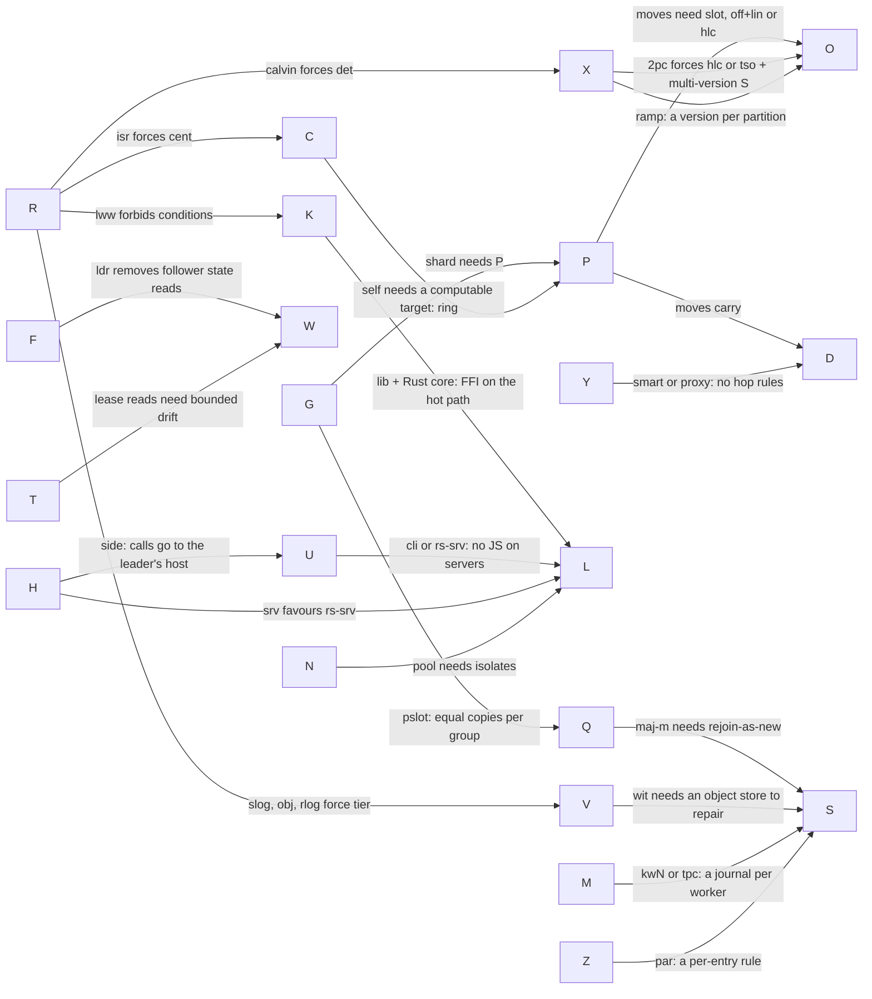

# The v5 design space: a map from the base case

Written 2026-11-06 for the v5 design-space study ([BRIEF.md](BRIEF.md)). This file is the map: the base case, every axis and its options, the ladder of mechanisms from the base case, the candidate stacks, and how the axes constrain each other. It gives no verdict. The verdict is [VERDICT.md](VERDICT.md); the per-candidate reports are in [candidates/](candidates). Revised the same day after two completeness critics: four axes (Y, M, Z, N), new options on six axes and six new rows were added, and the section at the end lists what was left out.

## 0. How to read this

- **Goals.** G1 to G6 are the user's six goals in [BRIEF.md](BRIEF.md): G1 the patterns (DESIGN-V5 §5.1), G2 beat the competitors, G3 scale up and down without limit, G4 fast development (few novel mechanisms), G5 fero deploy and fero test, G6 `data` stays the state engine. REQUIREMENTS.md numbers them more finely.
- **Words.** A **partition** is the unit of order users see (one row by default). A **group** is one ordered log with one writer: the unit of cost (one commit queue, one fsync stream, one election). A **slot** is a fixed hash bucket of partitions. A mechanism is **novel** when fero designs it itself: no published spec or production system does it in that role. Mechanisms, rules and mutants are counted as REQUIREMENTS DEV-10 says; the "Novel" numbers below are [r] estimates until two agents count them that way.
- **Evidence tags.** [c] cited (a link or a named paper or system), [m] model-checked in [v5-spec/](../v5-spec), [r] reasoned. Nothing in this file is measured; every number is a cited figure or a draft target, and §6 lists what must be measured.

## 1. The base case B0

**B0: one process. One durable log per resource. State folded by `data`. No replication.** Concretely: a journal with group commit (one fsync covers a batch), snapshots on local disk, the writer runs L2 (conditions, ops, TTL by its own clock, dedup of client retries), clients follow over sockets, and relays (clients that serve clients) fan out reads. This is fero's solo node, and fero test's world.

| Goal | B0 | Why |
|---|---|---|
| G1 patterns | **all of them, on one box** | Every pattern in DESIGN-V5 §5.1 is a fold plus a rule for what to append (V5-PRIMITIVE §2) [c]. One writer makes conditions, `claim`, locks, counters and invariants exact. A batch over many rows of one resource is atomic for free |
| G1 across resources | saga only | one log per resource; one log per project would make it free, at G3's cost |
| G2 performance | best latency of any stack: a commit is one local fsync, no round trip; reads are in-process | capped by one process: one disk, one NIC, one core per writer path. Fair comparison is at equal durability: B0 against Redis without replicas and NATS core, never against Kafka `acks=all` or etcd [r] |
| G3 scale | **no** | one box's CPU, memory and disk. Reads and fan-out still scale through relays |
| durability | one disk | with B0.O (below), off-box but with lag |
| availability | **none** across a crash or a restart | downtime = restart + snapshot load |
| G4 dev speed | smallest possible | no distributed mechanism at all |
| G5 test | perfect | the world is one process; a tape is a log; a fork is a snapshot plus an offset |
| G5 deploy | partial | sleep and wake work with an object store; a roll is downtime; no caught-up signal |
| G6 data | yes | the fold is data's hot lane; data's change records are the wire |

**What B0 shows.** Every semantic pattern is already a B0 feature. Each step up the ladder buys only three things: **durability** beyond one disk, **availability** beyond one process, and **capacity** beyond one box. Each step also creates **semantic debts**: rules that hold for free in B0 and must be proven again [r]:
- *a second writer over time* (any replication with failover): dedup across failover (D), writer time across leaders (T), no answer before commit, read-your-writes across servers (W);
- *several groups per resource*: views across groups (mergeable partials), lock fences across groups, consumer-group assignment, whole-resource cursors (O), a `rows: { max }` split into per-group shares;
- *units that move*: positions that survive a move (O), dedup and fence state carried with the unit, readers mid-move;
- *membership that changes*: voter-count rules, leave, witness repair ([healing.md](../v5-spec/healing.md) found 9 gaps in the draft's text) [m];
- *resources that share a group* (G `lane`, `pslot`): equal `copies` and durability inside a group, and one resource's big records sit in another's batches (SC-15);
- *state kept apart from its effects* (outputs and cursors in different groups): exactly once past the dedup horizon (Q-30).

So a candidate is judged by which debts it takes on, and how cheaply it pays each.

## 2. The axes

Five axes are added to the seed list, because candidates differed on them and no seed axis held the difference: **V** (replica kinds), **Q** (what a commit means), **X** (atomicity across partitions), **U** (where user code runs), **H** (where fero runs). The critics added four more: **Y** (how a write reaches its writer), **M** (threads and I/O inside one process), **Z** (storage faults) and **N** (tenancy). **W** is multi-select. **I** applies only when some group runs Raft. Tags in `code` are used in the matrix (§4).

### R: replication and agreement
| Tag | What | Precedent | Novel |
|---|---|---|---|
| `solo` | one copy | SQLite, Redis alone, B0 | 0 |
| `async` | primary acks, then streams to replicas; failover loses the tail | Redis + Sentinel, MySQL/Postgres async | 0; failover needs a fencing epoch |
| `lww` | leaderless: any replica writes; per-cell last-writer-wins with Lamport clocks; anti-entropy | Dynamo, Cassandra, Riak, v4 | many (v4's); conditions need consensus on top (Cassandra LWT) |
| `raft` | a consensus group per unit; its leader is the one writer | etcd, CockroachDB, TiKV, Redpanda, YugabyteDB | 0 in safety; multi-Raft engineering is published |
| `rlog` | Raft groups run on log members; a server becomes a group's writer by committing a writer-epoch entry, and every append carries that epoch, which the group's leader checks. On one box the server is its own log member, so it is `raft` | Kafka producer epochs, BookKeeper ledger fencing, Neon's terms on safekeepers, Delos's NativeLoglet | about 1: the writer-epoch check |
| `vsr` | Viewstamped Replication Revisited with protocol-aware recovery: a damaged entry is repaired from peers and the replica keeps its vote | VR Revisited (Liskov and Cowling 2012), PAR (FAST'18), TigerBeetle | 0 in the protocol; no production library outside TigerBeetle (Zig) [r] |
| `isr` | leader plus an in-sync set; an outside controller changes both | Kafka ISR + KRaft, PacificA, Postgres + Patroni | the controller, ISR and epoch composition (KIP-101, 279, 320, 841, 903, 966) [c] |
| `chain` | writes flow head to tail; a master reconfigures | chain replication (OSDI'04), CRAQ (ATC'09), FAWN-KV | 1-2; fail-stop |
| `slog` | shared log: ordering apart from storage; a writer appends to loglets on log nodes; seal + metadata CAS to reconfigure | Corfu, Tango, Delos (OSDI'20), LogDevice, BookKeeper/Pulsar, Neon, Aurora | 3-4 ([V5-LOG-FIRST-REVIEW](../V5-LOG-FIRST-REVIEW.md) F1-F7) [c] |
| `obj` | the object store is the durable layer; a commit is a PUT; the writer holds a lease by compare-and-swap | WarpStream, SlateDB, S3 conditional writes | 1-2 (manifest CAS, lease epochs) |
| `calvin` | a sequencer orders inputs into epochs; replicas execute deterministically | Calvin (SIGMOD'12), FaunaDB, SLOG | 2; read and write sets known before a call runs |
| `epax` | leaderless consensus with dependency tracking | EPaxos, Atlas, Tempo, Cassandra Accord | high: recovery bugs found after publication (Sutra 2019; EPaxos Revisited, NSDI'21) [c] |
| `crdt+c` | CRDTs or LWW for most data, consensus where needed | Cassandra LWT, Riak strong buckets | two replication paths |

### G: what one ordered log covers (the cost unit)
| Tag | What | Precedent | Novel |
|---|---|---|---|
| `clus` | one log for the whole project | etcd, ZooKeeper | 0; one leader for everything |
| `lane` | a fixed number of logs per project; every resource hashes into them | Redis Cluster (16,384 slots per cluster), Pulsar bundles | 0-1; `copies` becomes project-wide |
| `res` | one log per resource | v4 (a cluster per resource), a one-partition Kafka topic | 0 |
| `shard` | part of a resource: a slot set, a range or a partition | Kafka partitions, CockroachDB ranges, TiKV regions, the draft | needs a P option |
| `pslot` | groups belong to the project; a group holds (resource, slot set) pairs from any resources with equal `copies` and durability; a new resource's 1,024 slots start inside an existing group, and slot moves split them off under load | TiKV PD's cross-table region merge (`enable-cross-table-merge`), CockroachDB's span-config coalescing (`spanconfig.storage_coalesce_adjacent.enabled`) | 0 beyond P `slot`; one group's batch and leader are shared across resources, and a different `copies` forces a group boundary |
| `key` | one log per partition | Durable Objects, Orleans, Restate, Akka persistence | needs P `dir` |

In every option a partition stays totally ordered. G only decides which partitions share a commit, an fsync, an election and a leader. A stack must never promise order across partitions of one group, or a later move breaks the promise [r].

### P: how partitions map onto groups
| Tag | What | Precedent | Novel |
|---|---|---|---|
| `one` | no mapping (G is `clus` or `res`) | etcd | 0 |
| `fixN` | N groups fixed at define; hash mod N | Kafka partitions, V5-PRIMITIVE's 16 cells | 0 |
| `slot` | S fixed slots (1,024) forever; groups own slot sets; one move protocol | Redis Cluster, Couchbase's 1,024 vBuckets | 1 big: fence, copy, open, carried state; 8 text bugs found, 16 of 18 mutants caught [m] |
| `split` | a group splits at a key or hash bit, and later merges; lineage | Bigtable, HBase, CockroachDB, TiKV, Spanner, Scylla tablets | about 8 rules ([V5-UNITS](../V5-UNITS.md)); merges "took years" at CockroachDB (F6) [c] |
| `ring` | consistent hash with virtual nodes | Dynamo, Cassandra, Riak, v4 | equals `slot` with groups pinned to vnodes |
| `rekey` | grow by copying into a new generation with more groups, then flip a catalog pointer | Vitess resharding (VReplication) | 1 library; cursors break; dedup across the flip |
| `dir` | a directory maps each partition to a group; one partition moves | Slicer (OSDI'16), Shard Manager (SOSP'21), Orleans | 1; directory rows = partitions |

Who moves units (by hand, a rule, a controller) is axis C.

### K: where semantics live
| Tag | What | Precedent | Novel |
|---|---|---|---|
| `kern` | dedup, conditions, ops, TTL, claim are commands of the kernel's state machine | etcd txn, Redis commands, FoundationDB resolvers, TiKV | 0; the kernel spec carries all of L2 |
| `lib` | the kernel is a fenced log with five operations (append, read, snapshot, change members, hand over); L2 and L3 are a deterministic library on the leader | V5-PRIMITIVE, DESIGN-V5 decision 21a, Delos log-structured protocols (SOSP'21), Restate | 0; one seam on the hot path |
| `hyb` | dedup and fences in the kernel, the rest a library | Kafka (idempotence and transactions in the broker, Streams in clients) | 0; two places to specify |

### C: the control plane (who places replicas and moves units)
| Tag | What | Precedent | Novel |
|---|---|---|---|
| `none` | static placement; an operator acts | etcd, Redis replication | 0; nothing heals |
| `self` | each group's leader heals its own replicas toward a computed target (a ring) | CockroachDB per-range queues, Redis Cluster failover | 1: healing rules; 9 gaps found over two rounds [m] |
| `self+p` | `self`, plus an optional planner whose hints name the config they read | the draft | 2 |
| `cent` | one replicated controller decides placement and moves | TiKV PD, Kafka KRaft controller, YugabyteDB master | 1; commands checked by group epoch (PD's region epoch) |
| `cent-co` | `cent`, run as a loop by `#meta`'s leader, so no separate component | KRaft combined mode, Elasticsearch's elected master | 1 |
| `out` | only an outside orchestrator | Kubernetes operators, fero deploy's platform | 0 in fero; self-hosters get no healing |

Sub-choice, the failure detector: per-group heartbeats with quiet idle groups; one ping per member pair shared by all groups (CockroachDB store liveness, the draft); or sessions to the controller (Kafka broker heartbeats).

### V: replica kinds
| Tag | What | Precedent | Novel |
|---|---|---|---|
| `full` | every replica folds and can lead | etcd | 0 |
| `+lrn` | plus learners: full replicas that do not vote | etcd learners, CockroachDB non-voters | 0 |
| `+wit` | plus log-only voters that never serve | Spanner witnesses, Cassandra transient replicas, the draft's log replicas | 1: lead only to repair |
| `tier` | a separate log tier holds all durability; compute is disposable | BookKeeper, Aurora storage, Neon safekeepers | comes with R `slog`, `obj` or `rlog` |

A vote-only arbiter (MongoDB) is not an option: it holds no log, so it cannot count toward a commit.

### Q: what a commit means (durability)
| Tag | What | Precedent | Novel |
|---|---|---|---|
| `maj-d` | a majority has it on disk before the ack | etcd, Raft | 0 |
| `maj-m` | a majority has it in memory; disks within about a second | Kafka's default (`acks=all`, no fsync), Redpanda write caching | 1: a replica that stops uncleanly rejoins as new |
| `isr` | every member of the in-sync set | Kafka `acks=all` + `min.insync.replicas` | needs R `isr` |
| `ldr` | the leader only | Kafka `acks=1`, Redis | 0; failover loses acked writes |
| `none` | no copy, no disk; best-effort fan-out | NATS core, Redis pub/sub | 1: a second delivery path |
| `put` | an object-store PUT | WarpStream, SlateDB | needs R `obj` |
| `mix` | chosen per resource (or per write) | the draft, v4's per-write ladder | the sum of the rungs |

### D: dedup and exactly-once
| Tag | What | Precedent | Novel |
|---|---|---|---|
| `win` | issuer window + floor + outcomes by id + per-hop time budgets | the draft | 1 big; three review rounds |
| `sess` | client sessions: per client, the highest sequence and cached answers, in replicated state, expiring by leader time | Raft thesis §6.3, LogCabin | 0 |
| `pid` | producer id + epoch + per-partition sequence | Kafka KIP-98 | 0; state per (producer, partition) |
| `keys` | user idempotency keys only | Stripe, SQS dedup ids | 0; fero's own retries stay unsafe |
| `txn` | transaction ids under two-phase commit | Percolator, TiKV | needs X `2pc` |
| `srcpos` | for derived outputs and consumers: the attempt id is (source slot, seq), kept for as long as the consumer's committed cursor may lag, that is, the source's retention | Kafka Streams' input offsets, Flink's source positions | 0-1; a key table as long as retention, priced per consumer (Q-30) |

Under P `slot` or `split`, dedup state must travel with the unit that moves: two mutants that drop it are caught [m]. Every option except `srcpos` forgets after a horizon (`win` and `sess` drop an issuer after about 10 minutes), so a consumer that restarts later than that, with its outputs in another group, can re-apply them (Q-30).

### O: positions (versions, cursors, fence tokens)
| Tag | What | Precedent | Novel |
|---|---|---|---|
| `off` | an offset per group | Kafka offsets, Raft indexes | 0; breaks when units move |
| `off+lin` | an offset per group plus split or move lineage | CockroachDB range descriptors | 1: lineage resolution, kept forever |
| `slot` | a sequence per slot, compared as (epoch, seq) | the draft | 1 small: one varint per record; whole-resource cursors up to 1,024 entries |
| `part` | a sequence per partition | Durable Objects, EventStoreDB streams | 0; millions of counters that outlive rows |
| `hlc` | hybrid-logical-clock timestamps, plus closed timestamps | CockroachDB, YugabyteDB, MongoDB | 1: closed timestamps |
| `lamp` | Lamport stamps per cell | v4 | no total order per partition |

### T: time, TTL and leases
| Tag | What | Precedent | Novel |
|---|---|---|---|
| `clamp` | the leader's wall time, never going back, clamped to the peers' median ± `skew.max` | the draft | 1 small |
| `hlc` | hybrid logical clocks | Kulkarni et al. 2014, CockroachDB | 0 |
| `mono` | durations on monotonic clocks; a new leader extends every lease | etcd's lessor, Chubby | 0; no wall-time TTLs |
| `tso` | a central timestamp oracle | TiKV PD, Percolator | 0; a central role on the write path |
| `tt` | clocks with a bounded error | Spanner TrueTime, AWS ClockBound | needs clock infrastructure |

### X: atomicity across partitions
| Tag | What | Precedent | Novel |
|---|---|---|---|
| `none` | one partition only; the app puts related rows in one partition | Redis Cluster hash tags (`CROSSSLOT`) | 0 |
| `saga` | locks with fences, an intent row, steps; readers see intermediate states | the draft §5.3 | 1: fences across groups (writers follow `#locks`) |
| `grp` | an atomic batch over partitions of one group | etcd txn | 0; must be limited to one slot, or a move breaks it |
| `2pc` | transaction records and intents, with multi-version state | Percolator/TiKV, CockroachDB parallel commits, Spanner | large |
| `det` | deterministic multi-partition order | Calvin | needs R `calvin` |
| `ktxn` | a coordinator, commit markers, `read_committed` readers | Kafka transactions (KIP-98) | large |
| `ramp` | read-atomic units: each write carries (unit id, sibling partitions); writes go in two rounds (prepare, then a commit marker); a reader that sees a fractured set fetches the missing versions by unit id in a second round | RAMP (Bailis et al., SIGMOD'14), RAMP-TAO (VLDB'21) | 0-1; each partition keeps the prior version until the unit's commit marker |

### S: storage
| Tag | What | Precedent | Novel |
|---|---|---|---|
| `jrnl` | one journal per process for every group, then per-group segments | TiKV raft-engine, CockroachDB's shared engine, the draft | 1 small: cuts, segment indexes |
| `walg` | a WAL per group | etcd, Kafka and Redpanda per-partition logs | 0; fsyncs grow with groups |
| `lsm` | an LSM store holds log and state | TiKV/RocksDB, CockroachDB/Pebble | 0; a big dependency; state larger than memory |
| `+tier` | old segments and snapshots go to an object store | Kafka KIP-405, Redpanda tiered storage | 1: snapshot layers against retention |
| `obj` | the object store only, with a local cache | WarpStream | needs R `obj` |

### F: where state is folded
| Tag | What | Precedent | Novel |
|---|---|---|---|
| `all` | every full replica folds | etcd, CockroachDB | 0; memory and fold CPU times the replicas |
| `ldr` | only the leader folds; followers keep the log | Kafka (brokers keep logs; Streams folds) | 0; failover is cold: snapshot plus tail |
| `lazy` | followers fold behind, or on first read | Kafka Streams standbys | 1 |

In every option, clients and relays fold what they follow.

### W: reads and subscriptions (pick one or more)
| Tag | What | Precedent | Novel |
|---|---|---|---|
| `lease` | leader reads under a time lease | CockroachDB, Spanner, etcd's lease-based reads | 0; needs bounded clock drift |
| `ridx` | read index: one round to a majority, no fsync | Raft thesis §6.4, etcd's default, TiKV follower read | 0 |
| `any` | subscriptions and committed reads from any ready replica, at a position | the draft, Kafka KIP-392 | 0 |

### U: where user code runs
| Tag | What | Precedent | Novel |
|---|---|---|---|
| `any` | methods run on the server the caller reached; writes are forwarded to the leader | v4, the draft | 0 |
| `ldr` | a call goes to its partition's leader and runs there | Durable Objects, Orleans, Redis Functions, VoltDB | 1: in-flight calls across a handover |
| `both` | `any` by default; a method may ask for the leader | — | 1 |
| `cli` | no user code on servers; apps are clients | Redis without Lua, Kafka brokers, TiKV | 0; rules become declarative or WASM |

Writer-side rules (`rules.write`, `partition`) are a sub-choice: JS on the leader, declarative only, or WASM.

### H: where fero runs
| Tag | What | Precedent |
|---|---|---|
| `emb` | inside the app's Node process | v4 |
| `srv` | a separate server binary; apps are clients | Redis, NATS, Kafka, etcd |
| `both` | one code base, both roles (servers and log members) | the draft |
| `side` | a native daemon per host holds L0, L1 and fan-out; the app's Node process is a privileged local client that runs L2 rules, methods and `data`'s fold for the groups this host leads | Dapr sidecars, Envoy, TiDB over TiKV; novel 1: the local seam |

### L: language and runtime
| Tag | What | Precedent | Cost |
|---|---|---|---|
| `ts` | TypeScript only | v4 | one kernel |
| `ts→rs` | TS behind a deterministic interface; Rust later, compared byte for byte under the same seeds | the draft | two kernels for a while |
| `rs+napi` | a Rust core from day one, TS bindings | napi-rs (SWC, Rspack, Lightning CSS) | an FFI seam; user code and `data` stay JS |
| `rs-srv` | a Rust server, a TS client | TiKV, Redpanda (C++) | the server runs no JS unless it embeds an engine (`rs+v8`) |
| `rs+v8` | a Rust server that embeds V8 (deno_core) or QuickJS (rquickjs); `data`, methods and rules run in isolates inside it; apps connect as clients or load their code into it | Cloudflare workerd (Durable Objects), Deno | a V8 dependency (about 30 MB) and an op seam per call (E-03) |
| `wasm` | Rust compiled to WASM, run inside Node | — | slower than native; threads need extra work |
| `go-srv` | a Go server | etcd, NATS, CockroachDB | a concurrent GC with sub-millisecond pauses; runs etcd's raft natively, at no port cost |

### I: the Raft core (when some group runs Raft)
| Tag | What | Precedent | Cost |
|---|---|---|---|
| `port` | port etcd's raft to TS; raft-rs later | etcd's raft is a pure state machine; raft-rs is its Rust port | 0 novel; keeps years of fixes |
| `own` | write it from the paper and the TLA+ spec | LogCabin | re-find what etcd fixed |
| `raft-rs` | raft-rs through napi | TiKV | needs L `rs+napi` |
| `openraft` | openraft (Rust, async) | Databend | not a step-function core: it drives I/O through async traits, so a deterministic sim needs a custom runtime (as madsim gives tokio code). Its runtime is pluggable (`AsyncRuntime`, tokio by default) with a `singlethreaded` feature; tokio stays a dependency [c: openraft 0.9.25 source, `src/async_runtime.rs`] |
| `jslib` | an existing JS library | none known to be production-grade [r] | to check (§6) |

### Y: how a write reaches its writer
| Tag | What | Precedent | Novel |
|---|---|---|---|
| `fwd` | any server takes the write and forwards it to the group's leader; `moved` on a stale route | v4, the draft | 0 in routing; in the draft, forwarding needs dedup across hops (D `win`'s forward-once rule and time budgets); whether `sess` needs any hop rule is E-20's question |
| `smart` | the client caches slot → leader from `#meta`, sends straight there, and follows MOVED/ASK during a move | Redis Cluster, Kafka clients, the TiKV client | 0; the client holds the slot table (≤ 1,024 entries per resource) |
| `proxy` | stateless routing proxies at the public address; servers never forward | Envoy's Redis proxy, Kafka proxies, Vitess vtgate | 0; one more process kind |

`smart` behind DEP-07's single public address needs an L4 proxy that routes by a hint (SNI or the resource name, as J's "one address per project, routed by the resource name in a client's first message"). Browsers stay `fwd`.

### M: threads and I/O inside one process
| Tag | What | Precedent | Novel |
|---|---|---|---|
| `loop` | kernel, fold and user code on one event loop | v4, Redis | 0 |
| `kw` | the kernel on one worker; user code and a row projection on the main thread | the draft's decision 13a | 0; rows cross a thread (E-07) |
| `kwN` | N kernel workers; each group pinned to one worker, one journal per worker; the main thread routes | TiKV's raftstore pool, CockroachDB's per-store scheduler | 0-1; a group-to-worker map; N × the fsyncs |
| `tpc` | thread per core, shared nothing, io_uring, one journal per core | Redpanda (Seastar), ScyllaDB, glommio | 1 if built; native only |

I/O sub-choice: `fdatasync` on libuv's thread pool, or io_uring; preallocated segments (`fallocate`, as etcd's WAL preallocates 64 MB) or growing files (an `fdatasync` on a growing file also flushes its size).

### Z: storage faults
| Tag | What | Precedent | Novel |
|---|---|---|---|
| `crash` | disks fail only by crash; Raft as published | etcd, most Raft systems | 0; a corrupt entry is undefined behaviour |
| `rejoin` | a checksum and an incarnation; a replica with any damage rejoins as new | the draft §4.1 | 1 small; damage on two replicas at once loses the majority, so F-12's operator step |
| `par` | a damaged entry is repaired from peers, and the replica keeps its vote unless the entry may be the only committed copy | PAR (FAST'18), TigerBeetle's VSR | 1; a per-entry "possibly committed" rule |

Damage on two replicas at once is plausible here: the one-box examples put three replicas on one disk, and a fleet can share one firmware bug.

### N: tenancy
| Tag | What | Precedent | Novel |
|---|---|---|---|
| `proc` | one process (one Fly app) per project | J | 0; idle cost per project |
| `pool` | many projects per process; user code in V8 isolates | Cloudflare Workers, Upstash | 0-1; needs isolates (L `rs+v8`) and OPS-14's isolation |
| `tier` | only the log tier is pooled; servers stay per project | the draft's hosted shape (V5 §4.2, §6.1) | 0; OPS-14 applies to the tier |

## 3. The ladder from B0

Each arrow adds one mechanism. Grey nodes are dead ends (§4.3); R0 and R1.F16 are pruned as end points but lie on LANE's and CELL's paths. BUY (dashed) is a reference point, not a contender. Steps that fit under any node are left out of the tree: relays, an object store for history (S `+tier`), and the language (L).

```mermaid
flowchart TD
  B0["B0 solo: one log per resource, data fold"]
  B0 --> B0O["B0.O + object store archive"] --> B0OL["B0.O.L + writer lease by CAS; commit = PUT"]
  B0 --> A1["A1 + async replicas"]
  B0 --> V4["V4 + every replica writes (LWW)"]
  B0 --> R0["R0 + one Raft group per project"] --> R0N["R0.N64 64 project lanes"] --> R0NM["R0.N64.M + key-range moves"]
  B0 --> R1["R1 + one Raft group per resource, #meta"]
  B0 --> I1["I1 + leader, in-sync set, controller"]
  B0 --> SL1["SL1 + shared log: log nodes, seal + CAS"]
  B0 --> CV1["CV1 + sequencer, deterministic execution"]
  B0 --> RL1["RL1 + Raft on log members; a server writes by epoch"]
  B0 --> BUY["BUY an outside log (JetStream)"]
  R1 --> R1P["R1.P + project-owned groups over many resources' slots"]
  R1 --> R1L["R1.L + learners"]
  R1 --> R1W["R1.W + log replicas (witness)"]
  R1 --> R1H["R1.H + self-healing by leaders"] --> R1HP["R1.H.P + planner hints"]
  R1 --> R1C["R1.C + controller loop on #meta leader"]
  R1 --> R1LF["R1.LF only leaders fold"]
  R1 --> R1F["R1.F16 fixed 16 groups"] --> R1FK["R1.F16.K + re-key library"]
  R1 --> R1S["R1.S slot-shaped positions"] --> R1SM["R1.S.M + slot moves"] --> R1SMA["R1.S.M.A + grow/shrink rule"]
  R1 --> R1X["R1.X + splits"] --> R1XM["R1.X.M + merges"]
  R1 --> R1D["R1.D + per-partition directory"]
  classDef pruned fill:#ddd,stroke:#999,color:#555
  class A1,CV1,R1D pruned
  classDef ref fill:#fff,stroke:#999,stroke-dasharray:4 3,color:#555
  class BUY ref
```

| Node | Adds | Unlocks | Costs (novel; debts) |
|---|---|---|---|
| B0 | one process, one log per resource, journal with group commit, data fold, local snapshots | every pattern on one box; fero test's world | — |
| B0.O | an object store: segments and snapshots uploaded and named | off-box durability with lag; sleep and wake; forks as pointers; history beyond the disk | 0; a five-call interface |
| B0.O.L | a writer lease by CAS on the object store; a commit is a PUT; a standby takes over when the lease lapses | availability with no consensus group; disposable servers | 1-2; every commit pays a PUT (to measure, §6) |
| A1 | async replicas | read replicas, a warm standby | 0; an acked write can vanish on failover, so locks and invariants break: a debt that cannot be paid |
| V4 | every replica writes; LWW cells; anti-entropy; ballot views | writes on both sides of a split | v4's open bugs went 15, 40, 34 in October, at mechanism crossings (DESIGN-V5 §10.1) [c] |
| R0 | one Raft group for the whole project | majority durability, failover, rolls by leadership transfer, atomicity across resources | 0; debts D, T, W; one leader for every write |
| R0.N64 | 64 fixed groups per project | 64 writers per project | 0-1; `copies` and durability project-wide; one lane's leader is every resource's neighbour |
| R0.N64.M | key ranges move between lanes | past 64 writers | slot moves, later and under pressure (V5-UNITS) |
| R1 | one Raft group per resource; `#meta`, the cluster's own group | per-resource `copies` and durability; failover in about 2 s (draft target); a roll pauses for one handover | 0 in safety; multi-Raft engineering (shared journal, one ping per member pair, quiet groups); debts D, T, W |
| R1.L | learners | read scale-out; warm spares | 0 |
| R1.W | log replicas: they vote, keep the log, and lead only to repair | two machines plus a witness survive a crash; fero deploy's top-up; sleep with a log tier | 1 |
| R1.H | each leader heals its own replicas to a ring target | no operator for failures | 1 [m] |
| R1.H.P | planner hints, checked against the config they name | load-aware placement; drains before restarts | 1 |
| R1.C | one controller loop on `#meta`'s leader (instead of R1.H and R1.H.P) | one decider with a global view; moves serialised for free | 1; healing waits while `#meta` has no leader |
| R1.LF | only the leader folds; followers keep the log | fold memory and CPU once, not per replica | 0; failover is cold (seconds per GB) unless a standby folds |
| R1.F16 | 16 fixed groups per resource | 16 writers per resource | 0; debts of several groups; 16 idle groups per resource |
| R1.F16.K | re-key into a new generation | growth past 16 | 1 library; cursors refused `unknown-log`; dedup across the flip; never shrinks |
| R1.S | slot-shaped headers and positions (1,024 slots), still one group | nothing visible; formats ready for moves | one varint per record; cursors up to about 8 KB |
| R1.S.M | slot moves: fence, copy, open, with carried state | many groups per resource, shrink, rebalance, a hot slot alone | 1 big [m]; debts of moving units |
| R1.S.M.A | an automatic grow and shrink rule, one move per resource at a time | elastic with no operator | 1: a policy with hysteresis |
| R1.X | splits with lineage | growth with no copy | about 8 rules; no shrink |
| R1.X.M | merges | shrink | "took years" at CockroachDB [c] |
| R1.D | a directory per partition | one partition moves alone | 1; directory rows grow with partitions |
| R1.P | groups belong to the project and hold slot sets of many resources | 100,000 small resources without 100,000 groups (SC-13) | 0 beyond slot moves; equal `copies` and durability per group |
| RL1 | Raft groups on log members; a server is a group's writer by a committed writer epoch | disposable servers with one protocol; durability apart from servers | about 1 (the epoch check); one more hop unless the writer sits on the log leader |
| BUY | an outside log (NATS JetStream, Redpanda or FoundationDB) under fero's L2 to L5 | the floor for DEV-01 and DEV-05 | fails TEST-10, DEP-20 and G2 by construction: a reference, not a contender |
| I1 | leader + in-sync set + controller | Kafka's shape | the KIP composition; the controller sits in the failover path |
| SL1 | log nodes, loglets, a seal + CAS chain, a metadata group | durability apart from servers | 3-4 [c] |
| CV1 | a sequencer and deterministic execution | atomicity across partitions for free | read and write sets before a call runs; 10 ms epochs in Calvin [c] |

## 4. The candidate stacks

**The rule.** Each candidate takes the options its family forces and its source document names. Where both are silent it takes the draft's choice, so two rows differ only where the designs really differ.

### 4.1 The matrix

| Id | R | G | P | K | C | V | Q | D | O | T | X | S | F | W | U | H | L | I |
|---|---|---|---|---|---|---|---|---|---|---|---|---|---|---|---|---|---|---|
| DRAFT | raft | shard | slot + rule | lib | self+p | +lrn +wit | mix | win | slot | clamp | saga | jrnl +tier | all | any ridx | any | both | ts→rs | port |
| MIN | raft | shard | slot | lib | cent-co | +lrn | maj-d | sess | slot | clamp | saga | jrnl +tier¹ | all | any ridx | any | emb | ts→rs | port |
| RUST | raft | shard | slot | lib | cent-co | +lrn | maj-d | sess | slot | clamp | saga | jrnl +tier¹ | all | any ridx | any | emb | rs+napi | raft-rs |
| SRV | raft | shard | slot | lib² | cent-co | +lrn | maj-d | sess | slot | clamp | saga | jrnl +tier | all² | any ridx | cli | srv | rs-srv or go-srv⁸ | raft-rs or etcd raft⁸ |
| LEAN | raft | shard | slot | lib | cent-co | +lrn³ | maj-d | sess | slot | clamp | saga | jrnl +tier¹ | ldr | ridx; any for logs | any | emb | ts→rs | port |
| CELL | raft | shard | fixN + rekey | lib | self | +lrn +wit | mix | sess | off | clamp | saga | jrnl +tier | all | any ridx | any | both | ts→rs | port |
| LANE | raft | lane | fixN (lanes) | lib | self+p | +lrn +wit | maj-d | win | off | clamp | saga | jrnl +tier | all | any ridx | any | both | ts→rs | port |
| SPLIT | raft | shard | split | lib | self+p | +lrn +wit | mix | win | off+lin | clamp | saga | jrnl +tier | all | any ridx | any | both | ts→rs | port |
| PD | raft | shard | split + merge | kern | cent | +lrn | maj-d | txn | hlc | tso | 2pc | lsm | all | lease ridx | cli | srv | rs-srv | raft-rs |
| ISR | isr | shard | fixN | hyb | cent | full | isr | pid | off | clamp | ktxn | walg +tier | all | any | any | both | ts→rs | port⁴ |
| SLOG | slog | shard | slot | lib | cent⁵ | tier +lrn | maj-d⁶ | win | slot | clamp | saga | tier + obj | all | any | any | both | ts→rs | port⁴ |
| OBJ | obj | shard | slot | lib | cent⁷ | tier | put | sess | slot | clamp | saga | obj | ldr + lazy | lease any | any | both | ts→rs | — |
| V4 | lww | res | ring | kern | self | full | mix | win | lamp | — | none | walg | all | any | any | emb | ts | — |
| MIN-P | raft | pslot | slot | lib | cent-co | +lrn | maj-d | sess | slot | clamp | saga | jrnl +tier¹ | all | any ridx | any | emb | ts→rs | port |
| MIN-TS | raft | shard | slot | lib | cent-co | +lrn | maj-d | sess | slot | clamp | saga | jrnl +tier¹ | all | any ridx | any | emb | ts | port |
| RLOG | rlog | shard | slot | lib | cent-co | tier +lrn⁹ | maj-d | sess | slot | clamp | saga | jrnl +tier | all⁹ | any ridx | any | both | ts→rs | port |
| EMB-V8 | raft | shard | slot | lib | cent-co | +lrn | maj-d | sess | slot | clamp | saga | jrnl +tier | all¹⁰ | any ridx | any | srv | rs+v8 | raft-rs |
| SIDE | raft | shard | slot | lib | cent-co | +lrn | maj-d | sess | slot | clamp | saga | jrnl +tier¹ | ldr¹¹ | ridx; any for logs | ldr | side | rs-srv + ts | raft-rs |
| BUY¹² | outside | theirs | theirs | lib | theirs | theirs | theirs | theirs | theirs | theirs | saga | theirs | all | any | any | srv | ts client | — |

¹ An object store is required across boxes, as draft decision 23a proposes. ² The server folds plain rows in Rust; `data`'s views run on clients and relays. ³ One warm standby that folds. ⁴ For the metadata group only. ⁵ The writer changes its log nodes; the controller changes writers (F3). ⁶ A write quorum of the log nodes. ⁷ CAS on the object store's manifest. ⁸ Two variants of one row: Rust with raft-rs, or Go with etcd's raft run natively; E-02 and E-11 measure both. ⁹ Log members vote; servers are full learners that fold; the writer is a server holding a writer epoch. ¹⁰ `data` folds inside V8 isolates in the server. ¹¹ The app's Node process folds for the groups its host leads; every app folds what it follows. ¹² NATS JetStream first (Redpanda or FoundationDB also fit); a reference row, not a contender.

**The four added axes, per row.** Where a row's family or source is silent, it takes the draft's choice: `fwd` (V5 §4.3), `kw` (decision 13a), `rejoin` (V5 §4.1), and `tier` where the row has log replicas (V5 §6.1), else `proc` (J). `smart` is forced where the source system's clients are smart (SRV, PD, ISR, BUY); `kwN` where a native server runs groups on threads. No row takes Z `par` by default: Q-37 decides whether any should.

| Id | Y | M | Z | N |
|---|---|---|---|---|
| DRAFT, CELL, LANE, SPLIT, SLOG, RLOG | fwd | kw | rejoin | tier |
| MIN, RUST, LEAN, MIN-P, MIN-TS | fwd | kw | rejoin | proc |
| SRV | smart | kwN | rejoin | proc |
| EMB-V8 | smart | kwN | rejoin | pool |
| SIDE | fwd (to the local daemon) | kwN (daemon) | rejoin | proc |
| PD | smart | kwN | crash | proc |
| ISR | smart | kw | crash | proc |
| OBJ | fwd | kw | crash | tier |
| V4 | fwd | loop | crash | proc |
| BUY | smart | theirs | theirs | theirs |

### 4.2 What each one is, and why it stays

Every row must now also count P-06's `none` rung (one more mechanism: a second delivery path) and, if Q-30 says so, a retention-length dedup table. The "Novel" column leaves both out until two agents count each row as DEV-10 says.

| Id | In one line | Not dominated because | Weakest on | Novel [r] |
|---|---|---|---|---|
| DRAFT | [DESIGN-V5](../DESIGN-V5.md) as of 2026-11-05: Raft per group over fixed slots, leaders heal and grow, an optional planner, log replicas | the most "without worry": no controller, a witness, elasticity with no operator | G4: the most novel policy of the Raft family; G2 in TS unproven | about 9 |
| MIN | the simplest stack that could meet every goal: DRAFT minus the witness, the planner protocol, the group rule and window dedup; one controller loop does healing and moves | fewest novel mechanisms that still scale both ways | G5: two machines need a small third full voter for F-11 (any third voter counts), and with no log replicas DEP-15 (S) is lost; healing pauses while `#meta` has no leader | 4-5 |
| RUST | MIN with a Rust core and raft-rs from day one | the shortest road to the G2 bars; never two kernels | G4 early on (two languages, an FFI seam); `data`'s fold is JS (G6) | 4-5 |
| SRV | MIN as a Rust or Go server binary with a TS client, like Redis or NATS | one binary to run; clients in any language; the Go variant runs etcd's raft natively, with no port | G6 and G1: servers cannot run methods, rules or `data` views without embedding JS (EMB-V8 is that answer); SC-01 and DEP-20 hold only if npm ships the binary and `fero(name)` spawns it, as esbuild ships its binary | 5 |
| LEAN | MIN where only leaders fold | fold memory and CPU once per group, so rows scale with servers | G5: failover and rolls are cold without the standby; no follower reads of state | 4-5 |
| CELL | [V5-PRIMITIVE](../V5-PRIMITIVE.md): fixed 16 cells per resource, moved whole, re-keyed to grow | no kernel mechanism for scaling at all | G3: 16 writers per resource, below SC-03's floor F_w (proposed 64), so it fails that MUST unless the re-key counts as growth or the user lowers F_w; a re-key copies data and breaks cursors; never shrinks | about 3 |
| LANE | the reviewer's 64 lanes per project | a bounded number of groups per project, whatever the resource count | G3: 64 writers per project, so at most 64 per resource and fewer once E-18 counts the effective number under skew (SC-03, SC-10); range moves later; no per-resource `copies` | about 5 |
| SPLIT | decision 20a: groups that split by size and load, CockroachDB-style, with no controller | grows without copying data | G4: about 8 split rules; no shrink until merges | about 12 |
| PD | TiKV's shape: split and merge, a separate controller (PD), timestamps from an oracle, two-phase commit, an LSM store | real atomic transactions across partitions; proven at very large scale | G4 and G6: MVCC, 2PC and a timestamp oracle; `data` is not the engine on servers | 2, on a very large published surface |
| ISR | Kafka's shape: leader and in-sync set under a KRaft-style controller | two copies plus the controller survive either crash; Kafka semantics | G4: the KIP composition; a controller election delays failover; commit waits for the slowest in-sync replica | about 4 |
| SLOG | the earlier log-first draft, with slots in place of splits | the hosted shape: servers disposable, durability apart from server count | G4: about twice the L1 code, three protocols; local dev runs a log tier | 5-6 |
| OBJ | the object store is the log: commits are PUTs, leadership by CAS | the cheapest durable bytes; sleep, wake and forks are pointers; no disks to manage | G2: every commit pays a PUT; needs a store even across two boxes | about 3 |
| V4 | v4 as it is | writes on both sides of a split; it exists | G4 (STATUS's open bugs) and G1: LWW cannot hold conditions without consensus | dozens |
| MIN-P | MIN with groups owned by the project (G `pslot`): a group holds slot sets of many resources with equal settings | SC-13: 100,000 small resources cost a few groups, not 100,000 | one group's batch and leader shared across resources (SC-15); a different `copies` forces a group boundary | 4-5 |
| MIN-TS | MIN in TypeScript for good (L `ts`) | one kernel, no FFI seam, no byte-for-byte differential test (DEV-05, TEST-10); it wins if E-02 and E-09 show the matched runs sitting at this box's fsync floor | G2 at the native bars (PERF-09, PERF-11's native columns) | 4-5 |
| RLOG | Raft groups run on log members; a server is a group's writer by a committed writer epoch; servers are full learners | disposable servers with one published protocol and no "lead only to repair" rule; on one box it is MIN | one extra hop (server to log leader) unless the two sit together; a writer handover = one epoch commit plus a fold catch-up | 5-6 |
| EMB-V8 | SRV with V8 embedded: `data`, methods and rules run in isolates inside a Rust server | the Durable Objects stack: a native runtime with JS and storage in one process keeps G6 and G1; pooled tenancy | a V8 dependency (about 30 MB); the op seam per call (E-03); SC-01 only through a spawned binary | 5 |
| SIDE | MIN with a native daemon per host holding L0, L1 and fan-out; the app's Node process folds and runs methods for the groups its host leads | GC pauses and main-thread stalls cannot stop replication (F-06, F-14); native fan-out (PERF-11) with no napi on the hot path; `data` stays JS | the local seam (E-03); two processes per host; calls go to the leader's host (U `ldr`) | 5-6 |
| BUY | fero's L2 to L5 on an outside log (NATS JetStream first) | a reference, not a contender: the floor for DEV-01 and DEV-05, and a measure of which semantics need fero's own kernel at all | fails TEST-10 (the sim cannot run their bytes), DEP-20 (plain `node`) and G2 (it cannot beat what it is built on) by construction | 0 in L1 |

### 4.3 The pruned families

| Family | Dominated by | On | Why |
|---|---|---|---|
| async primary as the only replication | MIN | G1 locks, invariants | an acked write can vanish on failover and a fence token can repeat. Kept only as a Q rung (`ldr`) |
| chain replication, CRAQ | MIN | availability, G4 | fail-stop: one slow node stalls its chain; a master reconfigures; FAWN-KV's join is v4's handover (V5-REPLICATION) [c] |
| ring-computed views + VR | MIN | G4 | "I would not choose (c) under any condition I can name" (V5-REPLICATION §4) [c] |
| leaderless consensus (EPaxos, Accord) | MIN | G4 | recovery bugs found after publication; no latency gain while a group's voters sit in one region, which REQUIREMENTS SC-14 makes the scope [c]. Reopened if the user wants multi-region writes |
| Calvin, deterministic | MIN; PD for transactions | G1 methods, G2 latency | methods must declare read and write sets first; epochs add up to 10 ms; one sequencer orders every write |
| FoundationDB's shape | MIN; PD for transactions | G4 | five roles; a recovery restarts the whole transaction system; watches are not streams (V5-PRIMITIVE §5) [c] |
| CRDT + consensus where needed | MIN | G4 | two replication paths; v4 is the evidence |
| a Durable Object per key (G `key`) | MIN | G1 views, G3 metadata | a log and a directory row per key; a leaderboard fans in over every key. Its useful part, a hot slot with its own group, is in `slot` |
| per-partition directory (P `dir`) | MIN | G3 | the directory grows with partitions: millions for one-row partitions |
| ring with vnodes (P `ring`) under consensus | MIN | G3 | the same as slots with groups pinned to vnodes; slots let groups be fewer and move |
| one group per project (R0) | MIN | G3 | one leader for every write. MIN with one group per resource is R0 per resource |
| one group per resource, nothing more | MIN | G3 | one leader per resource. It is MIN's first phase, with slot-shaped formats |
| fixed N with no re-key | CELL | G3 | strictly less than CELL |
| local fsync + async upload (Litestream) | OBJ, MIN | durability | acked writes lost on failover (RPO above zero) |
| virtual synchrony (Isis, Derecho), Hermes | MIN | G4 | delivery tied to membership: v4's failure mode |
| Aurora-style quorum storage | SLOG | — | the same family; SLOG is its fero form |

Two families were pruned in the first version and are now kept, because the prunes rested on draft targets, not evidence: **a Go server** is SRV's Go variant, and **TS only, for good** is the row MIN-TS. Both stay until E-02, E-04 and E-09 report.

## 5. Interactions

A choice on one axis forces or forbids a choice on another. The arrows read "forces".

| If | Then | Because |
|---|---|---|
| R `isr` | C `cent` | the in-sync set is changed by someone outside the group |
| R `slog` or `obj` | V `tier`; C needs a CAS register | durability lives off the servers; reconfiguration is seal + CAS |
| R `lww` | no K conditions or ops; X at most `saga` without fences | no single writer to judge against [c: Cassandra needs Paxos for LWT] |
| R `calvin` | X `det`; U methods declare keys first | deterministic order needs the read and write sets |
| R not `raft` | I applies only to a metadata group | — |
| G `clus` or `res` | P `one`; G3 capped at one leader | nothing to map |
| G `lane` | `copies` and Q are project-wide | resources share a lane's log |
| P `slot` | O `slot` (or `hlc`); D and lock fences carried per slot [m] | offsets and per-group state do not survive a move |
| P `split` | O `off+lin` or `hlc` | children inherit the parent's offsets |
| P `fixN` | O `off` works, until a re-key breaks it | units never move |
| K `lib` + L `rs+napi` | the library must be Rust too, or every batch crosses FFI | the 3 µs conditional-op pin is measured across this seam (DESIGN-V5 §8) |
| U `cli` or L `rs-srv` | `data` folds on clients only; rules become declarative or WASM (G6 risk) | no JS engine on servers |
| F `ldr` | W `any` for logs only; failover cold unless a standby folds | followers hold no state |
| Q `maj-m` | S marks a replica that stopped uncleanly as new | its disk may lack what it acked |
| Q `none` | a second delivery path (a rung of its own) | it bypasses the log |
| V `+wit` | S `+tier` (an object store) for repair | a log replica cannot build a full replica from its log alone |
| C `self` | the placement target must be computable by every leader (a ring) | no central view |
| C `cent-co` | healing pauses while `#meta` has no majority | the decider is `#meta`'s leader |
| X `2pc` | O `hlc` or T `tso`; S multi-version (`lsm`) | readers need a snapshot timestamp |
| W `lease` | T bounded clock drift | a lease is a time promise |
| T `clamp` | link pings carry clocks | the clamp uses the peers' median |
| R `rlog` | V `tier`, with servers as learners; a writer changes by a writer-epoch entry | the log members are the voters |
| X `ramp` | O names a version per partition (the slot sequence is enough); S keeps the prior version until the unit's commit marker | a reader fetches missing versions by unit id |
| D `srcpos` | the source keeps positions for its whole retention; the consumer's dedup table is as long as that retention | the attempt id is the source position |
| Y `smart` or `proxy` | D needs no hop rules (`sess` is enough) | a write takes one path to its leader |
| Y `smart` | the client holds the slot table; DEP-07's one address routes by a hint | Redis Cluster's MOVED and ASK |
| M `kwN` or `tpc` | S `jrnl` is one journal per worker; DEV-07 holds per worker, with messages between workers recorded as inputs | each worker must stay a deterministic step function |
| Z `rejoin` | damage on two voters at once is F-12's operator step | a rejoining replica does not count toward the majority |
| Z `par` | S keeps a checksum per entry and a "possibly committed" mark | a repair must never drop the only committed copy |
| G `pslot` | groups are cut by (`copies`, durability); slot tables stay per resource, groups are per project | resources share one log |
| H `side` | U `ldr`; F `ldr` in the app, logs in the daemon | the app folds only what its host leads |
| L `rs+v8` | `data` and methods run in isolates inside the server; N `pool` becomes possible | an isolate per project |
| N `pool` or `tier` | REQUIREMENTS OPS-14 (keys and budgets per project) and SC-11's neighbour clause | projects share a process or a journal |

## 6. Questions this map raises

Each goes to [QUESTIONS.md](QUESTIONS.md) with its experiment. Each could move a candidate up or down.

1. **L, G2.** Can a TS kernel reach the draft's TS targets on this box (50k persisted appends a second per process; fsync p99 + 5 ms commit)? What do etcd, Redis and NATS reach here with their own tools?
2. **K × L.** What does a napi crossing cost per record and per batch? Is K `lib` with a Rust core viable, or must the library be Rust too?
3. **I.** How large is a TS port of etcd's raft, and how fast? Is any JS Raft library usable?
4. **G, P.** What do 2,000 quiet groups cost in one Node process (memory, CPU, pings)? This prices CELL's 16 groups per resource against MIN's one.
5. **P.** What is the real unwritable window of a slot move (target about 10 ms)?
6. **D.** Do client sessions (`sess`) hold every property the window (`win`) holds, including across slot moves? A model check of both.
7. **C.** Is a controller loop on `#meta`'s leader (MIN) smaller and safer than healing by every leader (DRAFT)? Count the rules; model-check both.
8. **F.** What does folding cost per record and per GB of rows? Is LEAN's saving worth a cold failover?
9. **R `obj`.** What does a conditional PUT cost on an S3-compatible store here (MinIO), against an fsync? Does OBJ survive G2?
10. **X.** Does any §5.1 pattern need atomic cross-partition visibility, or are sagas plus Redis Cluster's same-slot rule enough?
11. **T.** Do `clamp`, `hlc` and `mono` give the same TTL and lease answers under clock skew and leader change?
12. **U.** What does routing calls to the leader (`ldr`) buy in latency, and what does it cost at a handover?
13. **Y.** Does forwarding through any server need hop rules under client sessions, and what does the extra hop cost P-01?
14. **M.** Does a TS kernel on 2 or 4 workers scale writes past one core, and at what CPU per append?
15. **Z.** What happens under each option when one entry on each of two replicas is corrupt?
16. **G `pslot`.** What do 100,000 small resources cost in groups, `#meta` bytes and create and open time, for MIN, MIN-P and LANE?
17. **L `rs+v8`, H `side`.** What does a deno_core or rquickjs op cost, and a local Unix-socket or shared-memory seam, against napi?
18. **BUY.** How much of fero's L2 to L5 runs on JetStream as it is, and which semantics need fero's own kernel?
19. **R `rlog`.** How long is a writer handover (one epoch commit plus a fold catch-up), and how many rules does the epoch add?
20. **X `ramp`.** Does RAMP-Fast give read atomicity with fewer rules than a coordinator, and in how many read rounds?
21. **N.** How much does one tenant at its quota hurt another on a shared journal, and what does each tenancy cost a month?
22. **D `srcpos`.** Do outputs and cursors in different groups stay exactly once past the dedup horizon?
23. **Composition.** Which mechanisms share state in each row, and does the riskiest crossing hold inside one model?
24. **Genesis.** Does founding a cluster give exactly one cluster per project, and always finish?

## Considered and not added

Two critics reviewed this file on 2026-11-06. Their findings were folded in above. These parts were left out or changed:
- **"MIN takes `smart` for servers and relays":** not taken. By §4's rule, a row takes the draft's choice where its source is silent, and the draft forwards (`fwd`). `smart` is a 0-novel variant open to every row; E-20 checks whether `sess` needs hop rules under `fwd`, and E-01's round trip prices the extra hop.
- **"Prune Go and Rust servers alike on H, G6 and SC-01":** not taken. None of the three fails by construction: an npm package can ship and spawn a native binary (esbuild does), and EMB-V8 answers G6. So the Go server joins SRV as a variant, and both stay until E-02, E-03 and E-09 report.
- **The tenancy axis was proposed as "M"**, which the other critic used for threads; it is **N** here.
- **R `vsr` as a full candidate row:** not added yet. Q-37 adds it as a candidate only if Raft needs more than 2 rules to survive one bad entry.
- **F-11's fix (b), giving the MIN family `+wit`:** not taken; REQUIREMENTS took fix (a), so any third voter meets F-11, and DEP-15 (S) still prices the witness.
